# LORE: A Large Generative Model for Search Relevance

> **Venue**: arXiv Technical Report (arXiv:2512.03025v3, 2025-11 초판 / 2026-01-06 v3)
> **Authors**: Chenji Lu*, Zhuo Chen*, Hui Zhao, Zhiyuan Zeng, Gang Zhao, Junjie Ren, Ruicong Xu, Haoran Li, Songyan Liu, Pengjie Wang, Jian Xu, Bo Zheng (Search Advertising Team, Alimama, Alibaba Group) — *Equal Contribution
> **Platform**: Taobao 검색 광고 (Alimama) relevance 모델

---

## 1. Background

### E-commerce 검색 relevance의 현황
- Relevance 모델은 query와 후보 item의 정합도를 판정해 mismatch 상품을 걸러내는, 검색 품질의 기반 모듈이다 (JD, Taobao 등).
- GPT-5 같은 SOTA LLM은 **도메인 지식 부족 + 비용 과다**로 직접 서빙이 어렵다. 그래서 **7B~14B급 소형 LLM을 e-commerce 데이터로 post-training** 해 도메인 전문가로 만드는 것이 주류 패러다임이 되었다.
- Post-training 방식은 "label만 맞추는 classification SFT" → "teacher(GPT-5, DeepSeek-R1)로 CoT를 합성해 distillation" → "그 뒤에 RL(DPO/KTO 같은 offline, GRPO 같은 online)을 추가"로 진화해 왔다.
- 이 논문은 Alimama가 **3년간 3번의 full iteration(LORE 1.0 → 2.0 → 3.0)** 을 거치며 얻은 경험을 정리한 기술 보고서이며, 온라인 **GoodRate 누적 +27%** 를 보고한다.

### 기존 방법의 한계
| 방법 | 문제점 |
|---|---|
| Vanilla SFT (label만 학습) | OOD·hard sample에서 성능 저하. 추론 능력 부재 |
| ELLM (attribute 추출·매칭 CoT) | Rule 기반 경계 판단 실패. 예: 색상 세분 규칙이 없어 "lake blue top"과 "sky blue top"을 같다고 매칭 |
| LREF, TaoSR1 (rule-following CoT) | Rule 인식은 하지만 **text only**. Query "blue top"인데 title에 색상이 없고 이미지에만 파란색이 보이면 판정 불가 |
| Prompting-only 소형 모델 | 7B급은 reasoning·instruction-following이 약해서 prompt만으로는 부족 |
| 공통 근본 원인 | "relevance 판정에 필요한 **완전한 CoT 표현이 무엇인가**"라는 질문에 원리적으로 답하지 않고 CoT를 단편적인 관점에서만 설계함 |

---

## 2. Motivation

### 핵심 통찰 1: Relevance는 단일 reasoning 문제가 아니라 세 가지 capability의 합성이다

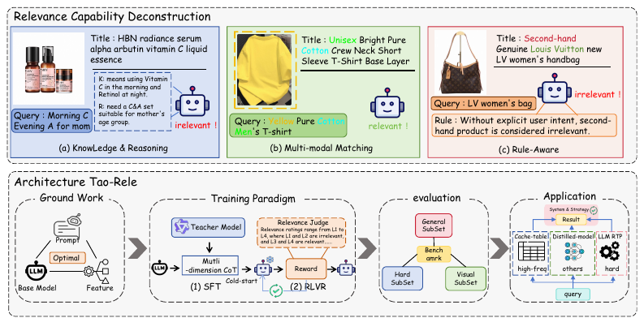

> **Figure 1**: LORE의 이론 프레임워크와 아키텍처 개요. 상단은 relevance에 필요한 세 capability, 즉 (a) Knowledge & Reasoning ("Morning C Evening A for mom"은 비타민 C와 레티놀 세트이고 중년층용이라는 추론), (b) Multi-modal Matching (title에 없는 "yellow"를 이미지로 확인), (c) Rule-Aware ("LV women's bag" 검색에 중고 LV 가방은 규칙상 irrelevant)를 보여준다. 하단은 Ground Work → SFT/RLVR → Benchmark → 온라인 Application으로 이어지는 전체 lifecycle이다.

- 저자들은 relevance 판정을 다음 두 단계로 분해한다.
  1. **Path Construction**: query의 요구(need)를 item attribute로 매핑하고 query→item 의미 경로를 구성한다.
  2. **Path Following**: 구성된 경로를 따라 attribute 단위로 정밀하게 판정한다.
- 이 분해에서 세 가지 필수 capability가 도출된다.

| Core Capability | 관여 단계 | 구체적 적용 |
|---|---|---|
| **Reasoning & Knowledge Integration** | Query Understanding, Item Understanding, Path Construction | 도메인 jargon·은유 해석("phone gas station" = power bank), 파생 attribute 의미 해석, "for summer trips" 같은 추상 요구를 attribute 조합으로 매핑 |
| **Multi-modal Understanding** | Item Understanding, Path Following | style·color·material처럼 이미지에 의존하는 attribute 추출과 시각 제약 검증 |
| **Complex Rule Adherence** | Item Understanding, Path Following | brand·spec처럼 정확 매칭이 필요한 inherent attribute 처리, 비즈니스 SOP 준수와 재현성 확보 |

### 핵심 통찰 2: Item attribute는 성질(inherent vs derived)과 modality에 따라 난이도가 다르다
- **Inherent attribute** (category, shop, brand, IP, model, spec, material, color, price, year, promotion): 관측 가능하고 판정이 거의 binary다. 그중 brand·model·IP·shop은 **characteristic attribute**라서 term matching만으로도 충분한 경우가 많다.
- **Derived attribute** (style, audience, function, season, bundle 등): inherent attribute에서 유도되는 목적·효과다. 직접 관측이 어렵고 주관적이며 정도(degree)가 있어 semantic reasoning이 필요하다. 업종마다 체계가 달라 열거가 불가능하다.
- **Modality**: color·style·material은 이미지가 필수인 반면, brand·price·year는 text만으로 충분하다. 즉 멀티모달 의존도는 query 수준이 아니라 **attribute 성질에 따라** 결정해야 한다.
- 이를 위해 query 요구를 **18개 attribute 차원**(category, brand, style 등)으로 분해하는 schema를 정의하고, 이 schema는 이후 RL reward의 mismatch type 집합(T_pre)으로도 재사용된다.

### 핵심 통찰 3: Query understanding의 난이도 계층
- **Entity recognition**: knowledge-free("Red dress size M") → 일반 세계 지식("pearl white"는 흰색의 한 색조) → 도메인 지식("OLED TV with eARC") → 오타·별칭("Iphone chrger").
- **Intent recognition**: target과 constraint의 구분("summer mint mambo slimming set"에서 target은 set, 나머지는 season/style/color/function 제약), 추상 요구("phones with the best battery life"), 누락된 context 보완(대화 이력, 프로필).

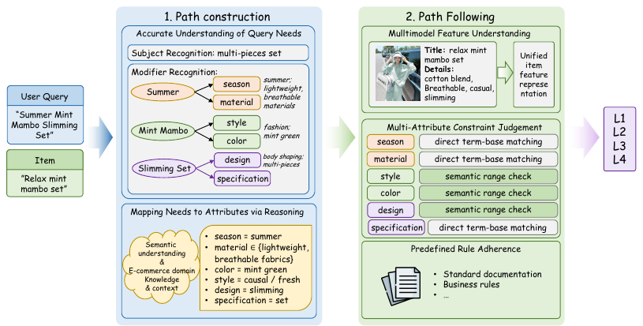

> **Figure 5**: Relevance 판정 과정 개요. (1) Path Construction에서는 "Summer Mint Mambo Slimming Set"의 주체(set)와 수식어(season, material, style, color, design, spec)를 인식하고, 도메인 지식으로 attribute 값에 매핑한다. (2) Path Following에서는 텍스트와 이미지를 통합한 item 표현을 만들고, attribute별로 direct term matching(inherent) 또는 semantic range check(derived)를 적용한 뒤 사전 정의된 rule을 따라 L1~L4를 결정한다.

---

## 3. Contributions
1. **Relevance task의 이론적 분해**: Path Construction / Path Following 2단계와 세 core capability(Knowledge & Reasoning, Multi-modal, Rule Adherence)를 정의해 relevance 모델 설계의 청사진을 제시한다.
2. **Progressive multi-dimensional CoT 합성 + SFT**: Knowledge RAG → relevance-guided enhanced caption → rule-aware CoT의 3단계로 teacher CoT를 합성하고 Qwen2.5-7B에 distill한다 (pass@8 0.937 → 0.964).
3. **Relevance 맞춤 RLVR**: KL-free GRPO, 계층형 verifiable reward, 난이도 기반 curriculum, dynamic sampling, clip-higher로 pass@8을 pass@1로 전환한다.
4. **RAIR benchmark** (Rule-Aware benchmark with Image for Relevance): General / Long-Tail Hard / Visual Salience 3개 subset, 총 63,601 샘플로 구성되며 rule checklist가 포함된다.
5. **Query 빈도 기반 계층 배포**: 고빈도 caching, 중빈도 distillation, hard query 실시간 추론으로 나눠 배포해 온라인 **GoodRate 누적 +27%** 를 달성했다.
6. **실무 인사이트**: "feature는 많을수록 좋다", "prompt는 중간 길이가 최적", "naive CoT distillation은 pass@1을 떨어뜨린다", "long CoT는 필요 없다", "clip-higher가 entropy collapse 대응책 중 최선" 등.

---

## 4. Method

### 4.1 Preliminary Exploration (Ground Work)

#### Feature Construction
- **Main Product Image**: style·재단·패턴처럼 시각적 attribute가 중요한 "image-heavy" query에 대응한다.
- **CPV (Category-Property-Value) triple**: 반구조화된 item 핵심 속성이다. 판정에 무관한 key가 많기 때문에 다음 방법으로 필터링한다.
  - 대량 상품 데이터에서 중·고빈도 key를 통계로 추린다.
  - Qwen3-235B-Instruct에 task 정의와 key를 주고 "relevance 판정에 유익한가"를 **8회 샘플링**해 self-consistency로 결정한다.
  ```
  S_CPV = { k | Σ_{i=1..8} 1[Qwen(k_i) = true] >= 4 }
  ```
- **SKU 정보**: 색상·사이즈·구성품 같은 구매 가능 variant를 보완한다.
- 결과: 다소 중복되고 noise가 있어도 **안정적이고 관련 있는 신호라면 추가할수록 이득**이었다.

| Features | pass@1 |
|---|---|
| base (Title) | 0.847 |
| + CPV | 0.855 |
| + CPV + SKU | **0.871** |

#### Model Selection
- 7B~14B 오픈소스 모델(단일 GPU로 학습·추론 가능한 크기)을 동일한 label-only SFT로 비교한 결과, 성능과 추론 효율 모두에서 앞선 **Qwen2.5-7B**를 base model로 선택했다.

#### Prompt Optimization
- SFT에서는 모델이 prompt 지시보다 **response 데이터에서** 능력을 학습하기 때문에, 상세한 prompt가 반드시 이득은 아니다.

| Prompt | 길이 | pass@1 |
|---|---|---|
| short (역할 정의만) | 수십 토큰 | 0.861 |
| **mid (핵심 지시만)** | ~800 tokens | **0.871** |
| long (규칙 전부) | ~7,000 tokens | 0.868 |

- 세 prompt의 차이는 1% 이내다. Short prompt는 task 정보가 부족해 분포를 단순 fitting하는 데 그치고, long prompt는 attention 분산으로 오히려 성능이 떨어진다고 해석한다. 이후 실험은 모두 **mid prompt**로 고정했다.

### 4.2 SFT: Comprehensive Reasoning Capability Injection (Cold-start)

#### 4.2.1 Data Construction

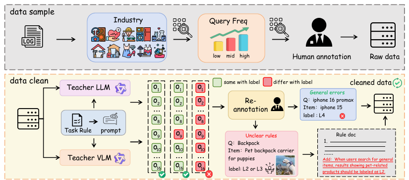

> **Figure 7**: SFT 학습 데이터 샘플링·정제 프레임워크. Taobao 로그를 업종별, query 빈도(low/mid/high)별로 stratified sampling한 뒤 사람이 annotation한다. 이어 Teacher LLM과 Teacher VLM이 각각 8회씩 총 16회 판정하고, 16회 모두 label과 불일치한 샘플을 재검수한다. 재검수 결과 명백한 오류("iphone 16 promax" 검색에 iphone 15를 L4로 표기)는 수정하고, 규칙이 모호한 경우("Backpack" 검색에 반려견 캐리어)는 rule 문서에 새 규칙을 추가한다.

- **Sampling**: 업종 비율로 stratified sampling한 뒤, 업종 내에서 query 빈도 high/mid/low 비율에 따라 다시 샘플링한다. 흔한 query와 long-tail을 모두 포함하는 것이 목적이다.
- **Cleaning**: 수작업 annotation의 정확도는 약 **95%** 수준이다. 오류 원인은 (1) 다속성 긴 query에서 세부 사항을 놓치는 것, (2) rule의 모호함이다.
  - Qwen3-235B-Instruct(text, 상세 rule 포함) 8회와 Qwen2.5-VL-72B(이미지 추가) 8회, 총 16회 판정을 수행한다.
  ```
  S_noise = { (Q_i, I_i) | Σ_{j=1..16} 1[J_j(Q_i, I_i) = y_i] = 0 }
  ```
  - Text 모델의 긴 context 이해력과 VLM의 멀티모달 능력을 함께 써서 false positive와 false negative를 모두 줄인다.
  - 걸러진 의심 샘플은 사람이 재검수해 오류는 수정하고, rule이 모호한 경우에는 새 가이드라인을 만든다. 이렇게 rule 체계 자체도 함께 개선된다.

| Data | Correction rate | Accuracy |
|---|---|---|
| before cleaning | - | 95% |
| after cleaning | 6.1% | **99%** |

#### 4.2.2 Multi-dimensional CoT Synthesis (Progressive, 3-step)

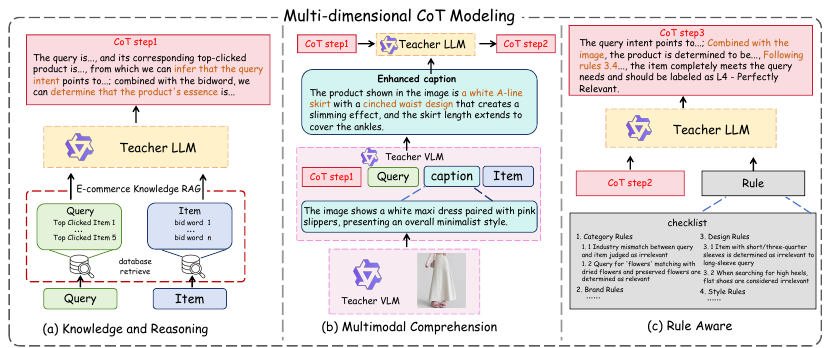

> **Figure 8**: Progressive multi-dimensional CoT 합성 프레임워크. (a) Knowledge & Reasoning: query 쪽에는 top-click item 5개, item 쪽에는 판매 포인트(bid word)를 RAG로 붙여 Teacher LLM이 CoT step1을 생성한다. (b) Multimodal Comprehension: Teacher VLM이 naive caption을 만든 뒤 CoT step1의 안내를 받아 relevance에 초점을 맞춘 enhanced caption으로 다시 쓰고, Teacher LLM이 이를 반영해 CoT step2를 생성한다. (c) Rule Aware: 업종별 rule checklist와 ground-truth label을 주고 rule을 인용하는 CoT step3를 역으로 생성한다.

**Step 1: Knowledge Injection & Reasoning (Path Construction 담당)**
- 대상 문제: (1) Long-tail query. 예를 들어 "strange things are also loved by someone"은 책 제목인데, 글자 그대로 해석하면 "신기한 장난감"으로 오해한다. (2) Semantically ambiguous item. 예를 들어 "lying gate" 같은 초니치 상품.
- **E-commerce Knowledge RAG**:
  - Query-side: 해당 query의 **historical CTR 상위 5개 item title**을 붙인다. 실제 사용자 의도를 반영하는 신호다.
  - Item-side: 판매자가 작성한 **"selling points"**(핵심 속성, 사용 시나리오, 차별점)를 붙인다.
  ```
  context_i  = concat(Q_i, K_Q, I_i, K_I)
  CoT_step1  = argmax_y P_θ(y | concat(prompt_LLM, context_i))      # Qwen3-235B-Instruct
  ```

**Step 2: Multimodal Comprehension (Path Following 담당)**
- VLM을 student로 직접 쓰지 않는 이유는 두 가지다.
  1. 같은 파라미터 규모라면 VLM의 reasoning 능력이 LLM보다 약하다.
  2. VLM을 fine-tuning하면 텍스트에만 의존하고 이미지를 무시하는 **"text shortcut"** 현상이 생긴다. 원인은 modality 간 정보 밀도 차이다.
- 대신 **caption-mediated 2-stage** 방식을 쓴다. VLM이 이미지를 텍스트 caption으로 바꾸고, LLM이 그 caption을 context로 받는다. 다만 일반 caption은 task와 무관한 내용이 많아 핵심 시각 단서를 놓치므로, caption을 **relevance-guided**로 다시 쓴다.
  ```
  C_naive    = argmax_y P_θ(y | prompt_VL, I_i)                                         # Qwen2.5-VL-72B
  C_enhanced = argmax_y P_θ(y | concat(prompt_VL, context_i, CoT_step1, C_naive))        # 같은 VLM, CoT로 가이드
  CoT_step2  = argmax_y P_θ(y | concat(prompt_LLM, context_i, CoT_step1, C_enhanced))    # Teacher LLM
  ```
- 예: naive caption "white maxi dress with pink slippers, minimalist style"이 enhanced caption "white A-line skirt, cinched waist design으로 slimming 효과, 발목까지 오는 길이"로 바뀐다.

**Step 3: Rule-Aware (Path Following의 객관적 검증)**
- Rule 전체를 prompt에 나열하면 context가 넘치고 instruction-following도 저하된다. 그래서 rule을 **reasoning 단계 안에 녹여** 시연(demonstration)으로 내재화하게 한다.
- Rule 체계를 업종별 rule set R로 분할한 뒤, (R, context_i, ground-truth L_i, CoT_step2)를 주고 rule을 인용하는 CoT를 **역설계(reverse-engineer)** 한다.
  ```
  CoT_step3 = argmax_y P_θ(y | concat(prompt_LLM, context_i, CoT_step2, L_i, R))
  ```
- Ground-truth label을 조건으로 주기 때문에 최종 결론이 label과 일치하는 CoT가 생성된다 (label-driven synthesis).

#### 4.2.3 Distillation by SFT
- CoT_step3를 response로 삼아 표준 SFT loss로 Qwen2.5-7B를 학습한다.
  ```
  L_SFT = - Σ_{i=1..N} log P(y_i | x_i; θ)

  response = <think> reasoning process </think><answer> (L1|L2|L3|L4) </answer>
  ```
- **SFT 단계에서는 pass@8을 지표로 본다** (temperature 1.0, 8회 샘플링). 이 값은 모델이 도달할 수 있는 성능 상한(capability boundary)을 뜻한다. RL은 맞는 답의 확률을 증폭할 뿐 원래 못 푸는 문제를 풀게 해 주지는 못하기 때문에, **pass@8이 baseline을 넘어야 RL로 넘어간다**.
  ```
  pass@8 = 1 - Π_{i=1..8} (1 - p_i)
  ```
- **Data scaling 실험**: 데이터를 10%씩 늘리며 format accuracy와 pass@8을 관찰했다.

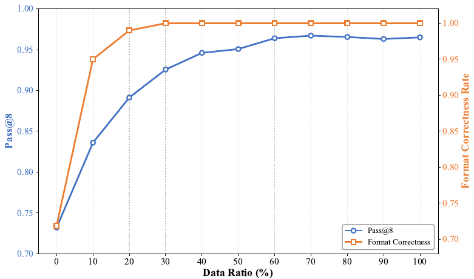

> **Figure 9**: SFT 데이터 비율에 따른 pass@8과 format correctness의 변화. Format 정확도는 20% 데이터에서 이미 98%를 넘고 30%에서 포화된다. Pass@8은 초반에 급증하다가 약 60%에서 plateau(≈0.964)에 도달한다.

- 학습에는 **전체 데이터의 60%** 를 사용했다. 그 이상은 이득이 없고 과적합 위험만 커진다 (data scaling의 diminishing returns).

| Model | pass@8 |
|---|---|
| vanilla SFT | 0.937 |
| **cold-start (CoT distill)** | **0.964** |

### 4.3 RL: Relevance-Oriented Human Preference Alignment
목표: 여러 번 샘플링하면 맞히는 능력(pass@8)을 한 번에 맞히는 능력(pass@1, greedy)으로 전환하는 것이다. 잘못된 reasoning path를 가지치기한다.

#### 4.3.1 Data Construction: Hard Sample Mining
- Cold-start 모델로 전체 학습 데이터에 8회 추론하면 정답 횟수 k의 분포가 **J자형**으로 나타난다. 8/8 정답 샘플이 약 31만 개로 압도적인데, 이런 샘플은 advantage가 0이어서 gradient를 만들지 못한다.
  ```
  SampleWeight(k) = 1.0          if k < 5        # confusing 샘플은 전부 유지
                    α ∈ (0, 1)   if 5 <= k < 8   # 비교적 확신하는 샘플은 다운샘플
                    0            if k = 8        # 포화 샘플은 제거
  ```

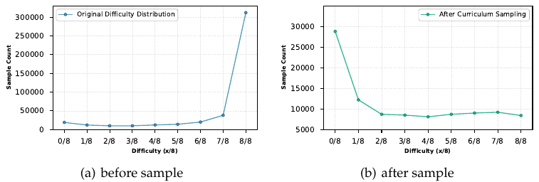

> **Figure 10**: 샘플링 전후 난이도 분포. (a) 원본은 8/8 정답이 약 310K로 몰린 J자형이다. (b) 필터링 후에는 0/8이 약 29K로 가장 많고 나머지가 약 8~12K로 고르게 분포하는 역 J자형이 된다.

#### 4.3.2 Basic RL Framework: KL-free GRPO
- GRPO 목적함수 (token-level importance ratio, group-normalized advantage):
  ```
  J_GRPO(θ) = E_{x~D, {y_i}_{i=1..G} ~ π_θold(·|x)} [
      (1/G) Σ_i (1/|y_i|) Σ_t min( w_{i,t}(θ) · Â_{i,t},
                                   clip(w_{i,t}(θ), 1-ε, 1+ε) · Â_{i,t} ) ]

  w_{i,t} = π_θ(y_{i,t} | x, y_{i,<t}) / π_θold(y_{i,t} | x, y_{i,<t})
  Â_{i,t} = (r_i - mean({r_j})) / std({r_j})
  ```
- **KL 항 제거**: SFT warm-start로 reasoning 패러다임과 출력 형식이 이미 굳어 있으므로, KL 제약은 오히려 더 나은 reasoning path 탐색을 막는다고 판단했다.

#### Training Objective: Verifiable Reward
```
r = r_format + r_result

r_format =  0.1   if o follows <think></think><answer></answer>
           -0.1   otherwise

r_result =  1.0   if o = L                                        # 4단계 정답
           -0.5   if o = L but mismatch type ∉ T_pre              # 출력한 mismatch 유형이 사전 정의된 18종 밖
            0.3   if o ≠ L and BinaryClass(o) = BinaryClass(L)    # 등급은 틀렸지만 relevant/irrelevant는 맞음
           -1.0   if o ≠ L and BinaryClass(o) ≠ BinaryClass(L)    # binary도 틀림
           -1.0   if o is unparsable
```
- 각 항의 역할:
  - **Format standardization**: 특수 토큰으로 reasoning과 answer를 분리해 파싱이 쉽도록 한다.
  - **Output space constraint**: "price mismatch", "function mismatch" 같은 mismatch 유형을 사전 정의된 18종(T_pre, 2장의 attribute schema)으로 제한해, 통제되지 않는 임의 출력을 막는다.
  - **Progressive (partial) reward**: binary가 맞으면 +0.3을 준다. 초기 학습의 sparse reward 문제를 완화하고 수렴을 빠르게 한다. L1-L4 중 L1/L2는 irrelevant, L3/L4는 relevant다.

#### 4.3.3 Training Strategy Optimization

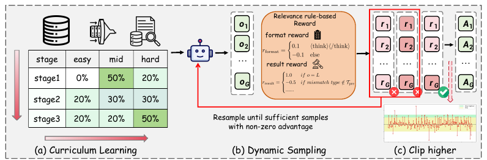

> **Figure 11**: RLVR의 기본 프레임워크와 최적화 전략. (a) 난이도별 비율을 단계마다 바꾸는 curriculum learning, (b) advantage가 0이 아닌 샘플이 충분히 모일 때까지 재샘플링하는 dynamic sampling, (c) clip 상한을 높이는 clip-higher.

**(1) Curriculum Learning**: 8회 추론의 정답 수 k로 난이도를 3단계로 나눈다 (easy: k∈{6,7}, medium: {3,4,5}, hard: {0,1,2}).

| Stage | easy | mid | hard | 의도 |
|---|---|---|---|---|
| Stage 1 | 0% | 50% | 20% | Rapid bootstrap: 가장 쉬운 샘플이 아닌 중간 난이도로 시작해 유효한 양의 보상을 빨리 얻음 |
| Stage 2 | 20% | 30% | 30% | Progressive challenge |
| Stage 3 | 20% | 20% | 50% | Edge case 공략. easy 샘플은 "memory anchor"로 남겨 forgetting을 막고 gradient variance를 안정화 |

- 비율은 grid search로 정했다 (표의 합이 100%가 아닌 것은 원문 그대로다). Curriculum을 쓰면 reward 수렴이 더 빠르고 안정적이다 (Figure 12).

**(2) Dynamic Sampling** (DAPO): rollout 중 실시간으로 advantage를 계산해 0인 샘플을 버리고, non-zero advantage 샘플이 batch size만큼 모였을 때만 update한다.

**(3) Entropy Collapse 대응**: 세 가지 전략을 비교했다.
- **Clip-higher**: 상한 clip을 1+ε_high로 높여 저확률 토큰의 확률이 더 크게 오를 수 있게 한다. ε = 0.2, ε_high = 0.28 (DAPO 권장값).
  ```
  clip(w_{i,t}(θ), 1 - ε, 1 + ε_high)
  ```
- **On-policy**: 샘플링한 batch를 gradient update 한 번에만 쓰고 버린다.
- **Off-policy + explicit entropy loss**: GRPO loss에 `α · E[-(1/G) Σ log π_θ(o_i|x)]` 항을 추가하고 multi-epoch 재사용은 유지한다 (실험에서는 coef 1e-3).

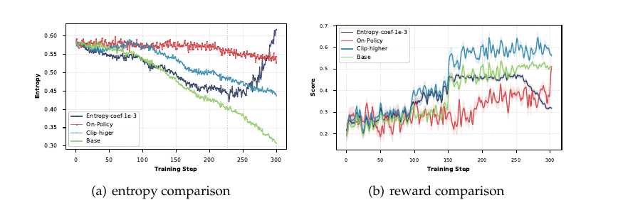

> **Figure 13**: Entropy collapse 완화 전략 세 가지(clip-higher, on-policy, off-policy + entropy loss)의 비교. (a) Entropy 곡선에서 Base는 약 0.58에서 0.30까지 급락한다. On-policy는 약 0.55 근처에서 거의 떨어지지 않고, Clip-higher는 약 0.44까지 완만하게 감소한다. Entropy loss는 약 250 step 이후 급등한다. (b) Reward 곡선에서는 Clip-higher가 약 0.6으로 가장 높고, Entropy loss는 후반에 약 0.32로 붕괴한다.

| 전략 | Entropy 거동 | 결과 |
|---|---|---|
| Base | 빠르게 붕괴 | 약 150 step 이후 성능 정체 |
| **Clip-higher** | 하강 속도만 늦춤 | **탐색과 활용의 균형, 최고 reward** |
| On-policy | 거의 하강하지 않음 | 탐색은 유지되지만 수렴을 방해해 성능 향상이 작음 |
| Entropy loss | 초반엔 완만, 임계 이하에서는 entropy loss가 주 loss를 압도 | Entropy 비정상 상승 후 **training collapse**. 계수 튜닝 비용도 큼 |

- 인사이트: 학습 초반에 모델은 entropy를 성능과 빠르게 맞바꾸고, entropy가 일정 수준 아래로 떨어지면 개선 여지가 사라진다. 즉 **entropy collapse 속도가 성능 상한을 결정한다**.

**(4) Importance Sampling 단위**: GSPO/GMPO를 참고해 sequence-level ratio를 시험했다.
```
w_i^seq(θ) = (π_θ(y_i|x) / π_θold(y_i|x))^(1/|y_i|)
           = exp( (1/|y_i|) Σ_t log( π_θ(y_{i,t}|x, y_{i,<t}) / π_θold(y_{i,t}|x, y_{i,<t}) ) )
```
- Sequence-level은 reward 상승이 더 안정적이지만 entropy가 더 빨리 떨어진다. Relevance처럼 reasoning 패턴이 비교적 고정된 task에서는 전략이 조기에 굳어 **후반 성능이 token-level보다 낮다**. 그래서 token-level을 유지했다.

#### 학습 vs 추론
| 단계 | 과정 |
|---|---|
| **데이터 준비** | Stratified sampling, 사람 annotation, LLM+VLM 16회 판정으로 noise 정제 (95% → 99%) |
| **CoT 합성** | Knowledge RAG CoT (Qwen3-235B) → relevance-guided caption (Qwen2.5-VL-72B) → rule-aware CoT (label·rule 조건부) |
| **SFT (cold-start)** | 데이터 60%로 Qwen2.5-7B SFT. pass@8로 상한 확인 (0.964) |
| **RL** | KL-free GRPO + 계층 reward + hard sample 필터 + 3단계 curriculum + dynamic sampling + clip-higher. pass@1(greedy)로 평가 |
| **추론 (오프라인)** | Image는 VLM caption으로 텍스트화해 입력. `<think>…</think><answer>L1~L4</answer>` 출력 |
| **추론 (온라인)** | Query 빈도로 계층화해 cache / distilled light-weight model / Int8 실시간 LLM으로 서빙 (5.5절) |

---

## 5. Experiments

### 5.1 Dataset: RAIR Benchmark
기존 benchmark(예: Shopping Queries)는 어려운 판정 사례를 변별하지 못한다. 그래서 세 core capability를 겨냥한 **RAIR**를 새로 구축했다 (Taobao 검색 로그, 전문 annotator 라벨, 14개 업종).

| | General subset | Long-Tail Hard subset | Visual Salience subset |
|---|---|---|---|
| 목적 | 기본 reasoning, 지식, attribute 추출 | 고급 LLM 변별용 hard case | 이미지가 판정에 필수인 case |
| 규모 | 46,775 | 10,931 | 5,895 |
| 구축 | 업종 stratified + 우세 업종 다운샘플 (어떤 업종도 15% 이하) | 유형별 마이닝 후 baseline 모델이 8회 중 5회 이하로 맞힌 샘플만 유지 | 시각 taxonomy 키워드 검색 → blacklist → **시각 키워드가 텍스트에 없는** pair만 유지 → LLM 검증 → naive 멀티모달 모델의 일관성이 8회 중 4 미만인 샘플 |
| 입력 | query, title, details, SKU, 익명화된 이미지 | 동일 | 동일 |
| Label | L1~L4 + rule checklist (rule id) | 동일 | 동일 |

- **Long-Tail Hard 유형 분포**: Multi-attribute 5,071 (46.4%, explicit), Reasoning-dependent 2,436 (22.3%), Knowledge-dependent 2,138 (20.0%), Negation 1,073 (9.8%), Alternatives 213 (1.9%).
  - NE/AL은 키워드와 regex로, KD/RD는 저빈도 로그에서 Qwen3-235B self-consistency(8회 중 4회 초과 일치)로, MA는 NER로 attribute가 5개 넘는 query를 골라 마이닝했다.
- **전체 label 분포** (총 63,601): L1 2,985 (4.7%), L2 13,443 (21.1%), L3 3,034 (4.7%), L4 44,139 (69.4%). L4에 크게 치우쳐 있어 macro-F1을 함께 본다.
- **Rule checklist**: label(y)과 업종(c)별로 관련 rule 부분집합 R'_{y,c}만 LLM에 주고 k회 추론한 뒤, 2회 이상 등장한 rule만 checklist에 채택한다. 평가와 오류 분석 전용이다.

### 5.2 Implementation Details
- **Student**: Qwen2.5-7B (text LLM). 이미지는 caption으로 입력한다.
- **Teacher**: Qwen3-235B-Instruct (text CoT, 데이터 정제, CPV 필터), Qwen2.5-VL-72B (caption, 데이터 정제).
- **Prompt**: mid 버전 (~800 tokens).
- **SFT**: 전체 SFT 데이터의 60% 사용. pass@8은 temperature 1.0, 8 samples로 측정.
- **RL**: KL-free GRPO, clip ε=0.2 / ε_high=0.28, token-level IS, 3-stage curriculum, dynamic sampling. 300~400 step 규모의 학습 곡선을 보고한다.
- **평가**: 학습한 모델은 greedy single-pass. Baseline은 rule 전체를 포함한 통일 prompt로 zero-shot 평가하고, 각 모델 권장 temperature를 쓴다 (GPT-5는 0.7, Llama-3는 0.6).
- **Metric**: acc@4 (4-class 정확도), acc@2 (relevant/irrelevant binary 정확도), macro-F1 (클래스 불균형 보정).

### 5.3 Main Results

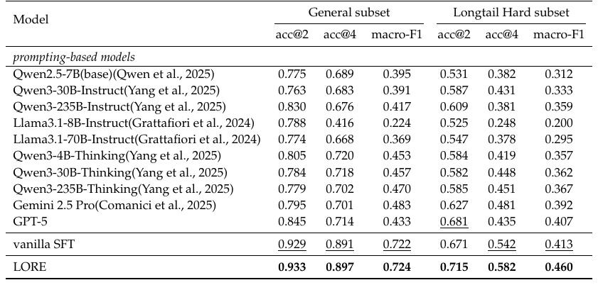

> **Table 9**: General subset과 Long-tail Hard subset의 주요 결과. 각 열에서 가장 좋은 점수는 굵게, 두 번째는 밑줄로 표시했다.

| Model | General acc@2 | General macro-F1 | Hard acc@2 | Hard acc@4 | Hard macro-F1 |
|---|---|---|---|---|---|
| Qwen2.5-7B (base) | 0.775 | 0.395 | 0.531 | 0.382 | 0.312 |
| Qwen3-235B-Thinking | 0.779 | 0.470 | 0.585 | 0.451 | 0.367 |
| Gemini 2.5 Pro | 0.795 | 0.483 | 0.627 | 0.481 | 0.392 |
| GPT-5 | 0.845 | 0.433 | 0.681 | 0.435 | 0.407 |
| vanilla SFT | 0.929 | 0.722 | 0.671 | 0.542 | 0.413 |
| **LORE** | **0.933** | **0.724** | **0.715** | **0.582** | **0.460** |

- **도메인 fine-tuning의 효과가 크다**: General subset에서 7B SFT 모델이 GPT-5를 크게 앞선다. LORE는 GPT-5 대비 acc@2가 **+8.8%p** (0.845 → 0.933), macro-F1이 **+29.1%p** (0.433 → 0.724) 높다. 논문은 이를 "relative gain"이라고 적었지만 수치상으로는 절대 차이다. 비즈니스 rule과 도메인 지식을 학습했기 때문이다.
- **General subset에서 CoT의 이득은 작다**: vanilla SFT가 이미 0.929로 in-distribution을 충분히 fitting하고 있어서, LORE의 추가 향상은 acc@2 +0.4%p에 그친다.
- **Hard subset에서 reasoning과 knowledge 주입의 효과가 두드러진다**: vanilla SFT는 GPT-5보다도 낮다 (0.671 vs 0.681). 반면 LORE는 acc@2 0.715 (vanilla SFT 0.671 대비 +4.4%p), macro-F1 0.460 (GPT-5 0.407 대비 +5.3%p), acc@4 0.582 (vanilla SFT 대비 +4.0%p)를 기록했다. Hard case를 가르는 것은 rule이 아니라 **reasoning 능력과 지식 보유량**이라는 해석이다.

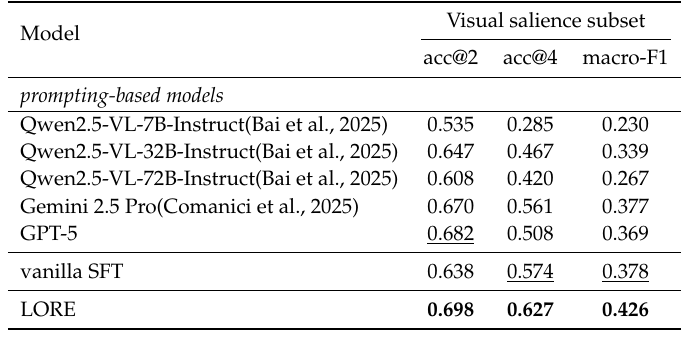

> **Table 10**: Visual Salience subset 결과. 이미지 정보 없이 학습한 vanilla SFT는 VLM baseline 대비 우위가 없지만, relevance-guided enhanced caption을 쓰는 LORE는 세 지표 모두에서 1위를 차지했다.

- Visual Salience subset에서 LORE는 macro-F1 **0.426**, acc@4 **0.627**을 기록했다. Vanilla SFT(0.378 / 0.574)와 GPT-5(0.369 / 0.508)를 모두 크게 앞서며, macro-F1은 vanilla SFT 대비 +4.8%p다.

**Case Study (Figure 15)**: 4가지 capability별 사례.
- Knowledge: "Capybara plush toy"와 "water pig(水豚)" 인형이 같은 대상임을 인식해 L4로 판정.
- Reasoning: "intellectual women's clothing"과 "commuter formal suit set"을 직업적이고 지적인 스타일로 추론해 L4로 판정.
- Multi-modal: "1/4 Black Soft" 검색에서 이미지 속 각인 "Kase MAGNETIC BLACK MIST 1/4"를 읽어 L4로 판정.
- Rule-aware: "iphone" 검색에 중고 iPhone 15 Pro가 나오면 L3(weakly relevant) 규칙을 적용.

### 5.4 Ablation Study / Discussion

**(1) Naive teacher CoT distillation은 pass@1을 떨어뜨린다**

| Model | pass@1 | pass@8 |
|---|---|---|
| vanilla SFT | 0.929 | 0.937 |
| cold-start (CoT distill) | 0.887 (**-4.2%**) | 0.964 (**+2.7%**) |

- 원인은 **training-inference distribution shift (exposure bias)** 다. 학습 중에는 teacher가 생성한 고품질 context를 조건으로 받지만, 추론 때는 자기 autoregressive 출력에 의존하므로 reasoning chain을 따라 오류가 누적된다.
- 그래도 pass@8은 오른다. 즉 distillation은 답변 공간의 다양성과 multi-step reasoning 능력을 넓혀 **상한을 높이고**, 이를 pass@1로 회수하는 것이 RL의 몫이다. 이것이 SFT와 RL 2단계 설계의 핵심 근거다 (LORE 최종 pass@1은 General 0.933로 vanilla SFT 0.929를 넘는다).

**(2) Long CoT는 필요 없다**
- RL 진행 중 response length는 약 170 tokens에서 시작해 오히려 감소한 뒤 약 145~150 tokens에서 안정화된다 (Figure 17). DeepSeek-R1 식의 "Aha moment"나 길이 증가는 관찰되지 않았다.
- Relevance는 query 의도와 item attribute를 식별하고 rule을 적용하는 직관적인 chain이면 충분하다. 수학이나 코드와 달리 그 이상의 장황한 reasoning은 이득이 없다. 서빙 비용 측면에서 의미가 큰 발견이다.

**(3) Multimodal: VLM vs Two-stage LLM (caption)**
- 같은 파이프라인(Qwen2.5-VL-72B teacher로 CoT 합성, 같은 SFT+RL)으로 Qwen2.5-VL-7B를 학습해 비교했다.

| Model | General acc@2 / macro-F1 | Hard acc@2 / macro-F1 | Visual acc@2 / acc@4 / macro-F1 |
|---|---|---|---|
| VLM-base (Qwen2.5-VL-7B) | 0.912 / 0.670 | 0.692 / 0.413 | **0.703 / 0.645 / 0.526** |
| LLM-base (LORE) | **0.933 / 0.724** | **0.715 / 0.460** | 0.698 / 0.627 / 0.426 |

- General과 Hard subset에서는 LLM-base가 우세하다 (macro-F1 +5.4%p, +4.7%p). 같은 CoT를 주입해도 **LLM의 reasoning과 지식이 더 강하기** 때문이다.
- Visual Salience subset에서는 VLM이 macro-F1 **+10%p**로 크게 앞선다. Caption으로 바꾸는 과정에서 정보가 손실되기 때문이다. 즉 caption 방식은 **전체 성능과 시각 정밀도 사이의 trade-off**이며, 시각 의존 트래픽 비중에 따라 선택이 달라진다.

**(4) RL 전략별 ablation 요약**
- Curriculum이 random 순서보다 수렴이 빠르고 안정적이다 (Figure 12).
- Clip-higher가 on-policy와 entropy loss보다 낫다 (Figure 13).
- Token-level IS가 sequence-level IS보다 낫다 (Figure 14).

### 5.5 Online Deployment (Application)

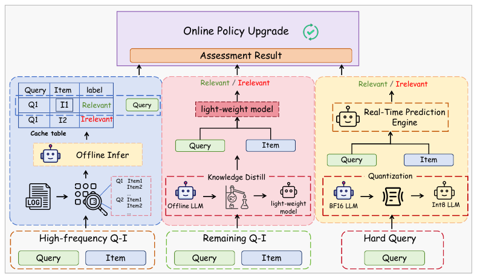

> **Figure 16**: Query 빈도 계층화에 기반한 LORE 온라인 적용 방식. 고빈도 Q-I는 오프라인 LLM 추론 결과를 cache table로 서빙하고, 나머지 Q-I는 LLM으로 knowledge distillation한 light-weight 모델로 판정한다. Hard query는 BF16 LLM을 Int8로 양자화한 실시간 예측 엔진으로 처리하며, 세 경로의 결과가 Online Policy Upgrade로 모인다.

| 트래픽 계층 | 비중 | 방식 | GoodRate |
|---|---|---|---|
| 고빈도 query-item | ~30% | **Cache Deployment**: 로그에서 고빈도 pair를 샘플링해 LLM으로 오프라인 추론한 뒤 online cache 조회 | **+4.8%** |
| 중빈도 (remaining) | ~65% | **Knowledge Distillation**: 기존 coarse→fine ranking 파이프라인은 유지하고, LLM이 대량의 고품질 학습 데이터를 생성해 온라인 모델을 강화 | **+9.5%** |
| Hard query | ~5% | **Real-time Inference**: 경량 intent 모델로 hard query를 식별하고 Int8 양자화 LLM으로 실시간 판정. 오프라인 hard set에서 GoodRate +14% | +0.9% (*추정, 미배포) |
| 시스템 전반 | - | **System & Strategy Update**: 더 신뢰할 수 있는 relevance score를 downstream ranking에 넣어 Pareto 최적화하고, 기존 heuristic rule을 폐기하거나 대체 | **+12.7%** |
| **Overall** | | | **+27.0%** |

- 가장 큰 기여는 **distillation (+9.5%)** 과 **system/strategy update (+12.7%)** 다. LLM을 직접 서빙하는 경로보다 **LLM을 teacher이자 신뢰할 수 있는 신호원으로 쓰는 경로**에서 이득이 더 컸다.
- Real-time LLM 경로의 +0.9%는 오프라인 평가로 추정한 값이며, 실제 온라인 결과는 아직 없다.

**Evolution (Figure 18 요약)**
| Phase | 시기 | Core goal | Backbone & 패러다임 | Data & Prompt | 적용 |
|---|---|---|---|---|---|
| LORE 1.0 | 2024-04 | Knowledge 생성과 주입 | Qwen-1.5, SFT | KG를 In-Context Learning으로 주입 | 오프라인 annotation 보조, badcase 탐지 |
| LORE 2.0 | 2024-09 | Deep reasoning | Qwen-2, CoT 생성 + SFT | Label-driven CoT, hard-case mining | 온라인 distillation (A/B 개선) |
| LORE 3.0 | 2025-06 | Multimodal fusion, rule alignment | Qwen-2.5 / VL, CoT + SFT + RL | 멀티모달 및 rule-aware CoT | Hybrid real-time 배포 (cache + 실시간) |

---

## 6. Key Takeaways
1. **Capability 분해가 CoT 설계의 출발점이다**: Relevance를 Path Construction / Path Following으로 나누고 Knowledge & Reasoning, Multi-modal, Rule Adherence 세 축을 정의한 뒤 각 축에 대응하는 CoT step을 순차 합성했다. 그 결과 Hard subset acc@2가 0.671에서 0.715로, Visual subset macro-F1이 0.378에서 0.426으로 올랐다.
2. **SFT는 상한을, RL은 실현을 맡는다**: CoT distillation만으로는 pass@1이 4.2% 떨어진다 (exposure bias). 그러나 pass@8은 0.937에서 0.964로 오르고, RL(KL-free GRPO + 계층 reward)이 이를 pass@1로 회수한다. **pass@8이 baseline을 넘는지를 RL 진입 조건**으로 삼는 운영 원칙이 실용적이다.
3. **RL은 데이터 난이도와 entropy 관리가 핵심이다**: 8회 추론으로 쉬운 샘플을 제거해 J자형 분포를 역 J자형으로 바꾸고, mid 난이도에서 시작해 hard 50%까지 올리는 curriculum과 clip-higher(ε_high=0.28)를 조합했다. Entropy loss는 학습 붕괴, on-policy는 수렴 부진, sequence-level IS는 조기 고착이라는 negative result도 함께 제시한다.
4. **"작고 정제된 것"이 이긴다**: 데이터는 60%에서 포화되고, prompt는 800 tokens(mid)가 7,000 tokens(long)보다 낫다. RL을 거치며 response length는 약 170에서 약 150 tokens로 줄어든다. 반대로 **feature는 많을수록 좋다** (Title 0.847 → +CPV+SKU 0.871). 데이터 정제(LLM+VLM 16회 판정)로 label 정확도도 95%에서 99%로 올렸다.
5. **Caption-mediated multimodal은 trade-off다**: 7B LLM + enhanced caption 조합은 General과 Hard에서 VLM보다 macro-F1이 약 5%p 높지만, Visual Salience에서는 VLM이 약 10%p 앞선다. Relevance-guided caption 재작성(CoT_step1을 조건으로 사용)이 이 격차를 줄이는 핵심 장치다.
6. **산업 배포는 query 계층화가 정답이다**: 고빈도 30%는 cache(+4.8%), 중빈도 65%는 distillation(+9.5%), hard 5%는 Int8 실시간 LLM(+0.9%, 추정)으로 나누고 system/strategy update(+12.7%)를 더해 **GoodRate +27%** 를 달성했다. LLM을 직접 서빙하기보다 **teacher와 신호원으로 활용할 때의 이득이 더 크다**는 점이 실무적 교훈이다.
