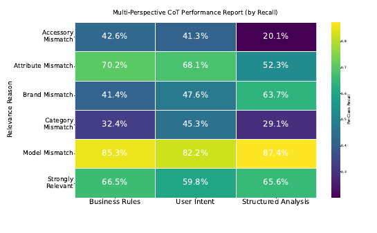
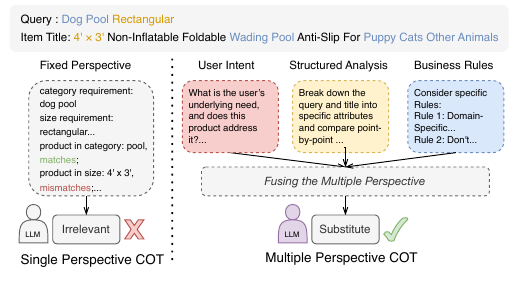
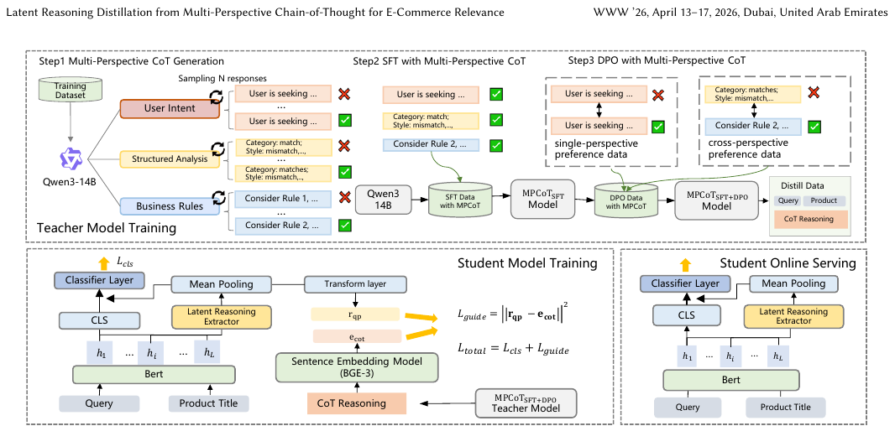
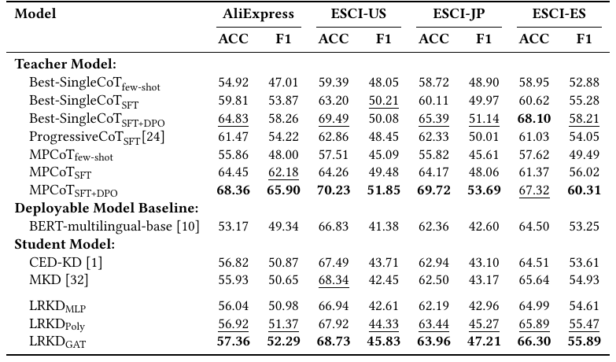
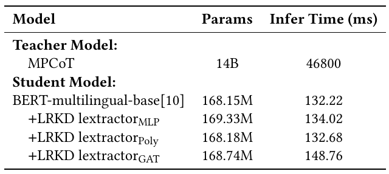
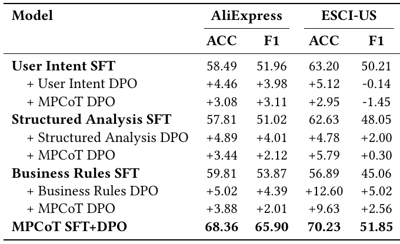
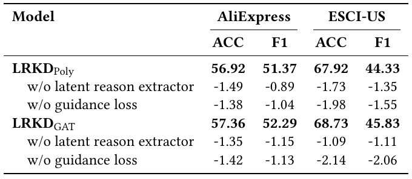
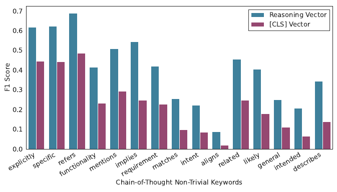
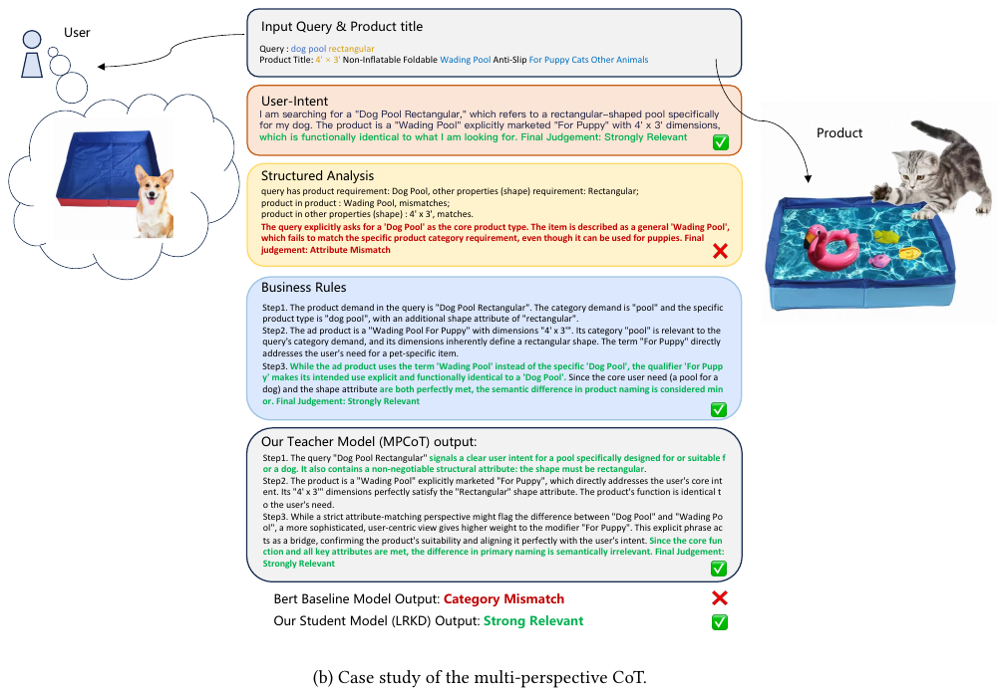

# Thinking Broad, Acting Fast: Latent Reasoning Distillation from Multi-Perspective Chain-of-Thought for E-Commerce Relevance

> **Venue**: WWW '26 (The ACM Web Conference 2026, April 13–17, 2026, Dubai, UAE) / arXiv:2601.21611
> **Authors**: Baopu Qiu*, Hao Chen*, Yuanrong Wu, Changtong Zan, Chao Wei, Weiru Zhang, Xiaoyi Zeng (Alibaba International Digital Commerce Group, Zhejiang University)
> **Platform**: AliExpress 검색 광고 (Search Advertising) relevance model

---

## 1. Background

### E-commerce Relevance Modeling의 현황
- Relevance classification은 query `q`와 상품 title `p`의 매칭 정도를 판정하는 문제로, 정확도와 함께 query당 수천 개 후보를 처리할 수 있는 **속도**가 필요하다.
- TF-IDF, BM25 같은 통계 기반 방법을 거쳐 dual-encoder, 그리고 BERT, ColBERT, Poly-Encoder 같은 interaction 기반 cross-encoder로 발전했다. 이들 모델이 **query의 80~90%는 잘 처리**하지만, 나머지 **10% 이상의 long-tail·ambiguous query**에는 더 정교한 reasoning이 필요하다. 이런 query는 구매 의도가 높은 경우가 많아서 비즈니스 영향도 크다.
- 최근에는 LLM을 prompting하거나 fine-tuning해 relevance를 판정하고, Chain-of-Thought(CoT)로 해석 가능성과 정확도를 함께 높이는 연구가 많다 (예: Zhao et al. MKD, Tang et al. LREF). 다만 LLM은 latency 때문에 online serving에 바로 쓰기 어려워서, BERT 같은 student로 **knowledge distillation (KD)** 하는 방식이 표준이다.

### 기존 방법의 한계
| 방법 | 문제점 |
|---|---|
| Single-perspective CoT (MKD, LREF 등) | LLM이 하나의 고정된 관점(예: attribute 단위 비교)으로만 추론한다. user intent, attribute matching, business rule이 함께 얽힌 e-commerce relevance의 다면성을 담지 못한다 |
| Score-based KD (p_Good / (p_Good + p_Bad)) | binary 설정을 전제로 하므로 multi-class(6-class, 4-class) 라벨 체계에는 쓸 수 없다 |
| Pseudo-label KD | LLM을 black-box annotator로만 쓰고 reasoning 정보는 버린다 |
| CED-KD (Agrawal et al., 2025) | auxiliary decoder가 rationale을 재구성하도록 학습하지만, **inference 때 decoder를 버린다**. rationale은 학습 중 일시적인 gradient 신호로만 남는다 |
| MKD (Zhao et al., WWW'25) | CoT를 token-level BIO tag로 바꿔 CRF loss로 distill한다. **표면적인 lexical matching**에 머물러 깊은 semantic reasoning은 전달하지 못한다 |

---

## 2. Motivation

### 핵심 통찰 1: 관점마다 잘 잡는 relevance 오류 유형이 다르다
- 저자들은 base LLM(Qwen3-14B)을 세 가지 perspective로 각각 prompting하는 pilot 실험을 했다.
  - **User Intent**: 쇼핑하는 사람의 직관을 흉내 낸다. 사용 시나리오와 기능적 니즈에 집중한다.
  - **Structured Analysis**: 전문 annotator처럼 query와 상품을 attribute 단위로 하나씩 비교한다.
  - **Business Rules**: 본품과 액세서리 구분처럼 e-commerce에서 자주 생기는 모호한 케이스를 heuristic rule로 해소한다.
- AliExpress 6-class 라벨별 recall은 다음과 같다 (Figure 3).

| Relevance Reason | Business Rules | User Intent | Structured Analysis |
|---|---|---|---|
| Accessory Mismatch | **42.6%** | 41.3% | 20.1% |
| Attribute Mismatch | **70.2%** | 68.1% | 52.3% |
| Brand Mismatch | 41.4% | 47.6% | **63.7%** |
| Category Mismatch | 32.4% | **45.3%** | 29.1% |
| Model Mismatch | 85.3% | 82.2% | **87.4%** |
| Strongly Relevant | **66.5%** | 59.8% | 65.6% |

- Structured Analysis는 Brand/Model Mismatch에서는 강하다. 하지만 fine-grained Attribute Mismatch(52.3%)와 Accessory Mismatch(20.1%)에서는 크게 약하다. 이런 케이스는 platform rule을 알아야 판정할 수 있기 때문이다. Category Mismatch는 User Intent가 가장 잘 잡는다(45.3%). 즉 세 관점은 **서로 보완적**이다.



> **Figure 3**: AliExpress 데이터셋에서 perspective별 CoT의 class별 recall. 어떤 관점도 모든 오류 유형에서 우세하지 않다.

### 핵심 통찰 2: 이득은 생성 횟수가 아니라 관점의 다양성에서 나온다
- Qwen3-14B few-shot 기준 비교:

| 설정 | Accuracy |
|---|---|
| Single perspective (User Intent, 1회) | 64.61% |
| Single perspective pass@3 (User Intent 3회, 하나라도 맞으면 정답) | 72.59% |
| **Multi-perspective oracle** (3개 관점 각 1회, 하나라도 맞으면 정답) | **77.52%** |

- 생성 budget을 3회로 똑같이 맞춰도 multi-perspective oracle이 pass@3보다 **+4.93pt** 높다. 같은 관점을 여러 번 샘플링하는 것보다 관점을 다양하게 하는 쪽이 정답을 커버하는 범위가 넓다는 뜻이다. 남은 과제는 이 oracle을 실제로 구현하는 것, 즉 상황에 맞는 관점을 고르거나 융합하는 일이다.



> **Figure 1**: Single perspective에서 multiple perspective로. "Dog Pool Rectangular" query에 "Wading Pool ... For Puppy" 상품이 주어지면, 고정된 attribute 비교 관점은 Irrelevant로 판정하지만 세 관점을 융합하면 Substitute로 올바르게 판정한다.

### 핵심 통찰 3: Distillation에서 rationale을 inference 때도 살려야 한다
- 기존 rationale distillation(CED-KD, MKD)은 rationale을 **학습 때만 쓰는 보조 신호**로 다루고, 서빙 모델에는 reasoning 구조가 남지 않는다.
- 저자들은 텍스트 생성 없이 rationale의 **semantic 정보를 embedding 공간에서 재현하는 모듈**을 student에 붙이고, 이 모듈을 inference 때도 유지하자고 제안한다.

---

## 3. Contributions
1. **MPCoT (Multi-Perspective Chain-of-Thought)**: User Intent / Structured Analysis / Business Rules 세 관점의 rationale을 생성해 SFT를 하고, 관점 간 충돌 케이스로 **cross-perspective DPO**를 해서, 상황에 따라 적절한 관점을 고르는 teacher를 만든다.
2. **LRKD (Latent Reasoning Knowledge Distillation)**: BERT student에 경량 **latent reasoning extractor**(MLP / Poly-Encoder / GAT)를 붙이고, 그 출력을 teacher CoT의 BGE-M3 embedding에 MSE로 정렬한다. extractor는 inference 때도 남아서 예측에 직접 기여한다.
3. **오프라인 성능**: AliExpress(6개 언어, 6-class)와 ESCI(US/JP/ES, 4-class)에서 teacher와 student 모두 SOTA를 달성했다. probing 실험으로 extractor가 lexical cue 이상의 reasoning semantics를 담는다는 것을 보였다.
4. **온라인 A/B**: AliExpress 검색 광고에서 7일, traffic 10% 실험 결과 **RPM +1.42%, CTR +0.48%, Relevance Satisfaction +0.4%** (모두 통계적으로 유의).

---

## 4. Method



> **Figure 2**: 전체 프레임워크. 위: MPCoT teacher 학습 (Step1 multi-perspective CoT 생성 → Step2 SFT → Step3 single/cross-perspective preference data로 DPO). 아래 왼쪽: LRKD student 학습 (BERT + Latent Reasoning Extractor, CoT의 BGE embedding과 정렬). 아래 오른쪽: online serving 때는 CoT 없이 query와 title만 입력한다.

### 4.1 Task 정의
- Relevance는 binary가 아닌 **C-class multi-class classification**으로 정의한다. 더 어렵고 현실적이며, LLM이 변별력을 발휘할 수 있는 풍부한 supervision을 주기 때문이다.
- Student와 teacher는 정의가 다르다.

| 모델 | 정의 |
|---|---|
| **Student** (BERT) | `f_student: (q, p) -> z ∈ R^C`, `P(y|q,p) = softmax(z)` (direct classification) |
| **Teacher** (LLM) | `f_teacher: (q, p) -> (r, y)`, r은 자연어 rationale, y는 최종 라벨 (CoT-based reasoning) |

### 4.2 MPCoT: SFT with Multi-Perspective CoT
더 큰 모델에서 distill하거나 데이터를 대량으로 필터링하지 않는다. base 모델 자신의 추론으로 데이터를 만드는 **self-enhancement loop**를 쓴다.

**(1) Multi-Perspective CoT 데이터 생성 + consistency filtering**
- 사람이 라벨링한 seed 데이터 `D = {(q_i, p_i, y_i)}`의 각 샘플에 대해, base 모델 M(Qwen3-14B)이 perspective k마다 `(r_k, ŷ_k)`를 생성한다 (sampling: temperature 0.7, top-p 0.99, top-k 50, 입력당 5개).
- 예측 라벨이 정답과 일치하는 rationale만 남긴다.

```
D_k^CoT = { (q_i, p_i, r_i^k, y_i) | (r_i^k, ŷ_i^k) = M(q_i, p_i, prompt_k)  and  ŷ_i^k = y_i }
k ∈ {User, Struct, Rule}
```

**(2) Aggregated fine-tuning**
- 세 관점 데이터를 합친 `D_SFT = D_User ∪ D_Struct ∪ D_Rule`로 학습한다.
- 핵심은 **unified instruction prompt**다. 어떤 관점을 쓸지 지정하지 않고 "think-then-respond" 형식으로 rationale과 label만 생성하게 한다. 같은 입력에 대해 서로 다른 관점의 정답 rationale이 함께 들어 있으므로, 모델은 다양한 추론 경로를 내재화한다.

```
L_SFT = - Σ_{(q,p,r,y) ∈ D_SFT} log P(r, y | q, p; θ)
```

### 4.3 MPCoT: DPO with Multi-Perspective CoT
SFT 모델은 다양한 추론을 할 수는 있지만, **주어진 context에서 어떤 관점이 맞는지 고르는 법**은 명시적으로 배우지 않았다. 이를 DPO로 보완한다.

**(1) Conflict set 구성**: SFT 모델에 perspective별 prompt를 넣었을 때, 하나 이상의 관점에서 틀린 샘플을 모은다.

```
D_conflict = { (q, p, y) | ∃k : M_SFT(q, p, prompt_k) -> ŷ_k ≠ y }
```

**(2) Cross-perspective preference pair**
- `y-` (rejected): 틀린 관점의 rationale
- `y+` (chosen): 세 관점에서 각각 pass@5로 생성한 결과 중 **정답을 낸 rationale** (다른 관점에서 가져올 수 있다)
- 예: User Intent는 틀리고 Structured Analysis는 맞은 샘플이면, (User Intent의 틀린 rationale, Structured Analysis의 맞은 rationale) 쌍으로 "이 context에서는 attribute 기반 추론을 우선하라"를 가르친다.
- Figure 2에서 보듯 같은 관점 내 preference pair(single-perspective)와 관점 간 pair(cross-perspective)를 함께 쓴다.

```
L_DPO = - E_{(q,p,y+,y-) ~ D_DPO} [ log σ( π_θ(y+ | q,p) - π_θ(y- | q,p) ) ]
```
(논문 식 그대로다. 표준 DPO의 reference model log-ratio와 β 항은 생략해서 표기했다.)

### 4.4 LRKD: Latent Reasoning Knowledge Distillation

**모델 구조**
1. **BERT cross-encoder**: `[q; p]`를 인코딩해 `H ∈ R^{L×d}`를 얻는다.
2. **Latent reasoning extractor R(·)**: token representation을 하나의 reasoning vector로 압축한다.
   ```
   r_qp = R(H, M_qp) ∈ R^d        # M_qp: attention mask
   ```
3. **Teacher 신호**: frozen **BGE-M3**(max len 1024)로 teacher CoT를 embedding한다.
   ```
   e_cot = BGE(r) ∈ R^d
   ```
4. **Classifier**: `[CLS]` representation `h_cls`와 `r_qp`를 concat한 `h_fuse`에 linear head를 붙여 C-class logit을 낸다 (Figure 2에서는 transform layer와 mean pooling을 거친다).

**Extractor 후보 3종** (hidden dim 128, Appendix A)

| Extractor | 방식 | 수식 요약 |
|---|---|---|
| **MLP** (2-layer) | token별로 독립 변환한 뒤 masked mean pooling | `H~ = MLP(H)`, `r = Σ_i M_i·h~_i / Σ_i M_i` |
| **Poly-Encoder** (K=32 codes) | 학습 가능한 context code K개가 token에 attention하고, head 평균을 낸다 | `A = softmax(H·U^T / sqrt(d) + B)`, `C_heads = A^T·H`, `r = (1/K) Σ_k c_k` |
| **GAT** (1-layer) | 유효 token을 node로 하는 fully-connected graph에서 attention message passing 후 평균 | `α_ij = LeakyReLU(a^T [W h_i ∥ W h_j])`, `r'_i = Σ_j softmax_j(α_ij)·W h_j`, `r = mean_i r'_i` |

#### Training Objective
```
L_cls   = -(1/N) Σ_i Σ_c 1(y_i = c) · log( exp(z_{i,c}) / Σ_{c'} exp(z_{i,c'}) )
L_guide = || r_qp - e_cot ||_2^2
L_total = L_cls + λ · L_guide          # λ = 0.1
```
- `L_cls`: 6-class 또는 4-class cross-entropy. score-ratio distillation이 multi-class에 맞지 않는 문제를 피한다.
- `L_guide`: extractor 출력이 **teacher의 rationale semantics를 embedding 공간에서 재현**하도록 강제한다. text를 생성하지 않으므로 decoder가 필요 없다.
- 기존 방법과의 차이: CED-KD는 decoder를 버리고 MKD는 BIO tag만 맞춘다. LRKD는 **extractor를 inference에서도 유지**해서 reasoning vector가 최종 예측에 직접 들어간다.

#### 학습 vs 추론
| 단계 | 과정 |
|---|---|
| **Teacher 학습** | Qwen3-14B → MPCoT 데이터 생성/필터링 → LoRA SFT → conflict set 기반 DPO → MPCoT_SFT+DPO가 distill용 CoT를 생성 |
| **Student 학습** | (q, p) → BERT → [CLS] + extractor(r_qp) → L_cls / 동시에 teacher CoT → BGE-M3 → e_cot, L_guide = MSE(r_qp, e_cot) |
| **추론 (online)** | (q, p) → BERT → [CLS] + extractor → classifier. **CoT, BGE, LLM 모두 불필요**, 추가 비용은 extractor 하나 |

---

## 5. Experiments

### 5.1 Dataset
| | Amazon ESCI | AliExpress (in-house) |
|---|---|---|
| 출처 | Amazon Shopping Queries (공개) | AliExpress cross-border e-commerce |
| 언어 | EN(US), ES, JP | EN, ES, KO, JP, PT, FR (6개) |
| Label | 4-class: Exact / Substitute / Complement / Irrelevant | 6-class: Strongly Relevant / Brand / Category / Model / Attribute / Accessory Mismatch |
| Train / Test | 100K / 10K (large version에서 샘플링, CED-KD와 동일 설정) | 약 100K / 20K |
- AliExpress 샘플 분포는 실제 online traffic 분포와 다르다. 같은 split을 SFT, DPO, KD 전 단계에서 일관되게 사용한다.

### 5.2 Implementation Details
- **Teacher**: Qwen3-14B + LoRA
  - SFT: 3 epochs, lr 5e-5 (cosine), global batch 32 (A100 ×4), max seq 3072
  - DPO: 3 epochs, lr 5e-6 (cosine, warmup 0.1), effective batch 64 (1 × grad accum 16 × 4 GPU), bf16
- **Student**: BERT-multilingual-base, AdamW lr 2e-6, 5 epochs, batch 256, 입력 128 tokens, λ = 0.1
- **CoT encoder**: frozen BGE-M3 (max len 1024)
- **Baselines**
  - Teacher: Best-SingleCoT (few-shot / SFT / SFT+DPO, 각 단계에서 세 관점 중 최고 성능), ProgressiveCoT_SFT (Tang et al. LREF의 curriculum SFT)
  - Student: BERT-multilingual-base (rationale 없이 fine-tune), CED-KD, MKD
- **Metrics**: offline은 Accuracy와 macro-F1, online은 RPM, CTR, RS (사람이 평가하는 relevance satisfaction)

### 5.3 Main Results



> **Table 1**: AliExpress와 ESCI 테스트셋에서 방법별 성능 비교 (ACC / macro-F1).

**Teacher (MPCoT)**
- **MPCoT_SFT+DPO**는 Best-SingleCoT_SFT+DPO보다 평균 **ACC +1.96pt, F1 +3.5pt** 높다. AliExpress에서는 68.36 / 65.90으로 **ACC +3.53, F1 +7.64**의 큰 차이가 난다. 유일하게 ESCI-ES ACC(67.32 vs 68.10)에서만 뒤진다.
- **Few-shot에서는 MPCoT가 오히려 불리**하다 (예: ESCI-US 57.51 vs 59.39). 관점을 섞은 unified prompt만으로는 이득이 없다. SFT에서 다양한 rationale을 학습하고 DPO에서 관점 선택을 학습한 뒤에야 single-perspective를 넘어선다. **"다양성 + 선택 학습"이 함께 있어야 효과가 난다.**
- ProgressiveCoT_SFT(고정된 난이도 curriculum)보다 MPCoT_SFT가 AliExpress F1 기준 62.18 vs 54.22로 우세하다. 고정된 curriculum보다 adaptive한 관점 선택이 낫다는 근거다.
- Few-shot Qwen3-14B만으로도 fine-tuned BERT와 비슷한 수준이다 (AliExpress 54.92 vs 53.17).

**Student (LRKD)**
- **LRKD_GAT**가 모든 데이터셋에서 최고다. BERT baseline보다 평균 **ACC +2.37, F1 +3.91**, MKD보다 **ACC +1.15, F1 +2.49**, CED-KD보다 **ACC +0.98, F1 +2.5** 높다.
- AliExpress: BERT 53.17 / 49.34 → LRKD_GAT **57.36 / 52.29** (+4.19 / +2.95).
- ESCI-JP F1: 42.60 → **47.21** (+4.61). 소수 class를 많이 개선해 macro-F1이 크게 오른다.
- 단, MKD는 ESCI-US ACC에서 68.34로 LRKD_Poly(67.92)보다 높다. MLP extractor는 baseline과 큰 차이가 없다 (ESCI-JP에서는 62.19로 오히려 소폭 하락). **extractor가 token 간 interaction을 모델링해야** 효과가 난다.
- Teacher와 student의 격차는 여전히 크다 (AliExpress ACC 68.36 vs 57.36, 약 11pt). 128-token BERT로 옮길 수 있는 reasoning에는 한계가 있다.

**Model Complexity**



> **Table 2**: 모델 효율 비교. A100에서 batch 100 query-item pair 기준 평균 inference time.

| Model | Params | Δ Params | Infer Time (ms) | Δ Latency |
|---|---|---|---|---|
| MPCoT teacher | 14B | - | 46,800 | - |
| BERT-multilingual-base | 168.15M | - | 132.22 | - |
| + LRKD MLP | 169.33M | +1.18M | 134.02 | +1.80 |
| + LRKD Poly | 168.18M | **+0.03M** | 132.68 | **+0.46** |
| + LRKD GAT | 168.74M | +0.59M | 148.76 | +16.54 (+12.5%) |

- Teacher는 student보다 약 **350배 느리다** (46,800ms vs 132ms). Poly-Encoder는 사실상 공짜에 가깝고, GAT는 latency +12.5%를 대가로 최고 성능을 낸다. 성능과 비용 사이의 실질적인 선택지다.

### 5.4 Ablation Study

**(1) Multi-perspective SFT가 필요한가** (Table 3)



> **Table 3**: Multi-perspective SFT ablation. single-perspective SFT 모델에 같은 관점의 DPO(+ X DPO)를 적용한 경우와 MPCoT DPO 데이터를 적용한 경우를 비교한다.

- Single-perspective SFT 모델에 multi-perspective DPO 데이터를 넣으면, 대부분 **같은 관점의 DPO보다 못하다** (예: AliExpress User Intent +4.46 vs +3.08, Business Rules +5.02 vs +3.88). 예외는 Structured Analysis의 ESCI-US ACC(+5.79 vs +4.78)뿐이다.
- 해석: SFT 단계에서 다양한 관점을 배우지 않은 모델은 DPO에서 주어진 cross-perspective 신호를 소화하지 못한다. **SFT와 DPO 모두 multi-perspective여야** 한다. 최종 MPCoT SFT+DPO는 68.36 / 65.90으로, 가장 강한 single-perspective 조합(Business Rules SFT + DPO: 64.83 / 58.26)보다 높다.
- Business Rules는 자기 관점 DPO에서 가장 큰 이득을 본다 (ESCI-US ACC **+12.60**). rule 기반 추론은 preference 학습으로 크게 보정된다.

**(2) Perspective 다양성 vs 데이터 양** (Appendix D.1, Table 6)
- MPCoT는 cross-perspective pair 때문에 DPO 데이터가 더 많아진다. 그래서 데이터 크기를 맞춘 single-perspective teacher(S-CoT_SFT+DPO)와 비교했다.

| Model | AliExpress ACC | F1 | ESCI-US ACC | F1 |
|---|---|---|---|---|
| S-CoT_SFT+DPO (size-matched) | 66.49 | 62.50 | 69.98 | 50.05 |
| MPCoT_SFT+DPO | **68.36** | **65.91** | **70.23** | **51.85** |

- 데이터 양을 맞춰도 AliExpress에서 ACC +1.87, F1 +3.41이 남는다. 이득은 **데이터 양이 아니라 관점의 다양성**에서 온다.

**(3) LRKD 구성요소** (Table 4)



> **Table 4**: LRKD ablation. w/o latent reason extractor는 reasoning vector 대신 [CLS]를 쓴 경우, w/o guidance loss는 extractor는 유지하고 MSE 정렬 loss만 제거한 경우다.

- 두 구성요소 모두 제거하면 **1~2pt 하락**한다. extractor를 남겨두고 guidance loss만 빼도(파라미터는 동일) GAT 기준 ESCI-US ACC **-2.14**, F1 **-2.06**으로 성능이 떨어진다. 즉 성능 향상은 **파라미터 추가가 아니라 CoT semantics 정렬**에서 나온다.
- extractor를 빼고 `h_cls` 하나로 분류와 reasoning 정렬을 모두 맡기면, 저자들은 이를 **representation overload**라고 설명한다. 별도의 reasoning 채널이 필요하다는 근거다.

**(4) Ensemble 대비 효율** (Appendix D.2, Table 6)

| Model | AliExpress ACC | F1 | ESCI-US ACC | F1 | 비고 |
|---|---|---|---|---|---|
| Avg. Ensemble | 55.10 | 50.01 | 68.05 | 42.33 | 관점별 BERT 3개의 예측 평균 |
| LRKD-Combined | 57.28 | 51.86 | **68.76** | 45.02 | single-perspective teacher 3개의 CoT를 concat해 BGE embedding, teacher 학습 비용 약 3배 |
| **LRKD-GAT (Ours)** | **57.36** | **52.29** | 68.73 | **45.83** | multi-perspective teacher 1개, student 1개 |

- teacher 1개로 3-teacher 조합과 동등하거나 더 낫다. **teacher 학습 비용이 약 1/3**이다.

**(5) Probing: reasoning semantics를 실제로 담는가** (Figure 4)
- ESCI-US의 teacher CoT에서 자주 나오는 keyword 중 **query나 title에 등장하지 않는 것**만 고른다 (surface matching 배제). 그다음 각 keyword가 CoT에 나오는지를 latent reasoning vector와 [CLS] vector로 각각 probe해 예측한다.
- Top-15 keyword 평균 F1: **reasoning vector 0.403 vs [CLS] 0.221 (+81.8% 상대 개선)**. 15개 keyword 모두에서 유의하다 (paired t-test, p < 0.05, 10회 반복).
- "mentions", "implies", "likely"처럼 입력에 없는 **추상적인 추론 어휘**까지 인코딩한다. 이는 extractor가 lexical overlap이 아니라 LLM의 추론 의도를 내재화했다는 근거다.



> **Figure 4**: 상위 non-trivial CoT keyword에 대한 probe F1. 모든 keyword에서 Reasoning Vector(파랑)가 [CLS] Vector(보라)를 앞선다.

**(6) Case Study** (Appendix E)
- **DPO의 효과 (Figure 5a)**: query "expositor Lego"에 "Minifigures Display Case ... Building Block" 상품이 주어졌을 때, SFT 모델은 "LEGO 전용이 아니다"며 Attribute Mismatch로 판정한다. SFT+DPO 모델은 "functionally similar"를 근거로 Strongly Relevant로 바르게 판정한다. 문자 그대로의 keyword 매칭보다 기능적 의도를 우선하게 된 것이다.
- **MPCoT + LRKD (Figure 5b)**: "dog pool rectangular" vs "Wading Pool ... For Puppy" 예시에서 Structured Analysis는 'Dog Pool' ≠ 'Wading Pool'이라며 Attribute Mismatch로 오답을 낸다. User Intent와 Business Rules는 Strongly Relevant로 맞힌다. MPCoT teacher는 "strict attribute matching이라면 차이를 지적하겠지만, 'For Puppy' modifier가 의도를 이어준다"며 충돌을 해소한다. BERT baseline은 Category Mismatch로 틀리고, LRKD student는 teacher처럼 Strongly Relevant로 맞힌다.



> **Figure 5(b)**: AliExpress multi-perspective CoT case study. 관점 간 판정이 충돌할 때 MPCoT teacher가 기능적 의도를 우선해 해소하고, LRKD student가 이 판단을 이어받는다.

### 5.5 Online A/B Test
- **설정**: AliExpress 검색 광고 시스템, **7일**, user traffic **10%** 대 10% (LRKD student vs reasoning 컴포넌트 없는 동급 student).
- **서빙 방식**: relevance model이 query-item pair마다 score를 내고, business rule과 calibrated threshold로 0~4 relevance tier(Irrelevant ~ Exact)에 배정한다. **tier 0~1은 ranking 전에 filtering**한다.

| Metric | 개선폭 |
|---|---|
| RPM (Revenue Per Mille) | **+1.42%** |
| CTR (Click-Through Rate) | **+0.48%** |
| RS (Relevance Satisfaction, 전문가 평가) | **+0.4%** |

- 모두 통계적으로 유의하다. relevance filter가 정밀해지면 사용자 경험(RS)과 광고 수익(RPM)이 함께 오른다.

---

## 6. Key Takeaways
1. **관점의 다양성은 샘플링 횟수로 대체할 수 없다**: 같은 3회 생성이어도 multi-perspective oracle(77.52%)이 single-perspective pass@3(72.59%)보다 +4.93pt 높다. 크기를 맞춘 DPO 데이터 비교에서도 MPCoT가 AliExpress F1 +3.41로 앞선다.
2. **다양성만으로는 부족하고 "선택"을 학습시켜야 한다**: MPCoT는 few-shot에서 single-perspective보다 못하다. SFT(다양한 rationale 내재화)와 cross-perspective DPO(충돌 케이스에서 어느 관점을 따를지)를 거친 뒤에야 평균 ACC +1.96, F1 +3.5로 역전한다. single SFT에 multi DPO만 붙이면 효과가 없다.
3. **Rationale을 inference에서도 살리는 distillation**: CED-KD(decoder 폐기)나 MKD(BIO tag)와 달리, LRKD는 BGE-M3 CoT embedding에 정렬된 extractor를 서빙 때도 유지한다. BERT 대비 평균 ACC +2.37, F1 +3.91이고, guidance loss만 빼도 최대 -2pt 하락한다.
4. **Extractor 구조 선택은 성능과 비용의 트레이드오프**: Poly-Encoder는 +0.03M params, +0.46ms로 거의 공짜이고, GAT는 +16.5ms(+12.5%)로 최고 성능을 낸다. MLP는 효과가 미미하므로 token 간 interaction 모델링이 핵심이다.
5. **Probing으로 "reasoning을 배웠다"는 주장을 검증**: 입력에 없는 CoT keyword 예측에서 reasoning vector의 F1이 0.403으로 [CLS](0.221)보다 81.8% 높다. 정성적 주장을 정량적으로 뒷받침하는 좋은 실험 설계다.
6. **산업 적용성과 한계**: 7일 A/B에서 RPM +1.42%, CTR +0.48%, RS +0.4%를 얻었고 서빙 비용 증가는 거의 없다. 다만 teacher와 student의 격차가 AliExpress ACC 기준 약 11pt(68.36 vs 57.36)로 여전히 크다. 128-token BERT student의 용량이 병목일 수 있고, extractor와 guidance만으로는 회수 가능한 reasoning에 상한이 있음을 시사한다.
