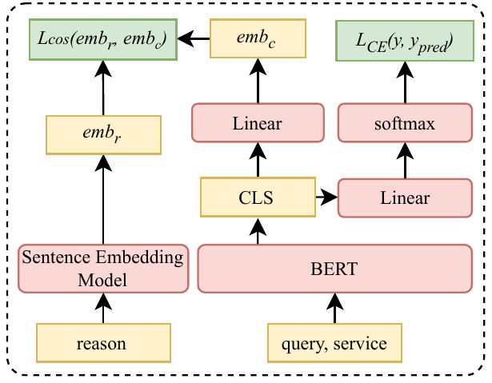
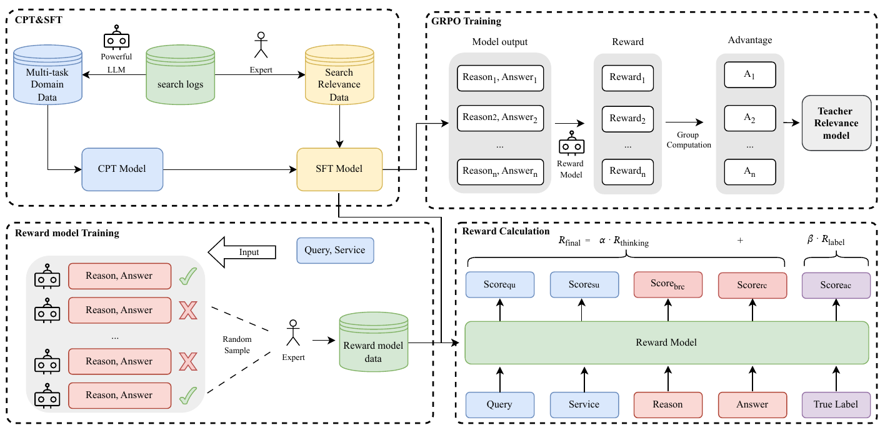
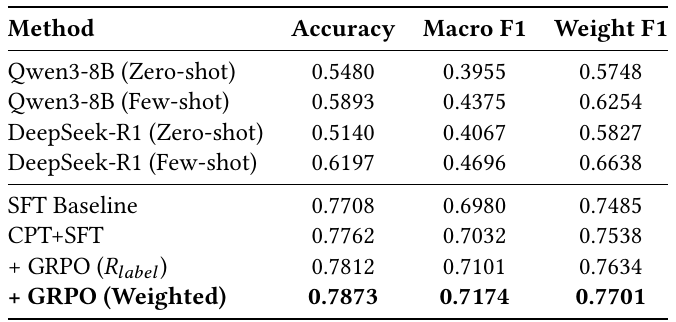
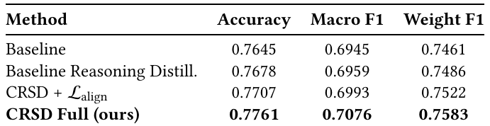
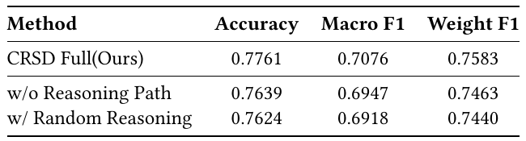
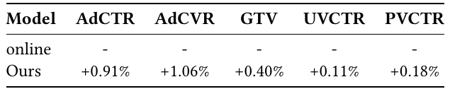

# From Reasoning LLMs to BERT: A Two-Stage Distillation Framework for Search Relevance

> **Venue**: WWW '26 (The ACM Web Conference 2026, April 13–17, Dubai, UAE) / arXiv 2510.11056v3
> **Authors**: Runze Xia\*, Yupeng Ji\*, Yuxi Zhou\*, Haodong Liu, Teng Zhang (Meituan, Shanghai), Piji Li† (Nanjing) — \* equal contribution, † corresponding
> **Platform**: Meituan 검색 광고 (search advertising) 시스템의 query–service relevance 모델

---

## 1. Background

### E-commerce Search Relevance의 현황
- 대규모 e-commerce 검색은 multi-stage 구조: retrieval(coarse ranking)이 후보를 뽑고, fine-grained ranking 단계의 **relevance model**이 각 `<query, service>` pair를 평가해 무관한 결과를 걸러낸다.
- relevance model은 하루 **수억 건**의 query–service 평가를 처리해야 하므로 높은 정확도와 함께 **millisecond 단위의 latency**를 만족해야 한다.
- Meituan은 relevance를 binary가 아닌 **3-class graded label**로 정의한다: `0-Irrelevant / 1-Moderate / 2-Relevant`.
- 주류 production 모델은 BERT 계열 encoder-only cross-encoder. 효율은 좋지만 world knowledge 기반 추론이 약하다.
  - 예: query "skin rejuvenation treatment" vs. service "facial hydrotherapy session" — 어휘는 전혀 다르지만 같은 종류의 뷰티 서비스. BERT는 이런 지식 기반 의미 등가성을 놓쳐 관련 결과를 잘못 제외한다.
- LLM(특히 reasoning LLM)은 world knowledge와 CoT 추론으로 이 문제를 풀 수 있고, label뿐 아니라 **reasoning path(판단 근거)** 까지 생성해 대규모 자동 annotation이 가능하다.

### 기존 방법의 한계
| 방법 | 문제점 |
|---|---|
| BM25 / DSSM | lexical matching 또는 click 기반 표현에 의존, 깊은 의미 relevance 포착 불가 |
| BERT cross-encoder (Nogueira & Cho 등) | 효율은 좋으나 일반 지식·추론 능력 부족, 학습 데이터 품질에 크게 의존 |
| LLM 직접 서빙 | 모델 크기·연산량 때문에 ms 단위 latency 충족 불가 |
| General-purpose LLM (zero/few-shot) | 플랫폼 고유 상품·시나리오·business rule 이해 부족, 플랫폼마다 relevance 기준이 달라 그대로 쓰면 성능 저조 (Accuracy 0.51~0.62) |
| 기존 LLM→BERT KD (label/score distillation) | 최종 출력 모방(output imitation)에 그치고 reasoning 과정의 논리 메커니즘은 전달 못 함 |
| Rationale-guided distillation (Agrawal et al., 2025) | 외부 sentence encoder로 reasoning을 임베딩해 BERT [CLS]와 정렬 → **이질적 semantic space** 간 정렬이라 신호가 간접적. 또한 reasoning LLM이 도메인에 맞지 않아 label 정확도가 낮음 |

---

## 2. Motivation

### 핵심 통찰 1: General-purpose reasoning LLM은 도메인 teacher로 부적합하다
- Qwen3-8B, DeepSeek-R1을 zero/few-shot으로 쓰면 Accuracy 0.5140~0.6197, Macro F1 0.3955~0.4696에 그친다 (Table 3 상단).
- 도메인 적응을 거친 teacher는 Macro F1 0.7174 → **few-shot DeepSeek-R1 대비 Macro F1 +24.8pp**.
- 결론: distillation의 상한은 teacher label 품질이므로, 먼저 **도메인 지식 주입 + 플랫폼 기준에 맞춘 reasoning 학습**이 필요하다.

### 핵심 통찰 2: Outcome-only reward는 희소하고 reward hacking에 취약하다
- 최종 정답 여부만 reward로 주면 (1) multi-step reasoning에 대한 신호가 너무 sparse하고, (2) 엉터리 reasoning으로 우연히 정답을 맞혀도 보상받는 **reward hacking**이 생긴다.
- teacher가 생성하는 reasoning path 자체를 student 학습에 쓸 것이므로, 정답뿐 아니라 **reasoning 품질**도 보상해야 한다 → multi-dimensional reward model.

### 핵심 통찰 3: Decoder-only LLM과 encoder-only BERT 사이의 Architectural Heterogeneity
- LLM hidden state와 BERT representation은 공간 자체가 달라 feature-level alignment가 어렵다.
- 기존 대안(Figure 2)처럼 외부 sentence embedding 모델(BGE-M3)로 reasoning을 인코딩해 BERT [CLS]에 cosine 정렬하면, **독립적으로 학습된 두 모델의 어긋난 공간**을 맞추는 것이라 표면적 모방에 머문다. 실제로 이 방법은 baseline 대비 Macro F1 +0.14pp에 불과 (0.6945 → 0.6959).
- 해법 아이디어: 정렬 대상을 **같은 BERT 모델**이 reasoning을 "봤을 때"의 표현으로 바꾸면 공간 불일치가 사라진다 → self-distillation.



> **Figure 2**: Baseline reasoning distillation. 외부 Sentence Embedding Model이 reason을 `emb_r`로 인코딩하고, BERT의 CLS를 Linear로 사영한 `emb_c`와 cosine loss(`L_cos`)로 정렬한다. 동시에 CLS → Linear → softmax로 분류 loss(`L_CE`)를 학습한다.

---

## 3. Contributions
1. **Domain-Adapted Reasoning LLM Pipeline**: Qwen3-8B에 CPT(도메인 지식 주입) → SFT(human-annotated reasoning 학습) → GRPO(multi-dimensional reward 기반 preference optimization)의 3단계를 적용해, 정확한 relevance label과 신뢰할 수 있는 reasoning path를 생성하는 teacher를 구축 (Macro F1 0.7174).
2. **Contrastive Reasoning Self-Distillation (CRSD)**: 같은 BERT를 `<query, service, reason>` 입력(teacher 설정)과 `<query, service>` 입력(student 설정)으로 돌려 둘의 [CLS]를 in-batch InfoNCE로 정렬. 이질적 아키텍처 정렬 문제를 회피하고, 추론 시에는 reasoning 없이 동작.
3. **Production 검증**: 6-layer BERT student가 teacher Macro F1의 **98.6%** 를 유지. Meituan 검색 광고 2주 A/B test에서 **AdCTR +0.91%, AdCVR +1.06%, GTV +0.40%**, 전문가 리뷰 기준 bad case rate **-30.5pp**. 실제 production 배포 완료.

---

## 4. Method

전체 프레임워크는 **Reasoning-then-Distilling** 2단계: (Stage 1) teacher reasoning LLM `M_t` 구축 → (Stage 2) CRSD로 lightweight student `M_s` 학습.



> **Figure 1**: Domain-adapted reasoning LLM의 3단계 학습 파이프라인. 좌상단: search log를 강력한 LLM으로 자동 annotation해 multi-task domain data를 만들고 CPT, 전문가 annotation 데이터로 SFT. 우상단: GRPO — 한 prompt에서 n개의 (Reason, Answer)를 샘플링하고 reward model 점수로 group-relative advantage 계산. 하단: 여러 LLM 출력을 전문가가 채점해 reward model을 학습하고, reward model은 5개 차원 점수(Score_qu, Score_su, Score_brc, Score_rc, Score_ac)를 출력해 `R_final = α·R_thinking + β·R_label`을 구성.

### 4.1 Stage 1-a: Domain-Adaptive Continued Pre-Training (CPT)
- Meituan online search log에서 데이터를 뽑아 여러 강력한 LLM으로 자동 annotation → **7개 task type, 약 700만 샘플**의 multi-task corpus.
- 논문 Table 1의 task 목록 (본문에는 "seven"이라 되어 있으나 표에는 6개만 나열됨):

| Task | Description |
|---|---|
| Query Understanding | query가 주어지면 사용자 의도를 기술 |
| Service Understanding | 플랫폼 service를 기술 |
| Query2service | query에 대해 클릭될 만한 service 생성 |
| Service2query | service에 대해 클릭될 만한 query 생성 |
| Pointwise Relevance | (query, service)의 relevance 정도 예측 |
| Pairwise Relevance | query와 service 2개 중 더 관련 있는 쪽 선택 |
| Setwise Relevance | query와 service 리스트 중 가장 관련 있는 것 선택 |

- 이 corpus로 open-source base LLM(Qwen3-8B)을 continued pre-training → `M_cpt`. 플랫폼 서비스와 사용자 행동에 대한 기반 지식을 갖춘 상태에서 reasoning을 가르치기 위함.

### 4.2 Stage 1-b: Supervised Fine-Tuning (SFT)
- 수만 건(실제 34,002건)의 `<query, service>` + **사람이 직접 작성한 reasoning chain** + 최종 answer로 구성된 데이터.
- `M_cpt`가 입력 `(q_i, s_i)`에서 reasoning `r_i`와 answer `a_i`를 함께 생성하도록 학습:

```
L_SFT = - Σ_{i=1..N} log P_θ(r_i, a_i | q_i, s_i)
```

- 결과 모델 `M_SFT`는 business rule을 준수하는 reasoning chain을 먼저 쓰고 답을 내는 능력을 갖춘다.

Reasoning 예시 (논문 Table 2):

| Field | Content |
|---|---|
| Query | Freshly-made cocktail |
| Service | Name: Jiu Xiang Homebar / Tags: cocktail set, single cocktail, whiskey coke bucket, all-you-can-drink, ... |
| Reasoning | "Freshly-made"는 현장 제조 의도를 암시. 'Homebar'는 'cocktail set'을 명시하고 'Bar' 카테고리에 속함. bar의 칵테일은 본질적으로 주문 즉시 제조되므로 'freshly-made' 요건 충족 → highly relevant |
| Label | 2 |

→ 키워드 매칭이 아닌, **카테고리 지식 + 상식 추론**이 필요한 판단이다.

### 4.3 Stage 1-c: Preference Optimization with a Multi-Dimensional Reward Model

#### Reward Model 구축
1. 다양한 크기의 여러 LLM으로 `<query, service>`에 대해 다양한 `<reason, answer>`를 생성 → 폭넓은 reasoning 스타일과 error mode를 샘플링.
2. 도메인 전문가가 각 출력을 **5개 차원, 각 0~4점**으로 채점:

| # | Dimension | 의미 | 구분 |
|---|---|---|---|
| 1 | Query Understanding (qu) | 사용자 검색 의도를 정확히 파악했는가 | process |
| 2 | Service Understanding (su) | service의 핵심 속성을 정확히 기술했는가 | process |
| 3 | Business Rule Compliance (brc) | 추론 중 플랫폼 business logic을 지켰는가 | process |
| 4 | Reasoning Consistency (rc) | reasoning이 최종 answer를 논리적으로 뒷받침하는가 | process |
| 5 | Answer Correctness (ac) | answer가 ground-truth label과 일치하는가 | outcome |

3. `M_RM`은 `M_SFT`에서 초기화하고, 입력 `<query, service, reason, answer with true_label>` → 5차원 점수 벡터를 출력하도록 SFT.
4. held-out test에서 전문가 평가와 **89.77% agreement**.

#### GRPO with Weighted Reward
- prompt `x = (q, s)`마다 policy가 N개(실험상 16개) 출력 `(r_i, a_i)`를 샘플링, `M_RM`으로 채점.
- process reward와 outcome reward를 분리(disentangle)해 가중합:

```
R_thinking = mean(Score_qu, Score_su, Score_brc, Score_rc)
R_label    = Score_ac
R_final    = α · R_thinking + β · R_label
```

- 표준 GRPO objective (group-relative advantage, PPO-style clipping, KL penalty):

```
J_GRPO(θ) = E_{(q,a)~D, {o_i}_{i=1..G} ~ π_θold(·|q)} [
    (1/G) Σ_{i=1..G} (1/|o_i|) Σ_{t=1..|o_i|}
        min( ρ_{i,t}(θ) · Â_{i,t},  clip(ρ_{i,t}(θ), 1-ε, 1+ε) · Â_{i,t} )
    - β · D_KL(π_θ || π_ref) ]

ρ_{i,t}(θ) = π_θ(o_{i,t} | q, o_{i,<t}) / π_θold(o_{i,t} | q, o_{i,<t})

Â_{i,t} = ( R_final^i - mean({R_final^j}_{j=1..G}) ) / std({R_final^j}_{j=1..G})
```

- 같은 문제에 대한 여러 reasoning path 사이에서 outcome-only보다 **dense하고 fine-grained한 신호**를 줘, "정답만 맞히는" 것이 아니라 "과정도 신뢰할 수 있는" reasoning으로 수렴시킨다.
- 참고: 논문은 α, β의 구체 값을 밝히지 않았다 (또한 KL 계수 β와 reward 가중치 β가 같은 기호를 쓴다).

### 4.4 Stage 2: Reasoning Distillation

teacher LLM으로 search log의 대규모 `<query, service>` pair에 label + reasoning path를 붙이고, 이를 production용 **6-layer Chinese BERT**에 증류한다.

#### Baseline Reasoning Distillation (비교 대상, Figure 2)
```
emb_r   = SentenceEncoder(reason)           # BGE-M3
cls     = BERT([CLS] q [SEP] s)
y_pred  = softmax(Linear(cls))
emb_c   = Linear'(cls)
L_total = L_CE(y, y_pred) + μ · L_cos(emb_r, emb_c)     # μ = 0.1
```
- 문제: `emb_r`과 `cls`는 독립적으로 학습된 서로 다른 모델의 공간 → 간접적인 cross-model 신호, 표면적 모방.

#### Contrastive Reasoning Self-Distillation (CRSD)


> **Figure 3**: 왼쪽: CRSD 프레임워크. 같은 BERT와 Classifier가 student 입력 `(query_i, service_i)`와 teacher 입력 `(query_i, service_i, reason_i)`를 각각 처리해 `CLS_i`, `CLSr_i`를 만들고, 두 설정 모두 true label에 대해 `L_sce`, `L_tce`로 학습하며 두 CLS를 `L_align`으로 정렬. 오른쪽: in-batch `L_align` — `CLS_i`와 `CLSr_i`(대각선)가 positive, 나머지 `CLSr_j`가 negative인 similarity matrix.

**핵심 가설**: 학습 중 reasoning-augmented 입력 `<query, service, reason>`을 처리하며 얻은 판단 패턴을 적절한 메커니즘으로 파라미터에 **내재화(internalize)** 하면, 추론 시 `<query, service>`만 주어져도 그 논리를 스스로 적용할 수 있다 — "explicit reliance on reasoning" → "implicit autonomous reasoning".

| 설정 | 입력 | max length | 출력 |
|---|---|---|---|
| **Teacher configuration** | `[CLS] query [SEP] service [SEP] reason` | 150 tokens | `cls_r` |
| **Student configuration** | `[CLS] query [SEP] service` | 64 tokens | `cls` |

두 설정은 **같은 BERT 파라미터와 같은 classifier**를 공유한다. 즉 teacher와 student가 같은 공간에 있으므로 heterogeneity 문제가 원천적으로 사라진다.

#### Training Objective

```
(1) Classification losses
    L_sce = CE(y_s, y)      # student config prediction vs. LLM label
    L_tce = CE(y_r, y)      # teacher config prediction vs. LLM label

(2) In-batch contrastive alignment (InfoNCE)
    L_align = - Σ_{i=1..N} log [ exp(sim(cls_i, cls_r_i) / τ)
                                 / Σ_{j=1..N} exp(sim(cls_i, cls_r_j) / τ) ]
    sim = cosine similarity, τ = temperature

(3) Total
    L_CRSD = L_sce + γ · L_tce + δ · L_align      # γ = δ = 0.01
```

각 loss의 역할:
- `L_sce`: 주 목표. 실제 서빙되는 student 설정의 분류 정확도.
- `L_tce`: teacher 설정도 분류를 잘하도록 해 `cls_r`이 "reasoning을 활용한 좋은 표현"이 되게 함. 가중치 γ를 작게 둬 긴 reasoning에 과도하게 의존하지 않게 한다.
- `L_align`: 가장 핵심. student 표현 `cls_i`를 자기 자신의 reasoning-augmented 표현 `cls_r_i`에 끌어당기고, 다른 샘플의 `cls_r_j`와는 밀어낸다. 단순 cosine/MSE 정렬과 달리 negative가 있어 **샘플별로 구별되는 reasoning 정보**를 담도록 강제한다.
- 주의: 수식상 gradient는 두 설정 모두로 흐르며, 논문은 teacher 쪽 stop-gradient 여부를 명시하지 않았다.

#### 학습 vs 추론
| 단계 | 과정 |
|---|---|
| **Stage 1 학습** | Qwen3-8B → CPT(7M) → SFT(34,002) → reward model 학습 → GRPO(11,634, weighted reward) → teacher LLM |
| **데이터 생성** | teacher LLM이 search log의 약 268만 `<query, service>` pair에 3-class label + reasoning path를 offline annotation |
| **Stage 2 학습** | 6-layer BERT를 teacher/student 두 입력 설정으로 동시에 forward, `L_sce + γ·L_tce + δ·L_align` 최적화 |
| **추론 (online)** | student 설정만 사용: `[CLS] query [SEP] service` (64 tokens) → 6-layer BERT → classifier. LLM도 reasoning도 불필요하며, 서빙 비용은 기존 6-layer BERT와 동일 |

---

## 5. Experiments

### 5.1 Dataset
| | LLM CPT 데이터 | LLM SFT 데이터 | LLM GRPO 데이터 | Distillation 데이터 | Evaluation 데이터 |
|---|---|---|---|---|---|
| 출처 | search log + 여러 LLM 자동 annotation | 사람 annotation (reasoning chain 포함) | 사람 annotation (SFT와 동일 분포, 상호 배타) | Meituan search log 샘플 + teacher LLM annotation | 사람 annotation, cross-validated |
| 언어 | Chinese | Chinese | Chinese | Chinese | Chinese |
| Label | 7 task multi-task | reasoning + 3-class | reasoning + 3-class | 3-class + reasoning path | 3-class |
| 규모 | 약 7M | 34,002 | 11,634 | 약 2.68M | 약 12,000 |

- distillation 데이터 label 분포: Irrelevant **16.2%**, Moderate **11.7%**, Relevant **72.1%** — 크게 불균형하므로 Macro F1이 가장 엄격한 지표.
- 평가 지표: Accuracy, Macro F1(클래스 비가중 평균), Weighted F1(support 가중 평균).

### 5.2 Implementation Details

**Teacher (Reasoning LLM)**

| 항목 | CPT | SFT | Reward Model | GRPO |
|---|---|---|---|---|
| Base | Qwen3-8B | `M_cpt` | `M_SFT`에서 초기화 | `M_SFT` |
| Batch size | 32 | 16 | 16 (SFT와 동일) | prompt 64 (mini-batch 32) |
| LR | 1e-5, cosine, warm-up 0.1 | 1e-5 | 1e-5 | 6e-7 |
| Epochs | 2 (최종 loss 약 0.6) | 3 | 3 | - |
| 기타 | AdamW, max length 2,048 | | | VERL 프레임워크, prompt당 16 response, reward model은 OOM 방지를 위해 vLLM으로 띄워 API 호출 |


**Student (BERT)**
- 6-layer Chinese BERT, PyTorch DDP, AdamW, constant LR 5e-5, effective batch size **4,096**, **5,000 steps**.
- 입력: student 64 tokens, teacher 설정 150 tokens.
- CRSD: γ = δ = **0.01**. Baseline Reasoning Distill.: BGE-M3, μ = 0.1.
- 비교 baseline: (1) **Baseline** = LLM label로만 BERT fine-tuning (standard data distillation), (2) **Baseline Reasoning Distill.** = Figure 2의 embedding-alignment 방식 (Agrawal et al. 계열).
- Teacher/Student 크기 차이: 8B decoder-only LLM → 6-layer encoder-only BERT. student 학습에서 "teacher"는 LLM이 아니라 **같은 BERT의 reasoning-augmented 설정**이라는 점이 핵심이며, LLM 지식은 label과 reasoning 텍스트를 통해서만 전달된다 (logit/hidden state 증류 없음).

### 5.3 Main Results

#### Teacher LLM (Table 3)



> **Table 3**: reasoning LLM과 general-purpose LLM baseline의 offline 결과. GRPO 변형은 CPT+SFT 위에 적용되며, label-only reward(`R_label`) 또는 제안한 weighted reward를 사용.

| 단계 변화 | Macro F1 변화 |
|---|---|
| DeepSeek-R1 few-shot → SFT Baseline | 0.4696 → 0.6980 (+22.8pp) |
| SFT → CPT+SFT | 0.6980 → 0.7032 (+0.52pp) |
| CPT+SFT → + GRPO(`R_label`) | 0.7032 → 0.7101 (+0.69pp) |
| + GRPO(`R_label`) → + GRPO(Weighted) | 0.7101 → **0.7174** (+0.73pp) |

- 가장 큰 도약은 도메인 데이터로 학습하는 것 자체(SFT). general LLM은 플랫폼 용어·business logic을 모른다.
- CPT, RL, reward 설계는 각각 0.5~0.7pp씩 누적 개선. 특히 **weighted reward가 label-only reward보다 +0.73pp** → reasoning 과정을 보상하면 최종 정답 정확도도 오른다는 주장의 근거.
- 최종 teacher: Accuracy 0.7873 / Macro F1 0.7174 / Weighted F1 0.7701.

#### Distillation (Table 4)



> **Table 4**: 증류 방법별 main result 및 ablation. 굵은 글씨가 최고 성능.

**각 행이 무엇인가**

네 방법 모두 같은 데이터로 학습한다. teacher LLM이 search log 약 268만 쌍에 붙인 label과 reasoning이다.

| Method | 학습 loss | 무엇을 하나 |
|---|---|---|
| **Baseline** | `CE(y_s, y)` | LLM이 붙인 label만으로 BERT를 학습한다. reasoning은 쓰지 않는다(standard data distillation) |
| **Baseline Reasoning Distill.** | `CE + 0.1 · L_cos(emb_r, emb_c)` | reasoning을 BGE-M3로 임베딩하고, BERT `[CLS]`를 linear 변환한 값이 이 임베딩에 가까워지게 한다(Figure 2). Agrawal et al.(COLING 2025)의 Reasoning Embedding 변형과 거의 같은 방식이다 |
| **CRSD + L_align** | `L_sce + δ · L_align` | 같은 BERT에 `<q, s, reason>`을 넣은 `cls_r`을 teacher로 삼고, `<q, s>`만 넣은 `cls`를 InfoNCE로 여기에 맞춘다. teacher 쪽 분류 loss `L_tce`는 **빠져 있다** |
| **CRSD Full** | `L_sce + γ · L_tce + δ · L_align` | 위 구성에 teacher 설정의 분류 loss `L_tce`를 더한다. γ = δ = 0.01이다 |

- 행 이름 "CRSD + L_align"은 "CRSD에 L_align을 더했다"가 아니라 **"분류 loss에 L_align만 더한 CRSD"** 라는 뜻이다. 즉 CRSD Full에서 `L_tce`를 뺀 ablation이다.
- 표는 위에서 아래로 장치를 하나씩 더하는 구성이다. 그래서 main result이면서 component ablation 역할도 한다.

| Method | Accuracy | Macro F1 | Weighted F1 | Macro F1 vs Baseline |
|---|---|---|---|---|
| Baseline | 0.7645 | 0.6945 | 0.7461 | - |
| Baseline Reasoning Distill. | 0.7678 | 0.6959 | 0.7486 | +0.14pp |
| CRSD + `L_align` | 0.7707 | 0.6993 | 0.7522 | +0.48pp |
| **CRSD Full** | **0.7761** | **0.7076** | **0.7583** | **+1.31pp** |

- CRSD Full은 Baseline 대비 Accuracy +1.16pp, Macro F1 +1.31pp, Weighted F1 +1.22pp. **McNemar's test p < 1e-8**로 통계적으로 유의.
- 기존 embedding-alignment 방식(+0.14pp)보다 CRSD가 약 9배 큰 개선 → "같은 모델 내부에서의 self-distillation"이 heterogeneity 문제를 실제로 우회함을 보여준다.
- `L_align`만 추가해도 +0.48pp, 여기에 `L_tce`(teacher 설정의 분류 학습)를 더하면 +0.83pp 추가. 즉 teacher 설정이 **분류에 유용한 방향으로** 학습되어야 정렬 대상이 의미 있어진다.
- 6-layer BERT가 teacher LLM Macro F1의 **98.6%** (0.7076 / 0.7174) 를 유지. Accuracy 기준으로도 0.7761 vs 0.7873.

### 5.4 Ablation Study

#### 컴포넌트 ablation
- 위 Table 4의 `CRSD + L_align` 행이 `L_tce` 제거 ablation에 해당: Macro F1 0.7076 → 0.6993 (-0.83pp).
- Stage 1에서는 CPT 제거(SFT Baseline, -0.52pp), RL 제거(CPT+SFT, -1.42pp), process reward 제거(`R_label`만, -0.73pp)가 각각 ablation 역할.

#### Reasoning Path 유효성 검증 (Table 5)



> **Table 5**: reasoning path의 중요성에 대한 ablation. "w/o Reasoning Path"는 teacher와 student 설정에 동일한 입력을 주고, "w/ Random Reasoning"은 teacher 설정에 distillation 데이터 전체에서 무작위로 뽑은 무관한 reasoning을 넣는다.

| Method | Macro F1 | vs CRSD Full | vs Baseline (0.6945) |
|---|---|---|---|
| CRSD Full | 0.7076 | - | +1.31pp |
| w/o Reasoning Path | 0.6947 | -1.29pp | +0.02pp (사실상 동일) |
| w/ Random Reasoning | 0.6918 | -1.58pp | **-0.27pp (baseline보다 나쁨)** |

- **w/o Reasoning Path**: 두 설정 입력이 같으면 contrastive loss가 trivial해지고 성능은 baseline으로 회귀 → 개선은 dual-branch 구조나 추가 loss 자체에서 나온 것이 아니다.
- **w/ Random Reasoning**: 입력 길이와 구조는 같지만 내용이 무관하면 오히려 baseline 이하 → 개선은 더 긴 입력이 아니라 **reasoning의 의미적 내용**에서 나온다. 잘못된 reasoning은 noise로 작용해 해롭다.
- 이는 템플릿이 요구하는 random reasoning 검증을 충족하며, 동시에 teacher reasoning 품질(Stage 1의 GRPO weighted reward)이 중요하다는 간접 근거이기도 하다.

### 5.5 Online A/B Test

- Meituan 검색 광고 시스템, **2주**. 실험군(CRSD 모델) 트래픽 **10%** vs 대조군(기존 6-layer BERT) **30%**.



> **Table 6**: online A/B test에서 baseline 대비 CRSD 모델의 상대 개선.

| Metric | 개선폭 |
|---|---|
| AdCTR | **+0.91%** |
| AdCVR | **+1.06%** |
| GTV | +0.40% |
| UVCTR | +0.11% |
| PVCTR | +0.18% |
| Bad case rate (전문가 리뷰, 5,521개 무작위 query의 top-5 결과) | **-30.5pp** |

- 광고 CTR/CVR의 개선은 query–ad relevance 향상이 사용자 engagement와 전환으로 이어진다는 근거이며, GTV 상승으로 연결.
- 기존 서빙 모델과 같은 6-layer BERT이므로 **추론 비용 증가 없이** 얻은 개선. 이후 production에 배포됨.
- 참고: online 지표의 유의성 수치(p-value, 신뢰구간)는 표에 제시되지 않았고, 논문은 "statistically significant"라고만 서술.

---

## 6. Key Takeaways
1. **Teacher 품질이 증류의 상한**: general reasoning LLM(DeepSeek-R1 few-shot, Macro F1 0.4696)은 도메인 relevance teacher로 쓸 수 없고, CPT→SFT→GRPO 도메인 적응으로 0.7174까지 끌어올려야 한다. 가장 큰 개선(+22.8pp)은 도메인 데이터 SFT에서 나온다.
2. **Process reward가 outcome도 개선**: reasoning 품질 4개 차원 + 정답 1개 차원을 분리한 weighted reward가 label-only reward보다 Macro F1 +0.73pp. reward model은 전문가와 89.77% 일치.
3. **Self-distillation으로 heterogeneity 우회**: LLM 표현을 직접 맞추지 않고, "같은 BERT가 reasoning을 봤을 때의 표현"을 teacher로 삼는다. 외부 encoder 정렬(+0.14pp) 대비 CRSD는 +1.31pp (p < 1e-8).
4. **Contrastive + teacher-side CE가 함께 필요**: `L_align`만으로 +0.48pp, `L_tce`를 더해야 +1.31pp. γ = δ = 0.01로 작은 가중치만으로도 충분.
5. **개선은 reasoning의 내용에서 나온다**: 동일 입력 시 baseline 회귀(0.6947), random reasoning 시 baseline 이하(0.6918). 구조나 입력 길이 효과가 아님을 깔끔하게 검증.
6. **서빙 비용 0 증가의 실전 성과**: 기존과 같은 6-layer BERT(64 tokens)로 teacher의 98.6% 성능, online AdCTR +0.91%, AdCVR +1.06%, GTV +0.40%, bad case -30.5pp. 다만 latency 수치, α/β/τ 값, teacher 쪽 stop-gradient 여부는 공개되지 않아 재현 시 직접 튜닝해야 한다.
