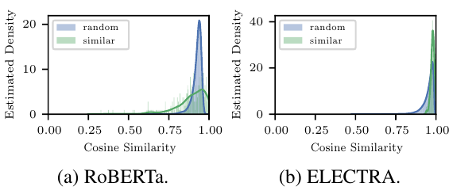
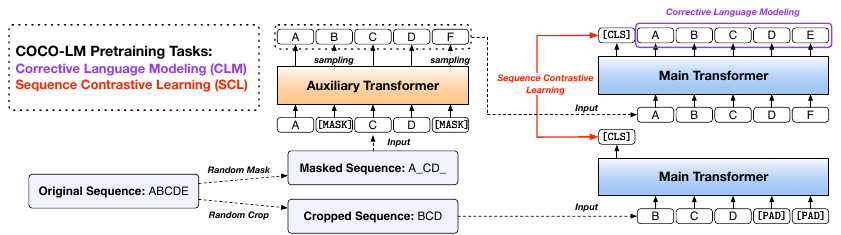
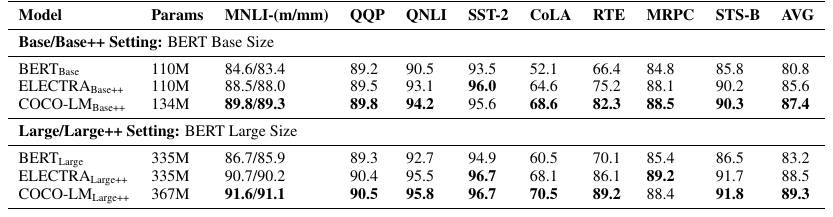
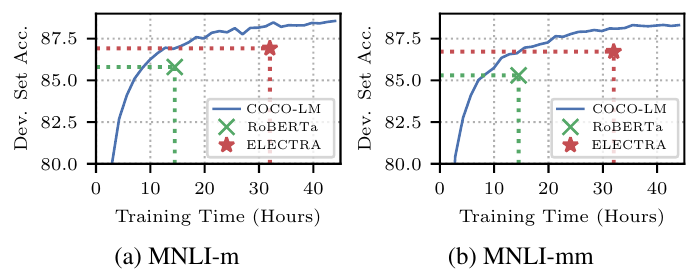
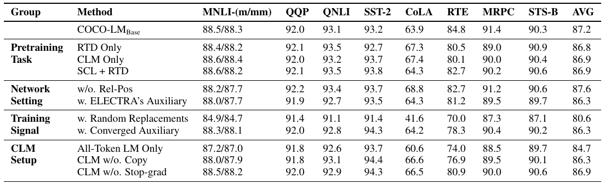
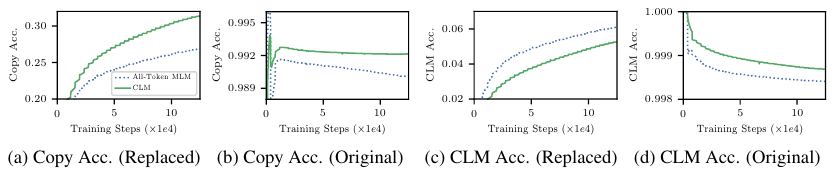
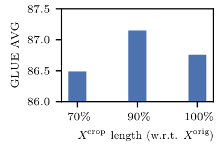
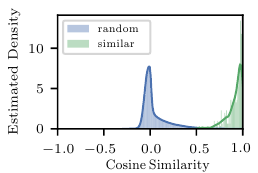
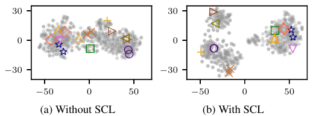
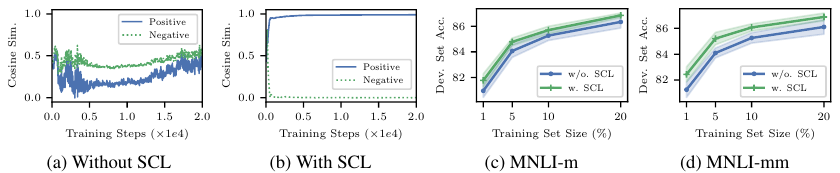

# COCO-LM: Correcting and Contrasting Text Sequences for Language Model Pretraining

> **Venue**: NeurIPS 2021 (35th Conference on Neural Information Processing Systems, Sydney, Australia)
> **Authors**: Yu Meng (UIUC, Microsoft 인턴), Chenyan Xiong, Payal Bajaj, Saurabh Tiwary, Paul Bennett, Jiawei Han (UIUC), Xia Song (Microsoft)
> **Code**: https://github.com/microsoft/COCO-LM

---

## 1. Background

### Encoder 사전학습(Pretraining)의 현황
- BERT 계열 bidirectional Transformer encoder는 보통 **Masked Language Modeling (MLM)** 으로 사전학습한다. 입력의 15%를 `[MASK]`로 가리고 원래 토큰을 맞추게 하는 방식이다.
- RoBERTa, BART, T5 모두 MLM이 가장 효과적인 사전학습 태스크라고 보고했다. Next Sentence Prediction 같은 sequence-level 태스크는 RoBERTa에서 효과가 없다고 판단해 빠졌다.
- **ELECTRA**는 다른 길을 택했다.
  - 작은 auxiliary Transformer("generator")가 MLM으로 가려진 토큰 자리에 그럴듯한 토큰을 채워 넣는다.
  - main Transformer("discriminator")는 각 토큰이 바뀌었는지 맞추는 **Replaced Token Detection (RTD)** 으로 학습한다.
  - MLM은 가려진 15% 위치에서만 loss가 나오지만, RTD는 **모든 토큰**에서 loss가 나와 학습 효율이 훨씬 높다.
  - 두 모델을 함께 학습하므로, generator가 점점 그럴듯한 교체 토큰을 만들면서 자연스럽게 커리큘럼(curriculum)이 생긴다.

### 기존 방법의 한계
| 방법 | 문제점 |
|---|---|
| MLM (BERT, RoBERTa) | 가려진 15% 토큰에서만 학습 신호가 나와 비효율적이다. 어느 정도 학습되면 대부분의 신호가 더 이상 정보를 주지 못한다. 모델 성능을 선형으로 올리려면 compute가 지수적으로 필요하다 |
| ELECTRA (RTD) | binary classification만 배우므로 **language modeling 능력이 없다**. 그래서 prompt-based learning처럼 label 단어를 생성해야 하는 용도에 쓸 수 없다. 원래 토큰에는 전부 같은 "non-replacement" label을 내도록 학습해 **표현 공간이 찌그러진다** |
| All-Token MLM (ELECTRA 변형) | 손상된 시퀀스 전체에서 원래 토큰을 맞추게 하면 LM 능력은 생기지만, ELECTRA 논문에서도 RTD보다 성능이 낮았다 |
| ELECTRIC | cloze model의 negative와 대조해 LM 능력을 되살렸지만, downstream 성능은 ELECTRA보다 낮다 |
| NSP / Sentence Ordering 등 sequence-level 태스크 | 두 문장의 co-occurrence를 분류하는 방식이다. RoBERTa 이후로는 효과가 없다고 보고 대부분 버렸다 |

---

## 2. Motivation

### 핵심 통찰 1: ELECTRA는 LM 능력을 잃는다
- RTD는 "바뀌었나 / 안 바뀌었나"만 맞추는 이진 분류다. 분류는 단순하고 안정적이지만 두 가지 대가가 있다.
  1. **LM 능력 부재**: prompt-based fine-tuning(LM-BFF 등)은 `[MASK]` 자리에 label 단어(예: "Yes"/"No")를 생성해야 한다. ELECTRA의 main Transformer에는 vocabulary 분포를 내는 head가 없으므로 이 방식을 아예 쓸 수 없다.
  2. **token-level 의미 학습 부족**: 이진 분류만으로는 token-level 태스크에 필요한 단어 의미를 충분히 배우지 못할 수 있다.

### 핵심 통찰 2: 사전학습 표현 공간이 좁은 원뿔(narrow cone)에 몰려 있다
- 사전학습 corpus에서 무작위로 뽑은 문장 쌍과, STS-B에서 가장 유사하다고 레이블된 문장 쌍의 `[CLS]` cosine similarity 분포를 비교했다.
  - **RoBERTa**: 무작위 쌍 대부분의 cosine이 **약 0.8**이다. 의미가 비슷한 쌍 상당수보다도 높다. 즉 **uniformity**(무관한 것끼리는 떨어져야 함)가 없다.
  - **ELECTRA**: 더 심하다. 무작위 쌍이든 유사 쌍이든 거의 전부 **약 0.9**에 몰려 있어서 둘을 전혀 구분하지 못한다.
- 저자들은 ELECTRA가 모든 원래 토큰에 같은 출력("non-replacement")을 내도록 학습하기 때문이라고 해석한다.
- 이런 비정상적인 표현 공간은 degeneration 위험을 높이고, sequence-level 응용(검색, 유사도 등)에 쓰려면 별도의 후처리나 fine-tuning(SimCSE, ANCE 등)이 필요해진다.



> **Figure 1**: 사전학습 모델의 `[CLS]` 임베딩으로 계산한 무작위 쌍(random)과 유사 쌍(similar)의 cosine similarity 분포. (a) RoBERTa는 무작위 쌍이 약 0.8에 몰려 유사 쌍과 겹친다. (b) ELECTRA는 두 분포가 모두 약 0.9 근처의 좁은 구간에 붙어 있다.

### 핵심 통찰 3: ELECTRA식 손상 시퀀스는 이미 좋은 "data augmentation"이다
- auxiliary model이 만든 손상 시퀀스 `X_MLM`은 원문의 일부 토큰을 그럴듯하게 바꾼 것이다. contrastive learning 관점에서 보면 이미 하나의 **augmented view**다.
- 여기에 원문을 조금 잘라낸 `X_crop`이라는 view를 하나 더 만들면, 추가 데이터 없이 positive pair를 만들 수 있다. 비전의 SimCLR에서 crop·rotation으로 view를 만드는 것과 같은 발상이다.

---

## 3. Contributions
1. **Corrective Language Modeling (CLM)**: 손상 시퀀스에서 바뀐 토큰을 **찾고(detect) 고치는(correct)** token-level 태스크다. RTD와 LM을 multi-task로 묶어 ELECTRA의 효율과 MLM의 LM 능력을 둘 다 얻는다.
2. **Sequence Contrastive Learning (SCL)**: 같은 원문에서 나온 `X_MLM`과 `X_crop`을 positive pair로 삼아 대조학습하는 sequence-level 태스크다. 표현 공간의 alignment와 uniformity를 사전학습 단계에서 바로잡는다.
3. **정확도와 효율**:
   - base, base++, large++ 세 설정 모두에서 GLUE 평균이 기존 SOTA보다 **약 1점 이상** 높다.
   - RoBERTa와 ELECTRA의 MNLI 정확도에 각각 **GPU 시간의 60%, 50%** 만으로 도달한다.
   - COCO-LM Large++(367M)는 **Megatron 3.9B**와 MNLI 정확도가 같다. 파라미터는 10% 미만이다.
4. **Prompt-based few-shot 학습 가능**: ELECTRA 계열이면서도 LM head가 있어 prompt-based fine-tuning에서 RoBERTa보다 높은 성능을 낸다(base++ MNLI-m 66.5 vs 60.1).

---

## 4. Method



> **Figure 2**: COCO-LM 전체 구조. auxiliary Transformer는 MLM으로 학습하고, 그 출력으로 만든 손상 시퀀스(A B C D F)를 main Transformer의 입력으로 쓴다. main Transformer는 이 시퀀스에서 원문(A B C D E)을 복원하는 CLM을 배운다. 동시에 원문을 잘라낸 시퀀스(B C D)와 짝지어 `[CLS]` 단위로 SCL을 배운다.

### 4.1 Preliminary: MLM과 ELECTRA

**MLM** (BERT): 15%를 `[MASK]`로 바꾸고 원래 토큰을 예측한다.

```
p_MLM(x | h_i) = exp(x^T h_i) / Σ_{x_t ∈ V} exp(x_t^T h_i)
L_MLM = E[ - Σ_{i ∈ M} log p_MLM(x_i^orig | h_i) ]        # M: masked positions
```

**ELECTRA**: auxiliary model이 masked 위치에 자신의 예측 분포에서 토큰을 샘플링해 채운다.

```
x_i^MLM ~ p_MLM(x | h_i)    if i ∈ M
x_i^MLM = x_i^orig          otherwise                       (1)

main Transformer: X_MLM → H → p_RTD( 1(x_i^MLM = x_i^orig) | h_i )   # sigmoid, BCE, 모든 토큰
```

- 무작위 교체보다 문맥상 그럴듯한 토큰이 들어가므로 판별이 더 어렵고, 그래서 학습 신호가 더 풍부하다.

### 4.2 Corrective Language Modeling (CLM)

main Transformer가 손상 시퀀스 `X_MLM`을 보고, **모든 위치에서 원래 토큰의 확률**을 낸다.

```
X_MLM --Main Transformer--> H --CLM Head--> p_CLM(x | h_i)
```

**CLM Head**는 All-Token MLM과 같은 구조다. 어휘(vocabulary) LM layer와 **copy mechanism**(이진 분류) layer를 합친 형태다.

```
p_LM(x_i | h_i) = 1(x_i = x_i^MLM) · p_copy(1 | h_i)
                + p_copy(0 | h_i) · exp(x_i^T h_i) / Σ_{x_t ∈ V} exp(x_t^T h_i)

p_copy(y_i | h_i) = exp(y_i · w_copy^T h_i) / ( exp(w_copy^T h_i) + 1 )
```

- `y_i = 1`: 입력 토큰이 원래 것이라 그대로 복사하면 된다.
- `y_i = 0`: 바뀐 토큰이라 vocabulary에서 다른 토큰으로 고쳐야 한다.
- 정리하면 "이 토큰은 원래 그대로인가?"를 먼저 판단한 뒤, 아니면 무엇으로 고칠지 vocabulary 분포를 쓰는 **gated mixture** 구조다.

**All-Token MLM과의 차이: 왜 multi-task로 학습하나**
- All-Token MLM은 copy mechanism을 LM loss 안에서만 **암묵적으로** 학습한다.
- 그런데 손상 시퀀스 위 LM은 극도로 **불균형한** 태스크다.
  - 전체 토큰의 92~93%는 입력을 그대로 복사하면 되는 원래 토큰이다.
  - auxiliary model이 바꾼 토큰은 **7~8%** 뿐이다. 게다가 그럴듯하게 바뀌었으므로 `[MASK]`보다 훨씬 속이기 쉽다.
- 이 상태에서 copy를 암묵적으로만 배우면 copy 정확도가 낮다. 그러면 LM head가 원래 토큰과 바뀐 토큰을 헷갈린다(5.4 Figure 8 참조).
- 그래서 CLM은 copy mechanism을 **RTD loss로 명시적으로** 학습한다.

#### Training Objective

```
L_copy = - E[ Σ_{i=1..n} ( 1(x_i^MLM = x_i^orig) · log p_copy(1 | h_i)
                         + 1(x_i^MLM ≠ x_i^orig) · log p_copy(0 | h_i) ) ]          (2)

L_LM   = - E[ Σ_{i ∈ M} log ( 1(x_i^MLM = x_i^orig) · sg(p_copy(1 | h_i))
                            + sg(p_copy(0 | h_i)) · exp(x_i^T h_i) / Σ_{x_t ∈ V} exp(x_t^T h_i) ) ]

L_CLM  = λ_copy · L_copy + L_LM
```

| 구성 요소 | 학습 위치 | 역할 |
|---|---|---|
| `L_copy` (= RTD) | **모든 토큰** | 바뀌었는지 판별. ELECTRA의 효율을 그대로 가져온다 |
| `L_LM` | **masked 위치 M만** | 원래 토큰 복원. MLM의 LM 능력을 가져온다 |
| `sg` (stop gradient) | `L_LM` 안의 `p_copy` | LM loss의 gradient가 copy 확률로 흘러가지 않게 막는다. 쉬운 분류는 `L_copy`로만 배우고, 그 결과를 어려운 LM 학습에 활용한다. 효과는 주로 **학습 안정성**(발산 방지)이다 |
| `λ_copy = 50` | | 이진 BCE loss가 30,000-way LM loss보다 훨씬 작아서 크게 가중한다 |

### 4.3 Sequence Contrastive Learning (SCL)

**Positive pair 구성**
- `X_MLM`: auxiliary model이 만든 손상 시퀀스. token-level 변형이다.
- `X_crop`: 원문 `X_orig`에서 연속된 구간을 무작위로 잘라낸 것. 길이는 원문의 **90%** 로 핵심 의미를 보존한다. sequence-level 변형이다.
- 같은 원문 `X_k^orig`에서 나온 `(X_k^MLM, X_k^crop)`이 positive pair다. 양방향으로 대칭 적용한다.
- **Negative**: 같은 batch 안의 나머지 모든 시퀀스(in-batch negatives).

```
B   = {(X_1^MLM, X_1^crop), ..., (X_N^MLM, X_N^crop)}
(X, X+) = (X_k^MLM, X_k^crop) 또는 (X_k^crop, X_k^MLM)
B-  = B \ {(X, X+)}

L_SCL = - E[ log ( exp(cos(s, s+)/τ) / ( exp(cos(s, s+)/τ) + Σ_{X- ∈ B-} exp(cos(s, s-)/τ) ) ) ]

      = - E[ cos(s, s+)/τ                                              ← alignment
             - log( exp(cos(s, s+)/τ) + Σ_{X- ∈ B-} exp(cos(s, s-)/τ) ) ]   ← uniformity    (3)

s = h_[CLS] (main Transformer),  τ = 1
```

- **첫 항(alignment)**: 같은 원문에서 나온 두 view를 가깝게 당긴다. token 교체와 cropping에 강건한 표현을 만든다.
- **둘째 항(uniformity)**: 무관한 시퀀스를 밀어내서, 무작위 쌍의 cosine이 낮아지게 한다. Wang & Isola(2020)의 alignment/uniformity 분해와 같은 해석이다.
- `X_MLM`과 `X_crop`을 맞추려면 token-level 교체와 sequence-level 잘림을 **동시에** 견뎌야 한다. 그래서 모델은 일부가 손상된 시퀀스로부터 원래 정보를 추론하도록 유도된다.

### 4.4 전체 Loss와 네트워크 구성

```
L_COCO-LM = L_MLM^Aux + L_CLM^Main + L_SCL^Main          (4)
```

- auxiliary와 main Transformer를 **함께** 학습한다. `λ_copy`를 빼면 모든 loss의 가중치는 같다.
- 입력 embedding과 LM head의 **token embedding은 두 Transformer가 공유**한다.

**Auxiliary Transformer 설계 (ELECTRA와 다른 점)**

| | ELECTRA generator | COCO-LM auxiliary |
|---|---|---|
| 크기를 줄이는 방식 | hidden 차원 축소 (예: 1/3, base는 12-layer × 256-hidden) | **layer 수 축소**, hidden은 main과 동일 |
| Base / Base++ | 12 layer, hidden 256 | **4 layer**, hidden 768 |
| Large++ | | **6 layer**, hidden 1024 |
| 샘플링 시 dropout | on | **off** (inference mode로 분포 계산) |

- main Transformer는 BERT/ELECTRA 표준 구조에 **T5 relative position encoding**만 더했다. 그래서 downstream pipeline에 거의 그대로 넣을 수 있다.

#### 학습 vs 추론
| 단계 | 과정 |
|---|---|
| **사전학습** | 원문 → (15% mask → auxiliary 샘플링 → `X_MLM`) + (90% crop → `X_crop`). main은 `X_MLM`에 CLM, `(X_MLM, X_crop)` 쌍에 SCL을 학습한다. SCL 때문에 `X_crop`에 대한 forward/backward가 한 번 더 필요하다 |
| **Fine-tuning / 추론** | auxiliary Transformer는 버린다. main Transformer만 BERT처럼 쓰므로 **downstream 비용은 BERT(+ relative position)와 같다**. prompt-based learning에는 CLM head를 LM head로 쓴다 |

---

## 5. Experiments

### 5.1 Dataset

**사전학습 corpus**

| | Base | Base++ | Large++ |
|---|---|---|---|
| Corpus | Wikipedia + BookCorpus | + OpenWebText, CC-News, STORIES | Base++와 동일 |
| 크기 | 16 GB | 160 GB | 160 GB |
| 학습 샘플 | 256M (125K step × batch 2048) | 4B (1.95M step × 2048) | 4B (1.95M step × 2048) |
| Vocabulary | 32,768 uncased BPE (TUPE와 동일) | 64,000 cased BPE (UniLMv2 전처리) | 64,000 cased BPE |
| Sequence length | 512 | 512 | 512 |

**Downstream 평가**

| Task | Train size | 유형 | Metric |
|---|---|---|---|
| MNLI | 393K | Inference | Accuracy |
| QQP | 364K | Similarity | Accuracy |
| QNLI | 108K | QA/Inference | Accuracy |
| SST-2 | 67K | Sentiment | Accuracy |
| CoLA | 8.5K | Acceptability | Matthews corr. |
| RTE | 2.5K | Inference | Accuracy |
| MRPC | 3.7K | Paraphrase | Accuracy |
| STS-B | 5.7K | Similarity | Spearman |
| SQuAD 2.0 | | Reading comprehension | EM / F1 |

### 5.2 Implementation Details
- **Main Transformer**:
  - Base, Base++: 12 layer, hidden 768, T5 relative position. 파라미터는 Base 110M이고, Base++는 64K vocab 때문에 134M이다.
  - Large++: 24 layer, hidden 1024. 파라미터 367M.
- **사전학습 하이퍼파라미터** (base / base++ / large++):
  - Peak LR 5e-4 / 2e-4 / 1e-4, warmup 10K step
  - Adam (β1, β2) = (0.9, 0.98), ε = 1e-6
  - clip norm 2.0, dropout 0.1, weight decay 0.01
  - Relative position bucket 32 / 64 / 128
- **태스크 설정**: MLM mask 15%, crop 10%(원문의 90% 유지), SCL temperature τ = 1, `λ_copy = 50`.
- **비용**: V100(32GB) 256장 기준으로 base는 약 20시간, base++는 2~3주, large++는 3~4주 걸린다.
- **공정 비교**: RoBERTa와 ELECTRA를 같은 설정으로 직접 다시 학습해 함께 보고한다(표의 "(Ours)"). Fine-tuning은 태스크별로 하이퍼파라미터를 탐색하고, GLUE와 SQuAD 모두 **5개 seed의 median**을 보고한다.
- 구현은 MC-BERT와 fairseq 위에 만들었다.

### 5.3 Main Results

**GLUE / SQuAD 2.0 dev set (Table 1 발췌)**

| Setting | Model | Params | MNLI-m/mm | RTE | MRPC | GLUE AVG | SQuAD EM / F1 |
|---|---|---|---|---|---|---|---|
| Base | RoBERTa (Ours) | 110M | 85.8 / 85.5 | 68.2 | 87.3 | 83.3 | 77.7 / 80.5 |
| Base | ELECTRA (Ours) | 110M | 86.9 / 86.7 | 75.1 | 88.2 | 85.5 | 79.7 / 82.6 |
| Base | TUPE | 110M | 86.2 / 86.2 | 73.6 | 89.9 | 84.9 | – |
| Base | **COCO-LM** | 110M | **88.5 / 88.3** | **84.8** | **91.4** | **87.2** | **82.4 / 85.2** |
| Base++ | UniLM V2 | 110M | 88.5 / – | 81.3 | 91.8 | 87.1 | 83.3 / 86.1 |
| Base++ | DeBERTa | 134M | 88.8 / 88.5 | – | – | – | 83.1 / 86.2 |
| Base++ | **COCO-LM** | 134M | **90.2 / 90.0** | **87.4** | 91.2 | **88.6** | **85.4 / 88.1** |
| Large++ | ELECTRA | 335M | 90.9 / – | 88.0 | 90.8 | 89.4 | 88.0 / 90.6 |
| Large++ | DeBERTa | 384M | 91.1 / 91.1 | – | – | – | 88.0 / 90.7 |
| Large++ | **COCO-LM** | 367M | **91.4 / 91.6** | **91.0** | **92.2** | **90.8** | **88.2 / 91.0** |
| – | Megatron 3.9B | 3.9B | 91.4 / 91.4 | – | – | – | 88.5 / 91.2 |

- **Base 설정**: 같은 조건으로 학습한 ELECTRA (Ours)보다 GLUE AVG가 **+1.7**(85.5 → 87.2), MNLI-m이 **+1.6** 높다. 가장 크게 오른 것은 소규모 태스크인 **RTE(+9.7)** 와 MRPC(+3.2)다.
- **Base++ 설정**: 기존 최고인 UniLM V2(87.1)보다 **+1.5** 높고, SQuAD 2.0 F1은 DeBERTa(86.2)보다 **+1.9** 높다.
- **Large++ 설정**: ELECTRA(89.4)보다 **+1.4** 높다. MNLI는 파라미터가 약 10.6배인 Megatron 3.9B와 같은 수준(91.4 / 91.6 vs 91.4 / 91.4)이다.
- **약점**: 모든 태스크에서 이기지는 않는다. Base에서 CoLA는 63.9로 ELECTRA (Ours)의 66.2보다 낮고, SST-2도 93.2로 RoBERTa (Ours)의 93.7보다 낮다.



> **Table 2**: GLUE test set(공식 leaderboard) 결과. 태스크마다 10개 seed로 탐색하고, dev에서 가장 좋은 모델로 test를 제출했다. ensemble이나 태스크별 트릭 없이 single-task fine-tuning만 썼다. COCO-LM은 Base++에서 AVG 87.4(ELECTRA 85.6), Large++에서 89.3(ELECTRA 88.5)이다.

**사전학습 효율**



> **Figure 3**: COCO-LM Base를 DGX-2 4대(V100 64장)로 학습할 때, 학습 시간(x축)에 따른 MNLI dev 정확도(y축). 같은 환경에서 학습을 마친 RoBERTa (Ours)와 ELECTRA (Ours)의 최종 시간과 정확도를 점으로 표시했다.

- SCL 때문에 step당 비용은 더 들지만(auxiliary 학습 + `X_crop` forward/backward), **GPU 시간 기준으로는 더 효율적**이다.
  - RoBERTa의 최종 정확도에는 약 **60%** 의 시간에 도달한다.
  - ELECTRA의 최종 정확도에는 약 **50%** 의 시간에 도달한다.
  - 같은 GPU 시간이면 MNLI가 1점 이상 높다.

### 5.4 Ablation Study



> **Table 3**: GLUE dev(base 설정) ablation. 구성 요소 하나를 제거(w/o.)하거나, 그것만 남기거나(Only), 다른 것으로 교체(w.)했을 때의 성능.

**(1) 사전학습 태스크**

| 구성 | MNLI-m/mm | GLUE AVG |
|---|---|---|
| RTD Only (shallow auxiliary를 쓴 ELECTRA) | 88.4 / 88.2 | 86.8 |
| CLM Only | 88.6 / 88.4 | 86.9 |
| SCL + RTD | 88.6 / 88.2 | 86.9 |
| **CLM + SCL (COCO-LM)** | 88.5 / 88.3 | **87.2** |

- 저자들이 구성한 backbone(얕고 넓은 auxiliary)만 써도 RTD Only가 86.8로 이미 ELECTRA (Ours) 85.5보다 높다. **개선분 상당 부분이 auxiliary 설계에서 나온다**는 점은 짚어 둘 만하다.
- CLM과 SCL이 각각 더하는 것은 +0.1 정도로 작고, 둘을 합쳐야 +0.4다. 효과를 보는 태스크도 다르다. CLM은 MNLI-mm에, SCL은 RTE(80.5 → 82.7)와 MRPC(89.0 → 90.2)에 효과가 있다.
- 반대로 CoLA는 RTD Only(67.3)가 COCO-LM(63.9)보다 높다. 문법 판단 태스크에서는 SCL이 오히려 손해일 수 있다.

**(2) 네트워크 설정**
- **Relative position을 빼면** AVG는 87.6으로 오히려 높아진다(주로 CoLA 68.8 덕분). 하지만 MNLI가 88.2 / 87.7로 떨어지므로 저자들은 relative position을 유지했다.
- **ELECTRA식 auxiliary**(12-layer, hidden 256)로 바꾸면 86.3(**-0.9**)이다. 얕고 넓은 auxiliary가 더 낫다.

**(3) 학습 신호 구성**
- **무작위 교체(random replacement)** 로 손상시키면 80.6(**-6.6**)으로 크게 무너진다. CoLA는 41.6까지 떨어진다. 그럴듯한 교체가 학습 신호의 핵심이다.
- **이미 수렴한 auxiliary**를 고정해서 쓰면 86.3(-0.9)이다. 두 모델을 함께 학습해야 auxiliary의 난이도가 점점 올라가는 커리큘럼 효과가 생긴다.

**(4) CLM 설정**

| 변형 | GLUE AVG | 해석 |
|---|---|---|
| All-Token LM Only (multi-task 없음) | 84.7 (**-2.5**) | copy를 암묵적으로만 배우면 크게 손해다 |
| CLM w/o. Copy | 86.3 (-0.9) | copy mechanism이 효과가 있다 |
| CLM w/o. Stop-grad | 86.9 (-0.3) | 수치 차이는 작다. 주된 효과는 학습 발산 방지다 |

**CLM의 copy mechanism 분석 (Figure 8)**



> **Figure 8**: 사전학습 step에 따른 copy 정확도와 LM 정확도. CLM(실선)과 All-Token MLM(점선)을 비교한다. Replaced는 auxiliary가 바꾼 토큰, Original은 원래 토큰 기준이다.

- (a)를 보면, 바뀐 토큰을 찾아내는 copy 정확도는 CLM이 약 0.31, All-Token MLM이 약 0.27로 CLM이 훨씬 높다. 원래 토큰에 대한 copy 정확도(b)도 CLM이 더 높다.
- (c)를 보면, 바뀐 토큰을 원래 토큰으로 고치는 LM 정확도는 All-Token MLM이 약간 높다. 대신 원래 토큰을 보존하는 쪽(d)은 CLM이 더 높다.
- 해석하면, CLM은 "고칠지 말지"를 명확하게 배워서 LM head의 혼동을 줄인다. 이것이 downstream 성능 차이(84.7 vs 87.2)로 이어진다.
- 또 하나 짚을 점이 있다. ELECTRA 논문에서 RTD가 All-Token MLM보다 좋았던 이유는, RTD가 사실상 **copy mechanism만 학습하는 것과 같기** 때문이다.

**SCL 분석: crop 비율 (Figure 4)**



> **Figure 4**: SCL positive pair를 만들 때 crop 비율에 따른 COCO-LM Base의 GLUE AVG. x축은 원문에서 남기는 비율이다(100% = cropping 없음).

- **90% 유지**가 가장 좋다(약 87.15).
- 100%(cropping 없음)는 약 86.75다. sequence-level 변형이 없으면 학습할 정보가 줄어든다.
- 70%는 약 86.5다. 너무 많이 잘라내면 의미가 바뀐다.
- SimCLR이나 SimCSE에서처럼 "단순하고 약한 augmentation이 가장 좋다"는 관찰과 같다.

**SCL 분석: 표현 공간 (Figure 5, 6, 7)**



> **Figure 5**: COCO-LM Base의 `[CLS]`로 계산한 무작위 쌍과 STS-B 최상위 유사 쌍의 cosine similarity 분포. 무작위 쌍은 **0 근처**, 유사 쌍은 **1 근처**에 몰려 두 분포가 명확히 분리된다. Figure 1(RoBERTa 약 0.8, ELECTRA 약 0.9에 집중)과 대조적이다.



> **Figure 6**: SCL 유무에 따른 시퀀스 표현의 t-SNE. STS-B에서 5점(가장 유사)으로 레이블된 쌍을 표시했고, 같은 모양이 같은 쌍이다. fine-tuning을 하지 않은 `[CLS]` 임베딩이다. SCL을 쓰면 유사 쌍이 더 가깝게 모인다. 평균 cosine은 SCL 없이 0.863, SCL로 **0.925**다.



> **Figure 7**: (a)(b) 사전학습 중 positive와 negative 쌍의 `[CLS]` 평균 cosine similarity. (c)(d) MNLI 학습 데이터의 일부만 써서 fine-tuning했을 때의 정확도. 오차 막대는 5회 실행의 max/min이다.

- **(a) 놀라운 관찰**: `X_MLM`과 `X_crop`은 토큰의 약 80%를 공유한다. 그런데도 SCL이 없으면 **positive 쌍의 cosine이 무작위 negative보다 낮다**. 사전학습만으로는 표현 공간이 저절로 정돈되지 않는다는 뜻이다.
- **(b)**: SCL을 쓰면 학습 초반에 positive는 약 1, negative는 약 0으로 빠르게 분리된다.
- **(c)(d) 적은 레이블 상황에서의 일반화**:
  - MNLI 레이블을 1%만 쓰면 SCL이 MNLI-m/mm을 **+0.8 / +0.5** 올린다. 레이블이 적을수록 SCL의 이득이 크다.
  - 레이블 **10%** 만 쓴 COCO-LM이 전체 레이블로 학습한 RoBERTa (Ours)와 비슷하다.
  - 레이블 **20%** 만 쓴 COCO-LM이 전체 레이블로 학습한 ELECTRA (Ours)와 비슷하다.

**CLM 분석: Prompt-based few-shot fine-tuning (Table 4)**

LM-BFF 설정(클래스당 16개 샘플, manual prompt + demonstration)으로 MNLI를 평가했다. 결과는 5개 split의 평균이고, 괄호는 표준편차다.

| Model | MNLI-m | MNLI-mm |
|---|---|---|
| RoBERTa Base++ | 60.1 (1.5) | 61.8 (1.2) |
| **COCO-LM Base++** | **66.5** (2.1) | **68.0** (2.3) |
| RoBERTa Large++ | 70.7 (1.3) | 72.0 (1.2) |
| **COCO-LM Large++** | **72.0** (1.5) | **73.3** (1.1) |

- Base++에서 RoBERTa보다 **+6.4 / +6.2**, Large++에서 **+1.3 / +1.3** 높다.
- 흥미로운 점: COCO-LM의 main Transformer는 사전학습 중에 `[MASK]` 토큰을 **한 번도 보지 못했다**. 입력은 늘 auxiliary가 채운 손상 시퀀스였다. 그런데도 prompt의 `[MASK]` 자리를 잘 예측한다.
- **ELECTRA와 CLM이 없는 COCO-LM 변형은 이 실험을 할 수 없다**. LM head가 없어 label 단어를 생성하지 못하기 때문이다. ELECTRA 계열 사전학습에 CLM이 필요한 이유를 보여 준다.

### 5.5 Online A/B Test
- 해당 없음. 학계의 사전학습 방법론 논문이며 서비스 배포 실험은 없다.

---

## 6. Key Takeaways
1. **ELECTRA의 효율과 MLM의 LM 능력을 동시에 얻는다**: CLM은 모든 토큰에서 RTD(copy) 신호를 받으면서 masked 위치에서는 원래 토큰을 복원한다. copy를 암묵적으로만 배우는 All-Token MLM(84.7)보다 GLUE AVG가 **+2.5** 높다.
2. **불균형 태스크는 쉬운 부분을 분리해 명시적으로 학습한다**: 바뀐 토큰은 7~8%뿐이라 LM loss 하나로는 copy 판단을 제대로 배우지 못한다. RTD loss를 따로 두고(`λ_copy = 50`) stop-gradient로 분리한 것이 핵심 설계다.
3. **사전학습 단계에서 표현 공간을 바로잡는다**: SCL을 쓰면 무작위 쌍의 cosine이 0 근처로, 유사 쌍은 1 근처로 분리된다. RoBERTa(약 0.8)와 ELECTRA(약 0.9)의 좁은 원뿔 문제를 별도 fine-tuning 없이 해결하고, 레이블이 1%일 때 MNLI를 +0.8 올린다.
4. **같은 성능을 절반의 compute로 얻는다**: ELECTRA의 MNLI 정확도에 GPU 시간 **50%**, RoBERTa에는 **60%** 로 도달한다. 367M 모델이 3.9B Megatron과 MNLI 정확도가 같다.
5. **Auxiliary 설계와 커리큘럼이 생각보다 중요하다**: 얕고 넓은 auxiliary만으로 RTD Only가 ELECTRA (Ours)보다 +1.3 높다. 무작위 교체는 -6.6, 이미 수렴한 auxiliary를 고정해 쓰면 -0.9다. CLM과 SCL이 더하는 몫(+0.4)보다 크므로 개선분의 출처를 나눠 볼 필요가 있다.
6. **실무 관점**: downstream 추론 비용은 BERT와 같다(auxiliary는 버림). `[CLS]` 표현 공간이 정돈되어 있어 **검색, 유사도, relevance처럼 sequence embedding을 바로 쓰는 응용**이나 레이블이 적은 도메인에 특히 유리하다. ELECTRA 계열이면서 prompt-based few-shot도 가능하다(Base++ MNLI-m +6.4 vs RoBERTa).
