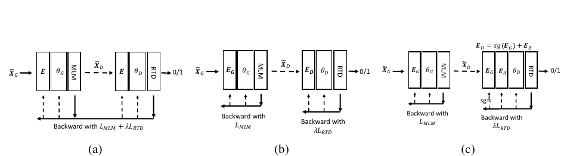
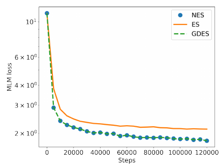

# DeBERTaV3: Improving DeBERTa using ELECTRA-Style Pre-Training with Gradient-Disentangled Embedding Sharing

> **Venue**: ICLR 2023 (arXiv 2111.09543v4, 2023-03-24)
> **Authors**: Pengcheng He, Jianfeng Gao, Weizhu Chen (Microsoft Azure AI, Microsoft Research)
> **Code / Models**: https://github.com/microsoft/DeBERTa

**한 줄 요약**: DeBERTa의 목적함수를 MLM에서 ELECTRA의 **RTD**(Replaced Token Detection)로 바꿨다. 그런데 ELECTRA처럼 generator와 discriminator가 토큰 임베딩을 그냥 공유하면 두 손실이 임베딩을 서로 반대 방향으로 잡아당긴다("tug-of-war"). 그래서 **discriminator 쪽 gradient만 generator 임베딩에 흐르지 않게 막는 GDES**(Gradient-Disentangled Embedding Sharing)를 제안했다. 그 결과 GLUE 91.37(large), MNLI-m 90.6(base)을 달성했고, 다국어판 mDeBERTaV3-base는 XNLI zero-shot에서 XLM-R-base보다 3.6점 높다.

---

## 1. Background

### 사전학습 언어모델의 효율 개선 흐름
- 파라미터를 키우는 것(T5, GPT-3)은 확실하지만 비싸다. **같은 크기에서 표현 품질을 올리는 방향**이 더 중요하다는 것이 출발점이다.
- 이 방향의 주요 성과는 두 갈래다.
  - **RoBERTa**: 더 큰 배치와 더 많은 데이터
  - **DeBERTa**: **Disentangled Attention(DA)**. 내용(content)과 상대 위치(position)를 별도 벡터로 표현하고, attention을 content-to-content, content-to-position, position-to-content로 나눠 계산한다. MLM 출력층에는 절대 위치를 넣는 enhanced mask decoder(EMD)를 쓴다. 1.5B 모델로 SuperGLUE에서 처음으로 사람 성능을 넘었다.
- 다른 갈래는 **ELECTRA의 RTD**다.
  - 작은 generator(MLM)가 마스크 위치를 그럴듯한 토큰으로 바꾼다.
  - discriminator는 **모든 토큰**에 대해 원본인지 바뀐 것인지 이진 분류한다.
  - 마스킹한 15%가 아니라 전체 토큰에서 학습 신호를 얻으므로 샘플 효율이 높다. COCO-LM, XLM-E, CodeBERT 등이 그 효과를 확인했다.

### 기존 방법의 한계
| 방법 | 문제점 |
|---|---|
| DeBERTa (MLM) | 손실을 마스킹된 15% 토큰에서만 얻어 샘플 효율이 낮다. `[MASK]` 토큰이 사전학습에만 있고 파인튜닝에는 없어서 생기는 불일치도 있다 |
| ELECTRA의 Embedding Sharing (ES) | generator의 MLM과 discriminator의 RTD가 **같은 임베딩 행렬을 서로 반대 방향으로 업데이트**한다. 수렴이 느려지고 임베딩 품질이 떨어진다 |
| 공유하지 않음 (NES) | 수렴은 빨라지지만 discriminator가 generator 임베딩의 의미 정보를 쓰지 못해 **파인튜닝 성능이 오히려 떨어진다** |

---

## 2. Motivation

### 핵심 통찰 1: MLM과 RTD는 임베딩에 대해 정반대를 원한다
- **MLM**(generator)은 의미가 비슷한 토큰을 맞혀야 하므로 **비슷한 토큰의 임베딩을 서로 끌어당긴다.**
- **RTD**(discriminator)는 "원래 토큰"과 "의미가 비슷한 가짜 토큰"을 구분해야 하므로 **비슷한 토큰의 임베딩을 서로 밀어낸다.**
- ES에서는 한 임베딩 행렬이 두 gradient의 합으로 업데이트된다.

```
g_E = ∂L_MLM/∂E + λ · ∂L_RTD/∂E        (λ = 50 in ELECTRA)
```

- 두 방향이 충돌하기 때문에 LR을 작게 잡거나 gradient clipping으로 조심스럽게 조절하면 수렴은 하지만 비효율적이다. 이것이 multitask learning의 **"tug-of-war"**다.

### 핵심 통찰 2: 그런데 공유 자체는 필요하다
- 가설 검증을 위해 임베딩을 공유하지 않는 **NES**를 만들었다. generator와 discriminator가 각자의 임베딩 E_G와 E_D를 갖고, 매 step 번갈아 업데이트한다.
- **임베딩 품질 (Table 1)**: 어휘의 10%를 샘플링해 모든 쌍의 평균 cosine 유사도를 쟀다.

| Word Embedding Sharing | E_G | E_D | E_Δ |
|---|---|---|---|
| ES | 0.02 | 0.02 | – |
| NES | **0.45** | 0.02 | – |
| GDES | **0.45** | **0.29** | 0.02 |

- NES에서는 generator 임베딩이 의미적으로 뭉치고(0.45), discriminator 임베딩은 흩어진다(0.02). **가설대로 두 목적함수가 반대 방향의 임베딩을 만든다.** ES는 두 힘이 섞여 0.02로 흩어진 쪽에 가깝다.
- 하지만 NES는 다운스트림 성능이 **ES보다 낮다**(MNLI-m 88.3 vs 88.8, SQuAD v2 F1 85.3 vs 86.3). generator 임베딩에 담긴 의미 정보가 discriminator에 도움이 된다는 ELECTRA의 주장이 맞다는 뜻이다.
- 결론적으로 **공유는 하되, gradient 충돌은 막아야 한다.**

---

## 3. Contributions
1. **DeBERTa + RTD**: DeBERTa의 MLM을 RTD로 바꾸는 것만으로 base 분석 설정에서 MNLI-m +2.5, SQuAD v2 F1 +3.8 (86.3 → 88.8, 82.5 → 86.3)을 얻었다.
2. **GDES (Gradient-Disentangled Embedding Sharing)**: stop-gradient 하나로 tug-of-war를 없애면서 공유의 이점은 유지한다. 수렴 속도는 NES와 같고, 다운스트림 성능은 세 방식 중 가장 높다. step당 계산 비용은 늘지 않는다.
3. **DeBERTaV3 large/base/small/xsmall**: 같은 구조의 기존 모델 대비 SOTA다. large는 GLUE 91.37로 DeBERTa보다 +1.37, ELECTRA보다 +1.91 높다.
4. **증류 없이 소형 모델 SOTA**: xsmall(22M backbone)이 MiniLMv2(증류 모델)보다 MNLI-m +1.2, SQuAD v2 F1 +2.5 높고, RoBERTa-base(86M)보다도 높다.
5. **mDeBERTaV3-base**: XLM-R의 1/3 step만 학습하고도 XNLI zero-shot 평균 79.8(+3.6), translate-train-all 82.2(+3.1)를 기록했다.

---

## 4. Method



> **Figure 1**: 세 가지 embedding sharing 방식. (a) **ES**: E, θ_G, θ_D를 `L_MLM + λL_RTD` 하나로 한 번에 역전파한다. (b) **NES**: 먼저 L_MLM으로 E_G와 θ_G를 업데이트하고, 그다음 λL_RTD로 E_D와 θ_D를 업데이트한다. (c) **GDES**: 먼저 L_MLM으로 E_G와 θ_G를 업데이트하고, 그다음 λL_RTD로 **E_Δ와 θ_D만** 업데이트한다. sg(stop gradient)가 discriminator 손실이 E_G를 건드리지 못하게 막는다.

### 4.1 DeBERTa 백본 (변경 없음)

DeBERTaV3의 discriminator 구조는 DeBERTa(v2)와 **같다.** 바뀐 것은 목적함수와 임베딩 공유 방식뿐이다.

- **Disentangled Attention**: 각 토큰을 content 벡터와 상대 위치 벡터 두 개로 표현한다. attention 점수는 content→content, content→position, position→content 항의 합으로 계산한다.
- **어휘**: DeBERTaV2와 같은 SentencePiece **128K** 어휘를 쓴다(BERT 30K, RoBERTa 50K보다 크다).
- **Enhanced Mask Decoder**: DeBERTa에서는 MLM 출력층에 절대 위치를 넣는 장치였다. V3에서 discriminator는 RTD 헤드로 바뀐다.

### 4.2 RTD 목적함수

```
Generator (MLM on 15% masked input X̃_G):
  L_MLM = E[ - Σ_{i ∈ C} log p_θG( x̃_i,G = x_i | X̃_G ) ]

Discriminator input (sample replacements from generator):
  x̃_i,D = sample ~ p_θG( · | X̃_G )   if i ∈ C
         = x_i                         otherwise

Discriminator (RTD, binary over ALL positions):
  L_RTD = E[ - Σ_i log p_θD( 1(x̃_i,D = x_i) | X̃_D, i ) ]

Total:  L = L_MLM + λ · L_RTD,   λ = 50
```

- **Generator 크기**: discriminator와 **폭은 같고 깊이는 절반**이다. 예를 들어 base discriminator가 12층이면 generator는 6층이다. ELECTRA는 폭을 1/4~1/3로 줄였지만, DeBERTaV3는 폭 대신 깊이를 줄였다. 임베딩을 공유하려면 폭이 같아야 하기 때문이다.
- 파인튜닝에는 **discriminator만** 쓴다.

### 4.3 GDES (Gradient-Disentangled Embedding Sharing)

discriminator의 임베딩을 **generator 임베딩 + 잔차**로 재매개화(re-parameterize)한다.

```
E_D = sg(E_G) + E_Δ          # sg = stop-gradient,  E_Δ initialized to 0

Per training step:
  1. Generator forward → sample replacements → build X̃_D
  2. Backward L_MLM        → update E_G, θ_G
  3. Discriminator forward on X̃_D (embeddings = sg(E_G) + E_Δ)
  4. Backward λ · L_RTD    → update E_Δ, θ_D   (no gradient into E_G)

After training:
  E_D := E_G + E_Δ   (merge, save as discriminator embedding)
```

**직관**
- E_G는 **MLM으로만** 학습되므로 의미적으로 일관된 임베딩이 된다(cos 0.45).
- discriminator는 그 의미 정보를 물려받은 채 시작한다. E_Δ는 0에서 시작하므로 처음에는 E_D = E_G다. 이후 RTD에 필요한 "구분하기 위한 차이"만 E_Δ로 학습한다.
- 결과적으로 E_D의 유사도는 0.29다. NES(0.02)보다 의미 정보를 많이 보존하고, generator와는 구분된다.
- E_Δ 자체의 유사도는 0.02로, RTD 쪽에서 학습된 성분은 서로 흩어지는 방향이다.

**세 방식 비교**

| | ES | NES | GDES |
|---|---|---|---|
| 임베딩 행렬 | 1개를 공유 | 2개 (독립) | E_G + 잔차 E_Δ |
| E_G에 흐르는 gradient | MLM + λ·RTD | MLM | **MLM만** |
| E_D 업데이트 | (E_G와 같음) | RTD | RTD → E_Δ |
| 업데이트 순서 | 한 번에 역전파 | 번갈아 | 번갈아 |
| 수렴 속도 | 느림 | 빠름 | **빠름 (NES와 같음)** |
| discriminator가 의미 정보 활용 | O | X | **O** |
| step당 비용 | 같음 | 같음 | 같음 |



> **Figure 2**: embedding sharing 방식별 generator의 MLM 학습 loss. **ES(주황)는 계속 높은 곳에 머물고**, NES(점)와 GDES(점선)는 겹친 채 더 낮게 수렴한다. GDES가 tug-of-war를 없애 NES 수준의 수렴 속도를 얻는다는 근거다.

#### 학습 vs 추론
| 단계 | 과정 |
|---|---|
| **학습** | generator(깊이 1/2)가 15% 마스크를 채운다. discriminator가 전체 토큰을 RTD로 판별한다. 임베딩은 GDES로 공유한다 |
| **저장** | E_D = E_G + E_Δ로 합쳐서 discriminator 체크포인트로 저장한다 |
| **파인튜닝·추론** | **discriminator만** 쓴다. 분류는 [CLS] 헤드, SQuAD·ReCoRD·NER은 토큰 단위 헤드를 붙인다. generator는 버린다 |

---

## 5. Experiments

### 5.1 Dataset

**사전학습 데이터 (Table 8)**

| 모델 | 데이터 | 규모 |
|---|---|---|
| §3 분석 실험 (DeBERTaV3-base-analysis, ELECTRA 재현) | Wikipedia + BookCorpus | 16GB |
| DeBERTaV3 (large/base/small/xsmall) | Wiki + Book, OpenWebText, Stories, CC-News (RoBERTa, DeBERTa-1.5B와 같음) | **160GB** |
| mDeBERTaV3-base | CC100 (XLM-R와 같음), 병렬 데이터 없음 | 2.5TB |

**평가 벤치마크 (Table 7)**

| | GLUE | QA | NER | 다국어 |
|---|---|---|---|---|
| 과제 | CoLA, SST-2, MNLI, RTE, QQP, MRPC, QNLI, STS-B | SQuAD v1.1/v2.0, ReCoRD, RACE, SWAG | CoNLL-2003 | XNLI (15개 언어) |
| 지표 | Acc, MCC, Pearson | EM/F1, Acc | F1 | Acc |
| 평가 | dev set | dev set | dev set | test set |

### 5.2 Implementation Details

**사전학습 하이퍼파라미터 (Table 10)**

| Hyper-parameter | V3 large | V3 base | V3 small | mDeBERTaV3 base | V3 base-analysis |
|---|---|---|---|---|---|
| Layers | 24 | 12 | 6 | 12 | 12 |
| Hidden / FFN | 1024 / 4096 | 768 / 3072 | 768 / 3072 | 768 / 3072 | 768 / 3072 |
| Attention Heads | 12 | 12 | 12 | 12 | 12 |
| Learning Rate | 3e-4 | 6e-4 | 6e-4 | 6e-4 | 5e-4 |
| Batch Size | 8k | 8k | 8k | 8k | 2k |
| Max Steps | 500k | 500k | 500k | 500k | 125k |
| Warmup | 10k | 10k | 10k | 10k | 10k |
| Weight Decay | 0.01 | 0.01 | 0.01 | 0.01 | 0.01 |
| Adam β2 / ε | 0.98 / 1e-6 | 0.98 / 1e-6 | 0.98 / 1e-6 | 0.98 / 1e-6 | 0.999 / 1e-6 |
| LR Decay / Grad Clip | Linear / 1.0 | Linear / 1.0 | Linear / 1.0 | Linear / 1.0 | Linear / 1.0 |

**원문 자체의 불일치**
- 본문 §4.1은 base와 small의 LR을 **5e-4**라고 하는데, Table 10은 **6e-4**다.
- Table 10은 large의 attention head를 12로 적었지만, 본문은 "DeBERTa-large와 같은 discriminator"라고 한다. DeBERTa-large의 head는 보통 16이다.

**그 밖의 설정**
- xsmall은 12층, hidden 384, 6 heads이고 Table 10에는 없다.
- generator는 모두 폭이 같고 깊이가 절반이며, 마스킹은 15%, λ = 50이다.
- 파인튜닝(Table 11)은 과제별로 dropout, warmup, LR, batch를 탐색했다. 최대 10 epoch이고, 한 번 돌리는 데 DGX-2 노드 1대로 1~2시간 걸린다. 모델 선택은 dev set으로 했다.

### 5.3 Main Results

#### (1) DeBERTa + RTD + GDES 분석 (base, Wiki+Book, 125k steps, Table 2)

| Model | MNLI-m/mm | SQuAD v2.0 F1/EM |
|---|---|---|
| BERT-base | 84.3/84.7 | 76.3/73.7 |
| ELECTRA-base | 85.8/– | –/– |
| DeBERTa-base (MLM) | 86.3/86.2 | 82.5/79.3 |
| DeBERTa+RTD, **ES** | 88.8/88.4 | 86.3/83.5 |
| DeBERTa+RTD, **NES** | 88.3/87.9 | 85.3/82.7 |
| DeBERTa+RTD, **GDES** | **89.3/89.0** | **87.2/84.5** |

- **MLM → RTD**: +2.5 MNLI, +3.8 SQuAD F1. 목적함수만 바꿔서 얻은 가장 큰 이득이다.
- **ES → GDES**: +0.5 MNLI, +0.9 F1을 추가로 얻는다.
- **NES는 ES보다 낮다**: 공유를 끊으면 손해라는 것이 확인된다.

#### (2) Large 모델: GLUE dev (Table 3)

| Model | CoLA | QQP | MNLI-m/mm | SST-2 | STS-B | QNLI | RTE | MRPC | Avg |
|---|---|---|---|---|---|---|---|---|---|
| BERT-large | 60.6 | 91.3 | 86.6/– | 93.2 | 90.0 | 92.3 | 70.4 | 88.0 | 84.05 |
| RoBERTa-large | 68.0 | 92.2 | 90.2/90.2 | 96.4 | 92.4 | 93.9 | 86.6 | 90.9 | 88.82 |
| XLNet-large | 69.0 | 92.3 | 90.8/90.8 | **97.0** | 92.5 | 94.9 | 85.9 | 90.8 | 89.15 |
| ELECTRA-large | 69.1 | 92.4 | 90.9/– | 96.9 | 92.6 | 95.0 | 88.0 | 90.8 | 89.46 |
| DeBERTa-large | 70.5 | 92.3 | 91.1/91.1 | 96.8 | 92.8 | 95.3 | 88.3 | 91.9 | 90.00 |
| **DeBERTaV3-large** | **75.3** | **93.0** | **91.8/91.9** | 96.9 | **93.0** | **96.0** | **92.7** | **92.2** | **91.37** |

- 평균이 기존 최고보다 +1.37 높다. 특히 **데이터가 적은 과제에서 크게 오른다**: RTE +4.4(2.5k 학습 예제), CoLA +4.8(8.5k). 저자는 이를 데이터 효율과 일반화가 좋아진 근거로 본다.
- SST-2, STS-B, MRPC는 이미 포화에 가까워 +0.3 미만이다.

#### (3) Large 모델: QA, NLI, NER (Table 4)

| Model | MNLI-m/mm | SQuAD v2.0 F1/EM | RACE | ReCoRD F1/EM | SWAG | NER F1 |
|---|---|---|---|---|---|---|
| RoBERTa-large | 90.2/90.2 | 89.4/86.5 | 83.2 | 90.6/90.0 | 89.9 | 93.4 |
| XLNet-large | 90.8/90.8 | 90.6/87.9 | 85.4 | – | – | – |
| Megatron-336M | 89.7/90.0 | 88.1/84.8 | 83.0 | – | – | – |
| DeBERTa-large | 91.1/91.1 | 90.7/88.0 | 86.8 | 91.4/91.0 | 90.8 | 93.8 |
| **DeBERTaV3-large** | **91.8/91.9** | **91.5/89.0** | **89.2** | **92.3/91.8** | **93.4** | **93.9** |
| *(더 큰 모델)* | | | | | | |
| ALBERT-xxlarge | 90.8/– | 90.2/87.4 | 86.5 | – | – | – |
| Megatron-1.3B | 90.9/91.0 | 90.2/87.1 | 87.3 | – | – | – |
| Megatron-3.9B | 91.4/91.4 | 91.2/88.5 | 89.5 | – | – | – |
| DeBERTa-1.5B | 91.7/91.9 | 92.2/89.7 | 90.8 | 94.5/94.0 | 92.3 | – |

- 같은 크기에서 6개 과제 모두 1위다. **추론과 상식 과제에서 크게 오른다**: RACE +2.4, SWAG +2.6.
- 크기가 4~10배인 모델과 비교해도 대등하다.
  - ALBERT-xxlarge(연산 약 4배)와 Megatron-1.3B보다 모든 과제에서 높다.
  - Megatron-3.9B보다 MNLI와 SQuAD에서 높다.
  - DeBERTa-1.5B와는 MNLI에서 대등하고, SWAG에서는 앞선다(93.4 vs 92.3).

#### (4) Base 이하 모델 (Table 5)

| Model | Vocab (K) | Backbone #Params (M) | MNLI-m/mm | SQuAD v2.0 F1/EM |
|---|---|---|---|---|
| *Base: 12층, 768, 12 heads* | | | | |
| BERT-base | 30 | 86 | 84.3/84.7 | 76.3/73.7 |
| RoBERTa-base | 50 | 86 | 87.6/– | 83.7/80.5 |
| XLNet-base | 32 | 92 | 86.8/– | –/80.2 |
| ELECTRA-base | 30 | 86 | 88.8/– | –/80.5 |
| DeBERTa-base | 50 | 100 | 88.8/88.5 | 86.2/83.1 |
| **DeBERTaV3-base** | 128 | 86 | **90.6/90.7** | **88.4/85.4** |
| *Small: 6층, 768, 12 heads* | | | | |
| TinyBERT-small (KD) | 30 | 44 | 84.5/– | 77.7/– |
| MiniLMv2-small (KD) | 30 | 44 | 87.0/– | 81.6/– |
| BERT-small | 30 | 44 | 81.8/– | 73.2/– |
| **DeBERTaV3-small** | 128 | 44 | **88.2/87.9** | **82.9/80.4** |
| *XSmall: 12층, 384, 6 heads* | | | | |
| MiniLMv2-xsmall (KD) | 30 | 22 | 86.9/– | 82.3/– |
| **DeBERTaV3-xsmall** | 128 | 22 | **88.1/88.3** | **84.8/82.0** |

- **base에서는 이득이 large보다 크다**: MNLI-m은 ELECTRA·DeBERTa-base 대비 +1.8, SQuAD v2 EM은 ELECTRA 대비 +4.9, DeBERTa 대비 +2.3이다.
- **증류 없이 증류 모델을 이긴다**: small은 MiniLMv2-small보다 +1.2 / +1.3, xsmall은 MiniLMv2-xsmall보다 +1.2 / +2.5 높다.
- **깊고 얇은 쪽이 낫다**: xsmall(12층×384, 22M)은 small(6층×768, 44M)과 파라미터가 절반인데 성능이 비슷하거나 더 높다(SQuAD F1 84.8 vs 82.9). backbone 22M으로 RoBERTa-base와 XLNet-base(86~92M)보다 높다.
- **표를 읽을 때 주의할 점**: "Backbone #Params"는 **임베딩을 뺀** 값이다. DeBERTaV3는 vocab이 128K라 임베딩만 base 기준 약 98M(128K × 768)이고, 전체 파라미터는 BERT-base보다 훨씬 크다. vocab 차이가 성능 비교에 섞여 있다는 점을 감안해야 한다.

#### (5) 다국어: mDeBERTaV3-base, XNLI test (Table 6)

| Model | en | fr | de | ru | zh | ar | hi | sw | ur | Avg (15개 언어) |
|---|---|---|---|---|---|---|---|---|---|---|
| *Cross-lingual transfer (영어로만 파인튜닝)* | | | | | | | | | | |
| XLM | 83.2 | 76.7 | 74.0 | 72.7 | 72.5 | 68.6 | 65.6 | 58.2 | 62.4 | 70.7 |
| mT5-base | 84.7 | 79.1 | 77.4 | 77.1 | 74.1 | 73.3 | 70.8 | 69.4 | 68.3 | 75.4 |
| XLM-R-base | 85.8 | 79.7 | 78.7 | 78.1 | 76.7 | 73.8 | 72.4 | 66.5 | 68.3 | 76.2 |
| **mDeBERTaV3-base** | **88.2** | **82.6** | **82.7** | **80.8** | **79.5** | **78.5** | **75.9** | **73.9** | **72.4** | **79.8** |
| *Translate-train-all* | | | | | | | | | | |
| XLM-R-base | 85.4 | 81.4 | 80.3 | 79.7 | 80.2 | 77.3 | 76.1 | 73.1 | 73.0 | 79.1 |
| **mDeBERTaV3-base** | **88.9** | **84.4** | **84.8** | **83.2** | **82.6** | **81.6** | **79.3** | **77.3** | **73.6** | **82.2** |

(대표 9개 언어만 발췌했고, 평균은 15개 언어 기준이다.)

- mT5의 SentencePiece 250K vocab을 쓰고, XLM-R의 1/3인 500k step만 학습했다. 병렬 데이터도 쓰지 않았다.
- 그런데도 **모든 언어에서** XLM-R-base보다 높다. 평균은 +3.6(zero-shot), +3.1(translate-train)이다. 자원이 적은 언어에서 특히 크게 오른다(sw +7.4, ar +4.7).

### 5.4 Ablation Study

#### GDES의 일반성: ELECTRA 원본 구조에 적용 (Table 9)
DeBERTa 백본이 아닌 **ELECTRA를 재현한 모델**(discriminator 12층, generator 6층, Wiki+Book, 125k steps)에 같은 비교를 했다.

| ELECTRA-base | MNLI-m/mm | SQuAD v2.0 F1/EM |
|---|---|---|
| 원 논문 | 85.8/– | –/– |
| 재현 (ES) | 87.9/87.4 | 85.0/82.3 |
| NES | 86.3/85.6 | 81.7/78.9 |
| **GDES** | **88.3/87.8** | **85.9/83.1** |

- 같은 패턴이 반복된다. 결과는 GDES > ES > NES이고, GDES의 이득(+0.4 / +0.9)은 백본과 무관하다. **RTD 계열 모델이라면 어디든 붙일 수 있는 개선**이다.
- NES의 손실은 ELECTRA에서 더 크다(MNLI −1.6, F1 −3.3). DeBERTa(−0.5, −1.0)보다 크다.

#### 구성 요소별 기여 (Table 2를 다시 읽기)
| 변경 | MNLI-m | SQuAD v2 F1 |
|---|---|---|
| DeBERTa (MLM) | 86.3 | 82.5 |
| + RTD (ES) | 88.8 (+2.5) | 86.3 (+3.8) |
| + ES를 GDES로 교체 | 89.3 (+0.5) | 87.2 (+0.9) |

이득의 대부분은 RTD에서 나오고, GDES는 그 위에 추가로 0.5~0.9를 얹는다. 둘 다 계산 비용은 늘리지 않는다.

---

## 6. Key Takeaways
1. **MLM → RTD 전환이 가장 큰 이득이다**: 같은 DeBERTa 백본에서 MNLI-m +2.5, SQuAD v2 F1 +3.8을 얻는다. 15% 마스크 위치가 아니라 **모든 토큰에서 학습 신호**를 얻기 때문에 샘플 효율이 높다.
2. **Generator와 discriminator가 임베딩을 공유하면 tug-of-war가 생긴다**: MLM은 비슷한 토큰을 끌어당기고 RTD는 밀어낸다. 공유하지 않으면(NES) generator 임베딩은 cos 0.45, discriminator 임베딩은 0.02로 정반대가 된다. ES의 MLM loss는 끝까지 높게 머문다(Figure 2).
3. **GDES는 stop-gradient 하나로 해결한다**: E_D = sg(E_G) + E_Δ로 두면 의미 정보는 물려받고 충돌은 차단된다. ES보다 MNLI +0.5, F1 +0.9 높고, ELECTRA에 적용해도 같은 효과가 나며, 추가 비용이 없다.
4. **작은 모델에서 특히 효율적이다**: xsmall(backbone 22M)이 증류 없이 MiniLMv2를 이기고, RoBERTa-base(86M)보다도 높다(MNLI-m 88.1 vs 87.6). 같은 파라미터라면 **깊고 얇은** 구조가 낫다. 다만 128K vocab 때문에 임베딩까지 포함한 전체 크기는 경쟁 모델보다 크다.
5. **다국어로 확장하면 이득이 더 크다**: mDeBERTaV3-base는 XLM-R의 1/3 학습량으로 XNLI zero-shot 79.8(+3.6)을 기록했고, 저자원 언어에서 +5~7점 오른다.
6. **실무 시사점, 그리고 RTD 계열의 그늘**: DeBERTaV3는 출시 이후 오랫동안 분류·NLI 파인튜닝의 기본 백본이었다. 하지만 이 논문이 평가한 것은 GLUE, SQuAD, NER처럼 **파인튜닝 기반 NLU**뿐이다. 한국어 모델 사례에서는 다른 그림이 나온다.
   - 카카오뱅크는 KF-DeBERTa를 만들 때 v3(RTD)를 시험했지만, **KLUE-RE, WoS, 검색에서 성능이 크게 떨어져** v2(MLM)를 택했다([한국어 encoder 비교](../2026-10-28/korean_encoder_models_deep_dive.md)).
   - 순수 RTD 모델인 KoELECTRA도 KLUE-RE와 MRC에서 약하다.
   - 반면 RTD에 원 토큰 복원(CLM)과 대조학습(SCL)을 더한 COCO-LM 계열(Kiwi COCO-LM)은 이 약점을 메운다.
   - **RTD의 샘플 효율 이점은 분류형 과제에서 확실하지만, 검색·임베딩·관계 추출에서는 MLM이나 보조 목적함수가 필요할 수 있다.** [Ettin](./ettin_seq_vs_seq.md)이 ModernBERT 레시피에서 RTD가 아닌 MLM을 그대로 쓴 것도 같은 맥락에서 읽을 수 있다(이 연결은 요약자의 해석이며, Ettin 논문이 직접 그렇게 말하지는 않는다).
