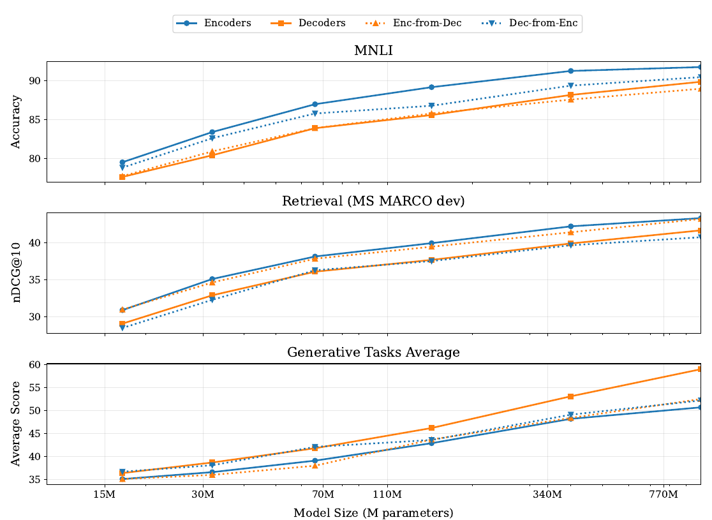
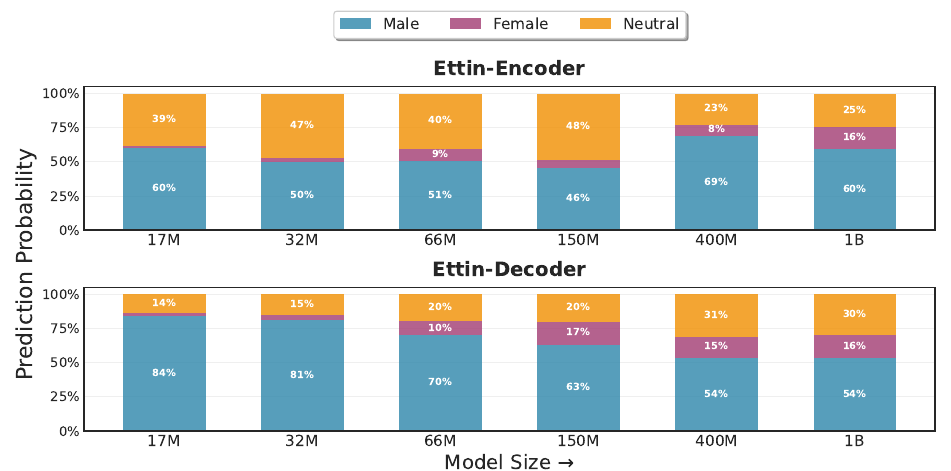

# Seq vs Seq: An Open Suite of Paired Encoders and Decoders (Ettin)

> **Venue**: ICLR 2026 (arXiv 2507.11412v2, 2026-03-12)
> **Authors**: Orion Weller, Kathryn Ricci, Marc Marone, Antoine Chaffin, Dawn Lawrie, Benjamin Van Durme (Johns Hopkins University, LightOn)
> **Code / Models / Data**: https://github.com/JHU-CLSP/ettin-encoder-vs-decoder

**한 줄 요약**: 데이터, 아키텍처, 학습 레시피를 **완전히 똑같이 맞추고** 바꾼 것은 attention 방향(양방향 vs causal)과 목적함수(MLM vs CLM)뿐인 encoder·decoder 5쌍(17M~1B, 최대 2T 토큰)을 공개했다. 이를 통해 "encoder냐 decoder냐"를 처음으로 공정하게 비교한다. 결론은 **목적함수가 맞는 쪽이 이기고, 반대 목적함수로 50B 토큰을 이어서 학습해도 그 차이를 메우지 못한다**는 것이다. 부산물로 **ModernBERT의 첫 open-data 재현**을 얻었고, 이 재현은 ModernBERT보다 성능이 높다.

---

## 1. Background

### Encoder와 Decoder의 현황
- LLM 커뮤니티는 생성이 쉬운 **decoder-only**에 거의 전적으로 집중하고 있다. 그 결과 encoder 개발은 정체되어 2019년 모델(BERT 등)이 여전히 많이 쓰인다. 2025년 3월 한 달에만 BERT-base의 HF 다운로드가 9천만 회였다.
- 분류, 검색, 온디바이스 추론에서는 여전히 encoder를 쓴다. NomicBERT, MosaicBERT, **ModernBERT** 등 encoder를 되살리려는 시도도 있지만, 가장 강한 ModernBERT는 **학습 데이터를 공개하지 않았다.**
- 반대로 "decoder를 encoder 과제에 맞게 바꾸면 된다"는 흐름도 강하다(LLM2Vec 등). MTEB 상위권은 7B 이상 decoder 기반 임베딩이 차지하고 있다.

### 기존 비교 연구의 한계
| 방법 | 문제점 |
|---|---|
| 같은 크기의 encoder와 decoder를 비교 (DeBERTa vs GPT-2 등) | 아키텍처, 사전학습 데이터, 학습 스케줄이 모두 달라서 **목적함수만의 효과를 분리할 수 없다** |
| 통제된 비교 (Charpentier & Samuel 2024, Gisserot-Boukhlef et al. 2025) | 사전학습 데이터가 매우 적다(약 100B 토큰). **SOTA급 규모에서 결론이 유지되는지 알 수 없다** |
| Decoder → encoder 적응 (LLM2Vec, 약 10B 토큰) | 처음부터 encoder로 학습한 모델과 같은 조건에서 비교한 적이 없다 |

---

## 2. Motivation

### 핵심 통찰 1: 공정한 비교에는 "레시피가 같은 쌍"이 필요하다
- encoder와 decoder의 우열 논쟁은 늘 **비교 대상끼리 조건이 다르다**는 반론에 막혔다.
- Pythia가 decoder 연구에서 했던 역할(같은 데이터와 순서로 학습한 여러 크기 모델 묶음과 체크포인트)을 **encoder와 decoder 쌍**으로 확장하면, 목적함수의 효과만 떼어 볼 수 있다.
- 단, 그 비교가 의미 있으려면 **양쪽 모두 SOTA급**이어야 한다. 한쪽에 유리한 레시피를 골랐다는 의심을 없애기 위해서다. 그래서 논문의 절반은 "Ettin이 양쪽 모두에서 SOTA"임을 보이는 데 쓴다.

### 핵심 통찰 2: "Decoder를 이어서 학습하면 encoder가 된다"는 가정은 검증되지 않았다
- 지금 업계 관행은 큰 decoder를 MLM이나 MNTP로 조금 더 학습시켜 임베딩·분류에 쓰는 것이다.
- 하지만 같은 데이터로 처음부터 학습한 encoder와 비교해 **실제로 얼마나 손해인지**는 측정된 적이 없다. 이 논문은 반대 목적함수로 50B 토큰을 이어서 학습시켜(LLM2Vec의 약 5배) 그 차이를 잰다.



> **Figure 1**: 모델 크기별 encoder vs decoder 비교. 위에서부터 MNLI(분류), MS MARCO dev(검색), 생성 과제 평균이다. 대체로 **목적함수가 맞는 쪽이 반대쪽보다 한 단계 큰 모델까지 이긴다.** 생성 과제에서 Dec-from-Enc(encoder에 CLM을 이어서 학습)는 크기가 커져도 잘 늘지 않는다.

---

## 3. Contributions
1. **Ettin suite**: 17M, 32M, 68M, 150M, 400M, 1B의 encoder·decoder 쌍 10개 + cross-objective 모델 10개를 공개했다. 학습 데이터, **체크포인트별 배치 순서**, 체크포인트 200개 이상(모델당 236개)을 모두 공개한다.
2. **ModernBERT의 첫 open-data 재현**: 공개 데이터(DCLM + Dolma + Dolmino)만으로 ModernBERT 레시피를 재현했다. 같은 크기에서 ModernBERT보다 높다(base GLUE 88.9 vs 88.4).
3. **한 레시피로 양쪽 SOTA**: encoder는 ModernBERT, decoder는 Llama 3.2 1B와 SmolLM2를 같은 크기에서 넘는다(1B 생성 평균 59.0 vs 56.6).
4. **Cross-objective 학습의 한계를 정량화**: 반대 목적함수로 50B 토큰을 학습해도 원래 목적함수 모델을 넘지 못한다. 예를 들어 MNLI에서 400M encoder(91.3)가 1B enc-from-dec(89.0)보다 높다.
5. **목적함수별 학습 행태 분석 (gender bias 사례)**: 같은 데이터에서 MLM은 중립 대명사를 훨씬 많이 고른다.

---

## 4. Method

### 4.1 아키텍처: ModernBERT 구조를 6개 크기로 확장

encoder와 decoder는 **완전히 같은 설정**을 쓰고, attention 방향(양방향 vs causal)과 목적함수(MLM vs CLM)만 다르다. ModernBERT는 base와 large 두 크기뿐이라, 나머지는 MobileLLM식 **"깊고 얇은" 모양**으로 새로 설계했다. 1B만 예외로 층 수는 28로 두고 폭을 넓혔다.

| Parameter | 17M (XXS) | 32M (XS) | 68M (Small) | 150M (Base) | 400M (Large) | 1B (XL) |
|---|---|---|---|---|---|---|
| Layers | 7 | 10 | 19 | 22 | 28 | 28 |
| Hidden Size | 256 | 384 | 512 | 768 | 1024 | 1792 |
| Intermediate Size | 384 | 576 | 768 | 1152 | 2624 | 3840 |
| Attention Heads | 4 | 6 | 8 | 12 | 16 | 28 |
| Learning Rate | 3e-3 | 3e-3 | 3e-3 | 8e-4 | 5e-4 | 5e-4 |
| Weight Decay | 3e-4 | 3e-4 | 3e-4 | 1e-5 | 1e-5 | 5e-5 |
| Warmup Tokens (B) | 4 | 4 | 3 | 3 | 2 | 2 |
| BS Warmup (B) | 125 | 100 | 75 | 50 | 10 | 3 |

**모든 크기에 공통인 설정 (Table 12)**

| 항목 | 값 |
|---|---|
| Tokenizer / vocab | ModernBERT 토크나이저, 50,368 |
| 최대 길이 | 1,024 → 7,999 (mid-training에서 확장) |
| 위치 표현 | RoPE, θ = 160,000 (**global과 local 모두 같은 값**) |
| Attention | 3층마다 global, 나머지는 sliding window 128 |
| Layer 구조 | pre-norm LayerNorm (bias 없음, eps 1e-12), embedding norm, final norm, 첫 층의 pre-norm 생략 |
| MLP | GLU (GeGLU), bias 없음 |
| Dropout | attention 0.0, attention output 0.1, embedding과 MLP 0.0 |
| 효율화 | unpadding (패딩 제거) |

base(150M)와 large(400M)는 파라미터 수가 ModernBERT-base(149.0M)와 ModernBERT-large(394.8M)와 정확히 같다.

### 4.2 학습 데이터: 3단계 open-data 혼합

OLMo 계열 공개 데이터를 쓴다. 뒤 단계로 갈수록 품질이 높은 데이터(Dolmino)를 쓴다. 필터링하지 않은 데이터로 ablation하면 결과가 나빴다고 한다.

| Category | Dataset | Pre-training (B, %) | Mid-training (B, %) | Decay (B, %) |
|---|---|---|---|---|
| News | CC News | 7.3 (0.4) | – | – |
| Code | Starcoder | 263.9 (15.5) | 38.4 (15.4) | – |
| Code | Code_Repos | – | – | 20.2 (26.5) |
| Crawl | CC Head | 356.6 (20.9) | – | – |
| Crawl | DCLM | 837.2 (49.1) | – | – |
| Crawl | DCLM (Dolmino) | – | 175.5 (70.4) | 26.0 (34.1) |
| Math | Open-Web-Math | 12.7 (0.7) | – | – |
| Math | Algebraic StackExchange | 12.6 (0.7) | – | – |
| Math | Math (Dolmino) | – | 10.4 (4.2) | 5.0 (6.6) |
| Scientific | PeS2o | 57.3 (3.4) | 8.3 (3.3) | – |
| Scientific | Arxiv | 28.0 (1.6) | 4.1 (1.6) | 3.0 (3.9) |
| Social | Reddit | 80.3 (4.7) | 6.2 (2.5) | – |
| Social | StackExchange | 19.6 (1.1) | – | – |
| Social | StackExchange (Dolmino) | – | 2.7 (1.1) | 4.0 (5.2) |
| Reference | Textbooks | – | – | 0.5 (0.7) |
| Reference | Dolma Books | 5.3 (0.3) | 0.8 (0.3) | 10.5 (13.8) |
| Reference | Wikipedia | 7.3 (0.4) | 0.5 (0.2) | 3.0 (3.9) |
| Instruction | Tulu Flan | 16.6 (1.0) | 2.4 (1.0) | 4.1 (5.4) |
| | **Total** | **1,704.7** | **249.3** | **76.3** |

실제 학습량은 pre-training 1.7T + mid-training 250B + decay 50B = **2T 토큰**이다. 위 표는 샘플링 원천의 크기이고, 필요하면 반복하거나 덜 뽑았다. 주목할 점은 **encoder 사전학습에도 instruction 데이터(Tulu Flan)와 코드가 상당량 들어갔다**는 것이다.

### 4.3 학습 레시피: 사다리꼴 LR 스케줄 3단계

```
Phase 1  Base pre-training   1.7T tokens
         - LR warmup + batch-size warmup, then stable (trapezoidal schedule)
         - seq len 1024, wide data mix
Phase 2  Mid-training / context extension   250B tokens
         - seq len up to ~8K, RoPE θ = 160k (global = local)
         - drop noisiest sources (old Dolma CC, CC News, generic StackExchange)
         - add filtered DCLM, math, StackExchange (Dolmino)
         - LR: inverse-sqrt decay from peak to 0.5 × peak
Phase 3  Decay   50B tokens
         - ProLong-style: upweight long docs (books, Wikipedia, textbooks)
         - LR: inverse-sqrt decay to 0.02 × peak
```

- **체크포인트**: 8.5B 토큰마다 저장해 모델당 236개다. 배치 순서도 공개되어 있어서, 두 체크포인트 사이에 모델이 무엇을 보고 배웠는지 정확히 추적할 수 있다.
- **Encoder 마스킹 비율**: Phase 1과 2는 **30%**, decay 단계는 **15%**다.

**ModernBERT 레시피와 다른 점**

| # | ModernBERT | Ettin |
|---|---|---|
| 1 | 비공개 데이터 | **공개 데이터** (DCLM, Dolma, Dolmino) |
| 2 | context extension 단계에서 decay 없음 | **context extension 단계에서도 decay 적용** |
| 3 | 체크포인트 merge | **merge 없음** (과학적 비교를 위해서다. 저자는 merge하면 1~2점 더 오를 것이라고 언급) |
| 4 | 마스킹 30% 유지 | **decay 단계에서 15%로 낮춤** |
| 5 | global과 local RoPE θ가 다름 | **같은 값** (160k) |

#### Training Objective

encoder와 decoder의 차이는 목적함수와 attention mask 두 가지뿐이다.

```
Encoder (MLM, bidirectional attention):
  M = random subset of positions (30% → 15% in decay)
  L_MLM = - Σ_{i ∈ M} log p(x_i | x_{\M})

Decoder (CLM, causal attention):
  L_CLM = - Σ_i log p(x_i | x_{<i})
```

- **MLM**은 손실을 마스킹된 30%(또는 15%) 위치에서만 얻는다.
- **CLM**은 모든 토큰에서 손실을 얻는다.
- 그래서 데이터가 적을 때는 CLM이 데이터 효율에서 유리하다. 이 점이 §5.5의 반론을 이해하는 열쇠다.

### 4.4 Cross-Objective Training (반대 목적함수로 이어서 학습)

각 모델의 최종 체크포인트를 **반대 목적함수로 50B 토큰 더 학습**한다.

| 방향 | 방법 | 비고 |
|---|---|---|
| **Enc-from-Dec** | decoder를 **MNTP**(masked next token prediction)로 학습. 마스킹된 토큰을 **바로 앞 토큰의 hidden state**로 예측해 CLM과 정렬한다(LLM2Vec 방식). attention은 양방향으로 바꾼다 | 마스킹 15% |
| **Dec-from-Enc** | encoder를 CLM으로 학습 (causal attention) | |

- 데이터는 decay 단계의 최고품질 데이터를 쓴다. 이 데이터를 두 번 보게 되지만, 고품질 데이터를 2회 반복하는 것은 해가 없다는 선행연구(Muennighoff et al. 2023)를 근거로 든다.
- LR은 새 사다리꼴 스케줄(warmup 3B, decay 10B)이다. 1B 모델만 연산 자원 제약으로 1/3로 줄였다.
- 50B는 사전학습 2T의 2.5%다. 일부러 불균형하게 잡았는데, **"큰 decoder를 적은 데이터로 바꿔 쓰는" 현실적인 상황을 흉내 내기 위해서**다.

#### 학습 vs 추론 (평가 방식)

| 단계 | Encoder | Decoder |
|---|---|---|
| **학습** | MLM (30% → 15%), 양방향 | CLM, causal |
| **분류·검색 평가** | 파인튜닝 (GLUE: 과제마다 160회 sweep, 검색: MS MARCO 학습) | 같은 방식으로 파인튜닝 |
| **생성 평가** | 끝에 `[MASK][MASK][MASK][EOS]`를 붙이고 첫 MASK를 예측하는 과정을 반복 (Samuel 2024 방식) | Eleuther LM harness, zero-shot |

---

## 5. Experiments

### 5.1 Dataset (평가)

| | Encoder 평가 | Decoder 평가 |
|---|---|---|
| 분류 | GLUE (CoLA, SST-2, MRPC, STS-B, QQP, MNLI, QNLI, RTE) | ARC, HellaSwag, LAMBADA, OBQA, PIQA, SciQ, SIQA, TriviaQA, Winogrande, WSC (모두 zero-shot, closed-book) |
| 검색·임베딩 | MTEB v2 English, MS MARCO dev | – |
| 긴 문맥 | MLDR | – |
| 코드 | CodeSearchNet | – |
| 어려운 과제 (1B만) | – | MMLU (CS), GSM8k |
| 편향 | WinoGender (Gotcha split) | WinoGender |

### 5.2 Implementation Details
- **연산 자원**: 크기마다 **4×H100 노드 1대** (NVLink)를 썼다. 17M은 pre-training에 약 6일, 1B는 약 40일 걸렸다.
- **1B 예외**: 연산 자원이 부족해 데이터를 1/3로 줄였다(2T 대신 약 667B). 그래도 Chinchilla 최적보다 많고, 더 오래 학습한 다른 1B 모델보다 성능이 높았다.
- **GLUE 파인튜닝 sweep**:
  - 탐색 범위는 LR {1e-5, 3e-5, 5e-5, 8e-5, 1e-4}, weight decay {1e-6, 5e-6, 8e-6, 1e-5}, batch {16, 32}다.
  - epoch은 MNLI·SST-2·RTE에서 {1, 2, 3, 4}, 나머지 과제에서 {2, 5, 10, 12}다.
  - 모델당 160회를 돌려 과제별 최고점을 보고했다.
  - RTE, STS-B, MRPC는 최고 MNLI 체크포인트에서 시작한다(ModernBERT 방식).
- **검색 학습**:
  - LR {1e-4, 3e-4, 5e-4, 7e-4}를 MS MARCO dev로 골랐다.
  - 유효 배치는 1024(gradient accumulation 4회)이고, negative를 늘린 새 학습 스크립트를 썼다.
  - DeBERTa-v2는 모든 LR에서 발산해서 warmup 20%, LR 1e-5로 따로 맞췄다.
- **Baseline 크기 구간**: XXS(BERT-mini, TinyBERT), XS(MiniLM-L12, BERT-small), S(DistilBERT, DistilRoBERTa), B(BERT, ModernBERT), L(BERT-large, ModernBERT-large), XL(DeBERTa-v2-XL)

### 5.3 Main Results

#### (1) Encoder: 모든 크기에서 SOTA 또는 동급

| Model | Params | CSN | MLDR | Clustering | Retrieval | MTEB v2 | SST-2 | MNLI | GLUE Avg |
|---|---|---|---|---|---|---|---|---|---|
| TinyBERT | 14M | 39.8 | 14.2 | 37.4 | 33.3 | **49.7** | 91.2 | **80.9** | 77.0 |
| **Ettin-Enc-17m** | 17M | **59.1** | **24.4** | **39.1** | **35.6** | 48.9 | 91.2 | 79.5 | **79.2** |
| MiniLM L12 | 33M | 48.3 | 19.6 | 37.8 | 38.4 | **51.3** | **93.3** | **85.6** | **84.6** |
| **Ettin-Enc-32m** | 32M | **69.2** | **28.4** | **39.6** | **39.7** | 50.9 | 92.0 | 83.4 | 83.5 |
| DistilRoBERTa | 82M | 60.3 | 19.7 | 39.3 | 40.0 | 51.8 | 93.1 | 84.7 | 83.8 |
| **Ettin-Enc-68m** | 68M | **75.1** | **30.1** | **40.1** | **43.1** | **52.6** | **94.4** | **87.0** | **87.2** |
| ModernBERT base | 149M | 75.9 | 30.4 | 41.3 | 43.9 | **54.0** | **96.0** | 89.1 | 88.4 |
| **Ettin-Enc-150m** | 149M | **76.3** | **31.8** | **41.5** | **45.7** | **54.0** | 95.8 | **89.2** | **88.9** |
| ModernBERT large | 395M | 78.3 | 34.9 | 41.5 | 47.0 | 55.0 | **97.1** | 90.8 | 90.4 |
| **Ettin-Enc-400m** | 395M | **80.7** | **36.2** | **41.8** | **48.4** | **55.5** | 96.7 | **91.3** | **90.8** |
| DeBERTa-v1-xl | 885M | 75.6 | 28.1 | **42.5** | 47.2 | **56.4** | **97.1** | 91.7 | 90.7 |
| **Ettin-Enc-1B** | 1.03B | **82.3** | **40.2** | 41.9 | **50.1** | 56.0 | **97.1** | **91.8** | **91.6** |

- **증류 없이도 증류 모델을 이긴다**: Ettin-68m의 GLUE는 87.2로 DistilRoBERTa(83.8)보다 3.4점 높다. 작은 크기에서 이득이 상대적으로 작은 이유는 baseline들이 증류로 강하게 최적화되어 있기 때문이다. MiniLM-L12는 비임베딩 파라미터가 21M으로 Ettin-32m(12M)의 거의 2배이고, 그래서 GLUE에서 앞선다.
- **ModernBERT 재현 이상**: 같은 파라미터에서 base GLUE는 88.9 vs 88.4, large GLUE는 90.8 vs 90.4다. 검색은 base 45.7 vs 43.9, large 48.4 vs 47.0으로 더 크게 앞선다.
- **코드 검색(CSN)과 긴 문맥(MLDR)의 격차가 크다**: 17M이 BERT-large(CSN 54.4)보다 높은 59.1이다. 코드가 15~26% 섞인 데이터와 8K 문맥 학습의 효과다.
- MTEB v2 세부(Table 6)를 보면 Ettin은 Retrieval과 Classification에서 강하고, **Summarization이 상대적으로 약하다**(1B 20.4 vs DeBERTa-v2-XL 28.6).

#### (2) Decoder: 같은 레시피로 decoder에서도 SOTA

| Model | ARC | HS | LMB | OBQA | PIQA | SciQ | SIQA | TQA | WG | WSC | Avg |
|---|---|---|---|---|---|---|---|---|---|---|---|
| Pythia-14m | 21.2 | 26.0 | 7.1 | 26.2 | 55.2 | 43.8 | 33.4 | 0.0 | 50.3 | **51.6** | 31.5 |
| **Ettin-Dec-17m** | **21.3** | **27.1** | **23.0** | **27.2** | **57.7** | **71.1** | **35.4** | **2.6** | **50.9** | 48.0 | **36.4** |
| SmolLM2-135m | **29.1** | **43.1** | 42.9 | **32.4** | **68.4** | 78.5 | 39.4 | 5.0 | **53.7** | **59.7** | 45.2 |
| **Ettin-Dec-150m** | 28.6 | 40.3 | **43.2** | 29.2 | 66.6 | **89.6** | **40.1** | **11.2** | **53.7** | 59.0 | **46.2** |
| SmolLM2-360m | **37.6** | **56.3** | **53.5** | **37.6** | **71.8** | 86.6 | 40.7 | **18.4** | **58.6** | 70.3 | **53.1** |
| **Ettin-Dec-400m** | 33.6 | 54.3 | 52.3 | 34.4 | 71.0 | **91.8** | **45.5** | 18.3 | 57.6 | **71.8** | **53.1** |
| OLMo-1B-0724 | 32.3 | **66.1** | 61.0 | 35.6 | **75.1** | 91.8 | **49.2** | 1.2 | 61.6 | 76.9 | 55.1 |
| Llama-3.2-1B | 36.2 | 63.7 | **62.1** | 37.2 | 75.0 | 88.4 | 43.2 | 24.9 | 60.6 | 74.7 | 56.6 |
| **Ettin-Dec-1B** | **39.7** | 62.9 | 58.4 | **41.6** | 74.4 | **93.8** | 48.2 | **29.3** | **62.7** | **79.1** | **59.0** |

- 1B는 데이터를 1/3만 썼는데도 Llama-3.2-1B보다 평균 2.4점 높다. **open-data decoder 기준으로 SOTA**다.

#### (3) Encoder vs Decoder (핵심 결과, Figure 1 / Table 9)

| Size | Model | MS MARCO (nDCG@10) | MNLI (Acc) | Generative Avg |
|---|---|---|---|---|
| 17M | Encoder | 30.93 | **79.5** | 35.1 |
| | Decoder | 29.11 | 77.6 | 36.4 |
| | Enc-from-Dec | **31.01** | 77.7 | 35.1 |
| | Dec-from-Enc | 28.52 | 78.8 | **36.7** |
| 150M | Encoder | **39.97** | **89.2** | 42.9 |
| | Decoder | 37.71 | 85.6 | **46.2** |
| | Enc-from-Dec | 39.49 | 85.8 | 43.7 |
| | Dec-from-Enc | 37.55 | 86.8 | 43.6 |
| 400M | Encoder | **42.24** | **91.3** | 48.2 |
| | Decoder | 39.93 | 88.2 | **53.1** |
| | Enc-from-Dec | 41.44 | 87.6 | 48.4 |
| | Dec-from-Enc | 39.69 | 89.4 | 49.1 |
| 1B | Encoder | **43.35** | **91.8** | 50.7 |
| | Decoder | 41.70 | 89.9 | **59.0** |
| | Enc-from-Dec | 43.24 | 89.0 | 52.5 |
| | Dec-from-Enc | 40.77 | 90.5 | 52.2 |

과제별로 나눠 보면 다음과 같다.

- **분류 (MNLI)**:
  - encoder가 압도한다. **150M encoder(89.2)가 400M decoder(88.2)보다 높다.**
  - Enc-from-Dec는 원래 decoder와 거의 같다(400M 87.6 vs 88.2). **MNTP로 50B 토큰을 더 학습해도 분류 성능은 오르지 않는다.**
  - 흥미롭게도 Dec-from-Enc(encoder에 CLM을 이어서 학습)가 순수 decoder보다 MNLI에서 높다. encoder로 학습한 표현이 CLM을 거친 뒤에도 남아 있다는 뜻이다.
- **검색 (MS MARCO)**:
  - encoder가 우세하지만, 이번에는 **MNTP가 효과를 낸다.** Enc-from-Dec가 모든 크기에서 원래 decoder보다 확실히 오른다(400M 39.93 → 41.44).
  - 그래도 encoder를 넘지는 못한다(42.24). 1B에서는 43.24 vs 43.35로 거의 따라잡는다.
- **생성**:
  - 반대로 decoder가 이기고, **크기가 커질수록 격차가 벌어진다.** 68M에서는 비슷하지만 1B에서는 6점 이상 차이가 난다(59.0 vs 52.2 / 50.7).
  - Dec-from-Enc는 크기가 커져도 잘 늘지 않는다. 그래서 이 방향의 선행연구가 거의 없었을 것이라고 저자는 추정한다.
  - 다만 평균에 가려진 부분이 있다. **분류 성격이 강한 "생성" 과제(ARC, SciQ)에서는 encoder가 오히려 높다**(400M ARC 35.6 vs 33.6). 평균 격차는 HellaSwag, TriviaQA, SIQA에서 decoder가 크게 앞서는 데서 나온다.

**1B 어려운 과제 (Table 5)**

| Model | MMLU CS | GSM8k |
|---|---|---|
| Decoder | 27.0 | **32.0** |
| Dec-From-Enc | **37.0** | 18.9 |

같은 패턴이 반복된다. 객관식 분류 성격인 MMLU는 encoder 출신 모델이 10점 높고, 생성형 추론인 GSM8k는 decoder가 13점 높다.

### 5.4 Ablation / Case Study: Gender Bias



> **Figure 2**: WinoGender의 "Gotcha" split(고정관념상 남/여 대명사가 50:50)에서 대명사 예측 분포. encoder는 마스크 토큰으로, decoder는 perplexity가 낮은 문장으로 예측했다. **encoder가 중립 대명사(they 등)를 훨씬 많이 고르고**, 양쪽 모두 남성 대명사 쪽으로 치우쳐 있다.

- 데이터가 같으므로 차이는 **목적함수 때문**이라고 볼 수 있다.
  - Encoder: 중립 대명사 비율이 23~48%이고, 남성은 46~69%다. 크기에 따른 추세가 불규칙하다.
  - Decoder: 중립 대명사 비율이 14~31%이고, 남성은 84%(17M)에서 54%(1B)로 **크기가 커질수록 꾸준히 줄어든다.**
- 원래의 coreference 과제(Table 10)는 작은 모델 대부분이 무작위 수준(50%)이다. 400M 이상 encoder만 의미 있는 점수를 낸다(400M 70.3, 1B 68.2). 같은 크기의 decoder는 55~57%에 머문다.
- 이 실험은 ablation이라기보다 **공개 데이터와 체크포인트로 할 수 있는 분석의 예시**에 가깝다. 이 논문에는 일반적인 컴포넌트 제거 ablation이 없다. 언급된 것은 "필터링하지 않은 데이터를 쓰면 성능이 나빴다" 정도다.

### 5.5 관련 연구와의 충돌, 그리고 저자의 해석
- 동시기 연구(Gisserot-Boukhlef et al. 2025, "Should we still pretrain encoders with MLM?")는 **"CLM으로 시작해서 MLM으로 이어서 학습하는 쪽이 거의 항상 낫다"**는 반대 결론을 냈다.
- 저자의 해석은 이렇다. 그 연구는 사전학습이 **100B 토큰뿐**이었다. 적은 데이터에서는 모든 토큰에서 손실을 얻는 CLM이 데이터 효율에서 유리하다. **SOTA 규모(2T)에서는 처음부터 encoder로 학습한 쪽이 이긴다.**
- 시사점은 이렇다.
  - 지금 MTEB 상위는 7B 이상 decoder 기반이지만, **3B급 encoder가 있다면 그것이 이길 가능성이 높다**고 저자는 주장한다.
  - 큰 encoder가 없는 현재로서는 "decoder + MLM 이어서 학습"이 현실적인 최선이다.
  - **1B 이하에서는 encoder가 같은 크기는 물론 한 단계 큰 모델까지 이긴다.**

---

## 6. Key Takeaways
1. **목적함수가 맞는 쪽이 이긴다**: 분류에서는 encoder, 생성에서는 decoder가 이기고, **한 단계 큰 반대쪽 모델까지 이긴다**(150M encoder MNLI 89.2 > 400M decoder 88.2). 데이터, 구조, 스케줄을 모두 통제한 상태에서 처음으로 확인한 결과다.
2. **반대 목적함수로 이어서 학습해도 차이를 메우지 못한다**: 50B 토큰(LLM2Vec의 5배)을 써도 그렇다. 400M encoder의 MNLI 91.3이 1B Enc-from-Dec의 89.0보다 높다. 다만 **검색에서는 MNTP가 꽤 효과가 있어서**, 1B에서는 거의 따라잡는다(43.24 vs 43.35).
3. **처음으로 공개 데이터만으로 ModernBERT를 재현했고, 결과가 원본보다 높다**: base GLUE 88.9 vs 88.4, 검색 45.7 vs 43.9. 학습 데이터, 배치 순서, 체크포인트 236개를 모두 공개해 재현하고 확장할 수 있다. 레시피의 핵심 변경은 decay 단계 마스킹 15%, context extension 단계의 decay, global과 local RoPE를 같은 값으로 둔 것, merge를 하지 않은 것이다.
4. **작은 모델도 증류 없이 강하다**: 68M의 GLUE가 87.2로 DistilRoBERTa(83.8)보다 높다. 17M의 코드 검색(CSN 59.1)은 BERT-large(54.4)보다 높다. 코드 15~26%, instruction 데이터, 8K 문맥 학습이 작은 encoder에도 효과가 있다.
5. **저비용 학습**: 크기마다 4×H100 노드 1대로, 17M은 6일, 1B는 40일(데이터 1/3) 걸렸다. **encoder 사전학습은 큰 클러스터 없이도 SOTA에 닿을 수 있다.**
6. **실무 시사점**: 1B 이하의 분류·검색·온디바이스 용도라면 decoder를 바꿔 쓰기보다 **처음부터 encoder로 학습한 모델을 써야 한다.** 언어나 도메인에 특화된 encoder를 만들 때도 Ettin 레시피와 체크포인트가 출발점이 될 수 있다. 예를 들어 한국어용 [Kiwi COCO-LM](../2026-10-28/korean_encoder_models_deep_dive.md)은 ModernBERT-base에서 이어서 학습한 모델인데, 같은 접근을 Ettin 체크포인트에 적용할 수 있다.
