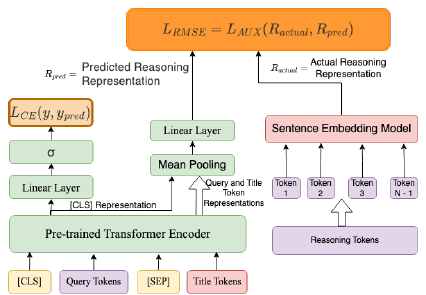
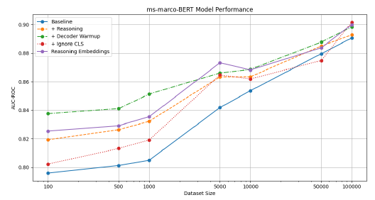

# Rationale-Guided Distillation for E-Commerce Relevance Classification: Bridging Large Language Models and Lightweight Cross-Encoders

> **Venue**: COLING 2025 Industry Track (31st International Conference on Computational Linguistics, 2025년 1월 19~24일, pp. 136–148)
> **Authors**: Sanjay Agrawal\*, Faizan Ahemad\*, Vivek Sembium (Amazon, India) — \*equal contribution
> **Platform**: Amazon 검색의 query-product relevance 모델 (9개 국가 marketplace)

---

## 1. Background

### E-commerce 검색 relevance의 현황
- 대형 e-commerce 검색(Amazon, Walmart)은 여러 단계로 동작한다.
  1. **Retrieval**: lexical, behavioral, semantic retrieval을 섞어 넓은 후보 집합을 만든다.
  2. **Relevance model**: 후보 중 질의 의도와 맞지 않는 `<query, product>` 쌍을 걸러낸다. RAG의 reranker와 비슷한 역할이다.
- 자주 검색되는 질의는 상품 집합을 **offline으로 미리 생성**해 production 테이블에 저장한다. 검색 트래픽 대부분이 이 offline 경로를 탄다.
- relevance 모델은 하루 **수백만 쌍**을 판정해야 하므로, 작고 빠른 **cross-encoder(BERT류)** 가 표준이다.
- LLM은 넓은 지식과 추론 능력 덕분에 relevance 판정을 훨씬 잘하지만 비용이 문제다.
  - 예: 20B LLM으로 5천만 쌍을 판정하면 GPU 1장에서 **며칠**이 걸린다. cross-encoder는 **몇 시간**이면 끝난다.

### 기존 방법의 한계
| 방법 | 문제점 |
|---|---|
| Vanilla BERT cross-encoder | 빠르지만, 레이블만 보고 학습하므로 query와 title의 의미적·기능적 연결을 충분히 배우지 못한다. 특히 데이터가 적을 때 약하다 |
| LLM zero-shot / few-shot | 따로 학습하지 않으면 fine-tuned BERT보다 ROC-AUC가 **20~36%** 낮다(few-shot도 7~26% 낮음). 추론 비용도 크다 |
| LLM + linear layer fine-tuning | 정확도의 상한선 역할을 하지만, 7B 모델이라 BERT보다 샘플당 **50배 이상** 느려서 production에 쓸 수 없다 |
| 고전적 KD (soft label, DistilBERT, TinyBERT, MiniLM 등) | teacher의 확률이나 표현만 전달하고, "**왜** 관련 있는가"라는 판단 근거는 전달하지 않는다 |
| Distilling Step-by-Step (Hsieh et al., 2023) | rationale distillation의 효과를 보였지만 T5 encoder-decoder의 **text-to-text** 설정이다. 추론 때도 생성을 해야 해서 BERT cross-encoder 분류기에 그대로 쓰기 어렵다 |

---

## 2. Motivation

### 핵심 통찰 1: LLM의 강점은 "판단 근거"에 있다
- LLM은 query와 product title 사이의 기능적 유사성(예: "noise-cancelling"이 Bose QC35의 핵심 기능)을 지식으로 연결해 설명할 수 있다.
- 이런 근거(rationale)를 소형 모델의 **추가 학습 신호**로 쓰면, 레이블만으로는 배우기 어려운 query-title 연결을 배울 수 있다는 가설이다.

### 핵심 통찰 2: 근거는 학습 때만 쓰고 추론 때는 버리면 된다
- rationale 생성을 **auxiliary task**로만 두면, 배포할 때는 decoder를 떼어 내고 BERT cross-encoder만 쓸 수 있다.
- 추론 비용은 vanilla BERT와 같고, LLM을 호출할 필요도 없다.

### 핵심 통찰 3: 레이블이 적을 때 효과가 가장 크다
- 레이블만 보는 학습은 데이터가 적을 때 query-title 관계를 제대로 일반화하지 못한다.
- 반면 rationale은 샘플 하나당 훨씬 많은 정보(왜 관련 있는지)를 준다. 그래서 저자원 상황에서 이득이 클 것으로 기대한다. 실제로 IN 데이터 100개 샘플에서 ROC-AUC가 **+5.24%** 올랐다(5.4절).

---

## 3. Contributions
1. **Cross-Encoder-Decoder 구조**: BERT cross-encoder의 hidden state 위에 T5 decoder를 붙여 LLM rationale을 생성하게 한다. 이를 auxiliary task로 학습하고, 추론 때는 BERT만 남긴다.
2. **실무 개선 기법**: decoder warmup(BERT를 얼린 상태에서 decoder를 먼저 학습), CLS 토큰 제외, 계산량이 적은 대안인 **reasoning embedding 회귀**(BGE-M3 임베딩에 MSE)를 제안한다.
3. **다국어·다중 데이터셋 평가**:
   - 9개 marketplace(AU, ES, BR, AE, FR, MX, Saudi Arabia, DE, IN), ESCI 3개 지역, GLUE 6개 태스크, QADSM에서 평가했다.
   - 초록 기준으로 vanilla BERT보다 평균 ROC-AUC가 9개 marketplace에서 **+1.4%**, ESCI에서 **+2.4%**, GLUE에서 **+6%** 높다.
4. **LLM 대비 효율**: 110M BERT가 7B LLM과의 ROC-AUC 차이를 1% 미만으로 줄이면서 샘플당 **50배 빠르다**고 주장한다. 10K 샘플 학습에서는 9개 중 **6개** marketplace에서 fine-tuned LLM을 앞선다.
5. 온라인 A/B 테스트 결과는 없다.

---

## 4. Method

전체 접근은 세 단계로 구성된다.

| 단계 | 내용 | 역할 |
|---|---|---|
| 1. LLM 직접 판정 | LLaMA2-7B, Mistral-7B로 zero-shot / few-shot 판정 | LLM의 기본 능력 확인 (baseline) |
| 2. LLM + Linear layer | LLM은 얼리고 마지막 hidden state 위의 linear layer만 BCE로 학습 | **"Performance ceiling"** (도달 가능한 상한) |
| 3. Rationale distillation | Mixtral 8x7B가 rationale을 생성하고, BERT cross-encoder-decoder가 이를 auxiliary task로 학습 | **제안 방법**. 배포는 BERT만 |

### 4.1 LLM 직접 판정 (Zero-shot / Few-shot)
- 입력 템플릿은 `"[Query] is [Product Title] relevant?"`이다.
- 응답이 'Yes'로 시작하면 relevant, 'No'로 시작하면 not relevant로 판정한다.
- Few-shot은 같은 형식의 레이블된 예시 몇 개를 앞에 붙인 in-context learning이다.

### 4.2 LLM + Linear Layer (Performance Ceiling)
```
h_i   = θ_LLM(q_i, p_i)              # LLM 마지막 hidden state, LLM 파라미터는 고정
ŷ_i   = W h_i + b
L     = -(1/N) Σ_{i=1..N} L_CE(y_i, ŷ_i)
```
- LLM은 얼리고 linear head만 학습한다. 저자들은 이 값을 "language modeling으로 도달 가능한 최대 성능"이라고 부른다.
- 다만 LoRA나 full fine-tuning이 아니라 **linear probing**이다. 엄밀한 의미의 상한은 아니라는 점에 주의해야 한다. 실제로 일부 데이터셋에서는 BERT가 이 "상한"을 넘는다.

### 4.3 Rationale 생성

- **생성 모델**: AWS Bedrock의 **Mixtral 8x7B Instruct**. LLM 평가에 쓴 LLaMA2·Mistral-7B와는 다른 모델이다.
- **입력**: `(q_i, p_i, y_i)` 세 가지다. 즉 **정답 레이블을 주고 그 이유를 설명하게 하는** label-conditioned, 사후 합리화(post-hoc rationalization) 방식이다.

```
Prompt (요약):
  Given a query, a product title and their relevance label, generate a concise
  reasoning (1-2 sentences) for their relevance. Focus on key semantic connections
  and functional similarities, rather than relying solely on exact word matches.
    1. core functionality matches
    2. semantic relationships between different terms serving similar purposes
    3. align user needs across demographics / use cases
    4. shared purpose indicators or common structural elements
    5. conceptually related terms that serve similar functions
  Query: [Query]
  Product title: [Title]
  Actual Relevance label: [Relevance]
  Write concise reasoning for given relevance label.
```

**생성 예시**
```
Query:         noise-cancelling headphones
Product Title: Bose QuietComfort 35 II
Relevance:     Relevant
Rationale:     The product is relevant to the query because the Bose QuietComfort 35 II
               headphones are designed with noise-cancellation features, making them ideal
               for users looking to reduce ambient sound. The query specifically mentions
               'noise-cancelling', which is a primary function of this product.
```

- 프롬프트가 "정확한 단어 일치보다 **기능적·의미적 연결**"을 강조하도록 설계되어 있다. lexical matching을 넘는 신호를 BERT에 주려는 의도다.

### 4.4 Cross-Encoder-Decoder


> **Figure 1**: Reasoning distillation용 Cross-Encoder-Decoder 구조. `[CLS] query [SEP] title`을 BERT cross-encoder에 넣는다. `[CLS]` 표현은 linear + sigmoid를 거쳐 relevance를 분류한다(`L_CE(y, y_pred)`). query·title 토큰 표현 전체는 pre-trained T5 decoder의 cross-attention 입력이 되고, decoder는 LLM rationale을 한 토큰씩 예측한다(`L_AUX`).

| 구성 요소 | 스펙 |
|---|---|
| Encoder | BERT-base (110M, 12 layer, hidden 768). MS-MARCO query-passage relevance로 추가 학습한 checkpoint |
| Decoder | **T5-base decoder** (pre-trained). BERT의 토큰 hidden state에 cross-attention해 rationale을 autoregressive로 생성 |
| 분류 head | `[CLS]` 위의 linear layer + sigmoid |

```
h_i  = BERT(q_i, p_i)                  # token hidden states
ŷ_i  = σ(W · h_CLS + b)                # 분류
r_i  = Decoder(h_i)                    # rationale 생성 (T5 decoder, cross-attention)
```

#### Training Objective
```
L_classification = -(1/N) Σ_{i=1..N} L_CE(y_i, ŷ_i)

L_aux            = -(1/N) Σ_{i=1..N} Σ_{t=1..T} log P(r_{i,t} | r_{i,<t}, h_i)

L_total          = L_classification + λ · L_aux,      λ = 0.1
```
- `L_classification`: 본래 목표인 이진 relevance 분류다.
- `L_aux`: 정답 rationale에 대한 teacher-forcing 토큰 cross-entropy다. gradient가 decoder의 cross-attention을 거쳐 **BERT의 query·title 토큰 표현**으로 흘러간다. 그래서 BERT는 "근거를 설명할 수 있는 표현"을 만들도록 압박받는다.

### 4.5 실무 개선 기법 (Practical Modifications)

| 기법 | 내용 | 이유 |
|---|---|---|
| **Decoder Warmup** | (1) BERT를 얼리고 데이터의 50%로 decoder만 학습한다. (2) 이후 학습의 첫 30% 동안 encoder를 선형 warmup하며 `L_warmup = L_aux`만 쓴다. (3) warmup이 끝나면 `L_total = L_cls + λ·L_aux`로 학습한다 | 무작위 상태의 decoder gradient가 처음부터 BERT를 망가뜨리지 않게 하려는 것이다. 학습이 안정되고 성능이 가장 좋다 |
| **Ignore CLS** | decoder의 cross-attention 입력에서 `[CLS]` 토큰을 뺀다 | 분류용 `[CLS]`를 생성 태스크와 분리하려는 시도다. 효과는 들쭉날쭉하다(5.4절) |
| **Reasoning Embedding** | decoder 대신 BGE-M3로 rationale을 임베딩해 둔다. BERT 마지막 층을 mean-pooling하고 linear 변환한 결과가 이 임베딩에 가까워지도록 회귀 학습한다 | decoder 없이 계산량을 크게 줄이는 대안이다 |



> **Figure 4**: Embedding 기반 reasoning. rationale 토큰을 sentence embedding model(BGE-M3)로 임베딩한다. 그 값을 BERT 토큰 표현의 mean pooling + linear 변환 결과와 회귀 loss로 맞춘다. `[CLS]` 분류 경로는 그대로 둔다.

```
e_reasoning   = BGE-M3(r_i)                          # 사전에 계산
h_mean        = MeanPool(BERT(q_i, p_i))
h_transformed = Linear(h_mean)
L_aux         = || h_transformed - e_reasoning ||_2
```

#### 학습 vs 추론
| 단계 | 과정 |
|---|---|
| **학습 (offline)** | (1) Mixtral 8x7B로 학습 데이터 전체의 `(q, p, y)` → rationale을 한 번 생성한다. (2) Decoder warmup(BERT frozen) → encoder 선형 warmup(`L_aux`만) → `L_cls + 0.1·L_aux` 순서로 공동 학습한다 |
| **추론 (production)** | **T5 decoder와 LLM을 모두 버리고** BERT cross-encoder + `[CLS]` 분류 head만 쓴다. 비용은 vanilla BERT와 같다 |

---

## 5. Experiments

### 5.1 Dataset
| | Amazon 내부 (9 marketplaces) | ESCI (공개) | GLUE + QADSM (공개) |
|---|---|---|---|
| 출처 | Amazon 검색 (익명화·집계, production 분포 아님) | Amazon Shopping Queries Dataset (Reddy et al., 2022) | GLUE 6개 태스크 + QADSM (XGLUE, 검색 광고 query-passage) |
| 언어 | AU·AE·IN(영어), ES·MX(스페인어), BR(포르투갈어), FR(프랑스어), Saudi Arabia(아랍어), DE(독일어) | US(영어), JP(일본어), ES(스페인어) | 영어 |
| Label | 이진 relevance | 이진 relevance | 태스크별 이진 레이블 |
| Train / Test | 100K / 10K (10K 학습 설정도 따로 평가) | 100K / 10K | 공식 split |
| Metric | ROC-AUC (보조로 Acc / Recall / Precision) | ROC-AUC, Recall@0.7, Precision@0.7 | ROC-AUC |

### 5.2 Implementation Details
- **Student**: BERT-base(110M)를 MS-MARCO relevance로 추가 학습한 것. 여기에 T5-base decoder를 붙인다(학습 때만).
- **Rationale 생성기**: Mixtral 8x7B Instruct (AWS Bedrock).
- **LLM 비교군**: LLaMA2-7B, Mistral-7B-v0.3. ZS/FS 판정과 linear-probe fine-tuning에 쓴다.
- **하이퍼파라미터**:
  - batch 32, LR 5e-5, **8 epochs**, warmup 500 step
  - weight decay: decoder 0.001, encoder 0.0
  - Adam (β1, β2) = (0.9, 0.999), ε = 1e-8
  - gradient clipping 1.0
  - `λ = 0.1`
- **학습 환경**: PyTorch FSDP.
- **평가**: 모든 실험을 **10회 반복**해 평균과 95% 신뢰구간을 보고한다.
- 표의 "+ Reasoning (Ours)"는 4.4절 구조에 **Decoder Warmup을 적용한 것**이다.

### 5.3 Main Results

**(1) Amazon 9개 marketplace + ESCI (Table 1, BERT 대비 상대 ROC-AUC 변화)**

| Dataset | Samples | + Reasoning (Ours) | Best fine-tuned LLM (LLaMA2 / Mistral-7B) | LLM ZS / FS |
|---|---|---|---|---|
| AU | 10K | **+2.21%** | -0.06% | -23.1% / -15.5% |
| AU | 100K | +1.21% | **+2.19%** | |
| ES | 10K | **+2.84%** | -0.73% | -28.0% / -15.6% |
| ES | 100K | +1.45% | **+3.98%** | |
| BR | 10K | **+0.37%** | -1.69% | -24.5% / -18.3% |
| BR | 100K | +1.14% | **+1.62%** | |
| AE | 10K | +1.45% | **+3.85%** | -29.8% / -20.5% |
| AE | 100K | +1.83% | **+3.13%** | |
| FR | 10K | **+2.11%** | +1.85% | -36.5% / -18.1% |
| FR | 100K | +2.16% | **+2.47%** | |
| MX | 10K | +0.32% | **+4.28%** | -27.9% / -15.1% |
| MX | 100K | +2.16% | **+3.64%** | |
| Saudi Arabia | 10K | **+1.56%** | -0.45% | -30.1% / -19.7% |
| Saudi Arabia | 100K | **+2.20%** | +1.37% | |
| DE | 10K | +2.14% | **+4.56%** | -24.7% / -7.5% |
| DE | 100K | +1.81% | **+4.97%** | |
| IN | 10K | **+1.76%** | +0.61% | -23.3% / -12.4% |
| IN | 100K | +0.87% | **+4.28%** | |
| ESCI-US | 100K | +2.55% | **+4.34%** | -16.3% / -9.6% |
| ESCI-JP | 100K | +1.53% | **+1.60%** | -33.6% / -25.6% |
| ESCI-ES | 100K | **+4.59%** | +3.77% | -29.5% / -15.5% |

- **모든 데이터셋에서 BERT보다 높다**: 10K에서 +0.32 ~ +2.84%, 100K에서 +0.87 ~ +2.20%다.
- **10K 학습**: 9개 중 **6개**(AU, ES, BR, FR, Saudi Arabia, IN)에서 fine-tuned 7B LLM보다 높다. 데이터가 적으면 LLM linear probe가 오히려 BERT보다 낮아지는 경우(AU, ES, BR, Saudi Arabia)가 많다.
- **100K 학습**: LLM을 앞서는 곳은 **1개**(Saudi Arabia)뿐이다. 데이터가 충분하면 LLM 상한과의 격차가 다시 벌어진다. 예를 들어 DE는 +1.81% vs +4.97%, IN은 +0.87% vs +4.28%다.
- **ESCI**: BERT보다 +1.5 ~ +4.6% 높다. 본문은 "Performance ceiling까지 넘는다"고 썼지만, 실제로 LLM을 넘은 곳은 **ES 하나**다(+4.59 vs +3.77). US는 +2.55 vs +4.34로 LLM이 더 높고, JP는 +1.53 vs +1.60으로 비슷하다.
- **LLM ZS/FS**: fine-tuned BERT보다 **15~36%** 낮다. 이 과제에서 LLM을 그대로 쓰면 실용적이지 않다는 근거다.

**(2) GLUE + QADSM (Table 2, ROC-AUC)**

| Dataset | BERT | + Reasoning (Ours) | Best LLM (7B) |
|---|---|---|---|
| QQP | 0.9571 | 0.9625 | **0.9728** |
| RTE | 0.4754 | 0.5873 | **0.8867** |
| MRPC | 0.7955 | 0.8811 | **0.9486** |
| QNLI | 0.9467 | 0.9531 | **0.9887** |
| CoLA | 0.5912 | 0.6130 | **0.9060** |
| SST-2 | 0.9488 | 0.9480 | **0.9907** |
| **QADSM** | 0.7174 | **0.9123** | 0.8787 |

- GLUE에서는 BERT보다 높지만 LLM에는 못 미친다.
  - 개선폭이 큰 곳은 MRPC(+0.086)와 RTE(+0.112)다.
  - SST-2는 오히려 조금 낮다(0.9488 → 0.9480).
  - 저자들은 저자원·고난도 태스크에서 LLM이 앞서는 이유를 방대한 사전학습으로 설명한다.
- **QADSM**(검색 광고 query-passage relevance)에서는 BERT 0.7174 → **0.9123**(+0.195)이다. 7B LLM(0.8787)도 **+0.034** 앞선다. 저자들 도메인과 가장 가까운 공개 벤치마크라는 점에서 의미가 있다.
- 다만 BERT baseline의 RTE ROC-AUC가 0.4754로 **무작위(0.5)보다 낮다**. baseline 학습이 제대로 되지 않았을 가능성이 있다. GLUE를 ROC-AUC로 평가하는 것 자체도 표준 방식이 아니어서 기존 연구와 직접 비교하기 어렵다.

### 5.4 Ablation Study

**(1) 실무 개선 기법 × 학습 데이터 크기 (IN marketplace, Table 3, BERT 대비 상대 ROC-AUC)**

| Samples | with Reasoning | + Decoder Warmup | + Ignore CLS | Reasoning Embeddings |
|---|---|---|---|---|
| 100 | +2.94% | **+5.24%** | +0.80% | +3.71% |
| 500 | +3.14% | **+4.98%** | +1.49% | +3.48% |
| 1,000 | +3.39% | **+5.76%** | +1.76% | +3.79% |
| 5,000 | +2.55% | +2.88% | +2.72% | **+3.72%** |
| 10,000 | +1.15% | **+1.75%** | +0.97% | +1.70% |
| 50,000 | +0.62% | **+0.93%** | -0.55% | +0.48% |
| 100,000 | +0.24% | +0.87% | **+1.24%** | +1.05% |



> **Figure 3**: IN 데이터에서 학습 샘플 수(x축, log scale)에 따른 ROC-AUC. Baseline(BERT), + Reasoning, + Decoder Warmup, + Ignore CLS, Reasoning Embeddings를 비교한다. 데이터가 적을수록 baseline과의 격차가 크고, 100K에서는 다섯 방법이 0.89~0.90으로 거의 모인다.

- **Decoder Warmup이 가장 꾸준히 좋다**: 7개 크기 중 5개에서 1위이고, reasoning만 쓴 것보다 최대 **+2.4pp** 높다(1,000개: +3.39 → +5.76%).
- **저자원일수록 이득이 크다**: 100~1,000개에서 +5~6%, 10K에서 +1.75%, 100K에서 +0.87%다. rationale이 샘플당 정보량을 늘려 준다는 가설과 맞는다.
- **Reasoning Embeddings**는 decoder 없이도 Decoder Warmup에 가까운 성능을 낸다(10K에서 +1.70 vs +1.75). 5,000개에서는 오히려 1위다. 학습 비용이 문제라면 실용적인 대안이다.
- **Ignore CLS**는 결과가 불안정하다. 50K에서는 **-0.55%** 로 baseline보다 낮고, 100K에서는 1위(+1.24%)다. 일관된 이득이 있다고 보기 어렵다.
- **데이터 크기 효과**: baseline ROC-AUC가 100 → 10K에서 약 4.4pp, 10K → 100K에서 약 2.9pp 오른다. 샘플을 늘려도 이득은 점점 줄어든다.

**(2) 해석 가능성: attention map + Shapley (Figure 2, 정성 분석)**
- baseline BERT는 query-title 토큰 간 attention이 들쭉날쭉하다. 판정에 중요한 토큰을 자주 놓친다.
- 제안 모델은 query와 title 양쪽에서 **의미적으로 관련된 토큰에 일관되게 집중**한다.
- 학습 때 붙였던 decoder로 생성한 rationale도 일관되고, 과제를 더 깊이 이해하는 것처럼 보인다.
- 다만 이 분석은 사례 몇 개를 보여 주는 정성 분석이고 정량 지표는 없다.
- (원 Figure는 heatmap 글씨가 너무 작아 읽을 수 없어서 싣지 않았다.)

**(3) Reasoning Path 유효성 검증: 논문에 없음**
- random rationale, 레이블을 섞은(shuffled) rationale, 또는 "rationale 없이 decoder로 query/title만 재구성하기" 같은 **통제 실험이 없다**.
- 그래서 지금 결과만으로는 성능 향상이 rationale의 **내용** 덕분인지 알 수 없다. 단순히 T5 decoder를 붙인 multi-task 정규화(regularization) 효과일 가능성도 남는다.
- Reasoning Embedding 변형이 decoder와 비슷한 효과를 낸다는 점은 "rationale의 의미 정보가 중요하다"는 간접 증거 정도로 볼 수 있다.

### 5.5 Online A/B Test
- 없다. 데이터셋은 익명화·집계된 것으로 "production 분포를 대표하지 않는다"고 명시되어 있다.
- "50배 빠르다"는 7B와 110M의 파라미터 규모를 비교한 주장이다. 실제 latency 측정 표는 제시하지 않는다.

### 참고: 논문 수치에서 맞지 않는 부분
- **초록과 표의 평균이 다르다**: 초록의 "9개 marketplace 평균 +1.4%, ESCI 평균 +2.4%"는 Table 1에서 계산한 평균과 다르다. Table 1 기준으로는 9개 marketplace가 10K·100K 모두 약 **+1.64%**, ESCI 3개 평균은 약 **+2.89%** 다. GLUE 6개 평균은 약 +6.5%로 초록의 "6%"와 맞는다.
- **"7B LLM과 1% 미만 차이"는 일부에만 해당한다**: 100K 학습 기준으로 DE(+1.81 vs +4.97)나 IN(+0.87 vs +4.28)은 격차가 3%p를 넘는다. 이 주장은 일부 데이터셋에만 들어맞는다.
- **부록 표에 복사 오류로 보이는 부분이 있다**:
  - DE의 LLaMA2-7B 행 수치가 MX의 LLaMA2-7B 행과 **완전히 같다**.
  - DE의 Mistral 100K 행도 FR의 Mistral 100K 행과 같다.
  - AE 100K의 Recall이 **1.0004**로 1을 넘는다(Table 5).
  - 이 때문에 부록 수치의 신뢰도는 조금 낮게 보는 편이 안전하다.

---

## 6. Key Takeaways
1. **Rationale은 학습 신호로만 쓰고 추론 비용은 0이다**: T5 decoder로 LLM rationale을 생성하는 것을 auxiliary task(λ = 0.1)로만 두고 배포 때는 BERT만 남긴다. 모든 marketplace에서 BERT보다 ROC-AUC가 높다(10K에서 +0.3 ~ +2.8%).
2. **저자원 상황에서 가장 효과적이다**: IN 데이터 100~1,000개에서 +5~6%, 100K에서는 +0.9%다. 10K 학습에서는 9개 중 6개 marketplace에서 7B LLM linear probe를 앞서지만, 100K에서는 1개뿐이다.
3. **Decoder Warmup이 핵심 실무 트릭이다**: BERT를 얼린 채 decoder를 먼저 맞추고 encoder를 천천히 푸는 방식이다. reasoning만 쓴 것보다 최대 +2.4pp 높고, 7개 데이터 크기 중 5개에서 1위다.
4. **Decoder 없이도 대부분의 효과를 얻는다**: BGE-M3 rationale 임베딩에 회귀하는 변형이 Decoder Warmup과 비슷하다(10K에서 +1.70 vs +1.75). MPCoT의 LRKD나 CRSD처럼 rationale을 임베딩 공간에서 증류하는 후속 연구들과 같은 방향이다.
5. **검색 광고 relevance(QADSM)에서 특히 강하다**: BERT 0.717 → 0.912로 7B LLM(0.879)보다도 높다. 반면 일반 NLU인 GLUE에서는 LLM과 격차가 크다(RTE 0.59 vs 0.89).
6. **실험 엄밀성에는 한계가 있다**: random rationale 같은 통제 실험이 없고, 초록과 표의 평균이 맞지 않으며, 부록 표에 중복 수치가 있다. 온라인 A/B와 latency 실측도 없다. 아이디어와 실무 트릭(warmup, embedding 변형)은 참고할 만하지만, 수치는 보수적으로 읽는 것이 좋다.
