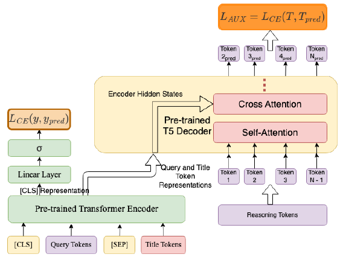
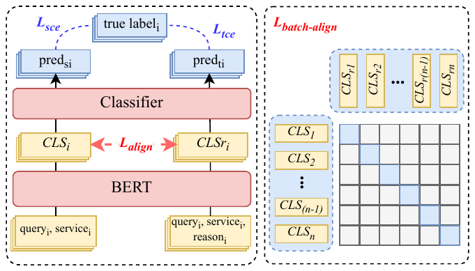

# RGD vs CRSD: LLM Reasoning을 BERT Cross-Encoder에 증류하는 두 가지 방식

> **비교 논문**:
> - **RGD**: Rationale-Guided Distillation for E-Commerce Relevance Classification: Bridging Large Language Models and Lightweight Cross-Encoders (COLING 2025 Industry Track, Amazon) — [요약](./rationale_guided_distillation.md)
> - **CRSD**: From Reasoning LLMs to BERT: A Two-Stage Distillation Framework for Search Relevance (WWW 2026, Meituan) — [요약](../2026-10-28/reasoning_llm_to_bert.md)
>
> 이 문서에서 RGD는 Amazon 논문 전체를, CRSD는 Meituan 논문 전체를 가리킨다. CRSD는 원래 Meituan 논문의 Stage 2 이름이다.

---

## 1. Background

### 공통 문제
- 두 논문 모두 e-commerce 검색의 **`<query, item>` relevance 판정**을 다룬다.
- production에서는 하루 수백만~수억 쌍을 처리해야 하므로 BERT cross-encoder밖에 쓸 수 없다.
- LLM은 world knowledge와 추론으로 어휘가 다른 query와 item 사이의 의미적 연결을 잡아낸다. 예를 들어 "noise-cancelling" → Bose QC35, "skin rejuvenation" → "facial hydrotherapy"다.
- 그래서 두 논문 모두 같은 질문에서 출발한다. **"LLM이 쓴 판단 근거(reasoning/rationale)를 학습 때만 써서, 추론 비용을 늘리지 않고 BERT를 개선할 수 있는가?"**

### 출발점의 차이
| | RGD (Amazon) | CRSD (Meituan) |
|---|---|---|
| 서비스 | Amazon 상품 검색, 9개국 marketplace (다국어) | Meituan 검색 광고, 중국어 로컬 서비스 |
| Label | **이진** (relevant / not) | **3-class** (Irrelevant / Moderate / Relevant) |
| 학습 레이블 출처 | **사람** 레이블 10K / 100K | **teacher LLM**이 자동으로 붙인 레이블 약 268만 |
| Student | BERT-base 12-layer, 110M (MS-MARCO로 추가 학습) | 6-layer Chinese BERT |
| 관계 | 먼저 나왔다 | RGD를 **직접 인용**하고, RGD의 embedding 변형을 baseline으로 재현해 비교한다 |

- CRSD는 RGD에 대한 **후속 반론** 성격이 있다. CRSD의 "Baseline Reasoning Distill."(BGE-M3 임베딩에 cosine 정렬, μ = 0.1)은 RGD의 *Reasoning Embedding* 변형(BGE-M3 임베딩에 L2, λ = 0.1)과 거의 같다.

---

## 2. 접근 방식 비교

### 2.1 핵심 가설

| | RGD | CRSD |
|---|---|---|
| **가설** | rationale을 **생성하도록** 학습시키면, BERT의 토큰 표현이 query와 title의 의미적·기능적 연결을 담게 된다 | 같은 BERT가 reasoning을 **입력으로 봤을 때** 만드는 표현을, reasoning 없이도 재현하도록 학습시키면 그 판단 논리가 파라미터에 **내재화**된다 |
| 학습 신호의 성격 | **Multi-task 정규화**. 보조 과제가 표현을 풍부하게 만든다 | **Self-distillation**. 모델 자신의 "더 많이 아는 상태"가 teacher가 된다 |
| 기존 방법을 보는 관점 | 고전 KD는 확률만 전달하고 "왜"는 전달하지 못한다 | 외부 encoder 임베딩에 맞추는 것(RGD 계열)은 **서로 다른 공간**을 맞추는 일이라 신호가 간접적이다(architectural heterogeneity) |
| reasoning이 BERT에 닿는 경로 | decoder의 cross-attention을 거쳐 **모든 토큰 hidden state**로 gradient가 흐른다 | **`[CLS]` 하나**를 contrastive로 정렬한다 |

### 2.2 Teacher 구축 전략

| | RGD | CRSD |
|---|---|---|
| Base model | Mixtral 8x7B Instruct (AWS Bedrock), **그대로 사용** | Qwen3-8B |
| 도메인 적용 | 없음. 프롬프트 설계로만 유도 | **CPT**: search log에서 만든 약 7M multi-task 샘플로 도메인 지식 주입 |
| SFT 전략 | 없음 | 사람이 쓴 reasoning chain 34,002건으로 학습 |
| Preference Optimization | 없음 | **GRPO**. reward model이 5개 차원(질의 이해, 서비스 이해, business rule, 일관성, 정답)을 채점한다. 전문가와 89.77% 일치 |
| reasoning 생성 방식 | `(q, p, y)`를 주고 **정답 label의 이유를 설명**하게 한다(label-conditioned, 사후 합리화) | `(q, s)`만 주고 reasoning과 label을 **스스로 추론**하게 한다 |
| teacher 품질 검증 | 없음. rationale 정확도는 평가하지 않았다 | Macro F1 0.7174. few-shot DeepSeek-R1(0.4696)보다 +24.8pp |
| 핵심 차별점 | **싸고 빠르다**. 학습 없이 프롬프트만 쓴다 | **비싸지만 신뢰할 수 있다**. teacher가 label 생성기 역할까지 한다 |

**Rationale 생성 방식 차이의 함의**
- **RGD**: 정답을 알려 주고 설명하게 하므로 rationale이 레이블과 **항상 일치**한다. 대신 LLM이 실제로 그렇게 판단할지와는 무관한 **그럴듯한 사후 설명**일 수 있다. 사람 레이블이 틀렸어도 그 오류를 합리화한다.
- **CRSD**: teacher가 스스로 판단하므로 reasoning과 label이 **teacher의 실제 판단 과정**을 반영한다. 대신 teacher가 틀리면 label과 reasoning이 함께 틀린다. GRPO의 process reward(일관성, business rule 준수)가 이 위험을 줄이는 장치다.

### 2.3 Distillation 구조 비교

<table>
<tr>
<td></td>
<td></td>
</tr>
<tr>
<td><b>RGD Figure 1</b>: BERT cross-encoder + T5 decoder. decoder가 BERT의 토큰 표현에 cross-attention하며 rationale을 생성한다.</td>
<td><b>CRSD Figure 3</b>: 같은 BERT를 reasoning 포함 입력(teacher 설정)과 미포함 입력(student 설정)으로 두 번 돌려, 두 <code>[CLS]</code>를 in-batch InfoNCE로 정렬한다.</td>
</tr>
</table>

```
[RGD — Cross-Encoder-Decoder]
  (q, p) ──► BERT-base ──┬─► h_CLS ──► Linear+σ ──► ŷ        L_cls  = BCE(ŷ, y)
                         └─► h_1..n (token states)
                                  │ cross-attention
  rationale (Mixtral) ──► T5 decoder (teacher forcing) ──► r̂   L_aux  = CE(r̂, rationale)
                                                              L = L_cls + 0.1·L_aux
  (변형) rationale ──► BGE-M3 ──► e_r ;  MeanPool(h) ──► Linear ──► ê
                                                              L_aux  = ||ê − e_r||_2
  추론: (q, p) ──► BERT ──► h_CLS ──► ŷ     (decoder 제거)

[CRSD — Contrastive Reasoning Self-Distillation]
  (q, s, reason) ──► BERT(θ) ──► cls_r ──► Clf ──► y_r       L_tce   = CE(y_r, y)
  (q, s)         ──► BERT(θ) ──► cls   ──► Clf ──► y_s       L_sce   = CE(y_s, y)
                       (같은 θ, 같은 Clf)
  cls_i ↔ cls_r_i (positive), cls_i ↔ cls_r_j (in-batch negative)
                                                              L_align = InfoNCE
                                                              L = L_sce + 0.01·L_tce + 0.01·L_align
  추론: (q, s) ──► BERT ──► cls ──► Clf ──► ŷ     (reasoning 입력 없음)
```

### 2.4 구성 요소 대응 관계

| 역할 | RGD | CRSD |
|---|---|---|
| reasoning 원천 | Mixtral 8x7B 프롬프팅 | CPT → SFT → GRPO teacher |
| reasoning을 BERT에 전달하는 장치 | T5 decoder (생성 loss) | teacher 설정 BERT (같은 모델) |
| 정렬 / 보조 loss | token-level 생성 CE (λ = 0.1) | `[CLS]` InfoNCE (δ = 0.01) |
| teacher 쪽 품질 보장 | decoder warmup (BERT를 얼린 채 decoder 먼저 학습) | `L_tce` (teacher 설정도 정답을 맞히게 학습) |
| 가벼운 변형 | BGE-M3 임베딩 회귀 | (CRSD에서는 baseline으로 쓰임) |

- 두 논문 모두 **"정렬 대상이 먼저 쓸 만해야 한다"** 는 같은 문제를 다른 방식으로 푼다.
  - RGD의 decoder warmup은 무작위 상태의 decoder gradient가 BERT를 망가뜨리지 않게 한다.
  - CRSD의 `L_tce`는 teacher 설정의 `cls_r`이 분류에 유용한 표현이 되게 한다.
  - 둘 다 이 장치가 개선분의 큰 몫을 차지한다. RGD는 reasoning만 쓴 것보다 최대 +2.4pp, CRSD는 +0.83pp(개선분의 63%)다.

### 2.5 핵심 차이 분석

| 차원 | RGD | CRSD |
|---|---|---|
| Alignment 대상 | LLM rationale **텍스트 자체** (또는 외부 encoder 임베딩) | **같은 BERT**가 rationale을 읽었을 때의 `[CLS]` |
| Alignment 단위 | 토큰 시퀀스 생성 (모든 토큰 표현이 관여) | 문장 표현 1개 (`[CLS]`) |
| Alignment Loss | autoregressive CE / L2 | in-batch InfoNCE (+ teacher 쪽 CE) |
| 표현 공간 이질성 | decoder가 BERT 공간과 언어 공간을 잇는 역할을 학습. 임베딩 변형은 이질적 공간 정렬 | 원천적으로 없음 (같은 파라미터) |
| 추가 학습 모듈 | T5-base decoder (약 110M+), warmup 단계 | 없음 (BERT forward 2회) |
| 학습 비용 | decoder forward/backward + 다단계 warmup | 64 + 150 토큰 BERT forward 2회. 6-layer라 가볍다 |
| 추론 overhead | 0 (decoder 제거) | 0 (reasoning 입력 제거) |
| 외부 의존 | Mixtral API, (변형은) BGE-M3 | 자체 학습한 teacher LLM, reward model, 전문가 annotation |
| 학습 후 rationale 생성 | **가능**. decoder를 남겨 두면 설명을 생성할 수 있다 | 불가능. BERT는 표현만 배운다 |
| 하이퍼파라미터 민감도 | λ = 0.1 하나와 warmup 비율(50%, 30%) | γ, δ, τ (τ 값은 공개되지 않음) |

---

## 3. 실험 결과 비교

### 3.1 공통 발견 (독립적 검증)

1. **범용 LLM을 그대로 쓰면 안 된다**
   - RGD: LLaMA2와 Mistral-7B의 ZS/FS가 fine-tuned BERT보다 ROC-AUC **15~36% 낮다**.
   - CRSD: Qwen3-8B와 DeepSeek-R1의 ZS/FS가 Accuracy **0.51~0.62**, Macro F1 0.40~0.47이다.
   - 서로 다른 회사, 언어, 레이블 체계에서 같은 결론이다. **도메인 relevance는 범용 LLM의 상식만으로 풀리지 않는다.**
2. **reasoning을 학습 때만 쓰는 증류가 추론 비용 없이 BERT를 개선한다**
   - RGD는 9개 marketplace와 ESCI 3개 지역 **모두**에서 BERT보다 높다.
   - CRSD는 Macro F1 +1.31pp이고, 온라인에서도 개선이 확인됐다.
3. **보조 신호는 작은 가중치로 충분하다**: RGD는 λ = 0.1, CRSD는 γ = δ = 0.01이다. 주 과제(분류)를 해치지 않는 선에서 표현을 유도하는 정규화로 작동한다.
4. **둘 다 BGE-M3로 rationale을 임베딩하는 방식을 시도했다.** 그런데 결론이 엇갈린다(3.3절).

### 3.2 성능 비교

벤치마크, 지표, 레이블 체계가 모두 달라서 **수치를 직접 비교할 수 없다**. 각자의 기준 대비 개선폭만 나란히 놓는다.

| | RGD | CRSD |
|---|---|---|
| 지표 | ROC-AUC (BERT 대비 **상대** 변화 %) | Accuracy / Macro F1 / Weighted F1 (**절대** 차이 pp) |
| 기준 대비 개선 | 10K: +0.32 ~ +2.84%, 100K: +0.87 ~ +2.20% | Acc +1.16pp, **Macro F1 +1.31pp**, Weighted F1 +1.22pp |
| 저자원 효과 | IN 데이터 100~1,000개에서 **+5~6%** | 실험 없음 (268만 건 단일 규모) |
| teacher 대비 | 10K: 9개 중 6개에서 7B LLM linear probe보다 높음. 100K: 1개만 | teacher Macro F1의 **98.6%**. 다만 Baseline도 이미 96.8%이므로, 격차를 57% 메운 셈이다 |
| 공개 벤치마크 | QADSM 0.717 → **0.912** (7B LLM 0.879보다 높음). GLUE는 LLM보다 크게 낮음 | 없음 (사내 데이터만) |
| 통계적 엄밀성 | 10회 반복 + 95% CI. 단, 초록과 표의 평균 불일치, 부록 표 중복 수치 | 단일 실행 + McNemar p < 1e-8. seed 분산 정보 없음 |

### 3.3 엇갈리는 발견: 외부 임베딩 정렬은 효과가 있는가?

| | RGD의 Reasoning Embedding 변형 | CRSD의 Baseline Reasoning Distill. |
|---|---|---|
| 방식 | mean-pool → Linear → BGE-M3 임베딩에 **L2** | `[CLS]` → Linear → BGE-M3 임베딩에 **cosine** |
| 결과 | IN 10K **+1.70%** (decoder 방식 +1.75%와 거의 같음). 5K에서는 1위 | Macro F1 **+0.14pp** (사실상 효과 없음) |

**왜 엇갈리는지에 대한 가능한 설명** (논문들이 직접 다루지는 않은 해석이다)
- **데이터 규모**: RGD 스스로도 데이터가 많을수록 이득이 줄어든다고 보여 준다(100개에서 +3.71%, 100K에서 +1.05%). CRSD는 **268만 건**이다. 이 규모에서는 레이블만으로도 이미 많이 배우므로, 외부 임베딩이 더해 주는 정보가 거의 남지 않을 수 있다.
- **지표**: ROC-AUC 상대 %와 3-class Macro F1 pp는 민감도가 다르다.
- **풀링 방식**: RGD는 mean-pool 표현을, CRSD baseline은 분류에 쓰는 `[CLS]` 자체를 정렬했다. `[CLS]`를 외부 공간에 맞추면 분류 표현과 충돌할 여지가 더 크다.
- **CRSD가 비교하지 않은 것**: CRSD는 RGD의 **주력 방법인 decoder 방식**과는 비교하지 않았다. 따라서 "CRSD가 RGD보다 낫다"는 결론은 **embedding 변형에 대해서만** 검증되었다.

### 3.4 Reasoning 유효성 검증

| | RGD | CRSD |
|---|---|---|
| reasoning 제거 (구조만 유지) | 없음 | Macro F1 0.6947, Baseline으로 회귀 (+0.02pp) |
| Random reasoning | **없음** | 0.6918, **Baseline보다 -0.27pp 낮음** |
| 해석 가능성 분석 | attention map과 Shapley 값으로 정성 분석 | 없음 |
| 결론 | 개선이 rationale **내용** 덕분인지, decoder를 붙인 multi-task 정규화 덕분인지 **구분할 수 없다** | 개선이 dual-branch 구조나 입력 길이가 아니라 **reasoning의 의미 내용**에서 나온다는 것을 깔끔하게 보였다 |

### 3.5 Online A/B Test 비교

| | RGD | CRSD |
|---|---|---|
| 플랫폼 | 없음 (오프라인만. 데이터가 production 분포를 대표하지 않는다고 명시) | Meituan 검색 광고 |
| 기간 / 트래픽 | – | 2주, 실험군 10% vs 대조군 30% |
| 주요 지표 | – | AdCTR **+0.91%**, AdCVR **+1.06%**, GTV +0.40%, bad case rate **-30.5pp** |
| 배포 | 언급 없음 | production 배포 완료 |
| latency | "50배 빠르다"는 파라미터 규모 기반 주장. 실측 없음 | 기존과 같은 6-layer BERT(64 tokens)라 비용 증가가 없다고 서술. 실측 수치 없음 |

---

## 4. 장단점 정리

### RGD
| 장점 | 단점 |
|---|---|
| **진입 비용이 낮다**: 범용 LLM 프롬프팅만으로 rationale을 얻고, teacher 학습이 필요 없다 | rationale이 label-conditioned 사후 합리화라서 **사람 레이블의 오류까지 그럴듯하게 설명**할 수 있다 |
| **저자원에서 효과가 크다**: 100~1,000개 샘플에서 +5~6% | 데이터가 많아지면 이득이 빠르게 줄고(100K에서 +0.9%), 7B LLM과의 격차가 다시 벌어진다 |
| 토큰 수준 신호: decoder cross-attention으로 **모든 토큰 표현**이 학습에 관여한다 | 학습 때 T5 decoder(약 110M+)가 추가로 필요하다. warmup 단계도 여러 번 거친다 |
| decoder를 남기면 **rationale을 생성할 수 있다** (설명 가능성) | random rationale 같은 **통제 실험이 없다** |
| 다국어 9개국과 공개 벤치마크(ESCI, QADSM, GLUE)로 폭넓게 평가했다 | 초록과 표의 평균 불일치, 부록 중복 수치 등 **수치 신뢰도 문제**가 있다. 온라인 검증도 없다 |
| 가벼운 embedding 변형이 decoder와 거의 같은 성능을 낸다 | 이진 분류만 다뤘다. graded relevance로 확장할 수 있는지 미검증이다 |

### CRSD
| 장점 | 단점 |
|---|---|
| **같은 모델 안에서 정렬**하므로 표현 공간 이질성 문제가 원천적으로 없다 | **teacher 구축 비용이 매우 크다**: 7M CPT, 34K 사람 reasoning, 전문가 5차원 채점, reward model, GRPO |
| 추가 모듈이 없다. BERT forward 2회만으로 학습한다 | `[CLS]` 하나만 정렬하므로 토큰 수준의 세밀한 신호는 전달하지 못한다 |
| teacher가 label 생성기 역할까지 해서 **대규모 자동 annotation**(268만)이 가능하다 | label이 teacher에서 나오므로 student 성능이 **teacher에 묶인다**(최대 0.7174) |
| reasoning 제거와 random reasoning **통제 실험으로 효과의 원인을 검증**했다 | 단일 실행이라 seed 분산을 모른다. τ, α, β, stop-gradient 여부 등 **재현에 필요한 세부가 빠져 있다** |
| 2주 온라인 A/B로 **비즈니스 지표 개선**과 production 배포를 확인했다 | RGD의 주력 방법(decoder)과는 비교하지 않았다 |
| 3-class graded relevance를 처리한다 | 사내 중국어 데이터만 썼다. 공개 벤치마크 결과가 없어 외부에서 검증할 수 없다 |

---

## 5. 어떤 상황에서 어떤 방법을?

**RGD를 선택해야 하는 경우:**
- **사람 레이블이 적다** (수백~수만 건). 저자원일수록 이득이 크다.
- 도메인 LLM을 학습할 인력이나 GPU가 없고, **범용 LLM API만** 쓸 수 있다.
- 이미 믿을 만한 사람 레이블이 있어서, rationale은 보조 신호로만 쓰면 된다.
- 운영자를 위한 **설명 생성**이 필요하다(decoder를 따로 남겨 오프라인 분석에 쓴다).
- 빠르게 효과부터 확인하고 싶다. 이 경우 **embedding 변형**(BGE-M3 회귀)이 가장 싸게 시작하는 방법이다.

**CRSD를 선택해야 하는 경우:**
- **레이블 없는 검색 로그가 대량으로 있고**, LLM으로 레이블과 reasoning을 함께 만들어 데이터를 키울 계획이다.
- 플랫폼 고유의 business rule이나 용어가 많아서, **도메인 적응 teacher**를 만드는 투자가 정당화된다.
- graded relevance(3-class 이상)를 다룬다.
- 학습 파이프라인을 단순하게 유지하고 싶다(추가 decoder 없음, BERT forward 2회).
- 데이터가 이미 커서 RGD식 보조 신호의 이득이 줄어드는 영역이다.

**함께 쓰는 방안 (검증되지 않은 제안):**
- **CRSD에 범용 LLM rationale 넣기**: teacher 설정 입력에 Mixtral 같은 범용 LLM의 label-conditioned rationale을 넣는 저비용 버전이다. 사람 레이블이 있고 도메인 teacher가 없는 상황이다. CRSD의 random reasoning 실험을 보면 rationale 품질이 낮으면 오히려 손해일 수 있으므로, 먼저 작은 규모로 검증해야 한다.
- **두 보조 신호를 동시에 쓰기**: RGD의 decoder 생성 loss(토큰 수준)와 CRSD의 InfoNCE(`[CLS]` 수준)를 함께 주는 방식이다. 두 신호가 BERT의 서로 다른 부분에 작용하므로 상보적일 가능성이 있다.

---

## 6. Key Takeaways
1. **같은 목표, 다른 가설**: 두 방법 모두 "reasoning은 학습 때만, 추론 비용은 0"이다. RGD는 rationale을 **생성하게** 해서 표현을 풍부하게 만들고(multi-task 정규화), CRSD는 rationale을 **읽은 자기 자신**을 따라가게 해서 판단을 내재화한다(self-distillation).
2. **Teacher 투자 규모가 가장 큰 차이다**: RGD는 범용 LLM 프롬프팅 하나로 끝난다. CRSD는 CPT 7M, SFT 34K, 5차원 reward model, GRPO를 거친 teacher가 label까지 만든다. 범용 LLM이 도메인 relevance에 약하다는 점은 두 논문이 **독립적으로 확인**했다(RGD에서 ZS/FS가 15~36% 낮음, CRSD에서 Acc 0.51~0.62).
3. **효과가 큰 구간이 다르다**: RGD의 이득은 저자원(100~1K 샘플에서 +5~6%)에서 가장 크고 데이터가 늘면 줄어든다. CRSD는 268만 건 대규모에서도 Macro F1 +1.31pp와 온라인 AdCTR +0.91%를 냈다.
4. **외부 임베딩 정렬은 저자원에서만 통하는 것으로 보인다**: RGD에서 BGE-M3 회귀는 10K에서 decoder와 거의 같았다(+1.70 vs +1.75%). CRSD의 268만 건에서는 +0.14pp에 그쳤다. 데이터가 많을수록 "같은 공간에서 정렬하는" CRSD식 설계가 유리하다는 가설과 맞지만, 직접 검증된 것은 아니다.
5. **"정렬 대상을 먼저 쓸 만하게 만들어라"**: RGD의 decoder warmup(최대 +2.4pp)과 CRSD의 `L_tce`(개선분의 63%)가 같은 원리다. 보조 경로가 쓰레기 신호를 보내지 않도록 안정화하는 장치가 개선의 큰 몫을 차지한다.
6. **검증 수준은 CRSD가 앞선다**: CRSD는 random reasoning 통제 실험과 2주 온라인 A/B를 갖췄다. RGD는 통제 실험, 온라인 검증, 수치 일관성이 부족하다. 대신 RGD는 공개 벤치마크(ESCI, QADSM, GLUE)와 10회 반복 CI를 제공해 외부 재현성이 더 낫다.
