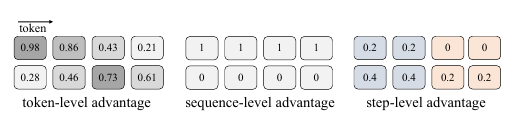
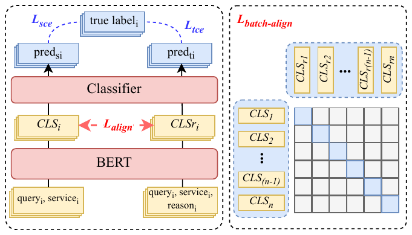
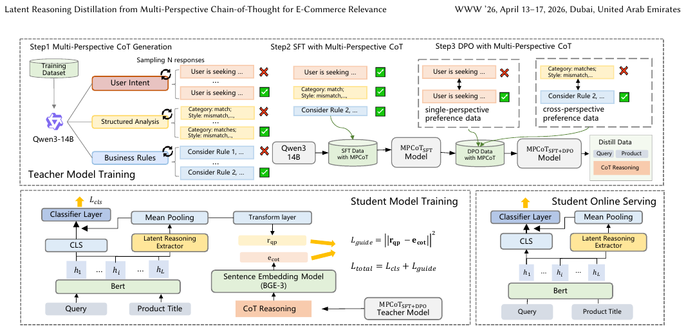
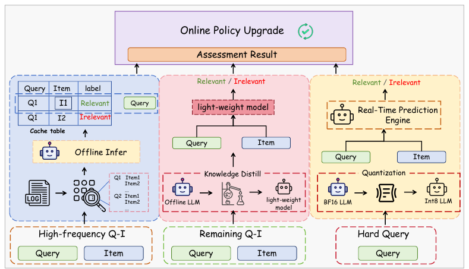

# TaoSR1 · TaoSR-SHE · TaoSR-AGRL · Reasoning-LLM→BERT · LORE · MPCoT-LRKD: LLM 기반 E-commerce Relevance의 진화

> **비교 논문** (arXiv 초판 순):
> 1. TaoSR1: The Thinking Model for E-commerce Relevance Search (arXiv 2508.12365, 2025-08, Taobao) — [요약](./taosr1.md)
> 2. TaoSR-SHE: Stepwise Hybrid Examination RL Framework for E-commerce Search Relevance (arXiv 2510.07972, 2025-10-09, Taobao) — [요약](./taosr_she.md)
> 3. TaoSR-AGRL: Adaptive Guided RL Framework for E-commerce Search Relevance (WWW'26 Industry, arXiv 2510.08048, 2025-10-09, Taobao) — [요약](./taosr_agrl.md)
> 4. From Reasoning LLMs to BERT: A Two-Stage Distillation Framework for Search Relevance (WWW'26 Industry, arXiv 2510.11056, 2025-10-13, Meituan) — [요약](../2026-10-28/reasoning_llm_to_bert.md)
> 5. LORE: A Large Generative Model for Search Relevance (Tech Report, arXiv 2512.03025, 2025-12, Alimama) — [요약](../2026-10-28/lore.md)
> 6. Thinking Broad, Acting Fast: Latent Reasoning Distillation from Multi-Perspective CoT (WWW'26, arXiv 2601.21611, 2026-01, AliExpress) — [요약](../2026-10-28/mpcot_lrkd.md)

---

## 1. Background

### 공유하는 문제
- 6편 모두 **query–item relevance를 다단계 등급 분류**로 정의하고, BERT cross-encoder가 처리하지 못하는 **long-tail·추론형 query(약 10%)** 를 LLM의 지식과 CoT로 풀려 한다.
- 공통 골격은 **"CoT 데이터 합성 → SFT → preference/RL 정렬"** 이다. 갈라지는 지점은 세 가지다.
  1. **RL 신호를 얼마나 잘게 쪼개는가** (outcome → process → step)
  2. **CoT에 무엇을 담는가** (규칙 → 지식·멀티모달 → 다관점)
  3. **LLM을 어떻게 서빙하는가** (직접 서빙 / BERT 증류 / 계층 혼합)

### 출발점의 차이
| | TaoSR1 / SHE / AGRL | Reasoning-LLM→BERT | LORE | MPCoT-LRKD |
|---|---|---|---|---|
| 조직 | Taobao & Tmall 검색 (같은 팀 연작) | Meituan 검색 광고 | Alimama (Taobao 검색 광고) | AliExpress 검색 광고 |
| 대상 | 메인 검색 (organic) | 로컬 서비스 광고 | 광고 | 크로스보더 광고, 6개 언어 |
| Label | 4-class (Excellent / Related / Mismatch / Irrelevant) | 3-class (Relevant / Moderate / Irrelevant) | 4-level L1~L4 + mismatch 유형 18종 | 6-class (Strongly Relevant + 5종 Mismatch) / ESCI 4-class |
| Backbone | Tbstar 42B MoE (활성 3.5B), 사내 from-scratch | Qwen3-8B | Qwen2.5-7B | Qwen3-14B + LoRA |
| 서빙 | **LLM 직접 서빙** | **6-layer BERT** | **계층 혼합** (cache / distill / Int8 LLM) | **BERT + extractor** |

- Taobao 메인 검색만 사내 MoE를 **직접 서빙**하고, 나머지 광고 플랫폼 3곳은 오픈소스 7~14B를 teacher로만 쓴다. 이 차이가 이후 모든 설계 선택(post-CoT, 증류 방식, 지표)을 갈라놓는다.

---

## 2. 시간 순서로 본 발전 방향

```
2025-08  TaoSR1 ──────── "CoT는 독이다 → RL로 해독한다"
           │              outcome reward GRPO, post-CoT 직접 서빙
           │
2025-10  ├─ TaoSR-SHE ── "보상을 단계로 쪼갠다"        (step-level advantage)
         ├─ TaoSR-AGRL ─ "보상을 쪼개되 게이트로 잠근다 + 막히면 힌트" (WWW'26)
         │
         └─ Meituan ──── "LLM은 teacher, BERT가 reasoning을 내재화" (WWW'26)
                          process RM GRPO → CRSD self-distillation
           │
2025-12  LORE ────────── "relevance에 필요한 능력을 먼저 분해한다"
           │              knowledge·multimodal·rule CoT, 계층 배포
           │
2026-01  MPCoT-LRKD ──── "한 관점의 CoT로는 부족하다"  (WWW'26)
                          다관점 CoT + latent reasoning을 서빙까지 유지
```

### Phase 1 — CoT 도입과 그 부작용 발견 (TaoSR1, 2025-08)
- **문제 제기**: CoT를 붙여 SFT하면 discriminative LLM보다 **Macro F1 62.22 → 51.54 (−10.7pt)** 로 떨어진다.
- **처방 두 가지**:
  - **Post-CoT (respond-then-think)**: 라벨을 먼저 출력해 오류 누적을 막고, 첫 토큰 확률만으로 판정 → prefill만으로 서빙 (RT 286ms).
  - **Pass@N 근거의 RL**: Pass@1 67.38 vs Pass@5 81.73 → 모델 안에 정답 경로가 있으니 DPO → GRPO로 꺼낸다.
- 이 시점의 RL 보상은 **최종 등급 정답 여부(outcome) 하나**뿐이다. 남은 숙제는 "이 sparse reward로 충분한가"였다.

### Phase 2 — 보상 신호의 정밀화 (SHE · AGRL · Meituan, 2025-10)
같은 달에 세 팀이 **outcome-only reward의 한계**를 동시에 지적하고 서로 다른 답을 냈다.

| | 진단 | 처방 | 핵심 장치 |
|---|---|---|---|
| **TaoSR-SHE** | sequence-level advantage가 맞은 단계를 벌주고 틀린 단계를 강화한다 (credit assignment) | 단계마다 다른 advantage | **SRPO**: S1~S5 단계별 보상, 앞 단계 token = 자기 단계부터 끝까지의 보상 합 |
| **TaoSR-AGRL** | (1) 규칙표가 min 연산처럼 동작해 중간 오류를 가린다 → shortcut / (2) hard case에서 16 rollout이 전부 틀려 gradient 소실 | 보상 분해 + 정답 게이트 + 저보상 샘플에만 힌트 | **RRS** (hard gate) + **AGR** (최소 guidance replay) |
| **Meituan** | 엉터리 추론으로 정답을 맞혀도 보상받는다 (reward hacking). 추론 텍스트를 증류에 쓸 것이므로 추론 품질이 중요 | 5차원 전문가 채점 RM으로 과정·결과를 분리 가중 | **Multi-dimensional RM** (qu, su, brc, rc, ac) |

- 세 처방은 모두 "**과정에도 보상을 준다**"는 점에서 같지만, **보상을 어디에 꽂느냐**가 다르다.
  - SHE: advantage를 **token 위치별로** 다르게 (보상 → advantage 경로 수정)
  - AGRL: 보상 합산식에 **게이트**를 씌워 틀린 trajectory로의 누출 차단 (보상 함수 수정) + **rollout 입력** 수정
  - Meituan: 보상 자체를 **학습된 RM**이 매기는 다차원 점수로 (보상 출처 수정)
- 같은 달 Meituan은 동시에 **서빙 경로를 Taobao와 반대로** 잡았다: LLM은 라벨·추론 텍스트 생성기로만 쓰고, 6-layer BERT가 같은 모델 안에서 reasoning을 내재화(CRSD).

### Phase 3 — "무엇을 추론해야 하는가"의 재정의 (LORE, 2025-12)
- 이전 논문들이 "어떻게 RL을 잘 돌릴까"에 집중했다면, LORE는 한 단계 앞에서 **relevance에 필요한 능력 자체를 분해**한다.
  - Path Construction / Path Following 2단계 → **Knowledge & Reasoning, Multi-modal, Rule Adherence** 3능력
  - CoT도 이 3능력 순서로 **progressive하게 합성**: RAG(top-click item, selling points) → relevance-guided caption → rule-aware CoT
- TaoSR 계열이 비판받은 지점(**text only**, 이미지에만 있는 속성 판정 불가)을 직접 겨냥한다.
- RL은 오히려 **단순화**: outcome 기반 계층 reward(binary만 맞아도 +0.3, mismatch 유형 18종 제약) + KL-free GRPO + DAPO 트릭(dynamic sampling, clip-higher). 보상 설계보다 **데이터 난이도와 entropy 관리**를 핵심 레버로 본다.
- 배포도 "직접 서빙 vs 증류"의 양자택일을 깨고 **query 빈도 계층화**로 통합한다.

### Phase 4 — CoT의 다양성과 증류의 지속성 (MPCoT-LRKD, 2026-01)
- **CoT의 관점**을 문제 삼는다: 이전 모든 논문의 CoT는 사실상 **하나의 고정 절차**(query 이해 → item 이해 → category → attribute → 판정)였다.
  - User Intent / Structured Analysis / Business Rules 세 관점은 오류 유형별로 강약이 다르고, **multi-perspective oracle 77.52% > 같은 예산의 pass@3 72.59%**.
- **증류**도 한 단계 진전: Meituan CRSD는 reasoning을 학습 때만 쓰는 정렬 신호로 썼지만, LRKD는 reasoning을 재현하는 **extractor를 서빙 때까지 유지**한다.
- RL 없이 **SFT + cross-perspective DPO**만 쓴다는 점이 특이하다 — RL 정밀화 경쟁과는 다른 축의 진화.

### 발전 방향 요약
| 축 | 초기 (2025-08) | → | 최근 (2026-01) |
|---|---|---|---|
| **RL 보상** | outcome binary (TaoSR1) | step-level advantage (SHE) / gated decomposed + guidance (AGRL) / 다차원 RM (Meituan) | outcome 계층 reward로 회귀 (LORE) · RL 생략 (MPCoT) |
| **CoT 내용** | 규칙 인용 5단계 (TaoSR1) | 단계별 검증 가능 구조 (SHE, AGRL) | 3능력 progressive (LORE) → 다관점 (MPCoT) |
| **지식 주입** | 규칙 RAG (TaoSR1) | CPT 7M (Meituan) | top-click item·selling point RAG + 멀티모달 caption (LORE) |
| **증류** | 증류 안 함, 직접 서빙 (TaoSR) | 같은 BERT 내 self-distillation, 학습 시에만 (Meituan) | latent reasoning 모듈을 서빙까지 유지 (MPCoT) |
| **배포** | 42B MoE 직접 서빙 | BERT 단일 | query 계층별 혼합 (LORE) |

- 한 줄로 요약하면: **"RL을 어떻게 정밀하게 돌릴까"(2025 하반기) → "LLM이 무엇을 알고 어떤 관점으로 봐야 하나"(2025 말~2026 초)** 로 무게중심이 이동했다.
- 이후 JD의 **K-CARE** (2026-04, [요약](./k_care.md))는 TaoSR1·SHE·AGRL을 "parametric memory 안에서 reasoning 경로만 다듬는 RL 계열"로 묶어 비판하고, 실서비스 검색 결과·intent query를 맥락으로 주입하는 **지식 경계 확장** 쪽으로 더 나아간다. LORE의 RAG 방향의 연장선이다.

---

## 3. 접근 방식 비교

### 3.1 Teacher (LLM) 구축 전략
| | TaoSR1 | TaoSR-SHE | TaoSR-AGRL | Meituan | LORE | MPCoT |
|---|---|---|---|---|---|---|
| Base | Tbstar 42B MoE | Tbstar 42B MoE | Tbstar 42B MoE | Qwen3-8B | Qwen2.5-7B | Qwen3-14B (LoRA) |
| 도메인 적응 | 사내 사전학습 (10T+ tokens) | 동일 | 동일 | **CPT 7M** (6~7 task) | feature 확장 (CPV, SKU, 이미지 caption) | 없음 |
| CoT 출처 | DeepSeek-R1, 규칙 RAG, **label 조건부** | 상속 (SFT 2M) | 상속 (TbStar-DPO) | **사람이 작성** 34k | Qwen3-235B + VL-72B, **label 조건부 역설계** | **자기 생성** + 정답 일치 필터 |
| CoT 형식 | **respond-then-think** | think-then-respond (S5 최종) | **respond-then-think** | think-then-respond | think-then-respond | think-then-respond |
| Preference | Pass@N DPO (self + oracle) | DPO 300k | DPO (출발점) | – | – | **cross-perspective DPO** |
| RL | GRPO, 균형 데이터 | **SRPO** | GRPO + **RRS + AGR** | GRPO + **5차원 RM** | **KL-free GRPO** + DAPO 트릭 | 없음 |
| 보상 | outcome binary | 단계 0.2×4 + 최종 1.0 | gate × (0.4 cate + 0.4 attr + 0.2 reason) | α·mean(4 process) + β·ac | format ±0.1 + 계층 result (1 / 0.3 / −0.5 / −1) | – |

- **Post-CoT를 쓰는 것은 직접 서빙하는 TaoSR1·AGRL뿐**이다. 첫 토큰만 쓰면 decoding이 필요 없기 때문이다. Teacher로만 쓰는 나머지는 추론 품질을 위해 think-then-respond를 유지한다. 같은 팀의 SHE가 think-then-respond로 돌아간 것은, step-level advantage가 **최종 판정(S5)이 마지막 단계**라는 순서를 전제로 하기 때문이다.
- **Label 조건부 CoT 합성**(TaoSR1, LORE)은 결론과 맞는 CoT를 쉽게 얻지만, TaoSR1은 이것이 **"추론과 결론이 모순되는 discriminative hallucination"** 을 부른다고 보고 GRPO로 교정한다. MPCoT는 아예 **모델이 스스로 맞힌 rationale만** 남기는 self-enhancement로 이 문제를 피한다.

### 3.2 RL 보상 설계의 대조



> **Figure (TaoSR-SHE Fig.3 재사용)**: PPO는 token-level, GRPO는 sequence-level(모든 token에 동일 값), SRPO는 step-level advantage를 쓴다.

```
[TaoSR1]   R = 1{최종 등급 정답}                         → 모든 token에 같은 Â
[SHE]      r^S1..S4 ∈ {0, 0.2},  r^S5 ∈ {0, 1}
           A(t ∈ S_j) = Σ_{k≥j} r^Sk                    → 단계마다 다른 advantage
[AGRL]     R = 1{rele 정답 ∧ format} · (0.4 R_cate + 0.4 R_attr + 0.2 R_reason)
           mean(R) ≤ τ 이면 부족 차원 정답 힌트를 붙여 재-rollout
[Meituan]  R = α · mean(qu, su, brc, rc) + β · ac        (RM이 0~4점 채점)
[LORE]     R = r_format(±0.1) + r_result(1 / 0.3 / −0.5 / −1)
```

**"과정 보상을 그냥 더하면 효과 없다"는 같은 실험의 두 번 보고**
- SHE의 **GRPO\***(단계 보상 합산)와 AGRL의 **GRPO-PR**(process 보상 가중합)은 같은 W-Eval에서 **완전히 같은 수치**(Macro F1 59.22, Class-1 F1 45.49, Acc 73.95)를 보고한다. 같은 팀이 같은 baseline을 공유한 것이다.
- 두 논문은 이 실패를 서로 다른 방식으로 넘었다:
  - SHE: 보상은 그대로 두고 **advantage를 단계별로 나눔** → 59.95
  - AGRL: **hard gate**로 틀린 trajectory의 부분 점수를 차단하고 **guided replay**로 sparse를 해소 → 61.53
- 반면 Meituan은 **gate 없는 가중합**으로도 label-only 대비 +0.73pp를 얻었다. 차이는 보상 출처로 보인다: Taobao의 process 보상은 category/attribute **정답 일치 여부**(이산적, 최종 라벨과 상관 높음)인 반면, Meituan은 **학습된 RM이 매긴 0~4점 품질 점수**(연속적, 추론 서술 자체를 평가)다.

**Reward hacking에 대한 증거 수준**
| 논문 | 주장 | 증거 |
|---|---|---|
| Meituan | outcome-only는 hacking에 취약 | 간접 (weighted reward가 F1 +0.73pp) |
| SHE | sequence 보상은 틀린 단계를 강화 | 간접 (SRPO +0.2pt) |
| **AGRL** | 규칙 집계가 shortcut을 허용 | **직접**: R_reason 제거 시 F1은 61.28로 그대로인데 **RAR 87.25 → 79.84** |

- AGRL의 RAR(Rule Adherence Rate)만이 **정확도로는 보이지 않는 퇴화**를 정량화했다. 규칙 기반 계층 판정을 하는 다른 논문들도 이런 지표를 함께 봐야 한다.

### 3.3 증류 구조 비교 (BERT로 내리는 두 논문)



> **Figure (Meituan Fig.3 재사용)**: CRSD. 같은 BERT가 `(q, s)`와 `(q, s, reason)`을 각각 처리하고, 두 [CLS]를 in-batch InfoNCE로 정렬한다.



> **Figure (MPCoT Fig.2 재사용)**: MPCoT teacher 학습과 LRKD student. BERT에 latent reasoning extractor를 붙이고 출력을 teacher CoT의 BGE-M3 embedding에 MSE로 정렬하며, extractor는 서빙 때도 유지한다.

```
[Meituan CRSD]
  학습: (q, s)         → BERT → cls   ─┐
        (q, s, reason) → BERT → cls_r ─┴─ InfoNCE(cls, cls_r) + CE(cls) + 0.01·CE(cls_r)
  서빙: (q, s) → BERT → cls → classifier           # reasoning 경로 없음, 비용 0 증가

[MPCoT LRKD]
  학습: (q, p) → BERT → H ─┬─ [CLS] ──────────┐
                           └─ extractor → r_qp ┴─ concat → classifier → CE
        CoT → BGE-M3 (frozen) → e_cot ── MSE(r_qp, e_cot) · 0.1
  서빙: (q, p) → BERT → [CLS] ⊕ extractor(H) → classifier   # extractor 유지
```

| 차원 | Meituan CRSD | MPCoT LRKD |
|---|---|---|
| Reasoning 정렬 대상 | **같은 BERT**가 reasoning을 입력으로 봤을 때의 [CLS] | **외부 encoder (BGE-M3)** 의 CoT embedding |
| Heterogeneity | 원천 회피 (같은 공간) | 외부 공간 그대로 (Meituan이 비판한 방식과 같은 계열) |
| Loss | InfoNCE (in-batch negative) | MSE (negative 없음) |
| 서빙 구조 | 기존 BERT와 동일 | extractor 추가 (+0.03M~1.18M params) |
| 추론 overhead | 0 | Poly +0.46ms / GAT +16.5ms (+12.5%) |
| Teacher 대비 회수율 | Macro F1 **98.6%** (0.7076 / 0.7174) | AliExpress ACC 약 84% (57.36 / 68.36) |
| Reasoning 내용 검증 | **Random reasoning → baseline 이하** (0.6918 < 0.6945) | **Probing**: CoT keyword F1 0.403 vs [CLS] 0.221 |

- 두 논문은 **같은 비판 대상**(외부 encoder로 reasoning을 임베딩해 BERT와 맞추는 Agrawal et al. 계열)에서 출발해 반대 방향으로 갔다. Meituan은 외부 encoder를 **버렸고**(+0.14pp → +1.31pp), MPCoT는 외부 encoder를 **유지하되 전용 모듈과 MSE로 정렬**했다(guidance loss 제거 시 −2pt). 둘 다 "외부 embedding 정렬은 무의미하다"와 "의미 있다"의 근거를 각각 보여 주므로, **정렬 대상보다 정렬을 받아 주는 구조(같은 모델 vs 전용 채널)** 가 더 중요한 변수로 보인다.
- 회수율 차이(98.6% vs 84%)는 방법 우열보다 **teacher–student 격차**와 **label 체계**(3-class vs 6-class) 차이가 크다.

### 3.4 서빙 / 배포 전략



> **Figure (LORE Fig.16 재사용)**: query 빈도 계층화 배포. 고빈도는 cache, 중빈도는 증류 경량 모델, hard query는 Int8 실시간 LLM.

| | TaoSR1 / AGRL | Meituan / MPCoT | LORE |
|---|---|---|---|
| 서빙 모델 | 42B MoE (활성 3.5B) 직접 | 6-layer BERT / BERT-base + extractor | cache + 증류 모델 + Int8 7B |
| Latency | RT 286ms (TaoSR1), P99 ≤ 400ms (AGRL) | 기존 BERT와 동일 | 계층별 상이 |
| CoT 활용 | post-CoT라 **추론 시 생성 안 함** (첫 토큰만) | 학습 시에만 | 오프라인 추론 결과 cache |
| 운영 장치 | **CumPT** (threshold 1개로 3-tier) | – | 경량 intent 모델로 hard query 라우팅 |

- 주목할 점: **TaoSR1·AGRL도 서빙 때 CoT를 생성하지 않는다.** post-CoT의 첫 토큰 확률만 쓰므로, 실질적으로는 "CoT로 학습한 판별기"를 서빙하는 셈이다. TaoSR1 저자도 Appendix에서 **post-CoT가 추론 능력 자체는 높이지 않는다**고 인정한다. "CoT를 서빙에 쓰는가"라는 기준으로 보면 6편 모두 **서빙 시 CoT를 생성하지 않으며**, 차이는 판별기의 크기(42B MoE vs BERT)뿐이다.
- LORE의 결과는 직접 서빙 경로의 기대치를 낮춘다: GoodRate +27% 중 **실시간 LLM 경로는 +0.9%(추정)** 이고, 증류(+9.5%)와 시스템 개편(+12.7%)이 대부분이다.

---

## 4. 메트릭 비교

### 4.1 무엇을 재는가
| 층위 | TaoSR1 | SHE | AGRL | Meituan | LORE | MPCoT |
|---|---|---|---|---|---|---|
| **오프라인 분류** | Macro F1, Class-1/3 F1, Acc | Macro F1, Class F1, **Good F1**, Acc | Macro F1, Class-1 F1, Good F1, Acc | Acc, Macro F1, Weighted F1 | **acc@2, acc@4**, macro-F1 | Acc, macro-F1 |
| **능력 상한** | **Pass@N** | – | – | – | **pass@8** (SFT 단계 RL 진입 조건) | multi-perspective oracle |
| **과정 품질** | Atomic Capability Benchmark (4차원) | RM 단계 정확도 86~90% | **RAR** (규칙 준수율) | RM–전문가 일치 89.77% | **RAIR rule checklist** | **probing F1** |
| **학습 동역학** | – | – | gradient 기여 샘플 비율, entropy | – | entropy, response length | – |
| **사람 평가 (온라인)** | GSB, Query/Item Goodrate | GSB, Query/Item Goodrate | GSB, Query/Item Goodrate | bad case rate (top-5) | GoodRate | RS (relevance satisfaction) |
| **비즈니스 (온라인)** | UV, IPV, 거래량, GMV | 주문, GMV (서술만) | IPV, GMV, 주문, Exposed PV | AdCTR, AdCVR, GTV | – | RPM, CTR |

- **지표 체계가 수렴하는 지점**
  - **Macro F1이 공통 주 지표**: 모든 데이터가 상위 등급에 치우쳐 있어(Taobao L4 50%, LORE L4 69%, Meituan Relevant 72%) Accuracy만으로는 소수 등급 개선이 보이지 않는다.
  - **Pass@N / pass@8을 "RL이 꺼낼 수 있는 상한"으로** 쓰는 관행: TaoSR1과 LORE가 독립적으로 같은 논리를 사용한다.
  - **binary 축약 지표**: Taobao의 Good F1(3+4 병합), LORE의 acc@2(L1/L2 vs L3/L4) — 온라인에서는 결국 "보여 줄지 말지"가 중요하다는 인식.
- **지표 체계가 갈라지는 지점**
  - **과정 지표**는 논문마다 제각각이다 (RAR, RM 정확도, probing, rule checklist). 표준이 없어 "추론이 좋아졌다"는 주장을 논문 간에 비교할 수 없다.
  - **온라인 사람 평가**도 이름만 비슷하다: Taobao의 Item Goodrate(요청당 Class 3·4 비율), LORE의 GoodRate, Meituan의 bad case rate(top-5 중 오류), MPCoT의 RS는 정의가 모두 다르다.

### 4.2 직접 비교 가능한 수치 — 같은 테스트셋을 공유하는 쌍
대부분 테스트셋이 달라 수치를 나란히 놓을 수 없지만, **Taobao 3편 안에서는 두 쌍이 같은 테스트셋을 쓴다.**

**(a) TaoSR-SHE in-the-wild set (21,616) = TaoSR-AGRL W-Eval**
- 근거: 두 논문의 baseline 행이 일치한다 (GRPO 59.25 / 45.41 / 73.83, GRPO\* = GRPO-PR 59.22 / 45.49 / 73.95, DPO 59.06 vs 59.07).

| Model | Macro F1 | Class-1 (Irrelevant) F1 | Acc |
|---|---|---|---|
| TbStar-DPO | 59.06~59.07 | 44.49~44.59 | 73.61~73.70 |
| GRPO | 59.25 | 45.41 | 73.83 |
| GRPO + process 보상 합산 | 59.22 | 45.49 | 73.95 |
| **TaoSR-SHE** (SRPO + hybrid) | 59.95 (+0.70) | 47.05 (+1.64) | 74.15 |
| **TaoSR-AGRL** (RRS + AGR) | **61.53 (+2.28)** | **52.77 (+7.36)** | **74.28** |

- 같은 출발점(DPO 체크포인트)과 같은 테스트셋에서 **AGRL이 SHE보다 Macro F1 +1.58pt, Irrelevant F1 +5.72pt** 높다. "보상을 단계로 나누는 것"보다 "**틀린 경로의 보상을 차단하고 막힌 샘플에 힌트를 주는 것**"이 실분포에서 더 효과적이었다.
- 두 방법 모두 개선의 대부분이 **Irrelevant 판정**에서 나온다. Good F1은 두 방법 모두 거의 변화가 없다.

**(b) TaoSR-SHE balanced query-type set (77,380) = TaoSR1 test set**
- 근거: TaoSR1의 label 분포 합계(38,739 + 3,863 + 27,913 + 6,865 = 77,380)가 SHE의 balanced set 규모와 같고, SHE의 curriculum ablation 수치(60.01 → 66.84 → 67.12, 65.02 → 67.12)가 TaoSR1의 post-CoT 결과표(CoT 60.01, CoT+GRPO 66.84, CoT+DPO 65.02, 최종 67.12)와 **정확히 일치**한다.
- 즉 SHE의 "Curriculum Learning" 절은 **TaoSR1의 GRPO 데이터 레시피를 재서술한 것**으로 보인다 (TaoSR1의 "label 균형이 핵심" = SHE의 "query-type → label 순서 curriculum"). 두 논문의 67.12는 우연이 아니라 같은 모델·같은 테스트셋의 같은 수치다.

**나머지는 비교 불가**: Meituan(3-class, 12k), LORE(RAIR 63k, 4-level), MPCoT(AliExpress 20k / ESCI)는 각자 다른 데이터와 label 체계다. 공개 벤치마크(ESCI)를 쓴 것은 MPCoT뿐이다.

### 4.3 공통 발견 (독립적으로 같은 결론에 도달한 사항)
| 발견 | 근거 논문 | 수치 |
|---|---|---|
| **CoT SFT만으로는 단일 정확도가 떨어진다** | TaoSR1, LORE | TaoSR1 Macro F1 62.22 → 51.54 / LORE pass@1 0.929 → 0.887 |
| **그러나 다중 샘플 상한은 오른다 → RL이 회수** | TaoSR1, LORE | Pass@5 81.73 / pass@8 0.937 → 0.964 |
| **도메인 학습이 범용 대형 모델을 이긴다** | TaoSR1, Meituan, LORE | 24-layer BERT > Qwen3-0.6B (+8.4pt) / DeepSeek-R1 few-shot 0.4696 → SFT 0.6980 / 7B SFT > GPT-5 (acc@2 +8.8%p) |
| **RL 데이터: 전부 정답·전부 오답 샘플 제거** | TaoSR1, SHE, AGRL, LORE | 4편 모두 DAPO식 dynamic sampling. AGRL은 "항상 틀리는 샘플 = 라벨 노이즈"를 확인 |
| **RL 데이터: 양보다 난이도·균형** | TaoSR1, SHE, LORE | label CV 1.06 → 0으로 +3.6pt / 어려운 1.3k > 쉬운 30k / 8/8 정답 31만 개 제거 |
| **Curriculum이 섞어 학습보다 낫다** | SHE, LORE | 쉬운 → 어려운 67.12 > 전체 혼합 66.52 / mid → hard 3단계가 수렴 안정 |
| **Entropy collapse가 RL의 상한을 정한다** | LORE, AGRL | LORE: clip-higher 최선, entropy loss는 붕괴 / AGRL: static guidance 시 0.16 → 0.07 |
| **단순 가산 process reward는 효과 없음** | SHE, AGRL (같은 실험) | 59.25 → 59.22 |
| **RL 이득은 Irrelevant 판정에 집중** | SHE, AGRL | Class-1 F1 +1.64 / +7.28, Good F1 ≈ 불변 |
| **Long CoT는 불필요** | LORE, TaoSR1 | 응답 길이 170 → 150 tokens로 감소 / post-CoT 첫 토큰만으로 서빙 |

- 특히 **"CoT SFT는 pass@1을 낮추고 pass@N을 높인다 → RL이 필요하다"** 는 서로 다른 조직(Taobao, Alimama), 다른 backbone(Tbstar MoE, Qwen2.5-7B)에서 독립적으로 재현되었다. 이 분야에서 가장 신뢰할 만한 결론이다.

### 4.4 Online 비교
| | TaoSR1 | TaoSR-SHE | TaoSR-AGRL | Meituan | LORE | MPCoT |
|---|---|---|---|---|---|---|
| 플랫폼 | Taobao 메인 검색 | Taobao 메인 검색 | Taobao 메인 검색 | Meituan 검색 광고 | Taobao 검색 광고 | AliExpress 검색 광고 |
| 비교 대상 | 기존 production | GRPO 모델 | **TaoSR1** | 기존 6-layer BERT | 이전 시스템 (누적) | extractor 없는 BERT |
| 기간·트래픽 | 미공개 | 미공개 | 4% / 4일 | 10% vs 30% / 2주 | 3년 누적 | 10% / 7일 |
| 사람 평가 | GSB +10.9~34.4% | Q&A GSB +12.91% | GSB +7.11% (평균) | bad case **−30.5pp** | GoodRate **+27%** | RS +0.4% |
| 비즈니스 | IPV +2.43%, **GMV −0.29%** | 주문·GMV **하락 → baseline 회복** | IPV +3.89%, GMV +0.34%, **주문 −0.72%** | AdCTR +0.91%, AdCVR +1.06%, GTV +0.40% | 미보고 | **RPM +1.42%**, CTR +0.48% |

- **광고 vs 메인 검색에서 비즈니스 결과가 엇갈린다.**
  - 광고 플랫폼(Meituan, AliExpress)은 relevance가 **ranking 전 필터**로 동작하므로, 무관 광고를 정확히 걸러내면 CTR·CVR·RPM이 바로 오른다.
  - Taobao 메인 검색 3편은 모두 **첫 배포에서 GMV·주문이 하락하거나 중립**이었다. relevance가 정확해지자 "관련은 있지만 잘 안 팔리는" 상품이 올라왔고, SHE와 AGRL은 multi-path recall과 relevance+전환 공동 최적화 pre-ranking을 함께 바꾼 뒤에야 baseline 수준 또는 소폭 상승을 얻었다. 즉 **organic 검색에서 relevance 모델 교체는 upstream recall과 공동 설계해야** 한다.
- LORE는 GoodRate만 보고하고 비즈니스 지표를 공개하지 않았다. 그리고 그 GoodRate +27% 중 +12.7%는 relevance 모델이 아니라 **downstream ranking 전략 개편**에서 나왔다.

---

## 5. 어떤 상황에서 어떤 방법을?

**TaoSR1식 post-CoT 직접 서빙을 선택해야 하는 경우:**
- 사내에 활성 파라미터가 작은 MoE와 prefill 최적화 인프라(FP8, prefix KV 공유)가 있다
- BERT로는 상한이 막힌 추론형 query(대체품, 부정, QA) 비중이 크다
- 운영 단순성이 중요하다 → CumPT로 tiering threshold를 1개로 줄일 수 있다

**TaoSR-AGRL식 gated reward + guided replay를 선택해야 하는 경우:**
- 판정이 **category × attribute → relevance** 같은 결정론적 규칙 합성으로 정의되어 있다 (규칙이 min처럼 중간 오류를 가리는 구조)
- GRPO가 DPO 대비 거의 개선이 없고, gradient 기여 샘플 비율이 낮다
- 세부 라벨(category, attribute)을 사람이 함께 달 수 있다
- Irrelevant 판정(무관 상품 제거) 개선이 1순위다 — 같은 테스트셋에서 SHE보다 Class-1 F1 +5.7pt

**TaoSR-SHE식 step-level advantage를 선택해야 하는 경우:**
- 중간 단계마다 서로 다른 검증 수단(사람 라벨, 생성형 RM)이 이미 있다
- 추론의 **감사 가능성**(어느 단계가 틀렸는지)이 정확도만큼 중요하다
- 단, 같은 조건에서 AGRL보다 이득이 작았다는 점을 감안할 것

**Meituan식 CRSD 증류를 선택해야 하는 경우:**
- 서빙 비용을 **전혀 늘릴 수 없다** (기존 BERT와 동일 구조 유지)
- 사람이 작성한 reasoning(수만 건)과 전문가 채점 RM을 만들 여력이 있다
- 3-class처럼 label이 단순해 BERT가 teacher를 거의 따라잡을 수 있다 (98.6% 회수)

**LORE식 capability 분해 + 계층 배포를 선택해야 하는 경우:**
- **이미지에만 있는 속성**(색상, 스타일, 소재)이 판정에 중요하다
- query 빈도 분포가 head-heavy라 고빈도 cache가 트래픽 상당 부분을 덮는다
- relevance 점수를 downstream ranking 전략까지 바꾸는 데 쓸 수 있다 (+12.7%의 근원)
- 7B급 오픈소스로 RL까지 직접 돌릴 수 있다

**MPCoT-LRKD를 선택해야 하는 경우:**
- label이 **오류 유형별로 세분화**되어 있다 (Brand / Category / Attribute / Accessory Mismatch 등) — 관점별 강약이 드러나는 구조
- RL 인프라 없이 SFT + DPO만으로 teacher를 만들어야 한다
- 소량의 서빙 비용 증가(+0.5~16ms)는 감수할 수 있고, 다국어 환경이다

---

## 6. Key Takeaways
1. **"CoT SFT → pass@1 하락, pass@N 상승 → RL로 회수"는 가장 확실한 공통 결론이다**: TaoSR1(Macro F1 62.22 → 51.54, Pass@5 81.73)과 LORE(pass@1 0.929 → 0.887, pass@8 0.937 → 0.964)가 다른 조직·다른 backbone에서 독립적으로 재현했다. CoT는 상한을 넓히는 도구이고, 실현은 RL의 몫이다.
2. **RL 보상 정밀화 경쟁의 승자는 "게이트"였다**: 같은 테스트셋에서 단순 가산 process 보상은 효과가 없고(59.22 vs 59.25), step-level advantage(SHE)는 +0.70pt, gated 보상 + guided replay(AGRL)는 **+2.28pt**. 과정에 보상을 주는 것보다 **틀린 경로로 보상이 새지 않게 막는 것**이 핵심이다. RAR 87.25 → 79.84는 정확도로 보이지 않는 reward hacking을 처음으로 정량화했다.
3. **2025 말부터 무게중심이 "RL 방법"에서 "LLM이 알아야 할 것"으로 이동했다**: LORE는 relevance를 3능력으로 분해해 지식 RAG·멀티모달 caption·규칙을 CoT에 주입하고 RL은 오히려 단순화했다. MPCoT는 관점 다양성(oracle 77.52% vs pass@3 72.59%)을, 이후 K-CARE는 실서비스 검색 결과 기반 지식 주입을 내세운다.
4. **서빙 시 CoT를 생성하는 논문은 하나도 없다**: TaoSR의 post-CoT도 첫 토큰만 쓰므로 실질적으로 판별기 서빙이다. 차이는 판별기 크기(42B MoE vs BERT)와, reasoning을 BERT에 어떻게 남기는가(Meituan: 학습 시 정렬만 / MPCoT: extractor를 서빙까지 유지)에 있다. LORE의 실시간 LLM 경로는 GoodRate +0.9%(추정)로, 증류(+9.5%)보다 작다.
5. **RL 데이터 레시피는 이미 표준화되었다**: 전부 정답·전부 오답 제거(4편), label 균형(TaoSR1 CV → 0으로 +3.6pt), 쉬운 → 어려운 curriculum(SHE, LORE), entropy collapse 관리(LORE clip-higher, AGRL adaptive guidance). 방법론보다 이 레시피가 개선폭의 상당 부분을 설명한다.
6. **Relevance 개선은 광고에서는 매출로, organic 검색에서는 재설계 과제로 이어진다**: 광고(Meituan AdCVR +1.06%, AliExpress RPM +1.42%)는 바로 수익이 오르지만, Taobao 메인 검색 3편은 모두 첫 배포에서 GMV·주문이 하락·중립이었고 recall·pre-ranking을 함께 바꿔야 했다. 또한 논문 간 수치 비교는 같은 팀의 두 쌍(SHE↔AGRL W-Eval, TaoSR1↔SHE balanced set)에서만 가능하며, 나머지는 테스트셋과 label 체계가 모두 달라 개선폭을 서로 견줄 수 없다.
