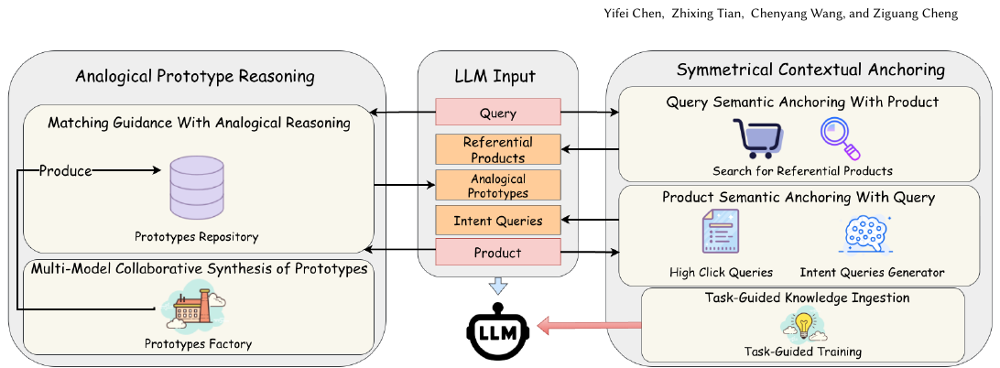
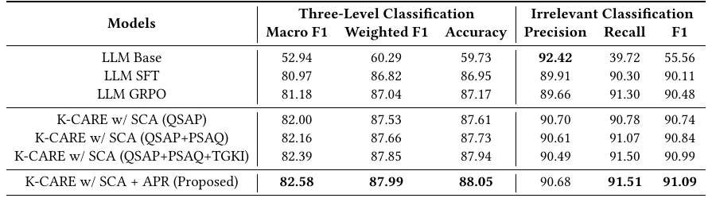

# K-CARE: Knowledge-driven Symmetrical Contextual Anchoring and Analogical Prototype Reasoning for E-commerce Relevance

> **Venue**: arXiv preprint (arXiv:2604.25683v1, 2026-04-28) — 학회 미표기, ACM 포맷 8 pages
> **Authors**: Yifei Chen, Zhixing Tian, Chenyang Wang, Ziguang Cheng (JD.COM, Beijing)
> **Platform**: JD.com 검색 relevance 모델 (3-level: Perfect / Passable / Bad)

---

## 1. Background

### E-commerce Search Relevance의 현황
- Relevance 모듈은 짧은 query와 방대한 상품 inventory를 매칭하는 검색의 관문이며, 정확도가 곧 사용자 경험을 결정한다.
- 모델 계보는 **BERT-style** (ReprBERT, ei-SRC 등) → **LLM** 으로 이동했고, 문제는 "query 이해 → product 이해 → matching rubric 적용"으로 이어지는 **relevance reasoning chain** 으로 정식화되고 있다.
- 최근 LLM 연구는 두 갈래:
  - **SFT/데이터 중심**: LREF (JD, WWW'25) — selection-driven SFT + Multi-CoT + DPO de-biasing
  - **RL 중심**: TaoSR1 (DPO + difficulty-aware GRPO), TaoSR-SHE (step-level reward SRPO), p (rule-aware reward shaping)

### 기존 방법의 한계
| 방법 | 문제점 |
|---|---|
| BM25 / TF-IDF | 의미적 유사도 모델링 불가 |
| DSSM | word hashing 기반 정적 표현 → 다의어 혼동 |
| BERT 계열 (ReprBERT, ei-SRC) | 모델 용량·문맥 모델링 한계 |
| LLM + SFT (LREF) | parametric memory 안에서만 정렬 |
| LLM + RL (TaoSR1/SHE/AGRL) | reasoning **경로**는 개선하지만 **지식 경계(knowledge boundary)** 는 확장하지 못함 |

---

## 2. Motivation

### 핵심 통찰 1: 병목은 reasoning 경로가 아니라 지식 경계다
- JD 실서비스 오류 분석 결과, **지속적으로 남는 실패의 60% 이상**이 모델 parametric memory에 해당 도메인 지식이 없는 **contextual void** 에서 발생한다.
- 예: 구어체 별칭이 특정 브랜드를 가리키는 경우, 묘사형 표현이 특정 카테고리에 해당하는 경우, niche 상품 등.
- 이런 실패는 RL로 reasoning trajectory를 아무리 최적화해도 해결되지 않는다 — 모르는 것을 추론으로 메울 수는 없기 때문.

### 핵심 통찰 2: 지식 공백은 두 종류다
| 유형 | 내용 | 대응 모듈 |
|---|---|---|
| **Semantic void** | idiosyncratic query나 niche product를 해석할 맥락이 없음 | SCA (행동 기반 implicit knowledge) |
| **Ambiguous decision boundary** | 의미는 이해했지만 미묘한 matching rubric 판단이 흔들림 | APR (전문가 큐레이션 prototype) |

- 따라서 K-CARE는 **e-commerce relevance에 특화된 RAG**로 설계됨: "무엇을 retrieve할지"와 "모델이 그 맥락을 어떻게 활용하게 할지"를 함께 다룬다.

---

## 3. Contributions
1. **K-CARE Framework**: LLM의 인지 범위를 parametric memory 밖으로 확장하는 knowledge-driven relevance 프레임워크
2. **Symmetrical Contextual Anchoring (SCA)**: query는 상품으로, 상품은 query로 양방향 grounding — 클릭 로그 sparsity를 search ranking과 P2Q 생성 모델로 보완
3. **Analogical Prototype Reasoning (APR)**: multi-model 합성으로 만든 hard-case prototype + rationale을 in-context로 주입해 decision boundary를 보정
4. **Online A/B**: K-CARE 라벨로 distill한 BERT 배포, JD.com 검색 **Bad Case Rate 12.10% → 11.39% (상대 −5.87%)**

---

## 4. Method



> **Figure 1**: K-CARE 구조. (1) SCA는 양방향 anchor를 통해 행동 기반 implicit knowledge로 reasoning을 grounding하고, (2) APR은 전문가 큐레이션 prototype을 in-context analogy로 활용해 decision boundary를 보정한다. LLM 입력은 Query / Referential Products / Analogical Prototypes / Intent Queries / Product 로 구성된다.

### 문제 정의
```
f : (Q, P) → Y,   Y = {Perfect, Passable, Bad}
목표: P(y | Q, P) 추정
```

### 4.1 Symmetrical Contextual Anchoring (SCA)
지식 획득(QSAP, PSAQ)과 지식 흡수(TGKI)의 두 단계로 구성된다.

#### QSAP — Query Semantic Anchoring with Product
- 목적: query를 **referential products**로 해석 (예: "tf perfume" → 상위 상품이 TOM FORD 향수 → tf = TOM FORD)
- 단순안은 **top-clicked 상품**을 붙이는 것이지만, tail/신규 query는 클릭 로그가 희소한 **cold-start** 문제.
- 해결: **검색 시스템 ranking 결과를 "silver standard"로 사용** — query를 실서비스 검색에 던져 상위 노출 상품을 anchor set으로 사용.
- ranking 결과에 노이즈가 있어도 LLM의 noise-tolerance로 의미 신호를 추출할 수 있다고 주장 → **클릭 이력 0인 query도 anchoring 가능**.

#### PSAQ — Product Semantic Anchoring with Query
- 목적: 상품을 **intent queries**로 해석. 판매자 작성 title은 마케팅 편향(title stuffing 등)이 있으므로 고객 관점(실제 검색 의도)으로 상품의 기능적 정체성을 보강.
- 단순안은 high-click queries를 붙이는 것이지만 long-tail 상품은 역시 희소.
- 해결: 클릭 로그로 학습한 생성형 **Product-to-Query (P2Q) 모델**이 상품당 약 **5~6개 intent query**를 예측해 보충.

#### TGKI — Task-Guided Knowledge Ingestion
- 문제: anchor는 "상품 리스트"처럼 **간접적**이라 LLM이 의미를 추론하는 부담이 크다. 맥락을 주는 것만으로는 부족 (Case 3: TGKI 없이는 TOM FORD anchor를 보고도 tf = TIFFANY로 오판).
- 해결: 4개의 auxiliary task로 anchor 활용법을 명시적으로 학습

#### QSAP · PSAQ · TGKI의 관계
- **QSAP·PSAQ는 맥락을 "가져오는" 방법**이고, **TGKI는 그 맥락을 "읽는 법"을 가르치는 사전 학습 단계**다.
- TGKI의 4개 task 중 `t_q_*`는 QSAP 맥락(query + 상위 노출 상품), `t_p_*`는 PSAQ 맥락(product + 클릭 query)으로 학습한다.

| Task                            | Prompt Template (논문 Table 2)                   | 입력 맥락 출처 | 방향          | 무엇을 가르치나                                                      |
| ------------------------------- | ---------------------------------------------- | -------- | ----------- | ------------------------------------------------------------- |
| t_q_und (Query Understanding)   | query + top-ranked products → query intent 해석  | **QSAP** | 상품들 → query | 상품 목록을 근거로 query 의도 해석 (예: 상위가 TOM FORD 향수 → "tf" = TOM FORD) |
| t_q_pre (Query Prediction)      | top-ranked product → 잠재 검색 query 예측            | **QSAP** | 상품 → query  | 상품에서 검색 query를 역으로 재구성                                        |
| t_p_und (Product Understanding) | product + clicked queries → product profile 합성 | **PSAQ** | query들 → 상품 | query 목록을 근거로 상품의 실제 정체성 정리 (예: 클릭 query가 워터슈즈 → 등산화 아님)      |
| t_p_pre (Product Prediction)    | clicked queries만 → 상품 고유 속성 예측                 | **PSAQ** | query → 상품  | query만으로 상품 속성을 역으로 재구성                                       |

```
            QSAP 맥락                          PSAQ 맥락
   query ──(상위 노출 상품들)            product ──(클릭 query들)

   t_q_und: 상품들 ⇒ query 의도          t_p_und: query들 ⇒ 상품 프로필
   t_q_pre: 상품   ⇒ query 생성          t_p_pre: query들 ⇒ 상품 속성
            └────── 역방향 ──────┘                └────── 역방향 ──────┘
```

- **und vs pre (이해 vs 예측)**: und는 "anchor → 대상 해석"으로 relevance 판정 시 실제로 하는 일을 연습한다. pre는 반대 방향 재구성이다. 각 맥락마다 양방향을 모두 학습한다는 점이 "Symmetrical"의 의미다.
  - 논문 설명: 이해 task는 행동 기반 implicit knowledge의 상호작용 패턴을 내재화해 anchor에서 정보를 추출하는 법을, 예측 task는 주입된 anchor를 relevance 판정에 활용하는 법을 학습시킨다.
- **t_q_pre ≈ P2Q**: PSAQ에서 별도 P2Q 생성 모델이 하는 "상품 → intent query 예측"을 relevance LLM 자신에게도 연습시키는 셈이다.
- **선행 연구와의 유사성**: Meituan의 CPT task(Query/Service Understanding, Query2service/Service2query)와 구성이 거의 같다. 차이는 Meituan은 지식 주입용 continued pre-training으로, K-CARE는 **맥락 활용법 학습**(anchor를 입력으로 받는 형태)으로 쓴다는 점이다.

#### 학습 절차와 한계
- 각 task의 정답 trajectory는 고성능 teacher (예: **GPT-5.2**)가 합성.
- **Decoupled training**: 4개 TGKI task를 joint로 먼저 학습 → 이후 core relevance task로 fine-tuning. ingestion 목적과 relevance 목적 간 gradient 간섭을 막기 위함.
- **추론 시에는 4개 task를 실행하지 않는다**. QSAP·PSAQ 맥락을 붙인 relevance 판정만 수행하며, TGKI는 간접 anchor를 읽는 능력을 미리 익히는 warm-up이다.
- **학습-추론 입력 불일치**: TGKI 템플릿은 "clicked queries"만 쓰지만, 실제 PSAQ 입력은 클릭이 희소할 때 **P2Q가 생성한 query**로 채운다. 생성 query에 대한 TGKI 학습 여부는 기술되지 않았다.
- **기여 크기**: TGKI의 순수 기여는 Macro F1 **+0.23pt** (82.16 → 82.39). 4개 task 각각의 ablation은 없어 어느 task가 효과를 냈는지는 알 수 없다.

### 4.2 Analogical Prototype Reasoning (APR)
SCA가 entity 단위 의미(단방향 이해)를 보강한다면, APR은 **양방향 matching rubric** — "왜 이 상품이 이 query를 만족/불만족하는가" — 을 보정한다.

#### 왜 SCA만으로는 부족한가
- SCA가 채우는 것은 "tf가 무엇인가", "이 상품이 실제로 무엇인가" 같은 **각 entity의 정체**다.
- 그러나 경계 사례의 판정은 두 entity를 이해한 뒤에도 남는 **매칭 규칙**에 달려 있다.
  - 예: query "飞天茅台 53%"와 상품 "茅台 布老 1994 53%"는 브랜드·도수가 같고 둘 다 마오타이 백주라는 것도 안다.
  - 그래도 "백주의 시리즈명은 모델명처럼 엄격히 일치해야 한다"는 규칙을 모르면 관련 있다고 낙관 판정하기 쉽다 (정답 Bad).
- 이런 규칙은 카테고리마다 다르고 암묵적이라 프롬프트에 일반 지침으로 다 적기 어렵다. APR은 규칙을 **"규칙이 적용된 사례 + 근거"** 형태로 보여 준다.

| | SCA | APR |
|---|---|---|
| 보강 대상 | query/product 각각의 의미 (entity-level) | (q, p) 쌍의 판정 기준 (matching rubric) |
| 지식 출처 | 사용자 행동 (검색 ranking, 클릭 로그, P2Q) | 사람 라벨 + 다중 LLM이 합성한 rationale |
| 검색 키 | query 또는 product 단독 | query + product 연결 embedding |
| 주입 형태 | 상품 목록 / query 목록 | `<q, p, l, r>` 사례 1개 |
| 지식 성격 | implicit, 노이즈 허용 | explicit, 검증된 고품질 |

#### Multi-Model Collaborative Synthesis of Prototypes
reasoning quadruplet `S = <q, p, l, r>` (query, product, label, rationale)을 4단계로 합성:

```
(1) Hard Case Mining
    D_hard = { (q, p, l) ∈ D_human_labeled | M_sub(q, p) ≠ l }
    # sub-optimal 모델이 사람 라벨과 다르게 예측한 경계 사례만 수집

(2) Multi-Model Proposal
    P_i = (judge_i, r_i) = M_i(q, p, l),  (q, p, l) ∈ D_hard
    # 이종 모델 앙상블 M_1..M_n 이 "사람 라벨이 맞는지(judge ∈ {0,1})" + 근거 r_i 제안

(3) Cross-Proposal Arbitration
    (judge*, r*) = M_arb(q, p, l, {P_1..P_n})
    D_cons = { (q, p, l, r*) | judge* = 1 }
    # 고성능 중재 모델이 제안들을 종합, 라벨이 검증된 사례만 남김

(4) Linguistic Quality Assurance
    r_final = M_qa(r*),  s.t. Logic(r_final) is coherent
    D_proto = { <q, p, l, r_final> }
```

| 단계 | 모델 | 걸러내는 것 | 남는 것 |
|---|---|---|---|
| (1) Hard Case Mining | M_sub (sub-optimal 모델) | 모델이 이미 맞히는 쉬운 사례 | 모델이 틀리는 경계 사례 |
| (2) Multi-Model Proposal | M_1..M_n (이종 LLM) | – (제안만 생성) | 라벨 타당성 판정 n개 + rationale n개 |
| (3) Cross-Proposal Arbitration | M_arb (고성능 LLM) | 사람 라벨이 틀렸다고 판정된 사례 | 라벨이 검증된 사례 + 통합 rationale r* |
| (4) Linguistic QA | M_qa | 논리·문장이 불완전한 rationale | 다듬은 r_final |

- **설계 의도**: (1)은 "모델이 틀리지만 사람은 맞히는" 사례로 저장소를 채워, retrieval되는 prototype이 실제로 판정을 바꿀 수 있는 정보를 담게 한다. (2)~(3)은 rationale을 단일 LLM에 맡기지 않고 여러 모델의 제안을 중재해, 한 모델의 편향된 설명이 "전문가 근거"로 굳는 것을 막는다.
- **라벨 정제 효과**: (3)에서 judge* = 0인 사례는 **수정되지 않고 버려진다**. 즉 사람 라벨 오류가 prototype으로 들어가는 것은 막지만, 학습 데이터 라벨 자체를 고치는지는 기술되지 않았다.
- **명칭과 실제의 차이**: 논문은 "expert-curated"라고 부르지만, 사람이 하는 일은 원래 라벨링뿐이다. rationale은 전부 LLM이 합성하고 검증한다.
- **명시되지 않은 것**: M_sub, M_i, M_arb, M_qa가 각각 어떤 모델인지, n이 몇인지, D_hard·D_proto 크기가 얼마인지 보고되지 않았다 (TGKI에서만 teacher 예시로 GPT-5.2를 언급).

#### Matching Guidance with Analogical Reasoning (추론 시)
```
v_target = Embed(concat(q, p))
proto*   = argmax_{s ∈ D_proto} sim(v_target, Embed(concat(s.q, s.p)))   # top-1
prompt   = [Query, Referential Products(QSAP), Analogical Prototypes(proto*),
            Intent Queries(PSAQ), Product]  →  LLM  →  {Perfect, Passable, Bad}
```
- query + product를 이어 붙여 embedding → D_proto에서 **가장 유사한 prototype 1개** retrieve → 프롬프트에 주입.
- LLM은 prototype을 "이번 사례와 닮은 선례"로 보고, 그 rationale의 판정 논리를 현재 (q, p)에 대응시킨다 (in-context analogy).
- Case 4: "飞天茅台 53% (京东自营)" vs "茅台 布老 1994 53%". 같은 브랜드 안에서 시리즈명은 모델명처럼 엄격히 매칭해야 한다는 규칙을 prototype이 전달 → Bad로 교정.
- **선행 연구와의 관계**: 인용한 Analogical Prompting (Yasunaga et al., ICLR 2024)은 LLM이 유사 예제를 **스스로 생성**한다. APR은 검증된 저장소에서 **retrieve**하므로, 구조적으로는 retrieval 기반 few-shot (kNN in-context example selection)에 rationale을 붙인 형태다.

#### 기여 크기와 한계
- **기여 크기**: SCA 위에 APR을 더하면 Macro F1 **+0.19pt** (82.39 → 82.58), Bad F1 +0.10pt (90.99 → 91.09). Bad precision은 +0.19pt (90.49 → 90.68), recall은 사실상 그대로(91.50 → 91.51)다. 즉 APR은 주로 **낙관적 오판(Bad를 관련 있다고 판정)**을 줄이는 쪽으로 작용했다. 다만 이는 Case 4와 방향이 일치하는 정황일 뿐, 클래스별 혼동 행렬은 보고되지 않았다.
- **평가 범위의 불일치**: APR은 "경계·long-tail 사례"를 겨냥하지만, 결과는 전체 test set(124,056건, Bad 46%·Perfect 42%로 쉬운 양극단이 대부분) 평균으로만 보고된다. 경계 사례 subset에서의 효과는 측정되지 않았다.
- **빠진 통제 실험**:
  - Random prototype, rationale 없는 prototype(`<q, p, l>`만 제공)과의 비교가 없다. 효과가 "사례 유사성"에서 오는지 "rationale"에서 오는지, 아니면 단순히 입력이 길어진 결과인지 분리되지 않았다.
  - Top-k (k > 1), 유사도 threshold, embedding 모델 선택에 대한 실험이 없다.
- **학습 시 사용 여부와 누출 가능성**: 논문은 APR을 "inference phase"에서 쓴다고만 쓰지만, Figure 1의 입력 구성상 relevance fine-tuning 입력에도 prototype이 들어간 것으로 보인다. D_proto는 사람 라벨 데이터에서 만들어지므로, 학습 샘플이 **자기 자신이나 거의 같은 사례**를 prototype으로 retrieve하면 라벨이 그대로 노출된다. 자기 자신을 제외하는 처리나 test set과의 중복 제거 여부는 기술되지 않았다.
- **서빙 시 소멸**: 온라인에서는 BERT student가 prototype 없이 (q, p)만 본다. APR의 효과는 teacher 라벨 품질을 통해 간접적으로만 전달된다.

#### 학습 vs 추론
| 단계 | 과정 |
|---|---|
| **학습** | (1) TGKI 4개 task joint 학습 → (2) SCA/APR 맥락이 포함된 입력으로 relevance task fine-tuning (Qwen3-8B) |
| **추론 (오프라인 teacher)** | query → 실서비스 검색으로 referential products 확보, product → high-click / P2Q intent queries, (q,p) embedding → prototype 1개 retrieve → 3-class 판정 |
| **온라인 서빙** | 8B LLM을 직접 서빙하지 않음. K-CARE가 대규모 unlabeled 데이터에 라벨을 생성 → **compact BERT를 label distillation(SFT)** 해서 서빙 |

---

## 5. Experiments

### 5.1 Dataset
| | JD Test Set |
|---|---|
| 출처 | JD 실서비스 검색 로그 샘플링 |
| 언어 | 중국어 |
| Label | Perfect / Passable / Bad (multi-turn human verification) |
| 규모 | 124,056 query-product pairs |
| 분포 | Bad 46.02% (57,091) / Passable 11.83% (14,682) / Perfect 42.14% (52,283) |

- Bad + Perfect가 88% 이상인 **bimodal 분포**. Bad 비중이 46%로 높아 Bad 탐지(Irrelevant Classification)를 별도 지표로 강조.
- 학습 데이터 규모는 공개되지 않음 ("high-quality relevance datasets"로만 기술).

### 5.2 Implementation Details
- Backbone: **Qwen3-8B** (모든 baseline도 동일 초기화)
- 학습: 32 × Ascend 910B NPU, batch 16/NPU, AdamW lr 1e-5, weight decay 0.1, DeepSpeed ZeRO-2, max length 690, 1 epoch
- 추론: vLLM, temperature 0
- TGKI 정답 합성 teacher: GPT-5.2

### 5.3 Main Results



> **Table 1**: 평가 결과. 3-level 분류(Macro F1, Weighted F1, Accuracy)와 Bad 클래스 분류(Precision, Recall, F1). 아래 블록은 SCA/APR 구성 요소를 누적 추가한 결과.

| Model | Macro F1 | Acc | Bad P | Bad R | Bad F1 |
|---|---|---|---|---|---|
| LLM Base (zero-shot) | 52.94 | 59.73 | **92.42** | 39.72 | 55.56 |
| LLM SFT | 80.97 | 86.95 | 89.91 | 90.30 | 90.11 |
| LLM GRPO | 81.18 | 87.17 | 89.66 | 91.30 | 90.48 |
| **K-CARE (SCA + APR)** | **82.58** | **88.05** | 90.68 | **91.51** | **91.09** |

- **Zero-shot LLM의 optimistic bias**: Bad precision 92.42%인데 recall 39.72% — 웬만하면 "관련 있음"으로 판정. SFT가 이를 크게 교정 (Macro F1 +28.0pt).
- **GRPO의 한계 확인**: SFT 대비 Macro F1 **+0.21pt**에 그침 → "reasoning 경로 최적화만으로는 정체된다"는 논문 주장의 근거.
- **K-CARE**: GRPO 대비 Macro F1 **+1.40pt**, Bad F1 **+0.61pt**, Bad precision도 +1.02pt 회복.
- 주의: K-CARE는 GRPO 위가 아니라 SFT 계열 위에 맥락을 추가한 것으로 보이며(본문에 RL 결합 여부 불명확), 개선폭은 1~1.5pt 수준이고 분산/유의성 보고는 없다.

### 5.4 Ablation Study (누적)
| 구성 | Macro F1 | Bad F1 | 직전 대비 ΔMacro F1 |
|---|---|---|---|
| LLM GRPO (참조) | 81.18 | 90.48 | – |
| + SCA (QSAP) | 82.00 | 90.74 | **+0.82** (GRPO 대비) |
| + PSAQ | 82.16 | 90.84 | +0.16 |
| + TGKI | 82.39 | 90.99 | +0.23 |
| + APR (Full) | 82.58 | 91.09 | +0.19 |

- **QSAP(query → 상위 노출 상품)가 가장 큰 단일 기여** (+0.82). 즉 "실서비스 검색 결과를 맥락으로 붙이는 것" 하나가 개선의 절반 이상.
- PSAQ, TGKI, APR은 각각 +0.2pt 안팎의 점진적 개선.
- Random context / random prototype 같은 대조 실험은 없음 — 개선이 "지식"에서 오는지 "입력 길이·형식"에서 오는지는 분리되지 않았다.

### 5.5 Online A/B Test
- 서빙 모델: K-CARE teacher 라벨로 distill한 **compact BERT** (teacher 대비 latency 한 자릿수 이상 감소라고 기술)
- 프로토콜: 다양한 카테고리의 대표 query **10,000개**를 고정해 3개 slot(Base1, Base2 = 기존 production, Test = K-CARE-distilled BERT)에 동일하게 흘려 traffic 변동을 배제
- 지표: **Bad Case Rate** = top-10 결과에 Bad 라벨 상품이 1개 이상 포함된 query 비율

| Session | Bad Case Rate |
|---|---|
| Base1 | 12.11% |
| Base2 | 12.09% |
| **Test (K-CARE)** | **11.39%** (상대 −5.87%) |

- 본문에는 "12.10% → 11.3%"로 표기되었으나 Table 4와 상대 감소율(5.87%) 계산상 **11.39%** 가 맞다.
- CTR/GMV 등 비즈니스 지표는 보고되지 않음.

### 5.6 Case Study
| Case | 모듈 | 내용 |
|---|---|---|
| 1 | QSAP | "纽泰特 심층가수분해 분유" vs "纽康特 아미노산 분유" — 한 글자 차이 근사 동음 브랜드. 상위 노출 상품으로 纽泰特 = Pepti Junior 임을 확인 → Bad |
| 2 | PSAQ | "hiking boots" vs 등산화·워터슈즈 키워드를 모두 넣은 title stuffing 상품. 클릭 query가 워터슈즈 의도를 드러냄 → Bad |
| 3 | TGKI | "tf perfume" vs TIFFANY 향수. anchor(TOM FORD)를 줘도 TGKI 없으면 오판, TGKI 후 정답 |
| 4 | APR | "飞天茅台 53%" vs "茅台 布老 1994 53%". 동일 브랜드 내 시리즈 엄격 매칭 규칙을 prototype이 전달 → Bad |

---

## 6. Key Takeaways
1. **진단의 전환 — 경로가 아니라 지식**: 남은 실패의 **60% 이상**이 contextual void이고, GRPO는 SFT 대비 Macro F1 +0.21pt에 그친다. RL 일변도였던 TaoSR 계열과 대비되는 문제 설정.
2. **실서비스 검색 결과 = 가장 싼 지식원**: query를 production 검색에 던져 얻은 상위 상품(QSAP)만으로 **+0.82pt**, 전체 개선의 약 60%. 클릭 로그 없는 tail query에도 적용된다는 점이 핵심.
3. **맥락 주입만으로는 부족, 활용법을 가르쳐야 한다**: TGKI의 4개 auxiliary task(이해/예측 × query/product)를 먼저 학습하는 decoupled training으로 간접 anchor 활용 능력을 확보 (Case 3).
4. **Prototype 합성 파이프라인이 곧 라벨 정제기**: hard case mining → multi-model proposal → arbitration → QA 과정에서 사람 라벨까지 교차 검증. 추론 시 유사 prototype 1개 주입으로 Bad F1 추가 개선.
5. **배포는 여전히 LLM → BERT 증류**: 8B teacher는 라벨 생성에만 쓰고 BERT를 서빙, **Bad Case Rate −5.87% (12.10% → 11.39%)**. 무거운 RAG 맥락 수집 비용을 오프라인으로 격리하는 실용적 구조.
6. **한계**: 오프라인 개선폭이 1~1.5pt 수준이고 분산·유의성, random-context 대조, 학습 데이터 규모, 비즈니스 지표가 없다. 실서비스 ranking을 anchor로 쓰므로 ranking 품질에 의존하는 순환 구조(현재 시스템의 오류가 teacher 맥락으로 유입될 위험)도 검증되지 않았다.
