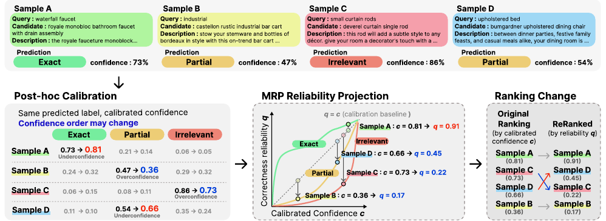
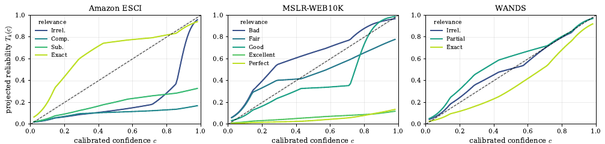
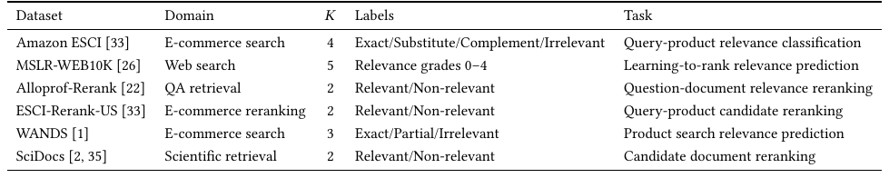

# Post-Calibration Reliability Reranking of Relevance Decisions via Label-wise Monotone Projection

> **Venue**: CIKM '26 (November 7–11, 2026, Rome, Italy) / arXiv:2608.10406v1 (2026-08-11)
> **Authors**: Inwoo Tae (UNIST), Yongjae Lee (UNIST, LinqAlpha)
> **Platform**: 특정 서비스 없음 — 공개 relevance 데이터셋 6종 (e-commerce 3종 포함)

---

## 1. Background

### Relevance Prediction과 Confidence의 현황
- Web search, product search, QA retrieval 시스템은 query-candidate 쌍마다 **relevance label**(예: Exact / Partial / Irrelevant)과 **confidence**를 함께 출력한다.
- 실서비스에서 confidence는 단순 참고값이 아니라 **의사결정 신호**다: 결과를 바로 노출할지, 더 무거운 reranker/LLM으로 보낼지(fallback), 사람 검수로 보낼지(review)를 결정한다.
- 따라서 confidence가 실제 정답률과 어긋나면, 틀린 예측을 과신하거나 맞는 예측을 불필요하게 fallback으로 보내게 된다 → **post-hoc calibration** (Temperature Scaling 등)이 표준 처방.

### 기존 방법의 한계
| 방법 | 문제점 |
|---|---|
| Post-hoc calibration (TS, DIAG, Spline, h-cal, SMART) | "confidence c인 예측들의 **평균** 정답률 = c"만 맞춘다. 같은 confidence 안에서 **어떤 label을 예측했는지**에 따른 정답률 차이는 남는다 |
| Label-wise class-probability calibrator | 클래스 확률 자체를 바꿔 예측 label·확률 벡터가 변할 수 있음 |
| Selective prediction / learning-to-defer | "얼마나 걸러내면 에러가 줄어드는가"에 초점. calibration 이후 남은 잔여 위험의 **순서 매기기**는 별도로 다루지 않음 |
| ECE 지표 | 평균적 scale 정합만 평가 — 같은 confidence 내 이질성을 보지 못함 |

---

## 2. Motivation

### 핵심 통찰 1: Calibration ≠ Reliability Reranking
- **Relevance**는 "query와 candidate가 얼마나 맞는가", **Reliability**는 "그 relevance 판정이 맞았을 확률"로 구분한다.
- 표준 top-label calibration 조건:
```
P(Z = 1 | C = c) = c        # Z = 1{Y = d(x)}: 고정된 판정이 맞았는지
```
- 그러나 confidence만으로 충분하려면 다음 귀무가설이 성립해야 한다:
```
H0: P(Z = 1 | C = c, D = k) = P(Z = 1 | C = c)   for all c, k
```
- 즉, **같은 calibrated confidence라면 어떤 label을 예측했든 정답률이 같아야** 한다. 이것이 깨지면 confidence 순 정렬은 잔여 위험(residual risk) 순서를 잘못 매긴다.
- 실제로 ESCI-Rerank-US에서 TS/DIAG/Spline/SMART는 ECE를 0.183 → 0.007~0.015로 크게 줄이지만, confidence 기반 AUPR-Error는 **0.462 그대로**다. calibration은 scale만 고치고 순서는 고치지 못한다.

### 핵심 통찰 2: 잔여 신뢰도는 예측 label에 따라 크게 다르다 (실증)
- confidence 구간별로 residual `Z − c`의 평균이 예측 label 간에 얼마나 벌어지는지(Spread)를 측정, label을 섞은 random baseline(95th percentile)과 비교:

```
Spread(B) = max_k E[Z − c | X ∈ B, D = k] − min_k E[Z − c | X ∈ B, D = k]
```

| Dataset | Label spread | Random | Ratio |
|---|---|---|---|
| ESCI-Rerank-US | 26.7pp | 3.8pp | 6.9× |
| MSLR-WEB10K | 59.8pp | 4.3pp | **13.8×** |
| Amazon ESCI | **60.8pp** | 8.1pp | 7.5× |
| SciDocs | 6.6pp | 4.2pp | 1.6× |
| WANDS | 14.3pp | 3.0pp | 4.8× |
| Alloprof-Rerank | 57.3pp | 4.9pp | 11.6× |

- 6개 데이터셋 × 18/18 seed 전부에서 random보다 크다 → **H0는 경험적으로 기각**. 같은 confidence 안에서도 예측 label에 따라 정답률이 수십 %p 차이 난다.



> **Figure 1**: MRP 개요. 각 행은 고정된 query-candidate relevance 예측이다. Post-hoc calibration은 예측 label의 confidence를 갱신하고, MRP는 이 calibrated confidence를 label별 correctness reliability로 사상해 같은 예측들을 위험도 순으로 재정렬한다. 하단은 confidence 기반 순서(A > C > D > B)와 MRP reliability 순서(A > D > C > B)가 달라지는 예시 — 예컨대 Irrelevant로 예측한 Sample C는 c = 0.73이지만 q = 0.22로 떨어진다. 이것은 후보 상품의 retrieval ranking이 아니라 **예측 자체의 reliability reranking**이다.

---

## 3. Contributions
1. **문제 정의 — Post-calibration residual reliability**: 고정된 relevance 판정에 대한 reliability reranking을 class-probability recalibration 및 relevance 기반 candidate ranking과 분리된 문제로 정식화
2. **MRP (Label-wise Monotone Reliability Projection)**: label별 단조 함수 T_k(c)로 calibrated confidence를 correctness reliability로 사상. 예측 label과 calibrated 확률 벡터는 그대로 유지 → **Accuracy·ECE 불변**
3. **광범위한 실증**: 6개 데이터셋 × 6개 calibrator에서 NLL_correct와 AURC를 일관 개선, budgeted fallback에서 평균 SelAcc 양(+)의 개선
4. **Structural ablation**: 이득의 원천이 global confidence 재사상이 아니라 **label-conditioned residual reliability**임을 규명
5. **MRC (부가 분석)**: MRP 점수를 top-label 확률 기하(simplex)에 다시 넣을 수 있는지 compatibility 분석

---

## 4. Method

### 4.1 Fixed-Decision Protocol
- base predictor 출력 `p0(x)`에서 판정을 고정한다:
```
d(x) = argmax_k p0_k(x)          # 고정 판정 (calibration이 바꾸지 못함)
Z(x) = 1{Y = d(x)}               # 판정 정답 여부
c_A(x) = [p_A(x)]_{d(x)}         # calibrator A가 그 판정에 부여한 confidence
```
- calibrated top label이 바뀌더라도 d(x)를 재평가하지 않으므로, **calibration과 MRP 모두 decision accuracy를 바꿀 수 없다** → reliability reranking 효과만 깨끗하게 분리.
- Baseline reliability: `q_∅(x) = c_A(x)` (calibrated confidence를 그대로 사용)

### 4.2 Label-wise Monotone Reliability Projection (MRP)
```
q_MRP(x) = T_{d(x)}( c_A(x) )       # 예측 label별 별도 함수
T_k : [0,1] → [0,1]
c ≤ c'  ⇒  T_k(c) ≤ T_k(c')   ∀k    # 단조 제약
```
- **단조성의 의미**: 같은 label 안에서는 confidence 순서를 보존한다. 순서가 바뀌는 것은 **label 간** 뿐이다 → 과적합을 막는 강한 inductive bias.
- 추론 시 예측들을 `1 − q_MRP(x)` (추정 에러 확률) 내림차순으로 정렬해 fallback/review 우선순위로 사용.
- **q_MRP는 multiclass 확률 벡터가 아니다**: "고정 판정이 맞을 확률" 스칼라일 뿐이며, 나머지 1 − q를 다른 label에 배분하지 않는다. 기존 `p_A(x)`는 class 확률 추정치로 그대로 남는다.



> **Figure 2**: SMART calibration 하에서 학습된 label별 reliability 곡선 T_k(c). 점선은 항등선 q = c. 같은 calibrated confidence라도 예측 label에 따라 correctness reliability가 크게 달라진다. 예: Amazon ESCI에서 **Exact** 예측은 c = 0.4에서 이미 q ≈ 0.74(underconfident)인 반면 **Substitute/Complement** 예측은 c = 1.0 근처에서도 q ≈ 0.17~0.33(심한 overconfident). WANDS는 반대로 Exact가 항등선 아래에 있다.

### 4.3 Monotone Lattice Implementation
T_k를 임의 함수가 아닌 **confidence 축 위의 1D 단조 lattice**로 표현:
```
knots:   0 = u_1 < ... < u_J = 1           (J = 8)
logit-scale lattice values (단조 보장):
  a_{k,j} = b_k + Σ_{r<j} softplus(η_{k,r})     # 증분이 항상 ≥ 0
linear interpolation on [u_j, u_{j+1}]:
  ã_k(c) = (u_{j+1} − c)/(u_{j+1} − u_j) · a_{k,j} + (c − u_j)/(u_{j+1} − u_j) · a_{k,j+1}
T_k(c) = σ( ã_k(c) )                        # [0,1] 범위 + 단조성 동시 보장
```

#### Training Objective
```
L_ρ(T; S_fit) = (1/m) Σ_i BCE( Z_i, T_{d_i}(c_i) ) + ρ · R_Δ2(T)

BCE(z, q) = −z log q − (1 − z) log(1 − q)

R_Δ2(T) = 1/(K(J−2)) · Σ_k Σ_{j=2}^{J−1} ( a_{k,j+1} − 2 a_{k,j} + a_{k,j−1} )^2
```
- **BCE**: 판정 정답 여부(Z)에 reliability를 맞춤
- **R_Δ2 (2차 차분 정규화)**: label별 곡선의 진동을 억제 — label별 샘플이 적을 때의 유한 표본 불안정성 완화

### 4.4 Ablation Variants (중첩 진단 시퀀스)
| Variant | 형태 | 검증하는 가설 |
|---|---|---|
| Conf. | q = c | 기준선 |
| Shared 1D | T(c) — label 무관 단일 곡선 | global confidence 불일치만 있는가? |
| Label-only intercept | q = σ(logit(c) + α_{d(x)}) | 고정된 label별 bias로 설명되는가? |
| Per-label isotonic | label별 비모수 isotonic | smooth 제약 없는 label별 단조 사상 |
| **MRP (Label-wise 1D)** | T_k(c) smooth lattice | 주 방법 |
| Label-wise 2D | T_k(c, g), g = top-runner logit gap | decision margin이 추가 정보를 주는가? |

#### 학습 vs 추론
| 단계 | 과정 |
|---|---|
| **학습** | validation을 calibrator-fit / projection-fit / projection-selection으로 3분할 → calibrator A 학습 → projection-fit의 (c_A, d, Z) 삼중쌍으로 T_k 학습 (Adam, lr 0.03, ≤ 400 epochs) |
| **추론** | 예측 label·확률은 그대로 노출, 별도로 `q = T_{d(x)}(c_A(x))` 계산 → 낮은 q부터 fallback/review로 라우팅 |

### 4.5 MRC: Reliability-to-Probability Projection (부가 분석)
- 질문: MRP 점수를 다시 "top-label 확률"로 넣을 수 있는가?
- calibrated 벡터를 sample-wise power-temperature 경로 위에서 움직여 top-label 확률이 q_MRP가 되는 α_i를 찾는다:
```
p_k^{A,α}(x) = (p_k^A(x))^α / Σ_j (p_j^A(x))^α
find α_i ≥ 0  s.t.  p_{d(x_i)}^{A,α_i}(x_i) = q_MRP(x_i)
```
- α → 0이면 simplex 중심(1/K), α → ∞이면 argmax vertex로 이동하므로, **q_MRP < 1/K 이면 불가능**(판정 label을 유지한 채 그 확률을 1/K 아래로 내릴 수 없음).

---

## 5. Experiments

### 5.1 Dataset



> **Table 1**: 실험에 사용한 relevance prediction 데이터셋. K는 relevance 클래스 수.

| | Amazon ESCI | WANDS | ESCI-Rerank-US | MSLR-WEB10K | Alloprof-Rerank | SciDocs |
|---|---|---|---|---|---|---|
| 도메인 | E-commerce search | E-commerce search (Wayfair) | E-commerce reranking | Web search | QA retrieval | Scientific retrieval |
| K | 4 | 3 | 2 | 5 | 2 | 2 |
| Label | Exact/Sub/Comp/Irrel | Exact/Partial/Irrel | Rel/Non-rel | grade 0–4 | Rel/Non-rel | Rel/Non-rel |

### 5.2 Implementation Details
- **Base predictor는 의도적으로 약하게**: 텍스트 데이터는 query+candidate 텍스트를 이어붙인 **lightweight linear classifier**, MSLR은 제공 feature 사용. 목적은 SOTA relevance 모델이 아니라 calibration과 MRP를 공정하게 비교할 고정 예측 소스를 만드는 것.
- Base predictor는 model seed 0으로 1회 학습, calibrator + MRP는 protocol seed 1/2/3으로 반복.
- Calibrators: Uncal.(identity), **TS**, **DIAG** (intra order-preserving), **Spline** (top-label), **h-cal**, **SMART** (sample margin-aware TS)
- MRP: J = 8 knots, ρ = 1e-4, Adam lr 0.03, max 400 epochs, projection-fit/selection 각 최대 8,000 샘플
- 환경: PyTorch 2.1.0, 단일 RTX A5000 — saved logits 위에서 학습하므로 매우 가벼움

### 5.3 Main Results (Table 2 요약, SMART calibrator 기준)
| Dataset | Acc | ECE | NLL_correct (Conf → MRP) | AUPR-Error (Conf → MRP) | AURC (Conf → MRP) |
|---|---|---|---|---|---|
| ESCI-Rerank-US | 0.571 | 0.007 | 0.680 → 0.647 | 0.462 → **0.558** (+0.097) | 0.385 → 0.332 |
| MSLR-WEB10K | 0.394 | 0.114 | 0.637 → 0.456 | 0.723 → **0.902** (+0.179) | 0.457 → 0.357 |
| Amazon ESCI | 0.764 | 0.021 | 0.516 → 0.468 | 0.392 → **0.525** (+0.133) | 0.162 → 0.152 |
| SciDocs | 0.562 | 0.016 | 0.681 → 0.680 | 0.480 → 0.477 (−0.002) | 0.398 → 0.381 |
| WANDS | 0.777 | 0.006 | 0.441 → 0.437 | 0.463 → 0.489 (+0.026) | 0.091 → 0.088 |
| Alloprof-Rerank | 0.757 | 0.014 | 0.459 → 0.300 | 0.443 → **0.761** (+0.318) | 0.099 → 0.059 |

- **Acc·ECE는 MRP 적용 전후 동일** (설계상 불변) — 개선은 오직 "어떤 예측을 먼저 의심할지"의 순서에서 나온다.
- 이득은 **Spread가 큰 데이터셋**(MSLR, Alloprof, Amazon ESCI)에서 크고, Spread가 작은 **SciDocs(1.6×)에서는 AUPR-Error 거의 불변** — Motivation의 진단과 정확히 일치.
- **Calibrator와 거의 무관**: 같은 데이터셋 안에서 6개 calibrator 모두 MRP 후 수치가 거의 같아진다 (예: ESCI-Rerank-US AUPR-Error 0.558~0.563). 즉 MRP는 calibrator 선택을 흡수하는 독립 layer.
- e-commerce 관점: Amazon ESCI에서 AUPR-Error **+34% 상대 개선**(0.392 → 0.525), WANDS는 Spread가 작아(4.8×) 개선 미미.

### 5.4 Budgeted Fallback (운영 관점)
coverage τ만큼 저위험 예측을 자동 처리하고 나머지는 fallback/review로 보낼 때, 자동 처리분의 정확도(SelAcc) 향상:

| Dataset | τ=10% | 50% | 70% | 90% |
|---|---|---|---|---|
| ESCI-Rerank-US | +0.043 | +0.082 | +0.056 | +0.016 |
| MSLR-WEB10K | **+0.331** | +0.174 | +0.113 | +0.028 |
| Amazon ESCI | +0.003 | +0.007 | +0.014 | +0.030 |
| SciDocs | +0.074 | −0.003 | −0.003 | −0.001 |
| WANDS | +0.005 | +0.002 | +0.004 | +0.004 |
| Alloprof-Rerank | +0.000 | +0.050 | +0.101 | +0.041 |
| **Average** | **+0.076** | **+0.052** | **+0.047** | **+0.020** |

- 모든 coverage에서 평균 양(+), **자동 처리 예산이 작을수록(τ 작을수록) 이득이 큼** — fallback 자원이 빠듯한 상황에서 가장 유용.
- 다만 Amazon ESCI·WANDS의 SelAcc 개선은 +0.2~3.0%p로 작다. AUPR-Error 개선이 큰 것과 비교해 실제 운영 이득은 제한적일 수 있다.

### 5.5 Ablation Study (Table 5, 전 설정 평균)
| Variant | C-NLL ↓ | AUPR-Error ↑ | AURC ↓ | SelAcc@50 ↑ |
|---|---|---|---|---|
| Conf. | 0.6181 | 0.4876 | 0.2775 | 0.7279 |
| Shared 1D | 0.5720 | 0.4876 | 0.2775 | 0.7279 |
| Label-only intercept | 0.5132 | 0.6160 | 0.2302 | 0.7773 |
| Per-label isotonic | 0.5166 | 0.6148 | 0.2294 | 0.7782 |
| **MRP (Label-wise 1D)** | 0.4977 | **0.6185** | **0.2273** | **0.7800** |
| Label-wise 2D | **0.4975** | 0.6184 | 0.2274 | 0.7795 |

- **Shared 1D**: NLL은 개선되지만 reranking 지표는 **정확히 동일** — label 무관 단조 함수는 순서를 바꿀 수 없으므로 당연한 결과. "확률 fit 개선 ≠ 위험 순서 개선"의 명확한 증거.
- **label 정보를 넣는 순간 reranking 지표가 점프** (AUPR-Error 0.488 → 0.616). 이득의 대부분은 **label-conditioned structure** 그 자체에서 온다.
- MRP vs Label-only intercept / Per-label isotonic의 차이는 **미미**(AUPR-Error +0.003 수준) — 저자도 "MRP가 모든 label-wise 대안을 압도한다고 읽어서는 안 된다"고 명시. MRP의 장점은 smooth 정규화로 인한 NLL 개선 정도.
- **Label-wise 2D**(top-runner gap 추가)는 1D와 사실상 동일 → decision margin은 추가 정보를 주지 않음.
- **Robustness**: MSLR에서 더 강한 LightGBM base (Acc 0.394 → 0.518, ECE 0.292 → 0.014)를 써도 MRP가 NLL_correct 0.629 → 0.586, AUPR-Error 0.631 → 0.730, AURC 0.318 → 0.286으로 개선 — 약한 linear base에만 국한된 현상이 아님.

### 5.6 MRC Projection 결과
- MRC는 NLL·Brier를 자주 개선하고, base가 poorly calibrated일 때 ECE도 줄인다 (예: MSLR Uncal. ECE 0.292 → 0.070).
- 그러나 강한 calibrator(TS, SMART 등) 위에서는 ECE가 오히려 악화되는 경우가 많다 (ESCI-Rerank-US SMART 0.007 → 0.048).
- **Infeasible 비율(q < 1/K)**: Amazon ESCI 7.2%, WANDS ~1.0%로 낮지만, ESCI-Rerank-US·MSLR·Alloprof는 25~38%로 높다.
- 결론: MRC는 "reliability 공간이 확률 기하에 들어맞는가"의 compatibility 분석일 뿐, 표준 multiclass calibration의 대체물이 아니다.

---

## 6. Key Takeaways
1. **Calibration은 reliability 문제를 끝내지 않는다**: ESCI-Rerank-US에서 calibrator들이 ECE를 0.18 → 0.01로 줄여도 AUPR-Error는 0.462로 불변. MRP를 얹으면 0.558. "scale 정합"과 "위험 순서"는 별개 축이다.
2. **잔여 위험의 핵심은 예측 label**: 같은 confidence 내 label 간 residual spread가 random 대비 최대 **13.8×** (MSLR), Amazon ESCI는 **60.8pp**. Shared 1D는 reranking 지표를 전혀 못 바꾸고, label을 넣는 순간 AUPR-Error 0.49 → 0.62.
3. **예측·확률은 그대로, 순서만 바꾸는 "안전한" layer**: Acc·ECE 불변, 기존 calibrator와 독립적으로 얹을 수 있고, saved logits 위에서 label당 8개 파라미터 수준으로 학습 — 배포 리스크와 비용이 매우 작다.
4. **Fallback 예산이 작을수록 유용**: 평균 SelAcc 개선 τ=10%에서 +0.076, τ=90%에서 +0.020. LLM 재판정·사람 검수로 보낼 몫을 고르는 relevance 파이프라인(예: BERT 1차 판정 → 의심 건만 LLM)에 직접 응용 가능.
5. **방법론 자체의 차별성은 작다**: MRP와 label-only intercept / per-label isotonic의 차이는 AUPR-Error 0.003 수준. 실무적으로는 "label별 Platt/isotonic 하나 더 얹기"만으로도 이득의 대부분을 얻을 수 있다는 것이 더 중요한 교훈.
6. **한계**: base predictor가 linear classifier 수준으로 약해 실서비스 BERT/LLM relevance 모델에서의 효과는 미검증. e-commerce 데이터 중 WANDS는 개선이 미미하고, query 의존 reliability나 candidate ranking과의 joint 최적화는 future work로 남았다.
