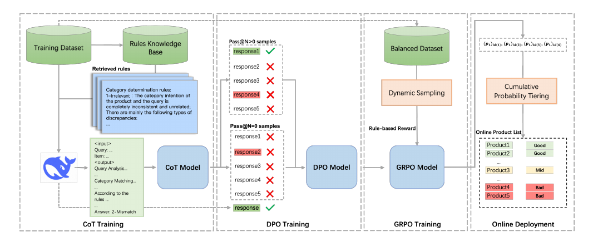
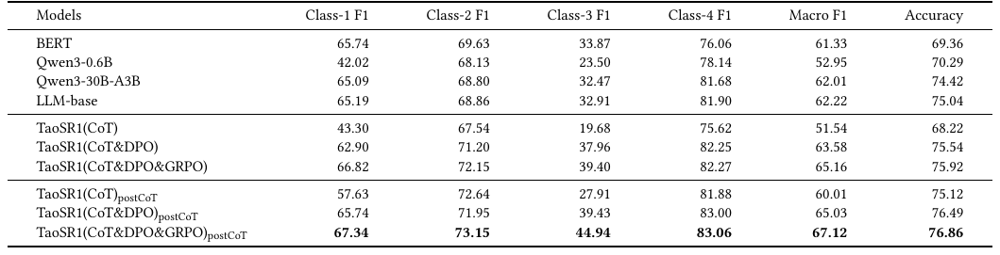

# TaoSR1: The Thinking Model for E-commerce Relevance Search

> **Venue**: arXiv preprint (arXiv:2508.12365, 2025-08 초판 / v4 2026-03-10) — 학회 미표기 (ACM 템플릿 placeholder)
> **Authors**: Chenhe Dong*, Shaowei Yao*†, Pengkun Jiao, Jianhui Yang, Yiming Jin, Zerui Huang, Xiaojiang Zhou, Dan Ou, Haihong Tang, Bo Zheng (Taobao & Tmall Group of Alibaba, Fudan University, Tsinghua University) — * equal contribution, † corresponding
> **Platform**: Taobao 메인 검색 query-item relevance 모델 (4-tier: 4-Excellent / 3-Related / 2-Mismatch / 1-Irrelevant)

---

## 1. Background

### E-commerce Search Relevance의 현황
- Query-item relevance는 검색 결과 품질과 장기 사용자 가치를 좌우하는 e-commerce 검색의 근간 기술이다.
- 지금까지는 **BERT 기반 encoder**가 주력이었고 검색 수요의 80~90%는 충분히 처리한다. 그러나 **나머지 10% 이상의 long-tail 복잡 query**(부정, 대체품, QA형, 지식형)는 깊은 의미 이해와 추론이 필요해 품질이 일관되지 않다.
- BERT는 bidirectional attention의 low-rank 문제로 파라미터 scaling에 한계가 있어 상한이 막혀 있다.
- LLM을 relevance에 쓰는 연구(RankLLaMA, LREF, ProRBP 등)가 늘었지만, 대부분 **discriminative 패러다임**을 유지하거나 **BERT로 distill해서 배포**한다 → 복잡한 추론이 필요한 query를 근본적으로 해결하지 못함.

### 기존 방법의 한계
| 방법 | 문제점 |
|---|---|
| BM25 / TF-IDF / 표현 기반 DL | 수작업 feature, 광범위한 지식 모델링 불가 |
| BERT fine-tuning | long-tail 추론 query 취약, scaling 상한 |
| LLM discriminative SFT (EOS hidden state + head) | LLM을 순수 분류기로 붕괴시켜 생성 능력·사전학습 지식을 활용하지 못함 |
| LLM → BERT distillation | 배포 모델의 추론 능력이 결국 BERT 수준으로 제한 |
| LLM + CoT 직접 적용 | 출력 토큰 증가로 latency 폭증, CoT 중간 오류 누적, discriminative hallucination |

---

## 2. Motivation

### 핵심 통찰 1: CoT를 그대로 넣으면 오히려 성능이 떨어진다
- LLM을 생성형으로 서빙하려 할 때 세 가지 도전이 있다:
  1. **Deployment latency**: 한 query당 수백 개 후보에 대해 CoT를 생성하는 것은 실시간 불가
  2. **Error accumulation in CoT**: 긴 중간 과정의 작은 hallucination이 최종 판정을 오염
  3. **Discriminative hallucination**: 추론은 맞는데 최종 답이 틀리는 현상
- 실제로 "think-then-respond" CoT SFT 모델은 discriminative LLM base보다 **Macro F1 62.22 → 51.54 (−10.7pt)** 로 크게 하락.

### 핵심 통찰 2: Pass@N은 base를 넘는다 → RL로 끌어올릴 여지가 있다
- CoT 모델을 여러 번 샘플링하면 정답을 하나라도 맞히는 비율(pass@N)이 N에 따라 빠르게 오른다:

| Model | Accuracy |
|---|---|
| LLM base (discriminative) | 75.01 |
| TaoSR1(CoT) Pass@1 | 67.38 |
| TaoSR1(CoT) Pass@2 | 74.26 |
| TaoSR1(CoT) Pass@3 | 77.68 |
| TaoSR1(CoT) Pass@5 | **81.73** |

- 단일 decoding은 base보다 7.6pt 낮지만 Pass@3부터 base를 넘는다 → 모델 안에 정답 경로가 있으나 안정적으로 선택하지 못할 뿐이며, **preference 최적화/RL로 꺼낼 수 있다**는 근거.
- Pass@5 분포: 0회 정답 13.7%, 5회 모두 정답 64.1%, 1~4회 정답 22.2%.

---

## 3. Contributions
1. **RAG 기반 CoT SFT**: 비즈니스 규칙을 atomic rule로 분해해 knowledge base화하고, DeepSeek-R1로 규칙을 인용하는 5단계 구조화 CoT를 합성
2. **Pass@N 기반 DPO**: 풀 수 있는 사례는 자기 정답/오답으로 self-correction, 못 푸는 사례(pass@N = 0)는 DeepSeek-R1 정답을 chosen으로 쓰는 oracle-guided correction
3. **Difficulty-based dynamic sampling GRPO**: 전부 정답·전부 오답 그룹은 버리고, label 분포를 균형화해 discriminative hallucination을 30% 감소
4. **Post-CoT (respond-then-think) + CumPT**: label을 먼저 생성해 첫 토큰 확률만으로 판정 → prefill만으로 서빙. 단일 threshold로 3-tier 분할하는 Cumulative Probability Tiering
5. **생성형 LLM 직접 서빙**: Tbstar-42B(MoE, 3.5B active)를 BERT distillation 없이 직접 배포, RT 800 → 286 ms. Side-by-side GSB +10.9~34.4%

---

## 4. Method



> **Figure 1**: TaoSR1 프레임워크. (1) 규칙 knowledge base에서 검색한 규칙으로 CoT를 합성해 SFT, (2) pass@N 다중 샘플링 + DPO로 생성 품질 향상(pass@N > 0은 자기 정답, pass@N = 0은 DeepSeek-R1 정답을 chosen으로), (3) 균형 데이터셋 + difficulty 기반 dynamic sampling GRPO로 discriminative hallucination 완화, (4) 첫 토큰 확률에 Cumulative Probability Tiering을 적용해 Good / Mid / Bad로 온라인 분할.

### 4.1 SFT with CoT

#### 생성형 학습 패러다임
- 기존 discriminative 방식: `[CLS]`/EOS 표현 위에 head를 붙여 MSE 회귀 또는 CE 분류
```
regression:      y_hat = W_mse^T π(x),       L_MSE = E[(y − y_hat)^2]
classification:  p = Softmax(W_ce π(x)),     L_CE = E[−Σ_c y_c log p_c]
```
- TaoSR1은 label 텍스트("4-Excellent")를 직접 생성하도록 LM loss로 학습하고, **첫 생성 토큰의 확률**을 연속 점수로 사용:
```
L_lm(π) = E[ −Σ_t log π(y_{t+1} | x, y_1..y_t) ]
P(y_1 = c | x) = exp(π(x)_{id(c)}) / Σ_{j=1..4} exp(π(x)_{id(c_j)}),   c ∈ {"1","2","3","4"}
```

#### RAG 기반 CoT 생성
- 라벨 하나로는 복잡한 비즈니스 규칙을 전달할 수 없다. 예: query "Mate50"에 "Mate50 Pro"는 **3-Related**지만, query "Mate50 Pro"에 "Mate50"은 **2-Mismatch**.
- **5단계 구조화 CoT**: (1) Query Understanding → (2) Product Comprehension → (3) Category Matching → (4) Attribute Matching → (5) Relevance Determination (적용 규칙 명시 인용)
- 규칙 문서 전체는 너무 길어 컨텍스트에 못 넣으므로 **atomic rule**로 분해해 category/brand/style 등 metadata로 인덱싱.
- 사람 라벨링 시 각 샘플에 해당하는 **atomic factor(reason)** 도 함께 라벨 → 이를 키로 규칙을 동적 검색해 prompt에 주입 → DeepSeek-R1에 `<prompt, RAG-rule, query, item, label>`을 주고 CoT 합성 → `<query, item, CoT, label>` 학습 데이터.

#### Think-then-respond vs Respond-then-think (Post-CoT)
| 패러다임 | 출력 형식 | 결과 |
|---|---|---|
| Think-then-respond | `<CoT, label>` | 오류 누적으로 discriminative base보다 **일관되게 열세** (Macro F1 51.54) |
| **Respond-then-think (post-CoT)** | `<label, CoT>` | 오류 누적 완화, 크게 회복 (60.01)했으나 여전히 base(62.22)보다 낮음 |

- Long-tail 사례(예: "Miu Miu 대체품" — discriminative 모델은 Miu Miu 정품을 retrieve)에서는 CoT가 상한을 높이지만, 전반적으로는 일반화가 부족 → **후속 RL이 필수**라는 가설.

### 4.2 Pass@N 기반 DPO
- 학습셋에서 CoT 모델로 N번 오프라인 샘플링한 뒤 두 부분집합으로 preference 데이터 구성:

| 부분집합 | 조건 | chosen (y+) | rejected (y−) |
|---|---|---|---|
| **Self-Correction** (D_pass) | pass@N > 0 | 자기 샘플 중 정답 | 자기 샘플 중 오답 (랜덤) |
| **Oracle-Guided Correction** (D_pass') | pass@N = 0 | DeepSeek-R1이 생성한 정답 | 자기 오답 |

- pass@N = 0 사례 중 약 **50%** 가 D_pass'로 확보됨.
```
L_DPO = −E_{(x, y+, y−) ~ D_pass ∪ D_pass'} [ log σ( β log π_θ(y+|x)/π_ref(y+|x) − β log π_θ(y−|x)/π_ref(y−|x) ) ]
```
- 학습 안정화를 위해 chosen에 대한 **auxiliary SFT loss (가중치 0.5)** 를 추가.
- **왜 DPO를 GRPO 앞에 두는가**: pass@N = 0인 hard case는 자기 샘플링만으로는 정답 경로를 찾을 수 없다. DPO는 외부 oracle의 지식을 주입하는 유일한 통로다.

### 4.3 GRPO with Difficulty-based Sampling
- DPO의 oracle chosen은 label을 조건으로 합성되어 **rationale과 결론이 모순되는 discriminative hallucination**을 유발하기 쉽다. GRPO는 더 큰 N의 온라인 샘플링으로 논리적으로 일관된 경로를 탐색.
- **DAPO와의 차이**: 그룹 응답이 전부 정답이거나 전부 오답이면 재샘플링하지 않고 **폐기**. 전부 오답 = 지식 부재라 재샘플링해도 효율만 떨어지고, 전부 정답 = advantage 0으로 gradient 소실.
```
L_GRPO(θ) = E[ (1/G) Σ_i (1/|o_i|) Σ_t min( r_{i,t}(θ) A_hat, clip(r_{i,t}(θ), 1−ε, 1+ε) A_hat ) − β D_KL(π_θ || π_ref) ]
  s.t.  0 < |{ o_i | is_equivalent(y, o_i) }| < γ

r_{i,t}(θ) = π_θ(o_{i,t} | x, o_{i,<t}) / π_θ_old(o_{i,t} | x, o_{i,<t})
A_hat_{i,t} = (R_i − mean({R_i})) / std({R_i})
R = 1 if 최종 relevance class 정답 else 0     # verifiable reward
```

#### 핵심 발견: label 분포 균형이 difficulty 구간보다 중요
| Difficulty Ratio | L1 | L2 | L3 | L4 | L-cv | Macro F1 |
|---|---|---|---|---|---|---|
| [0.2, 0.8] | 3.6% | 29.1% | 6.4% | 60.9% | 1.06 | 63.55 |
| [0.2, 0.6] | 4.6% | 29.9% | 8.2% | 57.3% | 0.97 | 63.87 |
| [0.1, 0.5] | 6.0% | 31.8% | 10.5% | 51.7% | 0.84 | 64.25 |
| **[0.01, 0.9] + balanced label** | 25% | 25% | 25% | 25% | **0** | **67.12** |

- 최종 성능이 GRPO 학습 데이터 label 분포의 **변동계수(CV)와 강한 음의 상관**을 보임.
- 그래서 모든 다수 클래스를 최소 클래스 크기로 **downsample**한 균형 subset에, 동질 그룹만 버리는 minimal-rejection 샘플링을 적용 → **훨씬 적은 데이터로** 불균형 전체 데이터 GRPO보다 우수.
- 정성 분석상 실패 사례 중 discriminative hallucination 비율이 DPO 모델 대비 **30% 감소**.

### 4.4 Cumulative Probability Tiering (CumPT)
- 온라인에서는 4-class 출력을 그대로 쓰지 않고 **Good / Mid / Bad 3-tier**로 분할해 tier 순으로 정렬 (4,3 → Good, 2 → Mid, 1 → Bad).
- 기존 방식은 가중 평균 점수에 2개 threshold를 적용 → anchor α1, α2 + threshold β1, β2로 **최소 4개 하이퍼파라미터**를 grid search해야 함:
```
score = 0·p(1) + α1·p(2) + α2·p(3) + 1·p(4)
tier  = good if score ≥ β2;  mid if β1 ≤ score < β2;  bad otherwise
```
- **CumPT**: 이진 분류에서 양성 확률을 threshold로 쓰는 관행을 다중 tier로 확장. 상위 클래스부터 확률을 누적해 **단일 threshold β_cum** 과 비교:
```
if   p(4)                   ≥ β_cum : Good
elif p(4) + p(3)            ≥ β_cum : Good
elif p(4) + p(3) + p(2)     ≥ β_cum : Mid
else                                 : Bad
```

#### 학습 vs 추론
| 단계 | 과정 |
|---|---|
| **학습** | (1) RAG-CoT SFT (post-CoT 형식) → (2) pass@N 오프라인 샘플링 + DPO (self + oracle) → (3) 균형 데이터 + difficulty sampling GRPO |
| **추론** | label 토큰이 먼저 나오므로 **첫 토큰 확률만 사용**(CoT decoding 불필요) → CumPT 단일 threshold로 Good/Mid/Bad 분할 → tier 순 정렬 |

---

## 5. Experiments

### 5.1 Dataset
| | Taobao Test Set |
|---|---|
| 출처 | Taobao 온라인 검색 로그, relevance 모델 scoring 후보 공간에서 샘플링 |
| 언어 | 중국어 |
| Label | 4-tier (사람 라벨) |
| 규모 | 약 70,000 query-item pairs |
| Query 분포 | **어려운 4개 유형에 의도적으로 집중**: 부정(negation), 저가 대체품, QA형, 지식형 |
| Label 분포 | L4 50% (38,739) / L3 5% (3,863) / L2 36% (27,913) / L1 9% (6,865) |

- 앞단 pipeline이 이미 완전 무관(L1)을 많이 걸러내 L1은 적고, 더 어려운 부분 무관(L2) 비중이 큼.
- 학습 데이터 규모는 공개되지 않음.

### 5.2 Implementation Details
- **Backbone**: Tbstar — Taobao가 10T+ 토큰(일반 + e-commerce)으로 처음부터 학습한 사내 MoE LLM, **총 42B / 활성 3.5B**
- **SFT**: batch 1024, lr 1e-6, cosine (warmup 0.05), AdamW, 2 epochs, max input 4096
- **DPO**: batch 1024, lr 1e-6, 500 steps, chosen auxiliary SFT loss 0.5. Pass@N 샘플링 top-k 20, top-p 0.95, temperature 0.6
- **GRPO**: rollout batch 64, lr 1e-6, 샘플당 **16 응답**(temperature 0.99, top-k 100), difficulty 구간 [0.01, 0.9], importance ratio clip 1 ± 0.2, advantage clip ±2, ROLL 프레임워크
- **Baselines**: 24-layer 사내 BERT, Qwen3-0.6B (SFT), Qwen3-30B-A3B (SFT), LLM base (Tbstar-42B discriminative SFT)

### 5.3 Main Results



> **Table 2**: 오프라인 평가 결과. 위 블록은 baseline, 가운데는 think-then-respond CoT 계열, 아래는 respond-then-think(postCoT) 계열.

| Model | Class-1 F1 | Class-3 F1 | Macro F1 | Acc |
|---|---|---|---|---|
| BERT (24-layer, in-house) | 65.74 | 33.87 | 61.33 | 69.36 |
| Qwen3-0.6B | 42.02 | 23.50 | 52.95 | 70.29 |
| Qwen3-30B-A3B | 65.09 | 32.47 | 62.01 | 74.42 |
| LLM base (Tbstar) | 65.19 | 32.91 | 62.22 | 75.04 |
| TaoSR1 (CoT) | 43.30 | 19.68 | 51.54 | 68.22 |
| TaoSR1 (CoT&DPO&GRPO) | 66.82 | 39.40 | 65.16 | 75.92 |
| TaoSR1 (CoT)_postCoT | 57.63 | 27.91 | 60.01 | 75.12 |
| **TaoSR1 (CoT&DPO&GRPO)_postCoT** | **67.34** | **44.94** | **67.12** | **76.86** |

- **도메인 사전학습이 중요**: e-commerce 코퍼스로 학습한 24-layer BERT가 Qwen3-0.6B를 Macro F1 8.4pt 앞서고, Tbstar도 비슷한 크기의 Qwen3-30B-A3B보다 우수.
- **CoT SFT 단독은 독**: 모든 클래스에서 F1이 하락 (Macro F1 −10.7pt).
- **RL이 CoT의 잠재력을 연다**: DPO 이후 base를 넘고, GRPO가 추가 개선.
- 최종 post-CoT 모델은 LLM base 대비 **Macro F1 +4.9pt**, 가장 어려운 **Class-3(Related) F1 +12.0pt** (32.91 → 44.94).
- 주의: 테스트셋 자체가 어려운 4개 유형에 집중되어 있어 일반 트래픽 대비 개선폭이 과장될 수 있다.

### 5.4 Ablation Study

#### Post-CoT 효과
| 단계 | Think-then-respond | Respond-then-think (post-CoT) |
|---|---|---|
| CoT SFT | 51.54 | **60.01** (+8.5) |
| + DPO | 63.58 | **65.03** (+1.5) |
| + DPO + GRPO | 65.16 | **67.12** (+2.0) |

- 모든 단계에서 post-CoT가 우세 → 분류 과제에서 오류 누적을 피하는 데 효과적. DPO/RL의 개선 여지도 post-CoT에서 여전히 큼.

#### Why DPO before GRPO
| Model (post-CoT) | Macro F1 |
|---|---|
| CoT | 60.01 |
| CoT + GRPO | 66.84 |
| CoT + DPO | 65.02 |
| **CoT + DPO + GRPO** | **67.12** |

- GRPO 단독도 66.84로 매우 강력하며, DPO를 앞에 두는 이득은 **+0.28pt**로 작다. 저자는 oracle(DeepSeek-R1) 지식 주입을 근거로 들지만, 실질 기여 대부분은 GRPO에서 나온다.

#### CumPT vs Formula-based Tiering
- Formula-based는 α1 = 0.33, α2 = 0.66, β1 = 0.15로 고정하고 β2만 변경:

| Method | Threshold | Online Macro F1 | Good F1 | Good P | Good R |
|---|---|---|---|---|---|
| Formula-based | β2 = 0.3 | 41.42 | 73.66 | 58.73 | 98.77 |
| Formula-based | β2 = 0.6 (best) | 65.26 | 85.36 | 80.87 | 90.37 |
| Formula-based | β2 = 0.7 | 56.83 | 83.35 | 81.05 | 85.78 |
| CumPT | β_cum = 0.3 | 67.05 | 85.37 | 80.50 | 90.88 |
| CumPT | β_cum = 0.5 | 67.14 | 85.42 | 81.04 | 90.30 |
| CumPT | β_cum = 0.7 | 67.17 | 85.39 | 81.51 | 89.66 |

- Formula-based는 β2 하나만 바꿔도 Online Macro F1이 41.4~65.3으로 크게 흔들린다.
- CumPT는 threshold 0.3~0.7 전 구간에서 **67.05~67.17로 안정적**이며, 원래 Macro F1(67.12)을 그대로 유지 → tiering 과정의 손실이 거의 없음. threshold는 precision-recall 균형만 부드럽게 조정.

#### Atomic Capability Benchmark (Appendix)
- 오프라인 평가셋 "hacking"(예: query와 item 순서 교체, query 반복 같은 트릭이 오프라인 점수만 올리고 온라인 이득은 없음)을 막기 위해, 4개 능력 차원(e-commerce 일반 지식, 비즈니스 규칙 준수, 추론, feature 활용)별 균형 2,000 샘플 벤치마크를 구축.
- 결론:
  1. **모델 규모**(Qwen3-32B)는 전 차원을 고르게 개선하지만 latency 부담이 큼
  2. **RAG 추가**는 e-commerce 일반 지식 차원을 가장 크게 개선 → 부족한 지식을 보충하는 핵심 수단 (K-CARE와 같은 방향의 관찰)
  3. **Post-CoT는 추론 능력 자체를 높이지 않는다** — 이득은 주로 규칙 준수와 feature 활용에서 옴. 본격적인 추론 향상에는 pre-CoT가 필요하며, implicit CoT나 Adaptive CoT를 향후 과제로 제시

### 5.5 Online Evaluation

#### Side-by-side 사람 평가 (2,000 queries, top-10 결과 비교)
| Query Type | 예시 | GSB | Query Goodrate | Item Goodrate |
|---|---|---|---|---|
| Q&A | "머리를 검게 하는 약은?" | +16.62% | +6.53pt | +5.66pt |
| **Alternative** | "Miumiu 대체품" | **+34.43%** | **+13.11pt** | **+10.69pt** |
| Negative | "털이 안 붙는 반팔" | +10.92% | +3.80pt | +3.74pt |
| Knowledge | "세차 고압수에 강한 페인트" | +18.45% | +6.85pt | +4.44pt |

- **대체품 query**에서 개선이 가장 큼: term-matching 모델은 "Miumiu 대체품"에 lexical overlap 때문에 정품 Miumiu를 높게 평가.

#### Online A/B (사용자 행동)
| Metric | 변화 |
|---|---|
| UV | +0.22% |
| IPV | +2.43% |
| Transaction volume | +0.82% |
| GMV | −0.29% |

- 비즈니스 지표는 사실상 **중립**: relevance 개선이 구매 의도를 해치지 않으면서 체감 품질을 올렸다는 해석.

#### 서빙 최적화 (Appendix)
- **가변 batch 부하 분산**: 시퀀스 길이로 요청을 나눠 batch별 계산량을 균등화
- **데이터센터 간 스케줄링**: 지역별 proxy가 micro-batch를 유휴 머신으로 분배
- **FP8 양자화 + 동일 prefix KV cache 공유** (같은 query의 여러 item 요청이 prefix를 공유)
- 결과: 요청당 평균 **RT 800 → 286 ms**, MFU **46.2%**. Post-CoT 덕분에 decoding 없이 **prefill latency만** 최적화하면 됨.

---

## 6. Key Takeaways
1. **분류 과제에서 CoT는 "앞"이 아니라 "뒤"에**: think-then-respond는 오류 누적으로 Macro F1 51.54(base 대비 −10.7pt). Label을 먼저 생성하는 post-CoT로 60.01까지 회복하고, 첫 토큰 확률만 쓰므로 decoding 비용 없이 서빙 가능. 다만 저자 스스로 post-CoT가 **추론 능력 자체는 높이지 않는다**고 인정.
2. **Pass@N 격차가 RL의 근거**: Pass@1 67.38 vs Pass@5 81.73. 모델 안에 정답 경로가 있으니 DPO/GRPO로 꺼낼 수 있다. 최종적으로 LLM base 대비 **Macro F1 +4.9pt (62.22 → 67.12)**, Class-3 F1 **+12.0pt**.
3. **GRPO가 핵심, label 균형이 GRPO의 핵심**: GRPO 단독으로 66.84를 달성하고 DPO 선행 이득은 +0.28pt뿐. GRPO 데이터의 label CV를 1.06 → 0으로 균형화한 것만으로 63.55 → 67.12(+3.6pt), 더 적은 데이터로 달성.
4. **비즈니스 규칙은 RAG로 CoT에 주입**: 규칙을 atomic rule로 쪼개 metadata 인덱싱하고, 라벨링 때 atomic factor까지 수집해 규칙을 정확히 검색. "Mate50 vs Mate50 Pro" 같은 비대칭 규칙을 모델이 내재화.
5. **CumPT로 tiering 하이퍼파라미터 4개 → 1개**: threshold 0.3~0.7에서 Online Macro F1 67.05~67.17로 안정적인 반면, 기존 방식은 41.4~65.3으로 요동. 배포 운영 부담을 크게 줄이는 실용적 기여.
6. **42B MoE 생성형 LLM의 직접 서빙**: BERT로 distill하지 않고 Tbstar(활성 3.5B)를 그대로 서빙, RT 286 ms. 대체품 query GSB +34.4%. 다만 테스트셋이 어려운 query에 편중되어 있고, GMV −0.29%로 비즈니스 지표는 중립이다. 이후 TaoSR-SHE, TaoSR-AGRL로 이어지는 Taobao relevance RL 계열의 출발점.
