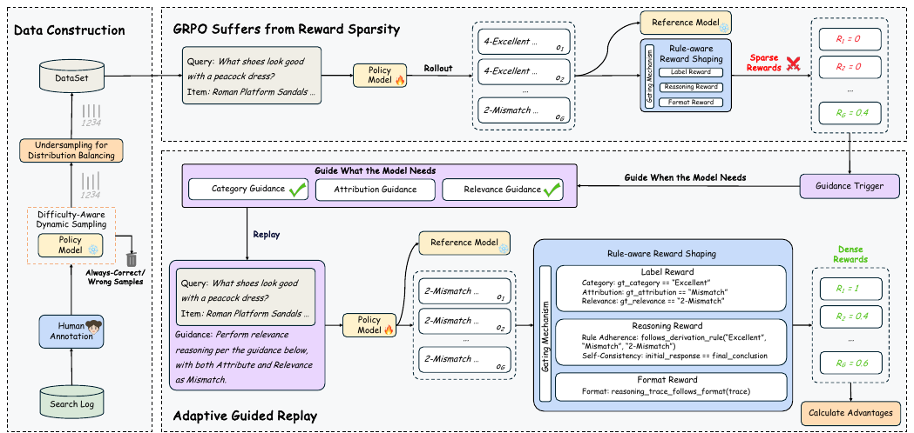
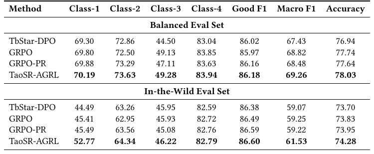
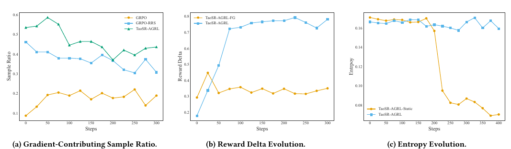

# TaoSR-AGRL: Adaptive Guided Reinforcement Learning Framework for E-commerce Search Relevance

> **Venue**: WWW '26 (The ACM Web Conference 2026, April 13–17, 2026, Dubai, UAE) — Industry Track / arXiv:2510.08048v4 (2026-07-03)
> **Authors**: Jianhui Yang* (Tsinghua Univ., Taobao & Tmall Group), Yiming Jin*† , Pengkun Jiao (Fudan Univ., Taobao & Tmall Group), Chenhe Dong, Zerui Huang, Shaowei Yao, Xiaojiang Zhou, Dan Ou, Haihong Tang (Taobao & Tmall Group of Alibaba) — * equal contribution, † corresponding
> **Platform**: Taobao 검색 relevance 모델 (4-class: 1-Irrelevant / 2-Mismatch / 3-Related / 4-Excellent), 수억 명 사용자 대상 배포

---

## 1. Background

### E-commerce Search Relevance의 현황
- Relevance 예측은 recall과 ranking 단계 모두의 핵심이며, AI 검색으로 넘어가며 **정확하고 해석 가능하며 통제 가능한** 판정이 요구된다.
- 두 방향에서 복잡도가 동시에 올라가고 있다:
  - **Query**: "목 아플 때 마실 차", "차 안에서 먹기 좋은 간식" 같은 open-ended 질의 증가
  - **Rule**: 점점 세분화·구조화. 예) "sugared tangerine" → "dried sugared tangerine"은 **3-Related**, "cranberry" → "dried cranberry"는 **4-Excellent**
- LLM 기반 접근(LREF, TaoSR1)은 relevance를 **matching이 아닌 reasoning 문제**로 재정의하고 SFT → DPO → GRPO로 정렬한다.
- 이 논문은 저자들의 이전 작업 **TaoSR1** 위에서 진행된다: 같은 **"respond-then-think"** 출력 형식(라벨을 먼저 출력한 뒤 CoT로 근거 제시 → error accumulation 완화)과 같은 백본 계열을 사용하며, 온라인 실험의 baseline bucket도 TaoSR1이다.

### 기존 방법의 한계
| 방법 | 문제점 |
|---|---|
| SFT / DPO | 학습 분포의 패턴을 모방할 뿐, reasoning이 필요한 long-tail 신규 샘플에 일반화가 약함. 또한 **과특화(over-specialization)로 탐색 공간이 좁아져** 이후 RL의 출발점으로 불리 |
| GRPO (outcome reward) | 최종 정답 여부만 보는 **sparse terminal reward** → 긴 다단계 추론이 필요한 hard case에서 보상 받는 trajectory 자체가 거의 안 나와 학습 정체 |
| Process supervision (PRM, LLM-as-a-Judge) | 별도 PRM 학습 비용, Judge의 robustness/consistency 문제 |
| External guidance (상위 LLM 힌트, partial trajectory) | 외부 "oracle" 모델 의존, 계산 비용 큼 |

---

## 2. Motivation

### 핵심 통찰 1: Rule 집계(aggregation)가 중간 오류를 가린다 → Reward Hacking
- Taobao relevance는 **Category 판정 × Attribute 판정 → Relevance** 를 결정론적 규칙(Derivation Rules)으로 합성한다.

| Cate \ Attr | Excellent | Related | Mismatch | Irrelevant |
|---|---|---|---|---|
| **Excellent** | Excellent | Related | Mismatch | Irrelevant |
| **Related** | Related | Related | Mismatch | Irrelevant |
| **Mismatch** | Mismatch | Mismatch | Mismatch | Irrelevant |
| **Irrelevant** | Irrelevant | Irrelevant | Irrelevant | Irrelevant |

- 이 규칙표는 사실상 **min 연산**처럼 동작하므로, **중간 단계를 틀려도 최종 라벨은 맞는** 경우가 많다. 예: 정답이 (Category = Mismatch, Attribute = Related) → Mismatch인데 모델이 Attribute를 Excellent로 틀려도 결과는 여전히 Mismatch.
- (논문 본문의 예시는 "Category Related + Attribute Irrelevant → 2-Mismatch"라고 서술하지만, Appendix의 규칙표상 이 조합은 Irrelevant다. 본문 예시가 규칙표와 어긋난다.)
- 최종 결과만 보상하면 모델은 이런 **shortcut**을 학습 → OOD 쌍에 brittle하고, CoT가 신뢰할 수 없어 오류 추적이 불가능해진다.

### 핵심 통찰 2: 비대칭·복합 규칙에서 탐색이 정체된다
- 예: **캐시미어** 의류는 함량 > 50%여야 4-Excellent, **쉬폰**은 포함만 되어도 4-Excellent.
- SFT/DPO로 다듬어진 모델은 action space가 수축되어 있어, 이런 규칙이 필요한 샘플에서 **16개 rollout이 전부 틀리는** 경우가 많다 → GRPO 그룹 내 advantage가 0이 되어 gradient가 사라진다.
- 실측: GRPO의 **gradient-contributing sample ratio는 0.1~0.2 수준** (Figure 2a). 대부분의 샘플이 학습에 기여하지 못한다.

---

## 3. Contributions
1. **Rule-aware Reward Shaping (RRS)**: 최종 판정 보상을 Category / Attribute / Reasoning(규칙 준수·자기 일관성) / Format으로 분해한 **dense reward** + 최종 정답일 때만 열리는 **hard validity gate**
2. **Adaptive Guided Replay (AGR)**: 보상이 낮은 샘플에 대해서만, 부족한 차원에 한정한 **최소 정답 힌트**를 prompt에 붙여 재-rollout — 외부 모델 없이 ground-truth 라벨만 사용
3. **3단계 데이터 구성**: hard query 4종 필터링 + 인간 세밀 라벨 → 난이도 기반 동적 샘플링 → 클래스 균형 undersampling
4. **배포 및 온라인 검증**: TaoSR1 대비 GSB **+7.11%**, Query Goodrate **+1.74pt**, Item Goodrate **+3.74pt**; 4% 트래픽 A/B에서 IPV **+3.89%**, GMV **+0.34%**

---

## 4. Method



> **Figure 1**: TaoSR-AGRL 개요. (1) Data Construction은 균형 잡히고 어려운 데이터셋을 구성한다. (2) Rule-aware Reward Shaping은 sparse한 최종 보상을 핵심 추론 단계를 포괄하는 dense·구조적 신호로 분해해 충실하고 해석 가능한 추론을 유도한다. (3) Adaptive Guided Replay는 보상이 낮은 hard 샘플을 표적 guidance와 함께 선택적으로 재생해 더 높은 가치의 추론 경로를 탐색하게 한다. (상단: GRPO는 대부분 R = 0인 sparse reward, 하단: guidance 후 dense reward)

### 문제 정의와 출력 형식
- 입력: query + item 텍스트 특징 / 출력: 4-class relevance
- **Respond-then-think** (TaoSR1과 동일): 라벨을 먼저 출력 → CoT가 `Query 이해 → Item 이해 → Category Match → Attribute Match → Derivation Rule로 Relevance 판정` 순서로 근거를 생성

### 전체 목적 함수
```
L_AGRL(θ) = E_(x,y)~D [ (1/G) Σ_i (1/|o_i|) Σ_t min( ρ_i,t(θ) · Â_i,t ,
                                                   clip(ρ_i,t(θ), 1−ε, 1+ε) · Â_i,t )
                        − β · D_KL(π_θ || π_ref) ]
  s.t.  0 < |{ o_i | is_equivalent(y, o_i) }| < γ        # 전부 맞히거나 전부 틀린 그룹 제외 (DAPO식 dynamic sampling)

(o_i, R_i) = ( π_θ(·|x),          R_i^(0)  )   if mean{R_i^(0)} > τ     # 비가이드 rollout
             ( π_θ(·|x, G(x,y)),  R_i^(rp) )   otherwise                # guided replay

ρ_i,t(θ) = π_θ(o_i,t | x, o_i,<t) / π_θ_old(o_i,t | x, o_i,<t)
Â_i,t    = (R_i − mean{R_i}) / std{R_i}
```
- 핵심은 GRPO 구조를 그대로 두고 **(a) 보상 R을 어떻게 만들지(RRS)** 와 **(b) rollout을 어떤 prompt로 만들지(AGR)** 두 지점만 바꾼다는 것.

### 4.1 Data Construction (3단계)
| 단계 | 내용 | 규모 |
|---|---|---|
| **Initial Filtering + Human Annotation** | 기존 모델이 약한 4종 query(**negation, affordable alternatives, Q&A, knowledge-based**) 로그를 추출 → 전문 annotator가 `<query, item, label_category, label_attribute, label_relevance>` 튜플로 세밀 라벨링 | 수백만 |
| **Difficulty-Aware Dynamic Sampling** | base 모델로 여러 번 오프라인 예측 → **항상 맞히는 샘플(trivial)과 항상 틀리는 샘플** 제거. 후자는 수작업 검수 결과 **라벨 정확도가 매우 낮은 노이즈 집합**이었음 → 중간 난이도만 유지 | 수십만 |
| **Undersampling for Distribution Balancing** | 고빈도 relevance 등급을 undersampling해 클래스 균형 확보 | **수만** |

### 4.2 Rule-aware Reward Shaping (RRS)
세 개의 직교 구성요소로 보상을 분해:
| 구성요소 | 역할 | 세부 |
|---|---|---|
| **Label Reward** | 사실적 충실성 | R_cate, R_attr, R_rele: Category / Attribute / 최종 Relevance가 정답과 일치하는지 |
| **Reasoning Reward** | 논리적 충실성 (라벨 정답과 독립) | **Rule Adherence**: 예측한 (Cate, Attr) → Relevance가 Derivation Rule을 따르는가 / **Self-Consistency**: 처음 출력한 라벨 == CoT 끝의 결론인가 |
| **Format Reward** | 구조적 충실성 | CoT가 지정 스키마를 따를 때만 1 (binary gate) |

```
R = I_Gate · ( w_cate · R_cate + w_attr · R_attr + w_reason · R_reason )

I_Gate = 1   if R_rele = 1  and  R_format = 1
         0   otherwise

w_cate = 0.4,  w_attr = 0.4,  w_reason = 0.2
```
- **Hard validity gate**: 최종 relevance와 형식이 모두 맞아야만 세부 보상이 열린다 → 틀린 trajectory로 "부분 점수"가 새어 나가는 **reward leakage** 차단.
- 자연스러운 **curriculum**: 먼저 형식·최종 정답을 맞히는 법을 배우고, 그 다음에야 중간 추론의 충실도를 다듬는다.
- 저자들은 이를 "중간 sub-decision을 명시 규칙으로 합성해 최종 결정을 내리는 **계층적 규칙 기반 의사결정 과제 전반에 이식 가능한 원리**"로 일반화한다.

### 4.3 Adaptive Guided Replay (AGR)
RRS로도 해결되지 않는 sparse reward(=16개 rollout이 모두 gate를 통과 못 함)를 겨냥한다.

#### Guide **When** the Model Needs
- 각 샘플에 대해 먼저 **guidance 없이** rollout → rule-aware reward R(x) 계산
- `R(x) < τ (= 0.1)` 이면 sparse-reward 샘플로 판단 → guidance 발동
- 이미 잘 푸는 쉬운 샘플에는 재계산 비용을 쓰지 않음 → 학습 효율 확보

#### Guide **What** the Model Needs — "Minimal Sufficient Guidance"
- 차원별(category / attribute / relevance) **배치 평균 보상**을 τ와 비교해, **기준 미달 차원에 대해서만** 정답을 텍스트 guidance로 생성
- 예: `"Perform relevance reasoning per the guidance below, with Attribute and Relevance as Mismatch."`
- 원래 prompt P(x)에 붙인 P'(x)로 **guided replay** → 모델이 높은 보상 trajectory를 직접 경험
- 정답 전체를 주지 않는 이유: 완전한 답을 주면 모델이 guidance에 의존해 **reward hacking / 추론 능력 퇴화 / policy collapse** 발생

#### Case Study (Appendix D)
| Query / Item | 비가이드 응답 | Guidance | 가이드 후 응답 |
|---|---|---|---|
| "what is cashmere clothing?" / 무염색 캐시미어 코트 | 4-Excellent (캐시미어 포함 → Excellent) | Attribute, Relevance = Mismatch | **2-Mismatch** — "캐시미어 함량이 50% 미만" 규칙을 스스로 서술 |
| "seaside vacation chiffon dress" / 플로럴 바캉스 원피스 | 2-Mismatch (쉬폰 함량 < 50%로 오적용) | Attribute, Relevance = Excellent | **4-Excellent** — 쉬폰은 포함만으로 충분 |

- 두 사례는 같은 "함량" 규칙이 소재에 따라 **비대칭**으로 적용됨을 guidance를 통해 학습하는 과정을 보여준다.

#### 학습 vs 추론
| 단계 | 과정 |
|---|---|
| **학습** | TbStar-DPO에서 출발 → 각 샘플 16 rollout → RRS 보상 계산 → 저보상 샘플·차원에 최소 guidance를 붙여 replay → 전부 정답/전부 오답 그룹 제외 후 GRPO 업데이트 |
| **추론** | guidance 없이 query + item만 입력 → 라벨 선출력 + CoT. 양자화·로드밸런싱으로 **P99 ≤ 400ms** 달성 |

---

## 5. Experiments

### 5.1 Dataset
| | Train | Balanced Eval Set (B-Eval) | In-the-Wild Eval Set (W-Eval) |
|---|---|---|---|
| 출처 | Taobao 검색 로그 (3단계 필터링) | Taobao 검색 로그 | Taobao 검색 로그 |
| 언어 | 중국어 | 중국어 | 중국어 |
| Label | 4-class + category/attribute 세부 라벨 | 4-class | 4-class |
| 특징 | 수만 건, 클래스 균형 | 4개 hard query 유형을 균형 있게 | **실제 온라인 라벨 분포**에 근사 — robustness 평가용 |

- 평가 지표: Class별 F1, **Good F1** (3-Related + 4-Excellent를 하나의 Good tier로 묶음 — 온라인 비즈니스 목표와 일치), Macro F1, Accuracy
- 테스트셋 크기는 공개되지 않음

### 5.2 Implementation Details
- 백본: **TbStar** — Taobao 자체 e-commerce **MoE (42B total / 3.5B active)**, DPO 정렬된 **TbStar-DPO**에서 RL 시작 (SFT 모델보다 성능 상한이 높아서)
- 프레임워크: 오픈소스 **ROLL**
- batch 64, max input 2048 / max generation 4096, lr 1e-6, grad accumulation 16
- rollout: 샘플당 **16개**, temperature 0.99, top-k 100
- online difficulty threshold [0.01, 0.9], PPO clip 1 ± 0.2, value clip 0.5, advantage clip ±2.0
- guidance trigger τ = 0.1, 보상 가중치 (0.4, 0.4, 0.2)
- 학습 MFU 35%

### 5.3 Main Results



> **Table 1**: Balanced Eval Set과 In-the-Wild Eval Set에서의 주요 결과. 모든 방법은 TbStar-DPO 백본 위에서 비교. GRPO-PR은 outcome 보상에 process 보상을 가중합한 baseline (0.4·R_rele + 0.3·R_cate + 0.3·R_attr).

| Method | B-Eval Macro F1 | B-Eval Acc | W-Eval Macro F1 | W-Eval Class-1 F1 | W-Eval Acc |
|---|---|---|---|---|---|
| TbStar-DPO | 67.43 | 76.94 | 59.07 | 44.49 | 73.70 |
| GRPO | 68.82 | 77.74 | 59.25 | 45.41 | 73.83 |
| GRPO-PR | 68.48 | 77.64 | 59.22 | 45.49 | 73.95 |
| **TaoSR-AGRL** | **69.26** | **78.03** | **61.53** | **52.77** | **74.28** |

- **GRPO의 천장**: W-Eval에서 GRPO, GRPO-PR 모두 DPO 대비 Macro F1 **+0.2pt**에 그친다 — sparse reward 하에서는 RL을 추가해도 거의 안 움직인다.
- **단순 process reward(GRPO-PR)는 효과 없음**: gate 없이 가중합만 하면 GRPO와 차이가 없다 (오히려 B-Eval에서 −0.34pt). RRS의 핵심은 "process reward를 넣는 것"이 아니라 **gate와 reasoning reward로 shortcut을 막는 것**.
- **실분포에서 이득이 더 큼**: 균형 데이터로 학습했지만 W-Eval에서 다음 best 대비 **+2.28pt**, B-Eval에서는 +0.44pt.
- **Class-1 (Irrelevant) F1 +7.28pt** (45.49 → 52.77): 무관 상품 거절이 크게 개선 → over-matching 감소, 분포 변화 하 클래스 경계 분리 향상. 반면 Class-3/4와 Good F1은 거의 변화 없음.

### 5.4 Ablation Study

#### 구성요소 Ablation (W-Eval)
| Method | Class-1 | Macro F1 | Accuracy |
|---|---|---|---|
| GRPO | 45.41 | 59.25 | 73.83 |
| GRPO-RRS (+ Rule-aware Reward Shaping) | 46.01 | 59.47 | 74.08 |
| GRPO-FG (+ 고정 guidance = 정답 relevance 라벨) | 48.34 | 59.60 | 74.01 |
| TaoSR-AGRL-FG (RRS + 고정 guidance) | 51.28 | 60.00 | 72.41 |
| **TaoSR-AGRL** (RRS + 적응형 guidance) | **52.77** | **61.53** | **74.28** |

- RRS 단독은 +0.22pt로 작지만, **적응형 guidance와 결합할 때 +2.28pt** — 두 모듈의 시너지.
- 정답 라벨을 고정 guidance로 주는 FG 변형은 Accuracy가 오히려 하락(72.41) — **무엇을 알려줄지 선별하는 것**이 중요.

#### Rule-aware Reward Shaping 세부 Ablation (Appendix A)
- **RAR (Rule Adherence Rate)**: 예측한 Category·Attribute로부터 Derivation Rule이 도출하는 Relevance와 최종 예측이 일치하는 비율 — 정확도와 별개로 "규칙대로 추론했는가"를 측정

| Method | Macro F1 | Accuracy | RAR |
|---|---|---|---|
| Soft Gating (λ = 0.2) | 60.54 | 73.96 | 84.07 |
| Soft Gating (λ = 0.5) | 59.93 | 74.06 | 81.96 |
| Soft Gating (λ = 0.8) | 59.77 | 73.83 | 83.58 |
| w/o Gating (λ = 1) | 59.80 | 73.68 | 83.23 |
| w/o R_reason | 61.28 | 74.02 | **79.84** |
| **TaoSR-AGRL (hard gate, λ = 0)** | **61.53** | **74.28** | **87.25** |

- **Gate를 풀수록 F1·RAR 모두 하락** → 틀린 trajectory로 보상이 새는 reward leakage 확인.
- **R_reason 제거 시 Macro F1은 61.28로 거의 그대로인데 RAR만 87.25 → 79.84로 급락** → 정답은 맞히되 규칙을 어기는 **shortcut = reward hacking의 직접 증거**. 정확도 지표만으로는 이 퇴화를 볼 수 없다.

#### 학습 동역학



> **Figure 2**: 학습 동역학 ablation. 변형들 대비 TaoSR-AGRL은 (a) 더 높은 gradient-contributing sample 비율(샘플 효율), (b) 더 큰 reward delta, (c) 안정적인 policy entropy 유지(붕괴 방지)를 보인다.

- **(a) 샘플 효율**: gradient에 기여하는 샘플 비율이 GRPO **~0.1–0.2** → GRPO-RRS **~0.3–0.45** → TaoSR-AGRL **~0.4–0.58**. RRS만으로도 크게 오르는 것은, GRPO에서 "정답이지만 추론이 틀린" false positive trajectory가 많았다는 뜻.
- **(b) Reward delta**: 고정 guidance(FG)는 ~0.3–0.35에 정체, 적응형은 ~75 step 이후 **~0.72–0.79**로 상승.
- **(c) Entropy**: 모든 샘플에 guidance를 주는 Static 변형은 ~200 step 이후 entropy가 **0.16 → 0.07로 붕괴** — 모델이 guidance에 의존해 좁은 응답 집합으로 수렴(policy collapse). 적응형은 ~0.16 유지.

#### Guidance Trigger Threshold τ (Appendix B, W-Eval)
| τ | 0 | **0.1** | 0.2 | 0.3 | 0.4 | 0.5 |
|---|---|---|---|---|---|---|
| Macro F1 | 60.23 | **61.53** | 59.91 | 59.40 | 59.45 | 58.70 |
| Accuracy | 73.58 | **74.28** | 74.10 | 73.77 | 73.64 | 74.27 |

- τ가 너무 낮으면 교정이 부족하고, 너무 높으면 guidance 의존 → policy 자율성 상실. **τ = 0.1에서 최적**, 그 이상은 Macro F1이 τ = 0(guidance 없음)보다도 낮아진다.

### 5.5 Online Evaluation

#### Side-by-side 인간 평가 (baseline bucket = **TaoSR1**)
- 실제 사용자 query 2,000개, 양쪽 bucket의 top-10 결과를 item 단위로 비교

| Category | GSB | Query Goodrate | Item Goodrate |
|---|---|---|---|
| Q&A | **+10.57%** | **+3.49pt** | **+4.85pt** |
| Alternative | +5.08% | +0.76pt | +2.85pt |
| Negative | +2.14% | +0.55pt | +3.64pt |
| Knowledge | **+10.66%** | +2.14pt | +3.63pt |
| **평균** | **+7.11%** | **+1.74pt** | **+3.74pt** |

- 개선은 **reasoning이 많이 필요한 트래픽(Q&A, knowledge)** 에서 가장 크다.

#### 온라인 A/B Test (4% 트래픽, 4일, 대상 query 한정)
| Metric | 개선폭 |
|---|---|
| Direct Clean GMV | **+0.34%** |
| Direct Clean Orders | −0.72% |
| Direct Clean IPV | **+3.89%** |
| Exposed PV | **+3.86%** |

- **첫 배포에서는 주문·GMV가 소폭 하락**했다. 원인 분석 결과, upstream recall이 **의미 매칭은 강하지만 판매 속도가 낮은 상품**을 과도하게 가져와 전환 효율이 떨어졌다 — 의미적 relevance만 최적화하면 텍스트 매칭이 덜 명시적인 상업적 경쟁력 있는 상품이 억제되는 trade-off.
- 해결: 개인화 신호를 넣은 **multi-channel recall** + relevance와 상업 잠재력을 함께 최적화하는 **pre-ranking 단계** 도입 후 위 A/B 수치 확보. 즉 최종 수치는 relevance 모델 단독 효과가 아니라 recall·pre-ranking 변경과 결합된 결과이며, 주문 수는 여전히 −0.72%.
- 서빙 최적화: 모델 수준 로드밸런싱, cross-datacenter 스케줄링 오버헤드 감소, 양자화 → **P99 ≤ 400ms**.

---

## 6. Key Takeaways
1. **GRPO의 병목은 reward sparsity**: SFT/DPO로 좁아진 policy 위에서 GRPO는 W-Eval Macro F1을 DPO 대비 **+0.2pt**밖에 못 올리고, gradient에 기여하는 샘플이 **10~20%**에 불과하다. TaoSR-AGRL은 이 비율을 **40~58%**로 올려 Macro F1 **+2.28pt** (61.53)를 달성.
2. **Hard gate + reasoning reward가 reward hacking을 막는다**: 단순 process reward 가중합(GRPO-PR)은 효과가 없다. R_reason을 빼면 F1은 거의 같지만 **RAR이 87.25 → 79.84로 급락** — 정답률만 보면 놓치는 shortcut 학습이다. 규칙 기반 계층 판정 과제라면 RAR 같은 **규칙 준수 지표를 반드시 같이 봐야** 한다.
3. **Guidance는 "언제·무엇을" 선별해야 효과가 있다**: 정답 라벨을 고정 guidance로 주면 Accuracy가 오히려 하락(72.41)하고, 모든 샘플에 주면 entropy가 **0.16 → 0.07로 붕괴**한다. τ = 0.1의 저보상 샘플·미달 차원에만 최소 힌트를 주는 것이 최적.
4. **이득은 Irrelevant 판정과 reasoning-heavy query에 집중**: Class-1 F1 **+7.28pt**, 온라인 Q&A·Knowledge query GSB **+10.6%**. 반면 Good F1과 Class-3/4는 거의 그대로 — 이 방법은 "무관 상품을 더 잘 거르는" 방향의 개선이다.
5. **Relevance 개선이 곧 매출 개선은 아니다**: 첫 배포에서 GMV·주문이 하락했고, recall·pre-ranking을 함께 바꾼 뒤에야 IPV **+3.89%**, GMV **+0.34%**를 얻었다 (주문 −0.72%). relevance 모델 교체 시 upstream recall과의 **공동 설계**가 필요하다는 실무 교훈.
6. **TaoSR 계열에서의 위치와 한계**: TaoSR1의 respond-then-think 형식과 백본을 이어받아 RL 단계의 sparse reward 문제를 다룬 후속작이며, 온라인 비교 대상도 TaoSR1이다. 다만 학습·평가 데이터 규모가 "수만 건" 수준으로만 공개되었고, 결과는 단일 run이며 분산 보고가 없다. 서빙은 양자화·로드밸런싱으로 P99 ≤ 400ms를 맞췄다고만 밝히고 BERT 증류는 언급하지 않아, BERT로 distill해 서빙하는 Meituan·JD(K-CARE) 계열과 배포 방식이 다른 것으로 보인다.
