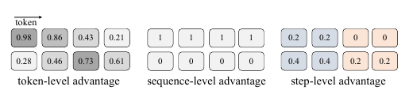
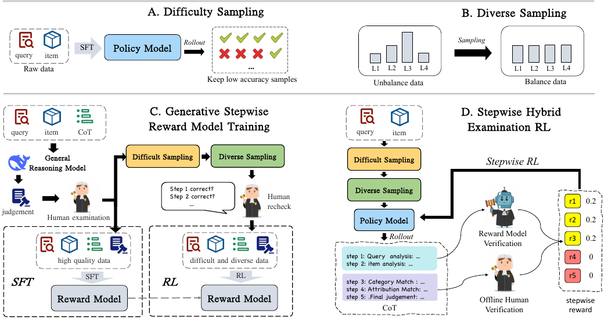
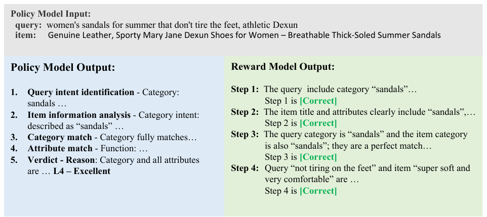
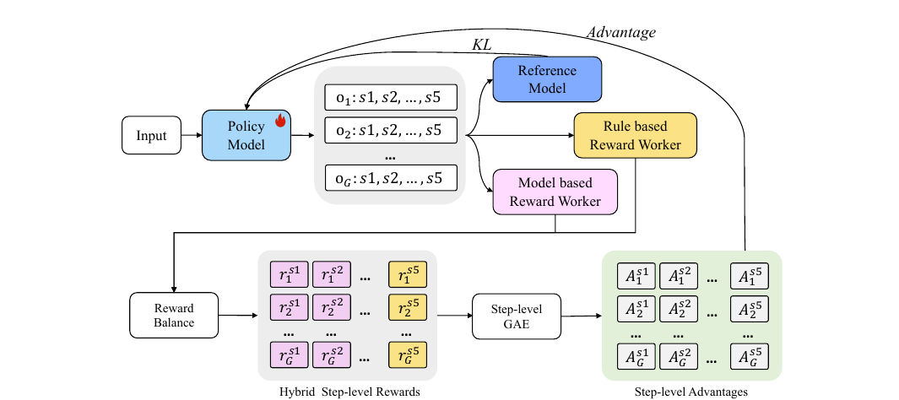
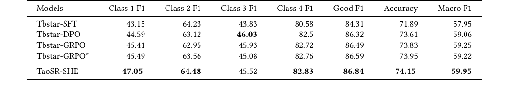

# TaoSR-SHE: Stepwise Hybrid Examination Reinforcement Learning Framework for E-commerce Search Relevance

> **Venue**: arXiv preprint (arXiv:2510.07972v1, 2025-10-09) — 학회 미표기
> **Authors**: Pengkun Jiao\* (Fudan Univ.), Yiming Jin\*† (Taobao & Tmall Group of Alibaba), Jianhui Yang (Tsinghua Univ.), Chenhe Dong, Zerui Huang, Shaowei Yao, Xiaojiang Zhou, Dan Ou, Haihong Tang (Taobao & Tmall Group of Alibaba) — \* equal contribution, † corresponding
> **Platform**: Taobao 검색 relevance (4-level: Irrelevant / Mismatch / Related / Excellent)

---

## 1. Background

### LLM 기반 E-commerce Relevance의 현황
- 전통적으로 relevance는 **판별형 분류 문제**로 다뤄졌지만, 판단 근거가 보이지 않는 "black-box"라는 비판이 있었다.
- LLM의 **Chain-of-Thought(CoT)** 를 이용해 relevance 판단을 단계별 추론으로 풀어내면, 판정 과정이 투명하고 감사(audit) 가능해진다.
- 후처리 학습(post-training) 방법은 크게 세 갈래:
  - **SFT / DPO**: LREF, ProRBP 등 — 학습 데이터에 과적합, long-tail·OOD query에서 일반화 약함
  - **RLVR (GRPO 등)**: 최종 정답만 검증해 보상 — 희소(sparse) 보상
  - **Process supervision**: 중간 단계까지 감독 — e-commerce relevance에는 아직 적용 사례가 적음

### 기존 방법의 한계
| 방법 | 문제점 |
|---|---|
| SFT | 학습 데이터 과적합, 복잡/OOD query 일반화 부족 |
| DPO | 동일하게 일반화 한계, 단계별(stepwise) 세밀한 감독 부재 → 규칙에 맞는 추론 강제 불가 |
| GRPO (RLVR) | 최종 label 정답 여부만 보상 → **sparse reward**, 틀린 중간 단계를 교정할 신호가 없음, reward hacking 위험 |
| PPO | token-level advantage를 위해 value function V(s_t)를 학습해야 함 — 학습 어렵고 비쌈 |

---

## 2. Motivation

### 핵심 통찰 1: Sequence-level 보상은 credit assignment를 망가뜨린다
- GRPO는 trajectory 전체에 **하나의 스칼라 보상**을 주고 모든 token에 동일하게 전파한다.
- 그 결과:
  - 중간 단계가 맞았는데 최종 판정이 틀리면 → **맞은 단계까지 벌을 받음**
  - 중간 단계가 틀렸는데 최종 판정이 우연히 맞으면 → **틀린 단계가 강화됨**
- relevance 판정처럼 "query 해석 → item 해석 → category 매칭 → attribute 매칭 → 최종 판정"의 다단계 추론에서는 이 noise가 치명적이다.



> **Figure 3**: PPO는 token-level advantage, GRPO는 sequence-level advantage(모든 token에 동일 값)를 쓰는 반면, SRPO는 **step-level advantage**를 추정한다 — 같은 단계에 속한 token은 같은 값, 단계마다 다른 값.

### 핵심 통찰 2: 단계마다 "검증 가능성"이 다르다
- 5단계 CoT 중 **category 매칭(S3)·attribute 매칭(S4)** 은 정답을 미리 계산할 수 있는 구조화된 과제다.
- 반면 **query 해석(S1)·item 해석(S2)** 은 열린 서술형이라 정답을 사전에 정의할 수 없다.
- → 단계별로 다른 검증자를 쓰는 **hybrid** 보상이 필요하다: S3/S4는 사람 라벨(규칙 기반), S1/S2는 생성형 보상 모델.

### 핵심 통찰 3: 데이터가 RL 효율을 좌우한다
- GRPO는 그룹 내 보상 분산으로 학습 신호를 만든다. rollout이 **전부 맞거나 전부 틀리면 advantage가 0** 이 되어 학습 신호가 사라진다.
- 고확률 행동과 고보상이 강하게 상관되면 출력 분포가 몇 개 패턴으로 붕괴(**entropy collapse**)한다 → 데이터 다양성 필요.

---

## 3. Contributions
1. **SRPO (Stepwise Reward Policy Optimization)**: GRPO의 sequence-level advantage를 **step-level advantage**로 대체해 단계별 credit assignment
2. **Stepwise Hybrid Reward**: S1/S2는 생성형 stepwise reward model(Tbstar-13B), S3/S4는 사람이 만든 정답 라벨, S5는 최종 판정 정답으로 보상
3. **데이터 중심 학습 전략**: offline rejection sampling + 다양성 기반 샘플링 + dynamic difficulty sampling + multi-stage curriculum learning
4. **성과**: in-the-wild 테스트셋에서 GRPO 대비 Macro F1 **+0.70pt** (59.25 → 59.95), Class 1 F1 **+1.64pt**. 사람 평가 side-by-side에서 Q&A query GSB **+12.91%**

---

## 4. Method



> **Figure 1**: TaoSR-SHE의 핵심 기법. (A) difficulty sampling — SFT 모델로 rollout해 정확도가 낮은 샘플만 남김, (B) diverse sampling — 불균형한 label 분포(L1~L4)를 균형화, (C) 생성형 stepwise reward model 학습 — 범용 추론 모델이 만든 판정을 사람이 검수해 SFT, 어렵고 다양한 샘플을 사람이 재검수해 RL, (D) stepwise hybrid examination RL — S1/S2는 reward model, S3~S5는 오프라인 사람 검증으로 단계별 보상(예: 0.2, 0.2, 0.2, 0, 0).

### 4.1 문제 정의 — 5단계 CoT Relevance
모델 π_θ는 최종 relevance label c와 함께 명시적 추론 체인 y를 생성한다. 추론은 5단계로 고정된다:

| 단계 | 내용 | 검증 방식 |
|---|---|---|
| S1 | Query Interpretation (query 의도 해석) | 생성형 reward model R_φ |
| S2 | Item Interpretation (상품 정보 해석) | 생성형 reward model R_φ |
| S3 | Category Relevance Evaluation | 사람 라벨 정답 gt_3 |
| S4 | Attribute Relevance Evaluation | 사람 라벨 정답 gt_4 |
| S5 | Final Ranking Determination (최종 등급) | 최종 relevance label 정답 |

### 4.2 Data Selection
- **Offline Rejection Sampling**: 초기 policy가 모든 rollout을 전부 맞히거나 전부 틀리는 샘플을 학습 전에 제거 → GRPO advantage가 0이 되는 "정보 없는" 샘플 배제, 수렴 가속.
- **Data Diversity**: 산업 도메인, query 유형, relevance 등급 등 여러 축에서 다양한 학습셋 구성 → 탐색 범위 확대, policy collapse 방지.

### 4.3 Training Paradigm
- **Dynamic Difficulty Sampling**: policy가 성장함에 따라 "어려운 샘플"의 기준을 학습 중 동적으로 갱신 (정확도 임계값 최소 0.01 ~ 최대 0.90).
- **Curriculum Learning**: 한 번에 모든 데이터를 학습하지 않고, 단계별로 난이도·균형 기준을 바꿔 학습 (예: query 의도 균형 → 난이도 균형). 서로 다른 최적화 목표 간 충돌을 완화.

### 4.4 Generative Stepwise Reward Model
- 정답이 없는 S1/S2에 보상을 주기 위해 **Tbstar-13B (dense)** 기반 생성형 reward model R_φ를 학습한다.
- 2단계 학습:
  1. **SFT**: policy가 생성한 대량의 CoT에 대해 범용 추론 모델이 판정 → 사람이 단계별 품질을 검수 → (query, item, CoT, judgment) 튜플 **30,000개**로 SFT
  2. **RL (GRPO)**: difficulty·diversity 샘플링으로 어려운 사례를 고르고 사람이 다시 검수한 **13,000개**로 GRPO 추가 학습
- 출력 형태: 각 단계를 분석하고 근거와 함께 **[Correct] / [Incorrect]** 이진 판정 (Figure 4)



> **Figure 4**: 생성형 stepwise reward model의 출력 예시. "여름용 발 편한 운동 샌들" query와 가죽 메리제인 샌들 상품에 대해, policy가 5단계 추론(L4 – Excellent)을 내면 reward model이 Step 1~4 각각을 근거와 함께 [Correct]로 판정한다.

- 저자들은 S1/S2만 reward model로, S3/S4는 사람 라벨로 보상한다(Remark 1). 매 iteration마다 단계별 사람 라벨을 대량 확보하기는 비싸므로, **reward model만 쓰는 설정**도 대안으로 실험했다 (5.4).
- 부가 활용(Remark 2): reward model의 판별 능력으로 **학습 샘플 선별**에도 사용 (5.6).

### 4.5 Stepwise Hybrid Reward
policy 출력 o_i에서 단계별 결과를 파싱하는 연산자 π_{S_j}를 두고:

```
r_i^{S_j} = R_φ(q, p, π_{S_j}(o_i))          if j ∈ {1, 2}     # 생성형 reward model
          = I[ π_{S_j}(o_i) = gt_j ]          if j ∈ {3, 4}     # 사람 라벨 정답과 일치 여부
r_i^{S_5} = 최종 relevance 등급 정답 여부

R_i = Σ_{j=1}^{J} r_i^{S_j}                                     # trajectory 총 보상
```

- **보상 계수 (Appendix B)**: S1~S4는 맞으면 **0.2**, 틀리면 0. S5는 맞으면 **1.0**, 틀리면 0. → 최대 총 보상 1.8, 최종 판정 비중이 가장 크다.

### 4.6 SRPO: Stepwise Reward Policy Optimization



> **Figure 2**: Hybrid Stepwise RL 파이프라인. policy rollout에서 각 단계를 추출하고, 규칙 기반 reward worker(S3~S5)와 모델 기반 reward worker(S1/S2)가 단계별 보상을 만든다. Reward Balance를 거친 hybrid step-level reward로 step-level advantage를 추정해 policy를 갱신한다.

GRPO의 기준 advantage (sequence-level):
```
Â_i = ( R_i − mean({R_j}_{j=1..G}) ) / ( std({R_j}_{j=1..G}) + δ )
```

SRPO의 step-level advantage — token t가 단계 S_j에 속할 때, 현재 단계부터 마지막 단계까지의 할인 보상 합:
```
A_i(t) = Σ_{k=j}^{J} γ^(k−j) · r_i^{S_k}
```

SRPO 손실 — GRPO 목적식에서 Â_i 를 A_i(t) 로 교체:
```
L_SRPO(θ) = − (1/G) Σ_{i=1}^{G} (1/|o_i|) Σ_{t=1}^{|o_i|}
              [ min( ρ_{i,t}(θ) · A_i(t),  clip(ρ_{i,t}(θ), 1−ε, 1+ε) · A_i(t) ) − β · D_KL[π_θ || π_ref] ]

ρ_{i,t}(θ) = π_θ(o_{i,t} | q_i, o_{i,<t}) / π_θ_old(o_{i,t} | q_i, o_{i,<t})
```

- **직관**: 앞 단계 token은 "자기 단계 + 이후 모든 단계"의 보상을 받는다. 앞 단계가 맞으면 그 몫(0.2)은 확실히 받고, 뒤 단계의 성공 여부도 일부 귀속된다. 반대로 S3에서 틀리면 S3 이후 token만 그 손실을 직접 받는다.
- 실험에서는 **γ = 1** 사용 — 즉 각 단계 token의 advantage = 그 단계부터 끝까지의 보상 합.
- 주의: 본문 수식은 그룹 정규화 없이 원 보상의 합으로 적혀 있으나, Figure 2에는 "Reward Balance"와 "Step-level GAE" 블록이 있다. 그룹 내 정규화를 어떻게 했는지는 본문에서 명확히 기술되지 않는다.

#### Algorithm (SRPO 요약)
```
while not converged:
    B ← dynamic difficulty sampling(D)
    for (q, p) in B:
        rollouts {o_i}_{i=1..G} ~ π_θ_old
        for each o_i:
            for j = 1..J:
                ŷ_ij  ← π_{S_j}(o_i)                         # 단계별 결과 파싱
                r_ij  ← GetReward(S_j, ŷ_ij, q, p, R_φ, gt_j)  # Eq. 5
            for each token t in o_i (step S_j):
                A_i(t) ← Σ_{k=j..J} γ^(k−j) r_ik
    update π_θ with L_SRPO
```

#### 학습 vs 추론
| 단계 | 과정 |
|---|---|
| **Reward model 학습** | Tbstar-13B: CoT-Judge 30k 쌍으로 SFT → 사람 재검수한 어려운 13k로 GRPO |
| **Policy 학습** | Tbstar-SFT(2M) → DPO(300k) 체크포인트에서 시작, 39,161개 RL 데이터로 SRPO. 단계별 보상은 S1/S2 = R_φ, S3/S4 = 사람 라벨, S5 = 최종 라벨 |
| **추론** | policy가 5단계 CoT + 4-level 등급을 생성. reward model과 사람 라벨은 학습에만 사용 |

---

## 5. Experiments

### 5.1 Dataset
| | In-the-wild Test Set | Balanced Query-type Test Set |
|---|---|---|
| 출처 | Taobao 온라인 검색 로그 (relevance 모델이 점수를 매긴 후보 공간에서 샘플링) | Taobao |
| 언어 | 중국어 | 중국어 |
| Label | 4-level: Class 1-Irrelevant / 2-Mismatch / 3-Related / 4-Excellent (사람 라벨) | 동일 |
| 규모 | **21,616** query-item 쌍 | **77,380** 쌍 |
| 특징 | 어려운 query 4종에 집중: **Q&A, 대체재(alternative), 부정(negation), 지식형(knowledge)** | diverse sampling·curriculum ablation용 |

- 학습 데이터: Taobao 온라인 검색 로그에서 난이도·다양성 기준으로 샘플링한 query-item 후보.
- **Good F1**: Class 3 + 4를 하나의 positive로 합친 F1. 저자들은 실서비스에서 가장 중요한 지표로 본다.

### 5.2 Implementation Details
- **Base / Policy 모델**: **Tbstar-42B-A3.5** — Taobao 자체 MoE, 총 42B·활성 3.5B, 일반 + e-commerce 데이터 10조 token 이상으로 from-scratch 사전학습
- **Baseline 체인**: Tbstar-SFT (2M 샘플) → Tbstar-DPO (300k pairwise) → Tbstar-GRPO (39,161 샘플)
  - Tbstar-GRPO\*: GRPO 최종 보상에 S3/S4 검증 보상을 **합쳐서** 넣은 변형 (step-level advantage는 없음)
- **RL 설정**: rollout batch 64, batch normalization, lr 1e-6, query당 16개 rollout (temperature 0.99, top-k 100), difficulty 임계값 0.01~0.90, loss clipping ±0.2, advantage clipping ±2, γ = 1
- **프레임워크**: 오픈소스 RL 프레임워크 ROLL
- **Reward model**: Tbstar-13B dense, SFT 30k + GRPO 13k

### 5.3 Main Results



> **Table 1**: in-the-wild 테스트셋에서의 오프라인 평가. Class 1~4 각각의 F1, Good F1(Class 3+4 병합), Accuracy, Macro F1.

| Model | Class 1 F1 | Class 2 F1 | Good F1 | Accuracy | Macro F1 |
|---|---|---|---|---|---|
| Tbstar-SFT | 43.15 | 64.23 | 84.31 | 71.89 | 57.95 |
| Tbstar-DPO | 44.59 | 63.12 | 86.32 | 73.61 | 59.06 |
| Tbstar-GRPO | 45.41 | 62.95 | 86.49 | 73.83 | 59.25 |
| Tbstar-GRPO\* | 45.49 | 63.56 | 86.59 | 73.95 | 59.22 |
| **TaoSR-SHE** | **47.05** | **64.48** | **86.84** | **74.15** | **59.95** |

- RL 계열 모두 SFT 대비 크게 개선 (Macro F1 +1.3~2.0pt). DPO → GRPO는 +0.19pt에 그친다.
- TaoSR-SHE는 GRPO 대비 Macro F1 **+0.70pt**, Accuracy +0.32pt, Good F1 +0.35pt. 가장 큰 개선은 **Class 1(Irrelevant) F1 +1.64pt** — 무관 상품 걸러내기가 좋아짐.
- 단, Class 3 F1은 DPO(46.03)가 가장 높다 (TaoSR-SHE 45.52). 저자들은 Good F1이 실무적으로 더 중요하다고 설명.
- **GRPO\* ≈ GRPO** (59.22 vs 59.25): 단계 보상을 단순히 sequence 보상에 **더하기만** 해서는 효과가 없다. 단계별로 **advantage를 나눠야** 효과가 난다는 점이 핵심.
- 분산·유의성 검정은 보고되지 않았다.

### 5.4 Reward Model 성능
| | Step 1 | Step 2 | Step 3 | Step 4 |
|---|---|---|---|---|
| +SFT | 86.92 | 86.21 | 89.91 | 83.60 |
| +RL (GRPO) | **89.84** | **89.10** | **90.22** | **86.36** |

- 단계별 검증 정확도 86~90%. GRPO 추가 학습으로 모든 단계에서 +0.3~2.9pt 개선.
- Appendix A (온라인 13k 데이터 기준): vanilla GRPO 77.04 → **Scalar RM 77.31 (+0.27)** → **Generative RM 77.66 (+0.62)**. 생성형이 성능도 높고 판정 근거를 읽을 수 있어 진단이 쉽다.

### 5.5 Ablation Study

#### Hybrid Stepwise Reward (in-the-wild)
| Method | Class 1 F1 | Class 2 F1 | Good F1 | Macro F1 |
|---|---|---|---|---|
| GRPO (sequence-level reward) | 45.41 | 62.95 | 86.49 | 59.25 |
| GRPO (stepwise reward 합산) | 45.49 | 63.56 | 86.59 | 59.22 |
| *Reward Model Only* | | | | |
| + Step Reward (RM only) | 45.73 | 63.82 | 86.63 | 59.25 |
| + SRPO | 46.60 | 63.98 | 86.68 | 59.46 |
| *Hybrid Reward* | | | | |
| + Step Reward (Hybrid) | 46.40 | **64.58** | 86.47 | 59.75 |
| **+ SRPO** | **47.05** | 64.48 | **86.84** | **59.95** |

- **Hybrid > RM only**: S3/S4에 사람 라벨을 쓰는 것이 Macro F1 +0.49pt (59.46 → 59.95). 다만 RM만 써도 SRPO는 GRPO 대비 +0.21pt — 사람 라벨이 부족할 때의 현실적 대안.
- **SRPO의 순수 기여**: 같은 보상에서 step-level advantage로 바꾸면 +0.20~0.21pt (59.25 → 59.46, 59.75 → 59.95).
- 개선폭이 모두 1pt 미만이라, 단일 run 기준의 차이가 noise 범위를 넘는지는 판단하기 어렵다.

#### Diverse Sampling (balanced query-type test set)
| Method | Macro F1 |
|---|---|
| Baseline | 65.02 |
| GRPO w/o diverse sampling | 65.64 |
| GRPO w/ diverse sampling | **66.49** |

- 다양성 샘플링이 +0.85pt. 축별 비교 중 **label 기준 다양화가 가장 효과적**이었다고 서술.

#### Curriculum Learning (balanced query-type test set)
| Training Stage | Macro F1 |
|---|---|
| Baseline | 65.02 |
| Stage 1a: 쉬운 label-balanced 데이터 (30k) | 66.49 |
| Stage 1b: 어려운 label-balanced 데이터 (1.3k) | 66.81 |
| Stage 1c: 전체 label-balanced 데이터 | 66.52 |
| **Stage 2: 쉬운 → 어려운 curriculum** | **67.12** |

| Training Stage (다른 데이터 유형) | Macro F1 |
|---|---|
| Baseline | 60.01 |
| Stage 1a: 다양한 query-type 데이터 | 63.20 |
| Stage 1b: 다양한 label 데이터 | 65.84 |
| Stage 1c: 전체 데이터 | 63.94 |
| **Stage 2: query-type → label 순서** | **66.84** |

- 두 실험 모두 **전체 데이터를 한 번에 섞어 학습(1c)하는 것이 가장 나쁘거나 중간** 수준이고, 순서를 둔 2단계 curriculum이 최고.
- 어려운 데이터 **1.3k개만으로도** 쉬운 데이터 30k보다 높다 (66.81 vs 66.49) — RL에서 데이터 양보다 난이도가 중요하다는 근거.

### 5.6 Reward Model 기반 데이터 선별
| Method | Training Samples | Macro F1 |
|---|---|---|
| GRPO w/ Full data | 40k | 65.64 |
| GRPO w/ RM-selected subset | **20k** | 65.54 |

- reward model로 과정·결과 오류가 있는 샘플을 골라내면, **데이터 절반으로 거의 같은 성능** (−0.10pt).

### 5.7 Online Evaluation (사람 평가 Side-by-Side)
2,000개 query에 대해 두 시스템의 top-10 결과를 사람이 비교:

| Query Type | 예시 | GSB | Query Goodrate | Item Goodrate |
|---|---|---|---|---|
| Q&A | 등산할 때 뭘 입어야 하나? | **+12.91%** | +3.33pt | **+3.89pt** |
| Alternative | 아크테릭스 대체품 | +0.61% | +0.72pt | +2.83pt |
| Negative | 터틀넥이 아닌 스웨터 | +5.85% | +1.29pt | +2.42pt |
| Knowledge | 주방 기름때 제거 제품 | +3.47% | +0.93pt | +1.02pt |

- **GSB**: 사람이 두 시스템 결과를 나란히 보고 판정, +x% = 실험군이 선호된 비율 우위
- **Query Goodrate**: 반환 페이지가 Good/Mid로 평가된 query 비율 / **Item Goodrate**: 요청당 Class 3·4 상품 비율의 평균
- **추론형 query(Q&A)에서 가장 큰 개선** — CoT 기반 relevance의 장점이 드러나는 영역.

#### 비즈니스 지표 하락과 해결 (중요한 실무 교훈)
- 초기 온라인 배포에서 relevance 품질은 올랐지만 **직접 귀속 주문 수와 GMV가 소폭 하락**했다.
- 원인 분석: 상위 retrieval 단계가 "관련은 있지만 **과거 판매가 적은**" 상품을 주로 가져왔고, TaoSR-SHE는 이를 올바르게 relevant로 판정했지만 전환 가능성이 낮았다.
- 해결:
  1. 개인화 신호를 포함한 **multi-path recall** 도입
  2. relevance와 전환 가능성을 **함께 최적화하는 pre-ranking 단계** 추가
- 결과: 비즈니스 지표가 baseline과 **통계적으로 구별되지 않는 수준으로 회복**, relevance 개선(Table 7)은 유지. 즉 비즈니스 지표를 **올린 것은 아니고 원래 수준으로 돌려놓은 것**이다.

---

## 6. TaoSR 시리즈 내 위치

- 같은 Taobao relevance 팀(Yiming Jin, Chenhe Dong, Shaowei Yao, Dan Ou, Haihong Tang 등)의 연작이다.
- 본문에서 **TaoSR1** (arXiv:2508.12365)은 서론에서 e-commerce search relevance 선행 연구로 **인용만** 될 뿐, 방법·결과 비교는 없다. **TaoSR-AGRL**은 언급되지 않는다 (arXiv 게시일도 하루 차이로 거의 동시).
- 실험 baseline은 TaoSR1이 아니라 자체 SFT → DPO → GRPO 체인이다. 다만 테스트셋은 시리즈 간에 공유된다:
  - **In-the-wild set (21,616) = TaoSR-AGRL의 W-Eval**: GRPO(59.25 / 45.41 / 73.83)와 GRPO\* = AGRL의 GRPO-PR(59.22 / 45.49 / 73.95) 수치가 일치한다. 같은 조건에서 AGRL은 61.53으로 SHE(59.95)보다 +1.58pt 높다.
  - **Balanced query-type set (77,380) = TaoSR1 테스트셋**: TaoSR1의 label 분포 합계가 77,380이고, 5.5절 curriculum 수치(60.01, 65.02, 66.84, 67.12)가 TaoSR1의 post-CoT 결과표와 정확히 일치한다. 즉 curriculum 절은 TaoSR1의 GRPO 데이터 레시피를 다시 서술한 것으로 보인다.
- 외부 시각: JD의 K-CARE (arXiv:2604.25683)는 TaoSR1·TaoSR-SHE·TaoSR-AGRL을 묶어 "parametric memory 안에서 reasoning 경로만 최적화하는 RL 계열"로 분류하고 그 한계를 지적한다.

---

## 7. Key Takeaways
1. **보상은 더하는 게 아니라 나눠야 한다**: 단계 보상을 sequence 보상에 단순 합산한 GRPO\*는 효과 없음 (59.22 vs 59.25). 단계마다 advantage를 따로 주는 SRPO로 바꿔야 +0.2pt, hybrid 보상과 합쳐 GRPO 대비 Macro F1 **+0.70pt**, Irrelevant F1 **+1.64pt**.
2. **검증 가능한 단계는 사람 라벨, 열린 단계는 생성형 RM**: category·attribute 매칭은 정답으로, query·item 해석은 Tbstar-13B 생성형 RM(단계 검증 정확도 86~90%)으로 보상. 사람 라벨을 빼고 RM만 써도 GRPO보다는 낫다 (+0.21pt).
3. **RL 데이터는 양보다 난이도와 순서**: 어려운 1.3k가 쉬운 30k를 이기고 (66.81 vs 66.49), 쉬운 → 어려운 curriculum이 최고 (67.12). 전체를 섞어 학습하면 오히려 나쁘다. RM으로 고른 20k가 전체 40k와 거의 같은 성능.
4. **생성형 RM > 스칼라 RM**: 성능(+0.62 vs +0.27)뿐 아니라 판정 근거를 읽을 수 있어 디버깅이 가능하다.
5. **추론형 query에서 가장 큰 온라인 이득**: Q&A query GSB +12.91%, Item Goodrate +3.89pt. 부정·지식형 query도 개선.
6. **Relevance만 올리면 GMV가 떨어질 수 있다**: relevance 판정이 정확해져도 recall이 저판매 상품을 가져오면 주문·GMV가 하락. multi-path recall과 relevance+전환 공동 최적화 pre-ranking으로 원래 수준을 회복했을 뿐 매출 상승은 보고되지 않았다. 오프라인 개선폭이 모두 1pt 미만이고 분산 보고가 없다는 점도 함께 감안해야 한다.
