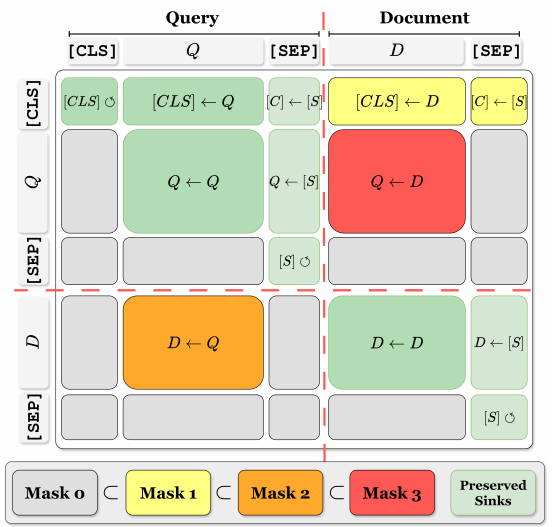
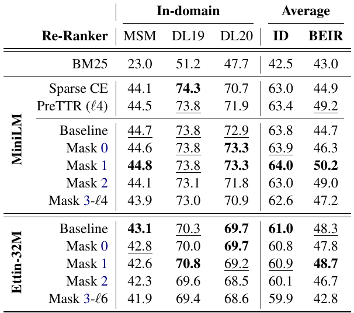
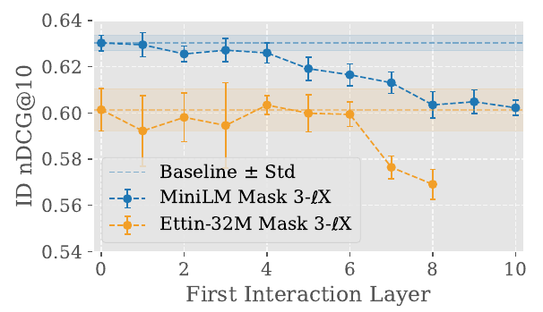
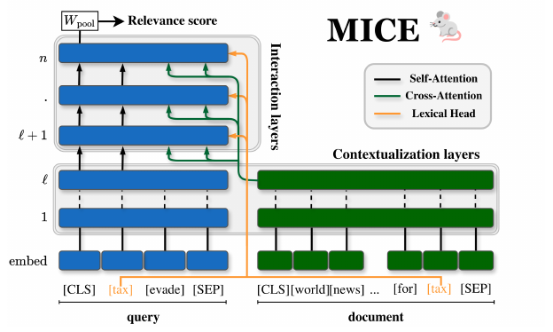
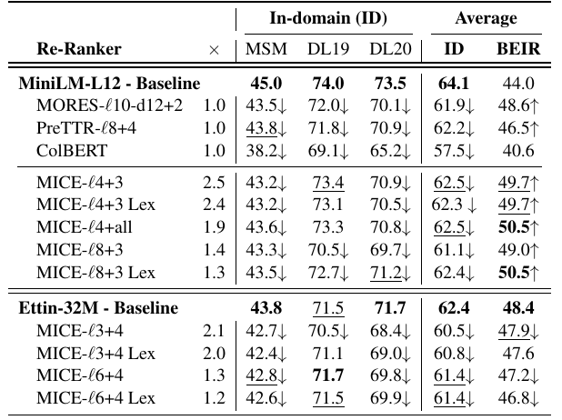
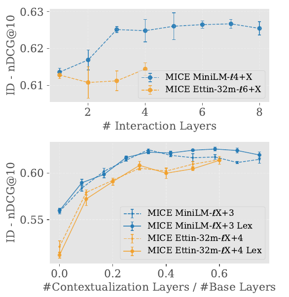
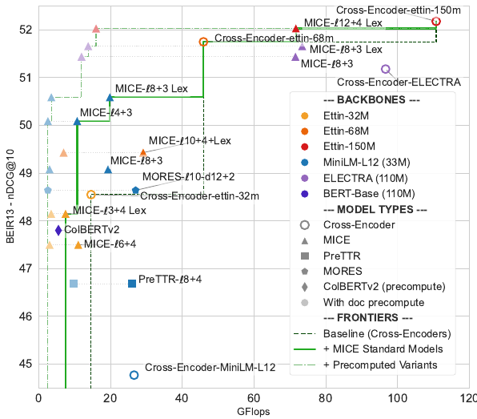

# MICE: Minimal Interaction Cross-Encoders for efficient Re-ranking

> **Venue**: arXiv 2602.16299 (v4, 2026-08-31), cs.IR
> **Authors**: Mathias Vast\*, Victor Morand\* (Sorbonne Université, CNRS, ISIR / Sinequa by ChapsVision), Josiane Mothe (Univ. Toulouse, IRIT), Benjamin Piwowarski (Sorbonne Université, CNRS, ISIR) — \*equal contribution
> **Code**: https://github.com/xpmir/mice

---

## 1. Background

### Neural re-ranking의 현황
- IR 아키텍처는 **bi-encoder**(single vector, offline indexing 가능) → **late-interaction**(ColBERT: token별 multi-vector + MaxSim) → **cross-encoder**(query·document를 concat해 full self-attention) 순으로 효과(effectiveness)는 높아지고 효율(efficiency)은 떨어진다.
- Cross-encoder는 SOTA ranking 성능을 내지만 비용이 커서 **retrieve-and-rerank** 구조의 2단계 re-ranker로만 쓰인다.
- 이 병목을 푸는 연구는 두 갈래로 분리되어 있었다.
  1. **first-stage를 강화**: ColBERT 같은 late-interaction 모델로 re-ranker 의존도를 줄임 — 그러나 cross-encoder보다 덜 효과적
  2. **cross-encoder를 가속**: sparse attention(Sparse CE), pruning, distillation, cascade — 그래도 late-interaction보다 무겁다
- 중간 지점의 **hybrid / mid-fusion** 구조(PreTTR, MORES, DeFormer, Poly-encoder)도 있지만 cross-encoder 성능을 맞추지 못했다.

### 기존 방법의 한계
| 방법 | 문제점 |
|---|---|
| Bi-encoder / SPLADE | query-document interaction을 명시적으로 못 잡아 OOD에서 특히 약함 |
| ColBERT (late-interaction) | MaxSim이라는 단순한 interaction → cross-encoder 대비 효과 낮음 |
| Poly-encoder | M=360 수준(MS MARCO 평균 문서 길이 초과)이어야 cross-encoder에 근접 |
| PreTTR / MORES (mid-fusion) | offline 문서 인코딩은 되지만 상위 layer는 여전히 full attention → **FLOPs 절감 없음** (speedup 1.0×) |
| Sparse CE (Schlatt et al., 2024) | Q ↚ D(문서→쿼리)를 막는데, 이는 interpretability 연구가 가장 중요하다고 한 방향 |
| Linear attention 류 | IR에서는 attention이 lexical/semantic matching의 핵심이라 이전(transfer)이 잘 안 됨 |

---

## 2. Motivation

이 논문의 출발점은 **cross-encoder 내부 정보 흐름에 대한 interpretability 연구** (Zhan et al., 2020; Lu et al., 2025)이다.
- 하위 layer: query·document 토큰을 각각 **contextualize** (Q–D interaction은 부차적)
- 상위 layer: **matching head**가 document → query 방향으로 매칭 신호를 옮기고, query 토큰에 relevance 정보가 모임
- 마지막: **relevance scoring head**가 query 토큰을 스캔해 [CLS]로 전달
- 즉 정보는 자유롭게 흐르지 않고 대략 **D → Q → [CLS]** 방향으로 흐른다.

그렇다면 이 흐름 외의 interaction은 지워도 되지 않을까? 논문은 이를 **causal masking 실험**으로 검증한다 (RQ1: 성능 유지하면서 얼마나 많은 interaction을 제거할 수 있나?).

### 핵심 통찰 1: 누적 masking으로 불필요한 interaction 식별
- 입력 시퀀스 `[CLS] q1..qn [SEP1] d1..dm [SEP2]`를 5개 파트 {[CLS], Q, [SEP1], D, [SEP2]}로 나눈다.
- 표기: `Y ← X` = **Y가 X에 attend** = X의 정보가 Y로 전달된다. `Y ↚ X` = 그 전달을 차단.
- 차단 방법: self-attention score 행렬에서 해당 (Y행, X열) 블록의 logit을 softmax 전에 −∞로 둔다 → attention weight가 0이 되어 정보가 흐르지 않는다.
- 각 mask를 건 채로 **처음부터 fine-tuning**한 뒤 성능을 측정한다 (causal analysis: "이 경로를 없애도 모델이 relevance를 학습할 수 있는가?").



> **Figure 2**: Masking 방식. 입력 파트 간 interaction을 누적적으로 차단한다. 색은 masking이 시작되는 단계를 의미하며, Mask 3에서 Q ↮ D가 완전히 분리된 block-diagonal 구조가 된다. 초록색은 항상 보존되는 interaction과 attention sink.

#### Figure 2 읽는 법
- 이 그림은 **self-attention 행렬을 파트 단위 블록으로 묶은 것**이다.
  - **행(row) = 정보를 받는 쪽** (attention의 query, 즉 "누가 보는가")
  - **열(column) = 정보를 보내는 쪽** (attention의 key/value, 즉 "무엇을 보는가")
  - 각 셀 `Y ← X`는 "Y 행이 X 열을 본다"는 뜻이다.
- 빨간 점선은 query 영역([CLS], Q, [SEP1])과 document 영역(D, [SEP2])의 경계다. 점선을 가로지르는 셀(우상단·좌하단)이 **query–document 간 interaction**이다.
- 색은 **그 셀이 처음 차단되는 단계**다. 하단 범례의 `Mask 0 ⊂ Mask 1 ⊂ Mask 2 ⊂ Mask 3`은 누적 관계를 뜻한다. 예를 들어 Mask 2는 회색 + 노랑 + 주황 셀을 모두 막는다.

셀 단위로 정리하면 다음과 같다 (행=받는 쪽, 열=보내는 쪽):

```
               │ [CLS]   Q      [SEP1] ║  D      [SEP2]
  ─────────────┼─────────────────────────╫────────────────
  [CLS]  받음  │  ●      ●       ●     ║  M1     M1
  Q      받음  │  M0     ●       ●     ║  M3     M0
  [SEP1] 받음  │  M0     M0      ●     ║  M0     M0
  ═════════════╪═════════════════════════╬════════════════
  D      받음  │  M0     M2      M0    ║  ●      ●
  [SEP2] 받음  │  M0     M0      M0    ║  M0     ●

  ● = 항상 보존 (초록)   M0 = 회색   M1 = 노랑   M2 = 주황   M3 = 빨강 (ℓ* 이하 layer에서만)
```

#### 단계별 해설

**Mask 0 (회색): [SEP]와 [CLS]의 "잡음 경로" 정리**
- **[SEP]는 아무것도 받지 않는다**: [SEP1], [SEP2] 행은 자기 자신을 제외한 전부 차단.
- **[CLS]는 아무에게도 보내지 않는다**: [CLS] 열에서 [CLS] 자신을 제외한 전부 차단. [CLS]는 최종 점수를 담는 출력 슬롯일 뿐, 다른 토큰의 표현에 영향을 주지 않는다.
- **[SEP]를 영역 전용 attention sink로 지정**: Q는 [SEP1]만, D는 [SEP2]만 볼 수 있다 (Q ↚ [SEP2], D ↚ [SEP1]).
  - attention sink: softmax 합이 1이어야 하므로, 특별히 볼 곳이 없는 head가 attention을 "버리는" 토큰. BERT에서는 주로 [SEP]가 이 역할을 한다.
  - sink를 영역별로 나눠 두어야 이후 Q와 D를 분리했을 때도 각자 sink를 유지할 수 있다.
- 기대 효과: relevance 판단과 무관한 경로만 지우므로 성능 변화가 거의 없어야 한다. 실제로 MiniLM은 ID 동일, OOD +1.6.

**Mask 1 (노랑): [CLS]는 document를 직접 보지 않는다**
- [CLS] ↚ {D, [SEP2]}. 이후 [CLS]가 보는 것은 자기 자신, Q, [SEP1]뿐이다.
- 근거: Lu et al. (2025)에 따르면 relevance 신호는 D → Q로 모인 다음 Q → [CLS]로 전달된다. [CLS]가 D를 직접 보는 경로는 중복이다.
- 결과적으로 **document 정보가 점수에 반영되는 유일한 경로는 D → Q → [CLS]**가 된다.

**Mask 2 (주황): document는 query를 보지 않는다**
- D ↚ Q (모든 layer). Mask 0에서 D ↚ [CLS], D ↚ [SEP1]이 이미 막혀 있으므로, 이제 **D 행은 D와 [SEP2]만 본다**.
- 따라서 document 토큰의 표현은 **모든 layer에서 query와 무관하게 결정된다**. 같은 문서라면 어떤 query와 짝지어도 표현이 같으므로 **offline으로 미리 계산해 둘 수 있다**. MICE의 frozen document 설계가 여기서 나온다.
- Sparse CE와의 대비: Sparse CE는 반대로 Q ↚ D(빨간 셀)를 막았다. 이 논문은 "막아도 되는 쪽은 주황(D ← Q)이고, 빨강(Q ← D)은 핵심 경로"라고 주장한다.

**Mask 3-ℓ (빨강): 하위 layer에서는 query도 document를 보지 않는다**
- Q ↚ D를 **첫 ℓ개 layer에서만** 추가로 막는다. ℓ보다 위 layer에서는 Q ← D가 열려 있다.
- 하위 layer에서는 점선을 가로지르는 셀이 모두 막혀 Q 영역과 D 영역이 **완전히 분리된 block-diagonal** 구조가 된다 (= 두 문장을 따로 인코딩하는 것과 같음).
- 상위 layer에 남는 query–document 간 interaction은 **Q ← D 단 하나**다.
- ℓ\*는 ID 성능을 유지하는 최대 ℓ이며, Figure 3에서 탐색한다 (MiniLM 4, Ettin-32M 6).

#### 마스킹 후 남는 정보 흐름

| 단계         | 남은 Q–D interaction          | 의미                                         |
| ---------- | --------------------------- | ------------------------------------------ |
| Baseline   | Q ↔ D 양방향, [CLS] ↔ 전부       | 일반 cross-encoder                           |
| Mask 1     | Q ↔ D 양방향, [CLS] ← Q만       | D 정보가 [CLS]에 도달하려면 반드시 Q를 거쳐야 함            |
| Mask 2     | Q ← D 단방향 (전 layer)         | D 표현이 query와 독립 → offline 계산 가능            |
| Mask 3-ℓ\* | Q ← D 단방향 (ℓ\* 초과 layer에서만) | 하위는 독립 인코딩, 상위는 D → Q 읽기 = **MICE 구조의 원형** |

- 즉 Mask 3은 MICE의 구조를 이미 거의 갖추고 있다. MICE는 여기에 (a) 상위 layer에서 D 토큰 계산 자체를 생략(frozen)하고, (b) 상위 layer 일부를 제거하고, (c) Lexical Head를 추가한 것이다.
- 주의: MICE는 최종적으로 **[CLS] ← D를 다시 허용**한다 (Appendix C ablation). Mask 1과 반대 결정이다.

| Mask | 차단하는 흐름 | 근거 |
|---|---|---|
| **Mask 0** | [SEP] ↚ {[CLS], Q, D}, {Q, [SEP], D} ↚ [CLS], Q ↚ [SEP2], D ↚ [SEP1] ([SEP1]/[SEP2]를 Q/D 전용 attention sink로 지정) | [SEP]는 relevance와 직접 관련 없음, 노이즈만 줄임 |
| **Mask 1** | Mask 0 + [CLS] ↚ {D, [SEP2]} | relevance 신호는 query 토큰을 거쳐 [CLS]로 감 |
| **Mask 2** | Mask 1 + D ↚ Q (전 layer) | Q→D 방향은 기여가 작음. **document 표현을 offline 계산 가능**하게 하는 첫 단계 |
| **Mask 3-ℓ** | Mask 2 + Q ↚ D (layer ℓ\*까지) | 하위 layer는 독립 contextualization 단계. ℓ\* = 성능을 유지하는 최대 layer |

### 핵심 통찰 2: interaction을 지우면 오히려 OOD가 좋아진다



> **Table 1**: BM25 top-1k re-ranking, nDCG@10 (5 seeds 평균). Mask 적용 여부에 따라 fine-tuning한 모델 비교. 굵게=backbone별 최고, 밑줄=2위.

- **Mask 0**: MiniLM에서 OOD(BEIR) 44.7 → 46.3. [SEP]는 relevance 예측과 무관함을 확인.
- **Mask 1** (MiniLM): ID 64.0 / BEIR **50.2** — baseline 대비 **OOD +5.5 nDCG@10**. [CLS]가 document를 직접 볼 필요가 없고, 오히려 이 경로가 **spurious correlation**을 학습시키는 통로로 보인다.
- **Mask 2** (D ↚ Q 전 layer): ID 63.0 / BEIR 49.0 — 성능 손실 거의 없음. 반대로 Sparse CE(Q ↚ D)는 BEIR 44.9로 개선 없음 → **Sparse CE의 masking 방향은 틀렸다**는 근거.
- Ettin-32M(ModernBERT)도 Mask 2까지 ID 61.0 → 60.1로 유지되지만 OOD 개선은 MiniLM만큼 뚜렷하지 않다.
- 해석: mask가 일종의 **regularization**으로 작동해 overfitting을 막는다.

### 핵심 통찰 3: 하위 절반 layer는 Q/D를 독립적으로 처리해도 된다



> **Figure 3**: ℓ\* 탐색 (Mask 3). 주어진 layer까지 Q–D 간 모든 interaction을 차단했을 때의 ID nDCG@10.

- MiniLM(12 layers): **ℓ\* = 4**까지 baseline과 동등, ℓ ≥ 5부터 하락
- Ettin-32M(10 layers): **ℓ\* = 6**
- 단, Mask 3은 Mask 2 대비 OOD가 떨어짐 (Ettin에서 약 −4). ℓ\* 이후의 하락 원인 후보: (1) 남은 interaction layer가 부족 / (2) 너무 깊은 독립 contextualization이 lexical 신호를 덮어씀 → 이 가설이 MICE의 **Lexical Head** 설계로 이어진다.

### 부록 관찰: 이미 학습된 cross-encoder에 mask를 사후 적용하면 깨진다
- off-the-shelf MiniLM cross-encoder에 Mask 2를 바로 씌우면 ID 64.9 → 49.7, BEIR 49.5 → 36.6 (약 −10~15).
- Ettin cross-encoder는 Mask 0만으로도 MS MARCO에서 30점 이상 하락 — ModernBERT는 attention sink 구조가 다를 가능성.
- → **mask를 건 상태로 fine-tuning**해야 한다는 결론.

---

## 3. Contributions
1. **Causal masking 분석**: interpretability 연구가 시사한 정보 흐름(D → Q → [CLS])을 masking + fine-tuning으로 검증. [CLS] ↚ D, D ↚ Q를 막아도 성능이 유지되며 OOD는 오히려 최대 +5.5 개선.
2. **MICE 아키텍처**: Mid-Fusion + Light Cross-Attention(D → Q 단방향, document 표현 frozen) + 상위 layer drop + Lexical Head로 cross-encoder를 재구성.
3. **효율-효과 trade-off 개선**: MiniLM 기준 FLOPs **2.5× 절감**, 실측 latency **2×** (document 사전 계산 시 **4×**, ColBERT와 유사한 latency) 이면서 BEIR는 cross-encoder 대비 **+5.7 ~ +6.5**.
4. **Pareto frontier 분석**: MiniLM, ELECTRA, Ettin-32M/68M/150M 등 여러 backbone에서 MICE가 효율-효과 Pareto frontier를 일관되게 밀어냄을 확인.

---

## 4. Method



> **Figure 1**: MICE 아키텍처. cross-encoder 효과 유지에 필요한 최소한의 interaction만 남긴다. 하위 ℓ개 layer에서 query(파랑)와 document(초록)를 독립적으로 contextualize하고, 상위 interaction layer에서는 query 토큰만 갱신되며 frozen document 표현을 cross-attention(초록 화살표)으로 읽는다. 주황색은 exact match 토큰("tax")을 연결하는 Lexical Head.

표준 cross-encoder 대비 네 가지 설계 변경:

### 4.1 Mid-Fusion (Contextualization layers)
- backbone의 첫 ℓ\* 개 layer로 query와 document를 **각각 독립적으로** 인코딩 (Mask 3 분석에서 얻은 ℓ\* 사용).
- 두 stream은 **같은 가중치를 공유** (ablation: MORES처럼 별도 encoder를 두는 것은 이득 없음).
- 결과적으로 document 표현을 **offline으로 사전 계산**할 수 있다 (ColBERT처럼).

### 4.2 Light Cross-Attention (Interaction layers)
- Mask 2가 D ↚ Q가 불필요함을 보였으므로 한 걸음 더 나아가, interaction layer에서 **document 토큰을 전혀 갱신하지 않는다** (frozen).
- query 토큰만 다음 순서로 갱신:
```
for layer in interaction_layers:
    q = q + CrossAttn(query=q, key/value=D_frozen)   # D -> Q (and D -> [CLS])
    q = q + SelfAttn(q)                               # intra-query contextualization
    q = q + MLP(q)
score = W_pool([CLS])
```
- **cross-attention을 self-attention보다 먼저** 수행 (MORES 방식) → query 토큰이 문서 정보를 먼저 모은 뒤 서로 공유.
- cross-attention 가중치는 원래 self-attention 가중치로 초기화.
- Mask 1과 달리 **[CLS] ← D는 허용** (ablation에서 허용하는 편이 나음 — document contextualization이 막힌 만큼 추가 자유도가 필요한 것으로 해석).
- ColBERT의 MaxSim 대비 cross-attention은 비선형적이고 세밀한 Q–D 의존성을 포착 가능 → 더 표현력이 높다.
- PreTTR과의 차이: PreTTR은 interaction layer에서 full Q–D attention을 유지하므로 FLOPs 절감이 없다.

### 4.3 Dropping Backbone Top Layers
- MLM으로 사전학습된 backbone의 마지막 layer들은 **token prediction에 특화**되어 re-ranking에는 불필요하다는 가설.
- interaction layer 수를 줄여 상위 layer를 제거 (MICE만의 고유 설계). 예: MiniLM은 4 contextualization + 3 interaction = 12개 중 7개만 사용.

### 4.4 Lexical Head
- 깊은 독립 contextualization은 semantic 정보는 풍부하게 하지만 BM25 같은 **exact-match / IDF 신호를 덮어쓸 수 있다**는 가설.
- interaction layer에 **추가 cross-attention head**를 하나 둔다. query-key 내적 대신 사전 계산된 lexical match score를 attention weight로 사용:
```
s_ij = 1   if q_i == d_j
s_ii = 1   if no d_j such that q_i == d_j   (normalization 보장용 self-loop)
attention = normalize(s)       # QK^T 없음
out = W_O · (attention · W_V · D)
```
- 파라미터는 value/output 행렬뿐.

### 4.5 이론적 효율 이득
1. contextualization 단계에서 Q와 D를 따로 처리 → concat 시퀀스의 quadratic attention 비용 감소
2. interaction 단계에서 document는 frozen → **긴 document 토큰에 대한 MLP·self-attention 계산을 전부 생략**, 짧은 query 토큰만 갱신
3. layer pruning으로 네트워크 깊이 자체 축소

#### Training Objective
- 모든 모델(baseline, mask, MICE, 재현 모델) 동일하게 **MarginMSE distillation** (Hofstätter et al., 2020):
```
L_MarginMSE = MSE( s(q, d+) - s(q, d-),  t(q, d+) - t(q, d-) )
  s: student score,  t: teacher ensemble score (Hofstätter et al. MS MARCO teacher scores)
```
- BCE와 달리 positive/negative 간 relevance **margin의 크기**를 보존해 더 좋은 성능.

#### 학습 vs 추론
| 단계 | 과정 |
|---|---|
| **학습** | MS MARCO triple에 MarginMSE distillation. Q·D를 공유 encoder로 ℓ\*층까지 독립 인코딩 → interaction layer에서 query만 갱신 → [CLS] score |
| **추론** | (a) 사전 계산 없이: Q·D 동시 인코딩 후 interaction (2× 빠름). (b) **document 표현 offline 사전 계산**: query만 인코딩 + 저장된 D 표현 로드 + 3~4개의 얇은 interaction layer (4× 빠름) |

---

## 5. Experiments

### 5.1 Dataset
| | MS MARCO / TREC-DL | BEIR (13) | nano-BEIR |
|---|---|---|---|
| 용도 | 학습 + ID 평가 (MSM dev, DL19, DL20) | OOD 평가 | MICE checkpoint 선택용 validation |
| 언어 | English | English | English |
| 도메인 | Web passage | Arg. retrieval, fact checking, bio-medical, QA, entity, citation 등 | BEIR 13개 subset (각 5,000 docs / 50 queries) |
| Label | MarginMSE teacher score (학습), qrels (평가) | qrels | qrels |
| 평가 | BM25 top-1k re-ranking, nDCG@10 | 동일 | — |

- 모든 설계 결정은 **ID 데이터로만** 검증 (BEIR에 대한 bias 방지). masking 실험은 MS MARCO dev(RR@10)로 validation.

### 5.2 Implementation Details
| Backbone | Checkpoint | Layers | Params | Hidden | Heads |
|---|---|---|---|---|---|
| MiniLM-L12-v2 | microsoft/MiniLM-L12-H384-uncased | 12 | 33M | 384 | 12 |
| Ettin-32M (ModernBERT) | jhu-clsp/ettin-encoder-32m | 10 | 32M | 384 | 6 |
| Ettin-68M | jhu-clsp/ettin-encoder-68m | 19 | 68M | 512 | 8 |
| Ettin-150M | jhu-clsp/ettin-encoder-150m | 22 | 150M | 768 | 12 |
| ELECTRA-base | google/electra-base-discriminator | 12 | 110M | 768 | 12 |

- 125,000 steps, batch 32, lr 7e-6, warmup 5,000, 10k step마다 validation, best checkpoint 유지
- 학습: H100 80GB 1장, MiniLM 기반 MICE 1회 학습 약 3시간. 추론 벤치마크: V100 32GB
- Baselines: 같은 backbone의 full cross-encoder, Sparse CE, PreTTR(auto-encoder 압축 없이 재현 → upper bound), MORES, ColBERT 재현, ColBERTv2
- 표기: `MICE-ℓX+Y` = X개 contextualization layer + Y개 interaction layer (`all`이면 남은 layer 전부)

### 5.3 Main Results



> **Table 2**: MICE 평가 (BM25 top-1K re-ranking, nDCG@10, 5 seeds). ↑/↓는 cross-encoder baseline 대비 통계적으로 유의한 차이. "×"는 baseline 대비 FLOPs 기반 이론 speedup (문서 사전 계산 없이 1회 forward 기준).

**MiniLM-L12 (baseline: ID 64.1 / BEIR 44.0)**

| Model | × | ID | BEIR |
|---|---|---|---|
| MORES-ℓ10-d12+2 | 1.0 | 61.9 | 48.6 |
| PreTTR-ℓ8+4 | 1.0 | 62.2 | 46.5 |
| ColBERT (재현) | 1.0 | 57.5 | 40.6 |
| **MICE-ℓ4+3** | **2.5** | 62.5 | 49.7 (+5.7) |
| MICE-ℓ4+all | 1.9 | 62.5 | **50.5** |
| **MICE-ℓ8+3 Lex** | 1.3 | 62.4 | **50.5** (+6.5) |

**Ettin-32M (baseline: ID 62.4 / BEIR 48.4)**

| Model | × | ID | BEIR |
|---|---|---|---|
| MICE-ℓ3+4 | 2.1 | 60.5 | 47.9 |
| MICE-ℓ6+4 | 1.3 | 61.4 | 47.2 |

- **MiniLM**: MICE-ℓ4+3은 ID에서 −1.6 손해지만 **FLOPs 2.5× 절감 + BEIR +5.7**. PreTTR·MORES보다 ID·OOD 모두 우수하며, 이들은 FLOPs 절감이 전혀 없다(1.0×).
- **ColBERT 재현 대비** ID +5.0, BEIR +9.1 → cross-attention이 MaxSim보다 풍부한 interaction을 제공.
- **Ettin-32M**: 효율은 좋아지지만 ID·OOD 모두 소폭 하락 (BEIR 48.4 → 47.2~47.9). ModernBERT에서는 OOD 이득이 재현되지 않음.

#### Layer 수 분석



> **Figure 4**: MICE에서 interaction / contextualization layer 수와 lexical head("Lex")의 영향 (ID nDCG@10, 3 seeds 평균). 위: interaction layer 수, 아래: contextualization layer 비율.

- **Interaction layer**: MiniLM은 **3개에서 plateau** — MICE-ℓ4+3이 MICE-ℓ4+8(12층 전부)보다 오히려 낫다. 상위 layer를 버려도 손해가 없다.
- **Contextualization layer**: 두 backbone 모두 **전체의 약 절반**에서 plateau. MiniLM은 Lex 없이 ℓ\*=4를 넘어가면 하락 → Figure 3 결과와 일치.
- **Lexical Head**: MiniLM에서 ℓ\* 이후의 하락을 회복 (Lex 실선이 계속 상승). MICE-ℓ8+3 → +Lex로 ID 61.1 → 62.4, BEIR 49.0 → 50.5. Ettin에서는 효과 없음.

#### Pareto Frontier (여러 backbone)



> **Figure 5**: 모든 모델의 효율(GFLOPs)–효과(BEIR13 nDCG@10) Pareto frontier. 점선=cross-encoder baseline frontier, 실선=MICE 추가 시 frontier, 일점쇄선=document 사전 계산 시 frontier.

- 가이드라인: ℓ\* ≈ backbone 전체 layer의 절반, interaction layer는 BERT 계열 3개 / ModernBERT 계열 4개.
- 모든 backbone에서 MICE가 Pareto frontier를 밀어냄. 다만 **OOD 개선은 BERT 계열(MiniLM, ELECTRA)에서만**; Ettin은 150M을 제외하면 효과가 다소 하락.
- 사전 계산 시: **MICE-Ettin-150M이 Ettin-32M cross-encoder 수준의 FLOPs로 훨씬 높은 OOD 성능** 달성.

#### 실측 효율

| Model (MiniLM-L12 backbone) | Precomp. | #param | Latency (ms) | Docs/s | Peak Mem |
|---|---|---|---|---|---|
| Cross-Encoder | ✗ | 33.4M | 470.22 | 267 | 1193.5 MB |
| MICE ℓ4+3 | ✗ | 26.3M | 241.05 | 531 | 1071.6 MB |
| ColBERT | ✗ | 33.4M | 498.48 | 257 | 1195.3 MB |
| **MICE ℓ4+3** | ✓ | 26.3M | **113.28** | **1130** | 598.4 MB |
| ColBERT | ✓ | 33.4M | 130.36 | 982 | 331.8 MB |

(Table 3 재구성. 512 doc tokens, batch 128, TITAN-V 12GB, 100회 forward 평균)

- 사전 계산 없이 cross-encoder 대비 **약 2× 빠름**, 사전 계산 시 **약 4×** → ColBERT와 동급 latency(1.15× 빠름)이면서 효과는 훨씬 높음.
- 단 메모리는 ColBERT 대비 **1.8×** (압축 없는 document 표현 + interaction layer).

### 5.4 Ablation Study
Appendix C (Figure 6, ID 데이터 3종 기준):

| 설계 선택 | 결과 |
|---|---|
| Contextualization layer 가중치 공유(tie) vs 분리 | **공유가 나음** — MORES식 별도 query/document encoder 불필요 |
| [CLS] ← D 허용 vs 차단(Mask 1) | **허용이 나음** — masking 실험(Mask 1)과 반대. interaction layer에서 document contextualization까지 막은 만큼 추가 자유도가 필요한 것으로 해석 |
| Cross-attention → Self-attention 순서 | cross-first가 근소하게 우세 |

추가로 Limitations에 보고된 **실패한 시도**:
- interaction layer에서 query self-attention 제거 → ranking 성능 붕괴 (query 내부 contextualization이 핵심)
- interaction layer 차원 축소 → pretrained 가중치로 초기화 불가해 layer pruning보다 열등
- PLAID로 사전 계산 document embedding 압축 → 큰 성능 하락
- 즉 MICE를 first-stage retriever로 쓰려는 시도는 실패, **여전히 re-ranker**.

---

## 6. Key Takeaways
1. **Interpretability → 아키텍처 설계로의 연결**: "D → Q → [CLS]" 정보 흐름 가설을 masking + fine-tuning으로 검증하고 그대로 구조에 반영. 분석이 곧 설계 근거가 된 사례.
2. **Interaction을 줄이는 것이 regularization이 된다**: MiniLM에서 [CLS] ↚ D만 막아도 BEIR **+5.5**, MICE-ℓ8+3 Lex는 cross-encoder 대비 BEIR **+6.5** (44.0 → 50.5). full attention은 OOD에서 spurious correlation 통로가 될 수 있다.
3. **Sparse CE의 masking 방향은 반대였다**: 막아야 할 것은 Q ← D가 아니라 **D ← Q**. D ← Q를 없애면 document를 offline 사전 계산할 수 있어 효율 이득이 매우 크다.
4. **효율**: MiniLM 기준 FLOPs **2.5×**, latency **2×** (사전 계산 시 **4×**, ColBERT와 동급), 파라미터 33.4M → 26.3M. 상위 layer drop + frozen document가 핵심.
5. **Backbone 의존성이 크다**: BERT 계열에서는 ID −1~2 / OOD 대폭 개선이지만, ModernBERT(Ettin)는 OOD도 하락하고 Lexical Head 효과도 없음. 분석의 근거가 된 interpretability 연구가 BERT 기반이라, 새 backbone에는 별도 분석·튜닝이 필요.
6. **실무 관점**: BM25 top-1k re-ranking에서 cross-encoder를 대체하기 좋은 후보이며, 특히 **도메인 shift가 있는 환경**에서 유리. 다만 document 표현을 압축 없이 저장해야 하므로 대규모 corpus에서는 저장 비용(메모리 1.8× vs ColBERT)이 실제 병목이 될 수 있고, 평가는 영어·소형 encoder(≤150M)에 한정됨.
