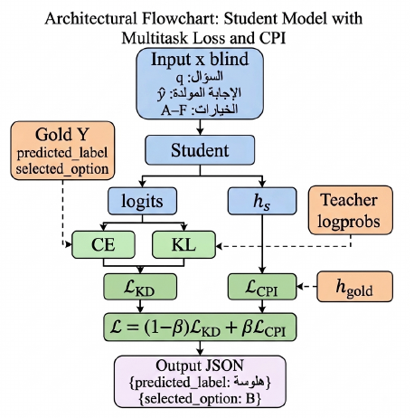
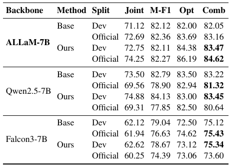
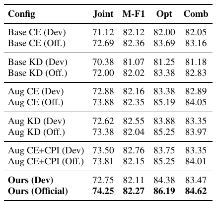

# Vescera at HalluScoring 2026: Privileged-Information Distillation with Contrastive Representation Alignment for Arabic Hallucination Detection

> **Venue**: ArabicNLP 2026 Shared Tasks (The Fourth Arabic NLP Conference, Vol. 2, pp. 1126–1130, 2026-10-28~29, Budapest)
> **Authors**: A. Zakaria Sellam (Univ. of Salento / ISASI-CNR), Ahmed Marouane Djouama (Univ. of Biskra), Ilyes Benaissa, Fadi Abdeladhim Zidi (ISASI-CNR), Marouane Tliba, Mohamed Amine Kerkouri, Aladine Chetouani (L2TI, Univ. Sorbonne Paris Nord)
> **Task**: HalluScoring 2026 Subtask 2.2 — Hallucination Detection & Find the Truth (아랍어)

---

## 1. Background

### 아랍어 Hallucination Detection의 현황
- HalluScoring 2026 Subtask 2.2는 **hallucination 탐지(detection)** 와 **정답 선택(selection)** 을 하나의 문제로 묶는다
  - 입력: 아랍어 질문 q, 모델이 생성한 답변 ŷ, 6개 후보 O = {A, …, F}
  - 출력: faithfulness label (hallucination / no_hallucination) + 정답 letter
  - 평가: `Comb = 0.4 × F1_macro + 0.6 × Acc_option` — option 정확도의 가중치가 더 크다
- 데이터(HalluTruthQA-4K)는 각 질문마다 **검증된 정답 a⋆(gold answer)** 와 5개 distractor를 포함
- 핵심 제약: **추론 시 a⋆를 볼 수 없다(blind)**. a⋆가 보이면 두 판단 모두 문자열 매칭 수준으로 쉬워지므로 평가 프로토콜이 이를 숨긴다

### 기존 방법의 한계
| 방법 | 문제점 |
|---|---|
| Reference/judge를 inference loop에 두는 방식 (SelfCheckGPT 등) | blind 제약을 구조적으로 완화하거나, 반복 추론 비용 발생 |
| 동시 참가 시스템들 (RAG, judge 등) | detection–selection 격차가 비슷하게 남고, 추론 시 무거운 장치 유지 |
| Hard label SFT | label은 1 bit, option은 1 letter — "오답이 얼마나 그럴듯했는지" 같은 정보가 없음 |

---

## 2. Motivation

### 핵심 통찰 1: 과제의 난이도는 "a⋆의 부재"에서 온다
- a⋆가 보이면 쉬운 문제, 안 보이면 어려운 문제 → 더 큰 모델이나 프롬프트로 해결할 문제가 아니라, **a⋆가 주는 정보를 a⋆를 보지 못하는 모델로 옮기는 문제**
- 이는 **LUPI (Learning Using Privileged Information, Vapnik)** 설정과 정확히 일치. Lopez-Paz et al. (2016)이 보였듯 knowledge distillation의 soft output이 privileged feature가 공급할 정보를 전달하는 채널이 된다

### 핵심 통찰 2: Teacher의 이점은 출력층이 아니라 표현(representation)에 있다
- a⋆를 읽은 teacher는 단순히 다른 token을 내는 것이 아니라 **질문 자체를 다르게 표현(encode)** 한다
- 따라서 output distribution만 맞추는 KD로는 부족하고, hidden state를 정렬하는 항이 추가로 필요하다는 가설 → CPI loss

### 핵심 통찰 3: 추론 시스템은 최소화, privileged 정보는 학습 시에만
- 테스트 시에는 LoRA adapter 하나 + greedy JSON decoding 2회. Reference 소비 모듈·검색 없음
- a⋆의 모든 사용을 학습 단계로 한정

---

## 3. Contributions
1. **Privileged-information transfer로의 재정의**: blind 아랍어 hallucination scoring을 gold-answer-conditioned teacher → blind student 전이 문제로 정식화
2. **KD + Contrastive Privileged-Information (CPI) loss**: 출력 분포(KD)와 hidden representation(CPI) 두 채널로 teacher의 이점을 전달
3. **Blindness-preserving augmentation**: prompt paraphrase × option-order permutation으로 학습 데이터 확장 (추론 구조는 불변)
4. **결과**: ALLaM-7B 기반 제출 시스템이 공식 test set **84.62 Comb**, dev **83.47 Comb**

---

## 4. Method



> **Figure 1**: Student 학습 파이프라인 개요. Blind 입력(질문 q, 생성 답변 ŷ, 후보 A–F)이 Student를 통과해 logits와 hidden state h_s를 만든다. Logits는 gold JSON에 대한 CE와 teacher logprob에 대한 KL로 L_KD를 구성하고, h_s는 teacher의 gold-conditioned hidden state h_gold와 비교되어 L_CPI를 만든다. 최종 loss는 (1−β)·L_KD + β·L_CPI.

### 4.1 문제 정식화
- 각 instance: `e = (q, ŷ, O, y_lab, y_opt, a⋆)`
- **두 개의 독립 JSON view** 로 디코딩:
  ```
  Detection:  (q, ŷ)     -> {"predicted_label": ...}
  Selection:  (q, ŷ, O)  -> {"selected_option": ...}
  ```
- 하나의 joint decode로 묶지 않는 이유: detection 오류가 가중치가 더 큰(0.6) option accuracy를 오염시키지 않도록
- 두 task가 **하나의 adapter를 공유** → option 증거가 faithfulness 판단을 regularize

### 4.2 Privileged Teacher
- LoRA teacher T를 **a⋆가 담긴 reference block을 prompt에 추가**한 상태에서 CE로 fine-tune. 배포하지 않음
- **단 한 번의 frozen forward pass** 로 필요한 것을 모두 캐싱:
  - supervised span 전체의 top-K token log-prob `p_T`
  - 마지막 supervised token 위치의 last-layer hidden state `h_gold`
- → teacher 비용은 한 번만 지불, 학습 중 재실행 없음. Augmented row마다 cache를 키로 연결

### 4.3 Blind Student
- Student S는 **T로부터 초기화** — 두 모델은 출력 포맷이 같고 prompt가 드러내는 정보만 다르므로, 처음부터 유효한 JSON을 내는 policy에서 시작

#### Knowledge Distillation
```
L_KD = α · T² · KL( p_T^(K) || p_S ) + (1 − α) · L_CE(Y, p_S)        (1)
```
- KL 항: teacher의 soft distribution이 "오답 option이 얼마나 근접했는지" 같은 calibrated uncertainty를 전달
- CE 항: teacher 자체가 불확실할 때도 gold JSON Y에 anchoring

#### Contrastive Privileged-Information (CPI)
```
L_CPI = 1 − cos( h_student, h_gold )                                  (2)
```
- 같은 token 위치에서 student의 blind hidden state를 teacher의 gold-conditioned hidden state 쪽으로 당김
- 이름은 "contrastive"지만 실제 식은 negative 없는 **cosine alignment** 이다

#### Training Objective
```
L = (1 − β) · L_KD + β · L_CPI,     β = 0.1                           (3)
```
- L_KD는 "모델이 무엇을 말하는가", L_CPI는 "말하기 전에 무엇을 encode하는가"를 제약 → 상호 보완
- β를 작게 둔 이유: CPI는 hidden state regularizer이며, 키우면 Comb가 실제로 측정하는 token-level 정확도를 희생

### 4.4 Blindness-Preserving Augmentation
- 3 prompt paraphrase × 3 option-order permutation으로 학습 데이터 확장 → **19,188 rows**
- a⋆를 입력에 넣지 않으므로 blindness는 구성상 보존됨

#### 학습 vs 추론
| 단계 | 과정 |
|---|---|
| **학습** | (1) a⋆ 포함 prompt로 teacher LoRA SFT → (2) frozen forward 1회로 p_T(top-K), h_gold 캐싱 → (3) teacher에서 초기화한 student를 blind prompt + augmentation으로 L = (1−β)L_KD + βL_CPI 학습 |
| **추론** | Student adapter 하나로 blind JSON greedy decoding 2회 (detection, selection). Reference·judge·검색 없음 |

---

## 5. Experiments

### 5.1 Dataset
| | HalluScoring Subtask 2.2 (HalluTruthQA-4K) |
|---|---|
| 언어 | 아랍어 |
| 도메인 | 4개 |
| Label | hallucination / no_hallucination (no_hallucination 쪽으로 약 59:41 편향) + 6지선다 정답 letter |
| Train / Dev / Test | 1,599 / 800 / 1,600 (official) |
| 학습 rows | 3,198 (instance × 2 view) → augmentation 후 19,188 |

### 5.2 Implementation Details
- Backbone 비교: **ALLaM-7B** (제출 시스템), Qwen2.5-7B, Falcon3-7B
- 모든 모델 LoRA adapter, 5 epoch, 고정 hyperparameter, greedy JSON decoding
- β = 0.1. α, temperature T, top-K의 K, LoRA rank 등은 논문에 명시되지 않음
- 지표: Joint, M-F1 (detection macro-F1), Opt (option accuracy), Comb = 0.4·M-F1 + 0.6·Opt
- **Base** = augmentation 없는 SFT (3,198 rows), **Ours** = augmentation + KD + CPI

### 5.3 Main Results



> **Table 1**: Dev set과 official test set에서 Base vs Ours(full method)를 세 backbone에 대해 비교. ALLaM-7B가 제출 시스템이며, 굵은 글씨는 backbone–split 쌍 내에서 더 높은 Comb.

- **ALLaM-7B**: 두 split 모두 개선 — dev **82.05 → 83.47 (+1.42)**, official **83.16 → 84.62 (+1.46)**. Official이 dev보다 높은 유일한 backbone
- **Qwen2.5-7B / Falcon3-7B**: dev에서는 소폭 개선(+0.23 / +0.22)이지만 official에서 **역전** — Qwen −0.68, Falcon −1.83
- 저자 해석: backbone 순위(ALLaM > Qwen > Falcon)가 **아랍어 사전학습 깊이**와 일치
  - ALLaM: 1.2T token 아랍어/영어 전용 사전학습 단계
  - Qwen2.5: 약 30개 지원 언어 중 하나
  - Falcon3: 네이티브 아랍어 tokenizer 없음 (후속 Arabic 변형에서 32K 아랍어 token을 추가해야 했음)
- 다만 dev→official 역전 자체는 backbone별 ablation이 없어 설명하지 못한다고 저자도 인정

### 5.4 Ablation Study



> **Table 2**: 제출 시스템(ALLaM-7B)에서 각 학습 구성요소의 기여도, dev vs. official test.

| 비교 | Dev ΔComb | Official ΔComb | 해석 |
|---|---|---|---|
| Base CE → Base KD | −0.87 | −0.33 | augmentation 없이 KD만 넣으면 오히려 하락 |
| Base CE → Aug CE (augmentation) | +0.84 | +0.89 | 양 split 모두 일관된 개선 — 가장 안정적인 단일 요소 |
| Aug CE → Aug KD (distillation) | +0.46 | −0.08 | dev 이득이 official에서 역전 |
| Aug CE → Aug CE+CPI (KD 없이 CPI) | +0.46 | −0.04 | dev 이득이 official에서 역전 → dev artifact |
| Aug KD → Ours (KD 위에 CPI) | **+0.12** | **+0.65** | **양 split에서 부호가 유지되는 유일한 효과** |

- 결론: **CPI는 KD 위에 얹을 때 신뢰할 만한 추가 요소이지만, KD의 대체재는 아니다**
- 이득은 거의 전부 **option accuracy** 에서 발생 (KD→Ours: Opt +0.50 dev, +0.94 official). Macro-F1은 81–83 범위에서 거의 움직이지 않음
  - 해석: hallucination 여부는 표면적 불일치만으로 판단 가능한 경우가 많지만, 6개 중 정답 선택은 "어느 것이 맞는지"를 encode해야 함 → representation-level 신호(CPI)가 더 잘 전달
  - 즉 a⋆는 주로 **"주어진 답변이 맞는가"(whether)보다 "어느 option이 맞는가"(which)** 를 disambiguate

### 5.5 주의할 점 (논문 자체의 불일치)
- **Conclusion의 과장**: "CPI improves every backbone we tested, on both splits"라고 쓰지만, CPI 단독 ablation은 ALLaM-7B에서만 보고됐고, Qwen·Falcon의 full method는 official에서 Base보다 낮다
- **Augmentation 수치**: "3 paraphrase × 3 permutation"이면 ×9인데, 3,198 → 19,188은 정확히 ×6
- **개선폭의 크기**: 핵심 CPI 효과가 +0.12 / +0.65 Comb 수준이고 seed 반복·분산이 보고되지 않아 통계적 유의성은 불분명
- Teacher(a⋆ 포함)의 성능, 즉 blind–gold 격차의 상한이 보고되지 않아 "격차를 얼마나 메웠는가"를 정량화할 수 없다
- **CPI target 정의가 섹션마다 다름**: Introduction은 "student의 last-token representation을 **a⋆의 cached embedding** 쪽으로 당긴다"고 쓰지만, Method(Sec. 2)는 target을 **a⋆를 읽은 teacher의 last-layer hidden state h_gold**로 정의한다. 식 (2)와 Figure 1은 후자를 따른다
- **Setup과 Base 정의 충돌**: Sec. 3은 "모든 모델을 augmented data로 5 epoch 학습"이라고 쓰지만, Sec. 4는 Base를 "augmentation 없는 SFT (3,198 rows)"로 정의한다. Table 1의 Base는 후자로 읽어야 한다

---

## 6. Key Takeaways
1. **Gold answer = privileged information**: 추론 시 금지된 정답을 학습 전용 teacher 입력으로 돌려 쓰는 LUPI 프레이밍. 추론 구조는 adapter 1개 + JSON 디코딩 2회로 그대로 유지
2. **Teacher는 한 번만 실행**: top-K logprob과 마지막 token hidden state를 캐싱해 KD·CPI 비용을 최소화 — 산업 환경에서 재현하기 쉬운 설계
3. **Augmentation이 가장 견고한 요소**: Base→Aug가 dev +0.84, official +0.89로 유일하게 양 split 모두 일관된 단독 개선. KD는 augmentation 없이는 오히려 손해(−0.87 / −0.33)
4. **CPI는 KD의 보완재**: KD 위에서만 양 split에서 부호 유지(+0.12 / +0.65). CE 위의 CPI 이득은 dev artifact
5. **이득은 selection에 집중**: Macro-F1은 거의 고정, Opt는 84.38 / 86.19까지 상승 — gold answer는 "어느 option이 맞는가"를 알려주는 정보
6. **Backbone의 언어 사전학습이 recipe 효과를 좌우**: ALLaM-7B 84.62 vs Qwen2.5 80.64 vs Falcon3 73.60 (official). 같은 recipe가 비아랍어 중심 모델에서는 official에서 역효과
