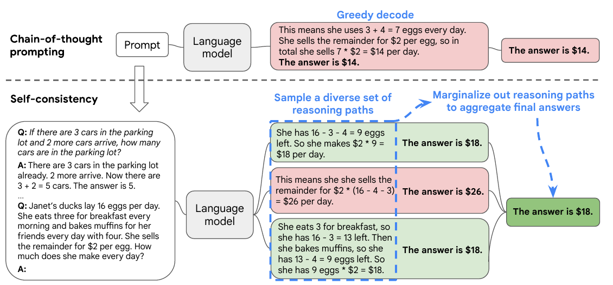
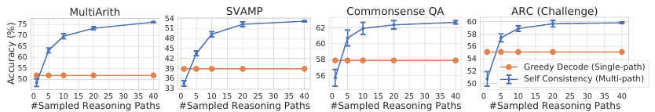

# 01. Self-Consistency Improves Chain of Thought Reasoning in Language Models

> **Authors**: Xuezhi Wang et al. (Google Research, Brain Team)
> **Venue**: ICLR 2023
> **Link**: https://arxiv.org/abs/2203.11171
> **목록 위치**: Part 1 — 기초와 평가

---

## 1. 핵심 연구 질문과 풀고자 하는 문제
- **CoT prompting에서 greedy decoding 대신 여러 reasoning path를 sampling한 뒤 최종 답을 다수결로 모으면 추론 정확도가 오르는가?**
- 배경: Wei et al. (2022)의 chain-of-thought prompting은 multi-step reasoning 성능을 크게 올렸지만, 디코딩은 greedy 하나의 경로에 의존한다.
- 기존 방법의 한계
  - Greedy decoding: 반복적이고 local optimum에 빠지기 쉬움. 한 번의 sampling은 stochasticity가 큼.
  - Verifier/re-ranker (Cobbe et al., 2021; Thoppilan et al., 2022): 추가 학습·human annotation 필요.
  - 일반 ensemble: 여러 모델 학습/보유가 필요.

## 2. 핵심 가설
- "복잡한 추론 문제는 정답에 이르는 여러 다른 사고 경로를 허용한다" — 정답 경로들은 서로 다르더라도 **최종 답이 일치하는 경향**이 강하고, 틀린 경로들은 같은 답에 모이기 어렵다 (Section 2에 명시: "correct reasoning processes, even if they are diverse, tend to have greater agreement in their final answer than incorrect processes").
- 따라서 reasoning path를 latent variable로 보고 marginalize하면 단일 경로보다 정확하다.

## 3. 제안하는 해결책
- 3단계 "sample-and-marginalize" decoding (Figure 1)
  1. 수작업 CoT exemplar로 few-shot prompting
  2. decoder에서 m개의 (reasoning path r_i, answer a_i) 를 sampling (temperature / top-k / nucleus 모두 호환)
  3. reasoning path를 marginalize → 최종 답의 majority vote



> **Figure 1**: Self-consistency의 3단계 — (1) CoT prompting으로 LM에 질의, (2) CoT의 "greedy decode"를 decoder sampling으로 바꿔 다양한 reasoning path 생성, (3) reasoning path를 marginalize하고 최종 답 집합에서 가장 일관된 답을 선택.

- 핵심 수식 (plain text)
```
a* = argmax_a  sum_{i=1..m} 1(a_i = a)          # unweighted majority vote

# 대안: 길이 정규화 확률로 가중
P(r_i, a_i | prompt, question) = exp( (1/K) * sum_{k=1..K} log P(t_k | prompt, question, t_1..t_{k-1}) )
```
- 답 파싱: "The answer is " 이후의 첫 숫자(산술) 또는 전체 문자열(상식)을 a_i로 사용 (각주 1).
- 집계 방식 비교 (Table 1, PaLM-540B): normalized weighted sum ≈ majority vote (GSM8K 74.1 vs 74.4), unnormalized/weighted average는 훨씬 나쁨. 저자 해석: 모델이 calibrated 되어 있지 않아 각 경로 확률이 거의 비슷함.
- 기존 방법과의 차이: 추가 학습·verifier·annotation 없이 단일 모델 위의 "self-ensemble". 단, fixed answer set이 있는 문제에만 바로 적용 가능.

## 4. 가설 검증 방법
- **모델**: UL2-20B, GPT-3 175B (code-davinci-001/002), LaMDA-137B, PaLM-540B. 학습/fine-tuning 없이 few-shot만.
- **데이터셋**
  - 산술: AddSub, MultiArith, ASDiv, AQuA, SVAMP, GSM8K
  - 상식: CommonsenseQA, StrategyQA, ARC-e/c
  - 기호: Last letter (4), Coinflip (4) — 2-letter/2-flip prompt로 4개 테스트하는 OOD 설정
- **Sampling**: UL2·LaMDA는 T=0.5, top-k=40 / PaLM은 T=0.7, k=40 / GPT-3는 T=0.7, top-k 없음. 40개 경로, 10회 반복 평균 (std ≤ 0.5).
- **Baseline**: CoT-prompting + greedy decode.
- **대조 실험·ablation**
  - 경로 수 1→40 (Figure 2): 경로가 많을수록 일관되게 상승, 5~10개에서 대부분 이득 확보(Section 5).



> **Figure 2**: LaMDA-137B에서 self-consistency(파랑)가 CoT + greedy decoding(주황)보다 산술·상식 추론 과제 전반에서 정확도를 크게 올리며, sampling하는 reasoning path 수가 많을수록 정확도가 일관되게 오른다.

  - Sample-and-rank (log prob 최상위 선택, Figure 3): 이득이 훨씬 작음.
  - Beam search (Table 6, UL2-20B): AQuA 40 beam top beam 10.2 vs SC sampling 26.9. SC에 beam search를 쓰면 다양성 부족으로 sampling보다 나쁨.
  - Prompt ensemble (Table 7, LaMDA-137B GSM8K): 3 prompt set 18.6, 40 permutation 19.2 vs SC 27.7.
  - Model ensemble (Table 10): LaMDA+PaLM 36.9 vs PaLM SC 74.4 — 약한 모델이 성능을 끌어내림.
  - Sampling 파라미터(T, k, p) 변화에도 robust (Figure 4, 6). 모델 규모가 클수록 이득 증가.
  - 불완전한 prompt (Table 8, LaMDA GSM8K): greedy 17.1→14.9로 하락하나 SC로 23.4.
  - Zero-shot CoT + SC (Table 8, PaLM GSM8K): 43.0 → 69.2 (+26.2).
  - CoT가 standard prompting보다 나쁜 NLI 등에서도 SC가 회복 (Table 5): ANLI R1 standard 69.1 / CoT 68.8 / SC 78.5.
  - Consistency(최종 답과 일치하는 decode 비율)가 accuracy와 높은 상관 (Figure 5) → uncertainty 지표로 활용 가능.
- **가설 지지 근거**: 4개 모델 × 전 과제에서 SC가 CoT greedy보다 같거나 높음. 동일 sample 수의 sample-and-rank, beam, ensemble보다 우월 → "다양성 + 답 일치"가 핵심이라는 주장과 부합.
- **주의할 점**
  - 추론 비용이 경로 수(40개)만큼 늘어남. 비교된 greedy baseline은 compute-matched가 아님(sample-and-rank·ensemble 비교는 같은 개수로 맞춤).
  - Abstract의 "AQuA +12.2%"는 code-davinci-002 수치이고, PaLM-540B는 +12.5 (Table 2). 모델마다 최고 이득을 골라 보고한 것.
  - 기호 과제에서 작은 모델은 이득이 거의 없음 (UL2 Letter 0.0→0.0, LaMDA 8.2→8.2, Table 3). Equation prompt는 +1.5에 그침 (Table 8).
  - 생성된 rationale 자체는 틀릴 수 있음 (StrategyQA 인구 수치 오류, Section 5) — 답이 맞아도 경로가 옳다는 보장은 없음.

## 5. 개선한 메트릭
| Metric | Benchmark | Baseline (CoT greedy) | Proposed (SC, 40 paths) | 변화 |
|---|---|---|---|---|
| Accuracy | GSM8K (PaLM-540B) | 56.5 | 74.4 | +17.9 (Table 2) |
| Accuracy | GSM8K (code-davinci-002) | 60.1 | 78.0 | +17.9 (Table 2) |
| Accuracy | AQuA (code-davinci-002) | 39.8 | 52.0 | +12.2 (Table 2) |
| Accuracy | SVAMP (code-davinci-002) | 75.8 | 86.8 | +11.0 (Table 2) |
| Accuracy | MultiArith (LaMDA-137B) | 51.8 | 75.7 | +23.9 (Table 2) |
| Accuracy | StrategyQA (code-davinci-002) | 73.4 | 79.8 | +6.4 (Table 3) |
| Accuracy | ARC-c (code-davinci-002) | 83.6 | 87.5 | +3.9 (Table 3) |
| Accuracy | CSQA (PaLM-540B) | 79.0 | 80.7 | +1.7 (Table 3) |
| Accuracy | ANLI R1 (PaLM-540B) | 68.8 | 78.5 | +9.7 (Table 5) |
| Accuracy | e-SNLI (PaLM-540B) | 81.0 | 88.4 | +7.4 (Table 5) |
| Accuracy | GSM8K zero-shot CoT (PaLM-540B) | 43.0 | 69.2 | +26.2 (Table 8) |

## 6. 한 줄 요약
> CoT 출력을 여러 번 sampling해 최종 답을 다수결로 모으는 것만으로, 추가 학습 없이 GSM8K +17.9 등 추론 정확도를 크게 올리며, 답의 일치율은 모델 confidence 지표로도 쓸 수 있다.
