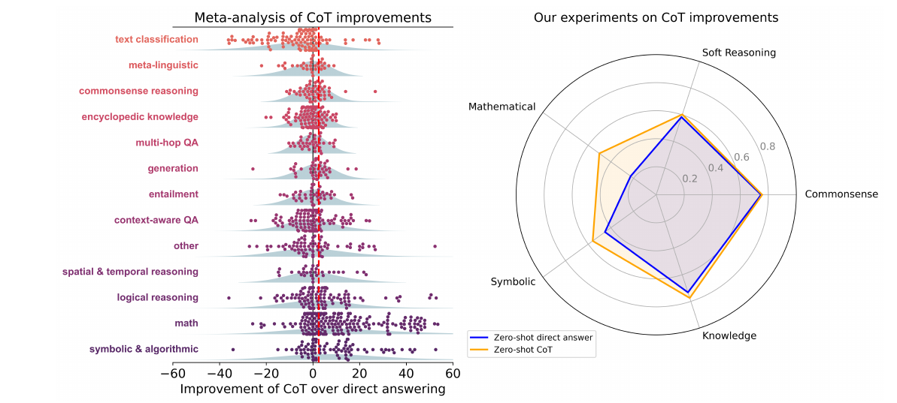
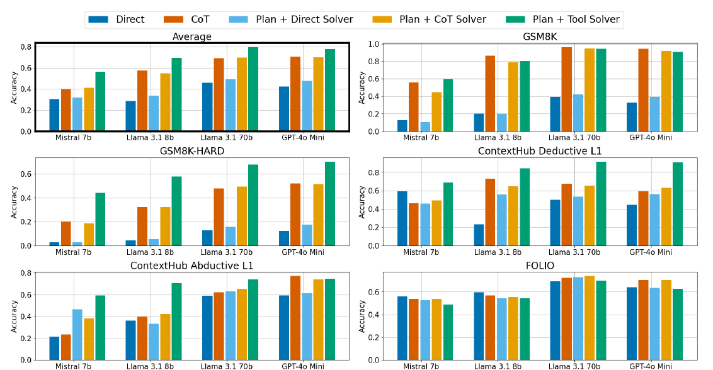

# 02. To CoT or not to CoT? Chain-of-Thought Helps Mainly on Math and Symbolic Reasoning

> **Authors**: Zayne Sprague et al. (UT Austin, Johns Hopkins University, Princeton University)
> **Venue**: ICLR 2025
> **Link**: https://arxiv.org/abs/2409.12183
> **목록 위치**: Part 1 — 기초와 평가

---

## 1. 핵심 연구 질문과 풀고자 하는 문제
- **Prompt 기반 CoT는 어떤 종류의 과제에서 실제로 direct answer(DA)보다 도움이 되며, 그 이유는 무엇인가?**
- 배경: CoT는 사실상 표준 기법이 되었고 ChatGPT·Llama 3.1 등은 기본적으로 CoT를 낸다. 그러나 "reasoning" 연구 다수가 GSM8K·MATH 같은 수학 과제로만 평가된다.
- 기존 인식의 한계: "CoT는 거의 모든 reasoning 문제(symbolic이든 아니든)에서 DA보다 낫다"는 통념이 있으나, 과제 공간의 좁은 부분만 보고 내린 결론일 수 있음. 일부 연구는 수학 외에서 CoT가 무용하거나 해롭다고 보고.

## 2. 핵심 가설
- 검증 대상 통념 (Section 2 "Central claim"에 명시): "I_cot는 symbolic/non-symbolic을 막론하고 거의 모든 reasoning 문제에서 I_da보다 우수하다." → 저자는 이를 **반박**하려 함.
- 저자의 대립 주장 (본문에서 도출)
  - H1: CoT의 이득은 math·logic·algorithmic 등 **symbolic 과제**에 집중되고, commonsense·knowledge·soft reasoning에서는 거의 없다.
  - H2: 그 이득은 주로 **execution(계산·기호 조작 추적)** 단계에서 오며, planning만으로는 설명되지 않는다. 또한 CoT는 외부 symbolic solver보다 못하다.

## 3. 제안하는 해결책
- 새 학습 방법이 아니라 **평가·분석 프레임워크**
  1. Meta-analysis: ICLR 2024, EACL 2024, NAACL 2024의 4,642편 → CoT vs DA 비교가 있는 110편, 1,218개 비교를 과제 카테고리로 분류.
  2. 자체 실험: 20개 데이터셋 × 14개 모델, zero-shot/few-shot, CoT vs DA (greedy decoding, vLLM).
  3. MMLU/MMLU Pro instance-level 분석: 질문 또는 CoT 출력에 "=" 포함 여부로 분할.
  4. Planning vs execution 분리 실험 (Section 5).
- Symbolic 문제 정의 (plain text)
```
S = f(q)            # 질문 q를 합의된 formal system의 기호 표현 S로 매핑
a_hat = solve(S)    # solver(LM 또는 외부 도구)가 S를 실행해 답 도출
S_plan ~ I_planning(q)   # Section 5: LM이 생성한 plan (Python 프로그램 / first-order logic)
```
- Section 5의 5가지 설정: (1) few-shot DA, (2) few-shot CoT, (3) Plan + Direct Solver, (4) Plan + CoT Solver, (5) Plan + Tool Solver (GSM8K는 PAL + Python, 논리 과제는 SatLM + Z3).
- 기존 연구와의 차이: 단일 벤치마크가 아닌 문헌 전체 + 다수 모델·데이터셋을 통한 체계적 비교, 그리고 "=" 같은 단일 feature로 CoT 이득 위치를 설명.

## 4. 가설 검증 방법
- **모델 (14개)**: Llama 2 7B, Mistral 7B, Llama 3.1 8B/70B, Gemma 2 9B, Phi-3 Small, Qwen 2 7B/72B, GPT-4o-mini, GPT-4o, Gemini 1.5 Flash/Pro, Claude 3 Haiku, Claude 3.5 Sonnet.
- **데이터셋 (20개)**: CSQA, StrategyQA, SiQA, PiQA, WinoGrande, ARC-e/c, AGIEval LSAT, MMLU, MMLU Pro, BBH, MuSR, GPQA, MuSiQue, BiGGen Bench, GSM8K, GSM8K-Hard, FOLIO, ContextHub, MATH (Table 4). 5개 카테고리: Commonsense / Knowledge / Soft Reasoning / Symbolic / Mathematical.
- **결과 — H1 지지**



> **Figure 1**: 왼쪽 — CoT 문헌 meta-analysis, 각 점은 어떤 (LLM, task) 쌍에서 보고된 CoT의 DA 대비 delta (빨간 점선은 평균 개선). 오른쪽 — 14개 LLM × 20개 데이터셋에서 5개 reasoning 카테고리별 zero-shot CoT vs direct answer 평균 성능. 두 결과 모두 math·symbolic 영역에서만 일관된 큰 개선이 나타난다.

  - Meta-analysis (Section 3): symbolic 14.2, math 12.3, logical 6.9 평균 개선. 상위 3개 카테고리는 CoT 56.9 vs DA 45.5, 그 외 카테고리는 56.8 vs 56.1.
  - 자체 실험 평균 (Table 6): Mathematical 22.6→50.2, Symbolic 45.2→56.1, 반면 Commonsense 74.8→75.7, Soft 58.3→60.3.
  - MATH·GSM8K 최대 이득 41.6%, 66.9% (Section 4.2). 예: Llama 3.1 8B GSM8K 18.5→85.4 (Table 7).
  - 유의성 검정: Knowledge/Soft/Commonsense 13개 데이터셋에 paired bootstrap + Bonferroni (p=0.00027). 이득을 보인 비교 중 약 32% (59개)만 유의, 그중 26개가 MMLU/MMLU Pro.
  - MMLU "=" 분석 (Table 18, 19): 예) Llama 3.1 70B MMLU 총 CoT delta 1.9 중 1.8이 "="가 있는 문항(전체의 10.6%)에서 발생 → 94.0%. MMLU Pro에서 GPT-4o는 17.7 중 17.1 (96.7%).
  - 답 형식(MC vs short answer / free response)은 결론을 크게 바꾸지 않음 (MuSiQue, BiGGen Bench). Few-shot도 zero-shot과 질적으로 동일 (Appendix E). Prompt 변형 간 차이도 작음 (Appendix D, Figure 7).
- **결과 — H2 지지** (Table 20, Figure 6)



> **Figure 6**: Math·logical reasoning 데이터셋에서 planning과 execution을 분리한 prompt 변형들의 성능. CoT는 formal plan을 풀어 최종 답을 내는 데 direct answer보다 낫지만 symbolic 계산 수행에는 한계가 있어, 전 모델 평균으로 Plan + Tool Solver가 CoT·Plan + CoT Solver보다 크게 앞선다.

  - Plan + Direct Solver는 DA와 비슷 → plan만으로는 이득이 거의 없음 (Llama 3.1 8B GSM8K: DA 20.1, Plan+Direct 19.6, CoT 86.4).
  - Execution을 추적하는 CoT / Plan + CoT Solver가 큰 이득.
  - Plan + Tool Solver가 어려운 과제에서 CoT를 크게 앞섬: GSM8K-Hard Llama 3.1 8B CoT 32.4 vs Tool 57.9, ContextHub Deductive L1 Llama 3.1 70B CoT 67.5 vs Tool 91.7.
- **주의할 점**
  - "Plan + Tool Solver가 대부분 설정에서 우세"라는 주장은 데이터셋에 따라 약함. 원본 GSM8K에서는 Llama 3.1 8B (CoT 86.4 vs Tool 80.3), 70B (96.1 vs 94.4), GPT-4o-mini (94.2 vs 90.5) 모두 CoT가 더 높고, FOLIO에서도 Tool이 대체로 열세 (Table 20). Tool 설정은 unparseable rate가 높음 (FOLIO Mistral 46.8%).
  - "MMLU 이득의 최대 95%가 '='에서 온다"는 상한에 가까운 값. 모델별로 9.8% (Llama 2 7B MMLU)~100% (Qwen 2 7B)로 편차가 큼 (Table 18).
  - 평가는 prompt 기반 CoT + greedy decoding에 한정. RL 등으로 CoT를 학습한 reasoning 모델(o1류)은 다루지 않으며, 저자도 fine-tuned CoT 등 "prompt를 넘어선" 패러다임이 필요하다고 결론. 데이터 오염과 long-horizon planning도 다루지 않음 (Limitations).
  - Table 3 모델 목록에는 Qwen이 빠져 있으나 Table 5·6에는 포함 — 사소한 표기 불일치.

## 5. 개선한 메트릭
분석 논문이므로 "Baseline = zero-shot DA, Proposed = zero-shot CoT"로 정리 (평균은 14개 모델 평균, Table 6).

| Metric | Benchmark | Baseline (DA) | Proposed (CoT) | 변화 |
|---|---|---|---|---|
| Accuracy (avg) | Mathematical 카테고리 | 22.6 | 50.2 | +27.6 (Table 6) |
| Accuracy (avg) | Symbolic 카테고리 | 45.2 | 56.1 | +10.9 (Table 6) |
| Accuracy (avg) | Knowledge 카테고리 | 73.3 | 77.5 | +4.2 (Table 6) |
| Accuracy (avg) | Soft Reasoning 카테고리 | 58.3 | 60.3 | +2.0 (Table 6) |
| Accuracy (avg) | Commonsense 카테고리 | 74.8 | 75.7 | +0.9 (Table 6) |
| Accuracy | GSM8K (Llama 3.1 8B) | 18.5 | 85.4 | +66.9 (Table 7) |
| Accuracy | CommonsenseQA (Llama 3.1 8B) | 74.9 | 68.5 | -6.4 (Table 7) |
| Accuracy | GSM8K-Hard (Llama 3.1 8B, few-shot) | CoT 32.4 | Plan+Tool 57.9 | +25.5 (Table 20) |
| 문헌 평균 개선 | Symbolic / Math / Logical | — | — | +14.2 / +12.3 / +6.9 (Section 3) |

## 6. 한 줄 요약
> Prompt 기반 CoT의 이득은 거의 전부 수학·기호·논리처럼 중간 계산을 추적해야 하는 과제에서 나오며, commonsense·knowledge 류 과제에서는 DA와 거의 같으므로 CoT는 선택적으로 쓰고 symbolic 과제에는 tool을 붙이는 편이 낫다.
