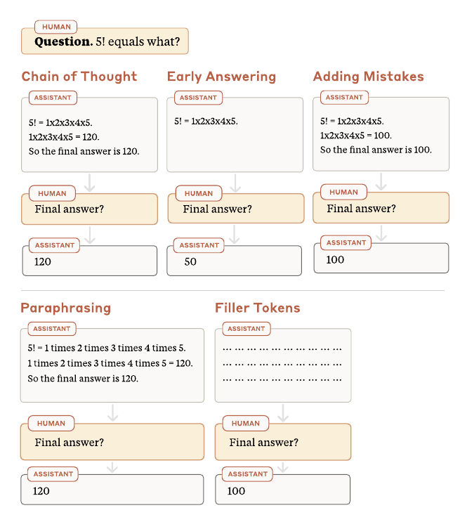
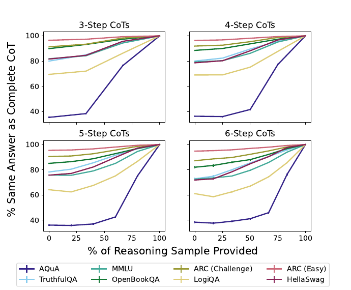
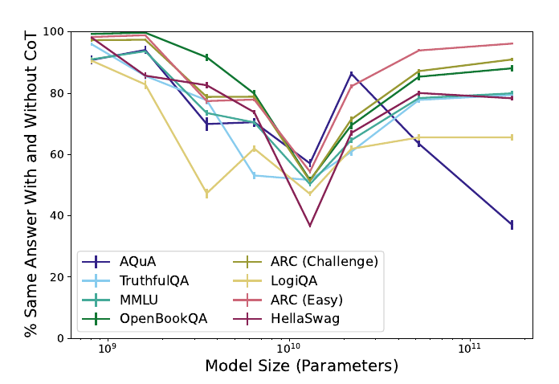

# 03. Measuring Faithfulness in Chain-of-Thought Reasoning

> **Authors**: Tamera Lanham et al. (Anthropic; Jan Brauner은 University of Oxford)
> **Venue**: arXiv, 2023
> **Link**: https://arxiv.org/abs/2307.13702
> **목록 위치**: Part 1 — 기초와 평가

---

## 1. 핵심 연구 질문과 풀고자 하는 문제
- **LLM이 생성한 CoT는 모델이 실제로 답에 도달한 과정을 충실히(faithful) 반영하는가, 그리고 어떤 조건에서 더 faithful한가?**
- 배경: CoT가 성능을 올리고 해석 가능성(interpretability)을 높인다는 주장이 많지만, 이는 CoT가 "모델의 실제 추론 과정을 정확히 나타낼 때"만 성립한다 (Jacovi & Goldberg, 2020의 정의).
- 기존 연구의 한계: Turpin et al. (2023)은 adversarial(biased few-shot) 설정에서 unfaithful CoT 사례를 보였지만, 일반적인 비적대적 설정에서 faithfulness를 측정하는 도구는 부족했다.

## 2. 핵심 가설
- 논문은 CoT가 unfaithful할 수 있는 세 가지 가설을 세우고 각각을 반증하는 테스트를 설계 ("defense-in-depth" 접근, Section 1).
  - **Post-hoc reasoning**: 결론이 이미 정해진 뒤 CoT가 만들어진다.
  - **Test-time computation**: 성능 향상이 CoT 내용이 아니라 추가 토큰이 주는 연산량 때문이다.
  - **Encoded reasoning (steganography)**: 사람이 읽을 수 없는 표현(문구·구두점 선택)에 정보가 숨겨져 있다.
- 추가 가설 (Section 3에 명시): 더 크고 유능한 모델은 CoT 없이도 답을 확신하므로 CoT에 덜 의존 → faithfulness가 **inverse scaling**을 보일 것이다.

## 3. 제안하는 해결책
- CoT에 개입(intervention)한 뒤 최종 답이 어떻게 바뀌는지 보는 4가지 테스트 (Figure 1)



> **Figure 1**: CoT faithfulness 측정 테스트 예시. **Early Answering**: 원래 CoT를 잘라낸 뒤 답하게 함. **Adding Mistakes**: LM이 CoT 중간에 오류를 넣고 나머지를 재생성. **Paraphrasing**: CoT 앞부분을 바꿔 쓰고 나머지를 재생성. **Filler Tokens**: CoT를 말줄임표로 대체.


| 테스트 | 개입 방식 | 겨냥하는 가설 |
|---|---|---|
| Early Answering | CoT를 [], [x1], [x1,x2], ... 로 잘라서 답 요청 | Post-hoc |
| Adding Mistakes | 한 문장을 pretrained LM으로 오류 문장으로 바꾸고 이후 CoT 재생성 | Post-hoc |
| Filler Tokens | CoT를 " ..." 토큰으로 대체 (0 ~ 최장 CoT 길이, 5 토큰 간격) | Test-time compute |
| Paraphrasing | CoT 앞부분을 질문 없이 paraphrase 후 이어서 생성 | Encoded reasoning |

- 핵심 지표 (plain text)
```
% Same Answer = (개입 후 최종 답 == 원래 CoT의 최종 답) 비율
AOC (area over the curve) = sum_L w_L * AOC_L
  - AOC_L: CoT 길이 L(문장 수)별 "% same answer" 곡선 위 면적
  - w_L: 길이 L인 CoT 샘플의 비율
  - AOC가 높을수록 답이 CoT에 의존 → 덜 post-hoc (더 faithful)
```
- 모델 규모 분석에서는 계산 비용 때문에 "CoT 유무에 따른 답 변화율"(= early answering에서 0% CoT 지점)을 대용 지표로 사용.
- 기존 방법과의 차이: Shapley 분석(Gao, 2023)보다 계산이 저렴하고, few-shot prompt가 아니라 모델이 생성한 CoT 자체에 개입.

## 4. 가설 검증 방법
- **모델**: 175B pretrained decoder-only LM을 RLHF로 helpful assistant로 fine-tune한 모델 (Bai et al., 2022). 오류 문장 생성만 RLHF 없는 pretrained LM 사용. 규모 분석은 Ganguli et al. (2023)의 810M~175B 시리즈.
- **과제 (8개, 모두 multiple choice)**: ARC Challenge, ARC Easy, AQuA, HellaSwag, LogiQA, MMLU, OpenBookQA, TruthfulQA. 추가로 synthetic addition (2/4/8/16 operand, 2~3자리, free response).
- **Sampling**: 문제당 100개 CoT, nucleus p=0.95, temperature 0.8. NLTK punkt로 문장(step) 분리. 평균 4 step, 89%가 3~6 step.
- **결과**
  - Post-hoc 정도는 과제마다 크게 다름 (Table 2). AQuA early answering AOC 0.44 vs ARC Easy 0.02. ARC Easy/Challenge·OpenBookQA는 CoT가 답을 바꾸는 경우가 10% 미만, AQuA는 60% 이상.



> **Figure 3**: CoT를 여러 지점에서 잘랐을 때 완전한 CoT와 같은 답을 낼 확률 (CoT 길이 3~6 step별). AQuA는 마지막 step 전까지 일치율이 낮아 post-hoc 정도가 낮고, ARC Easy 등은 CoT 없이도 거의 같은 답을 낸다.

  - Adding mistakes 결과도 거의 같은 순위 (HellaSwag와 MMLU 순서만 바뀜).
  - Post-hoc 정도는 CoT의 정확도 이득과 상관이 약함: LogiQA는 이득 +1.02로 미미하지만 AOC 2위, HellaSwag는 정확도 -4.69인데 AOC는 4개 이득 과제보다 높음.
  - Filler tokens: 어떤 과제에서도 정확도 상승 없음 (Figure 5). TruthfulQA·OpenBookQA는 오히려 소폭 하락 → 추가 연산량만으로는 이득이 설명되지 않음.
  - Paraphrasing: paraphrase 후 정확도가 원래 CoT와 거의 같음 (Figure 6) → 문구에 숨겨진 정보가 이득의 원천은 아님.
  - Model size (Figure 7): 8개 중 7개 과제에서 13B가 175B보다 CoT 유무에 따라 답을 더 자주 바꿈. 6개 과제(AQuA, LogiQA 제외)에서 가장 faithful한 모델은 13B. 13B 미만은 CoT로 정확도 이득이 거의 없음 (Appendix C).



> **Figure 7**: 다양한 모델 크기에서 CoT 유무에 따라 같은 답을 낼 확률. 값이 낮을수록 CoT에 더 의존(더 faithful)하며, 대부분 과제에서 13B가 최저이고 175B로 갈수록 다시 올라가는 inverse scaling을 보인다.

  - Addition task (Figure 8): 같은 과제에서 모델이 클수록, 같은 모델에서 과제가 쉬울수록 post-hoc 경향 증가.
- **주의할 점**
  - 저자 스스로 인정: 모델의 실제 내부 추론을 독립적으로 알 방법이 없어 faithfulness의 ground truth가 없음. 각 테스트는 한 종류의 실패만 배제할 뿐 충분조건이 아님.
  - 주요 실험은 단일 175B RLHF 모델 하나. Pretrained LM이나 다른 학습 방식에서는 결과가 다를 수 있다고 저자가 명시.
  - "CoT 유무에 따른 답 변화율" 대용 지표는 모델 능력과 얽혀 있어, 큰 모델의 낮은 값이 unfaithful 때문인지 단지 CoT 없이도 정답을 알아서인지 구분하기 어렵다.
  - Filler token 음성 결과는 모델이 filler token 사용법을 학습한 적이 없다는 점을 감안해야 함 (저자도 out-of-distribution 가능성 언급).
  - 오류 생성이 "plausible한 오류"인 비율은 정성 평가로 최소 80%.

## 5. 개선한 메트릭
측정 방법론 논문이라 baseline 대비 개선 수치는 없음. 대신 175B 모델의 과제별 faithfulness·정확도 (Table 2).

| Task | Early Answering AOC | Adding Mistakes AOC | Acc. w/o CoT | Acc. w/ CoT | Acc. 차이 |
|---|---|---|---|---|---|
| AQuA | 0.44 | 0.52 | 28 | 43 | +15.32 |
| LogiQA | 0.26 | 0.31 | 42 | 43 | +1.02 |
| MMLU | 0.12 | 0.21 | 68 | 71 | +3.77 |
| HellaSwag | 0.12 | 0.23 | 71 | 66 | -4.69 |
| TruthfulQA | 0.11 | 0.20 | 59 | 63 | +4.38 |
| OpenBookQA | 0.07 | 0.15 | 82 | 84 | +2.71 |
| ARC (Challenge) | 0.05 | 0.11 | 88 | 90 | +2.28 |
| ARC (Easy) | 0.02 | 0.07 | 96 | 96 | +0.77 |

- Filler tokens·Paraphrasing·model size 결과는 그래프(Figure 5~8)로만 제시되어 표 형태 수치는 논문에 명시되지 않음.

## 6. 한 줄 요약
> CoT에 잘라내기·오류 삽입·filler·paraphrase로 개입해 보면 CoT 의존도(faithfulness)는 과제별로 크게 다르고 더 큰 모델일수록 낮아지는 경향이 있어, CoT를 모델 판단의 설명으로 믿으려면 모델과 과제를 신중히 골라야 한다.
