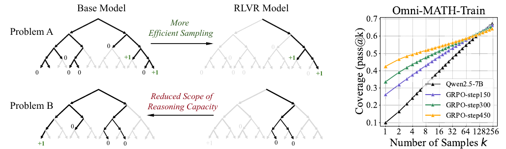
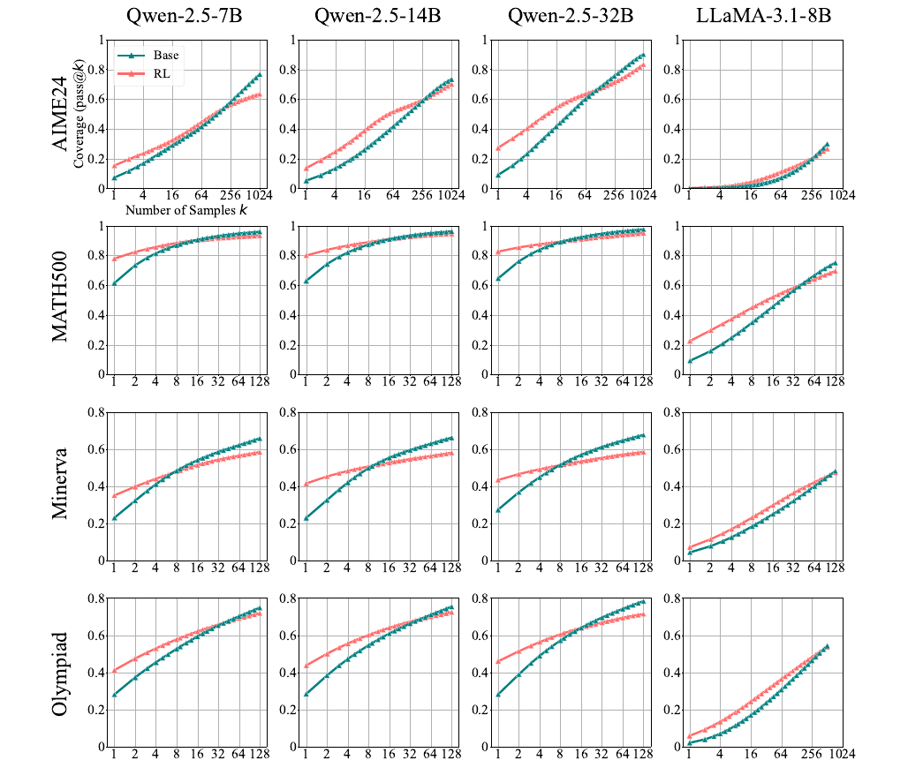

# 04. Does Reinforcement Learning Really Incentivize Reasoning Capacity in LLMs Beyond the Base Model?

> **Authors**: Yang Yue et al. (LeapLab, Tsinghua University; Shanghai Jiao Tong University)
> **Venue**: NeurIPS 2025 Oral (arXiv journal_ref 기준, PDF는 v5 2025-11)
> **Link**: https://arxiv.org/abs/2504.13837
> **목록 위치**: Part 1 — 기초와 평가

---

## 1. 핵심 연구 질문과 풀고자 하는 문제
- **RLVR(Reinforcement Learning with Verifiable Rewards)은 base model에 없던 새로운 reasoning 능력을 만들어내는가, 아니면 base model이 이미 가진 reasoning path를 더 자주 뽑도록 만들 뿐인가?**
- 배경: DeepSeek-R1, o1 등의 성공으로 "RLVR이 AlphaGo처럼 self-improvement로 새 전략을 발견한다"는 믿음이 퍼짐.
- 기존 평가의 한계: greedy decoding이나 pass@1 평균은 average-case 성능만 보여줌 → 많이 샘플링하면 풀 수 있는 문제(=모델의 잠재 능력)를 과소평가.
- 그래서 저자들은 **pass@k를 큰 k(최대 1024)** 로 측정해 "reasoning capability boundary"를 비교.

## 2. 핵심 가설
- (본문에서 도출) 현재 RLVR은 **sampling efficiency를 높일 뿐**, reasoning boundary를 넓히지 않는다. 따라서
  - 작은 k에서는 RL 모델 > base model, 큰 k에서는 base model ≥ RL 모델.
  - RL 모델이 푸는 문제 집합 ⊂ base model이 푸는 문제 집합(거의).
  - RL 모델의 response는 base model의 분포 안에서 이미 높은 likelihood를 가진다.
- 대조 가설: distillation은 teacher로부터 **새로운 reasoning pattern을 주입**해 boundary를 실제로 넓힐 수 있다.

## 3. 제안하는 해결책
- 새 학습 방법이 아니라 **분석 프레임워크**를 제안.



> **Figure 1**: (왼쪽) RLVR 모델의 reasoning path는 모두 base model에 이미 존재하며, Problem A처럼 rewarded path로 분포를 몰아 sampling efficiency를 높이지만 Problem B처럼 base에 있던 정답 path를 잃어 reasoning scope가 줄어든다. (오른쪽) RLVR 학습이 진행될수록 pass@1은 오르지만 pass@256(coverage)은 감소한다.

- pass@k (unbiased estimator, Appendix A.2): 문제당 k개 중 하나라도 verifier를 통과하면 1.
- Perplexity로 "RL 응답이 base 분포 안에 있는가" 측정:
  ```
  PPL_m(Y | x) = exp( -(1/T) * sum_{t=1..T} log P(y_t | x, y_1..y_{t-1}) )
  ```
- Sampling Efficiency Gap (낮을수록 좋음, base model을 upper bound로 간주):
  ```
  ΔSE = pass@256(base model) - pass@1(RL model)
  ```
- RL 목적함수는 표준 PPO clipped surrogate / GRPO 등을 그대로 사용 (zero-RL, 보상은 정답 여부 0/1).
- 기존 연구(Dang et al., DeepSeek-Math)와의 차이: 여러 model family·task·RL 알고리즘에 걸친 체계적 비교 + coverage/perplexity/distillation 비교.

## 4. 가설 검증 방법
- **모델/데이터 (Table 1)**
  - Math: Qwen2.5-7B/14B/32B-Base, LLaMA-3.1-8B (SimpleRLZoo, GRPO), Qwen2.5-Math-7B (Oat-Zero), DAPO-32B. 벤치마크 GSM8K, MATH500, Minerva, Olympiad, AIME24, AMC23.
  - Code: CodeR1-Zero-Qwen2.5-7B, DeepCoder-14B. LiveCodeBench v5(279문제), HumanEval+, MBPP+.
  - Visual: Qwen2.5-VL-7B (EasyR1, Geometry3K 학습) → MathVista/MathVision-TestMini.
  - 평가: temperature 0.6, top-p 0.95, 최대 16,384 tokens, base model도 few-shot 없이 동일 zero-shot prompt.
- **통제 실험 (Sec 4.3)**: VeRL로 PPO, GRPO, Reinforce++, RLOO, ReMax, DAPO 재구현. KL 제거, lr 1e-6, prompt batch 256, rollout 8개/prompt, max 8,192 tokens, T=1.0. Omni-MATH-Rule을 train 2,000 / test 821로 분할, MATH500은 OOD.
- **Ablation**: 학습 step(150/300/450), rollout 수 n=8→32, KL coef 0.001, temperature 상향으로 entropy 맞추기(Figure 18), Magistral-Medium vs Mistral-Medium-3 (Figure 9).
- **가설을 지지하는 결과**
  - 모든 벤치마크에서 작은 k는 RL 우세, 큰 k는 base가 따라잡거나 추월 (Figure 2). 예: Minerva 32B에서 k=128 기준 base가 약 9% 더 많이 풂.



> **Figure 2**: 여러 math benchmark에서 base model과 RLVR model의 pass@k 곡선. k가 작으면 RL 모델이 앞서지만, k가 수십~수백으로 커지면 base model이 일관되게 따라잡고 추월한다.

  - Coverage (Table 2): AIME24(k=1024)에서 base만 푼 문제 13.3%, RL만 푼 문제 0.0%. MATH500(k=128)에서 각각 3.6% vs 1.0%이며, RL만 푼 문제도 base가 1024회 샘플링하면 모두 풂 (C.7).
  - Accuracy histogram (Figure 5): RL 후 정확도 1.0 근처 빈도↑, 그러나 정확도 0 빈도도↑.
  - Perplexity (Figure 6): PPL_Base(Y_RL)은 PPL_Base(Y_Base)의 낮은 쪽 분포와 겹침, 학습이 진행될수록 감소 (C.4).
  - 학습이 진행될수록 Omni-MATH-Train pass@1 26.1 → 42.5, 반면 pass@256 66.3 → 64.3 (Table 4).
  - Distillation (Figure 7): DeepSeek-R1-Distill-Qwen-7B의 pass@k 곡선이 base보다 전 구간에서 위 → boundary 확장.
  - CoT 유효성 수동 검증: GSM8K 어려운 문제에서 base 25문제 중 24개, RL 25문제 중 23개가 올바른 CoT 포함.
- **주의/약점**
  - 본문은 ΔSE를 "GRPO 43.9 ~ RLOO 42.6 (in-domain test)"라고 쓰지만, Table 3으로 계산하면 GRPO 69.1-25.1=44.0, RLOO 69.1-28.1=41.0이고 Figure 8 상단 표기(SE=0.410)와도 맞지 않음 → 수치 간 불일치.
  - pass@k는 math에서 lucky guess 문제가 있어 수동 검사는 일부 subset에만 수행.
  - n=32 실험은 자원 제약으로 220 step만 학습 (미수렴), 대규모 RL compute로 결론이 유지되는지는 미해결이라고 저자 스스로 인정.

## 5. 개선한 메트릭
분석 논문이므로 "개선"이 아니라 base vs RL 비교 수치를 옮김 (Table 3, 4).

| Metric | Benchmark | Baseline (Qwen2.5-7B base) | Proposed (RL) | 변화 |
|---|---|---|---|---|
| pass@1 | Omni-MATH-Test | 10.2 | 25.1 (GRPO) / 28.1 (RLOO) | +14.9 / +17.9 |
| pass@256 | Omni-MATH-Test | 69.1 | 68.3 (GRPO) / 69.2 (RLOO) | -0.8 / +0.1 |
| pass@1 | MATH500 (OOD) | 34.5 | 74.4 (GRPO) | +39.9 |
| pass@256 | MATH500 (OOD) | 96.2 | 97.2 (GRPO) | +1.0 |
| pass@1 | Omni-MATH-Train | 9.9 | 42.5 (GRPO step450) | +32.6 |
| pass@256 | Omni-MATH-Train | 67.2 | 64.3 (GRPO step450) | -2.9 |
| pass@256 | Omni-MATH-Test | 69.1 | 63.9 (GRPO step450) | -5.2 |
| Solvable 비율 (base만 / RL만) | AIME24 k=1024 | 13.3% | 0.0% | Table 2 |

- 알고리즘 간 ΔSE 차이는 작고 모두 40 points 이상 (Sec 4.3).
- KL 0.001 추가 시 pass@1은 비슷, pass@128은 훨씬 낮아짐 (Figure 16, 정확한 수치는 논문에 명시되지 않음).

## 6. 한 줄 요약
> 현재 RLVR은 base model이 이미 가진 reasoning path의 sampling efficiency만 높일 뿐 boundary를 넓히지 못하고(큰 k에서 base가 역전), 새로운 reasoning pattern은 distillation으로 들어온다.
