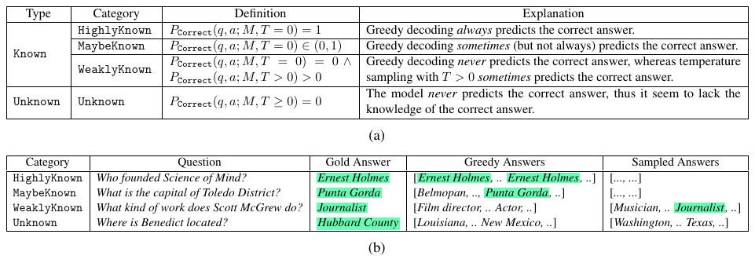
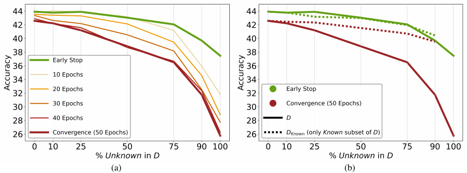
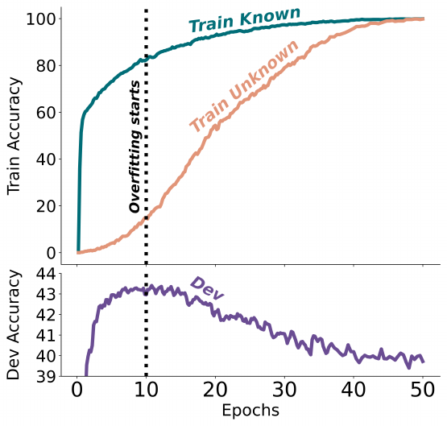

# 07. Does Fine-Tuning LLMs on New Knowledge Encourage Hallucinations?

> **Authors**: Zorik Gekhman et al. (Technion; Google Research)
> **Venue**: EMNLP 2024 (PDF는 arXiv v3, 2024-10; PDF 본문에 venue 표기 없음)
> **Link**: https://arxiv.org/abs/2405.05904
> **목록 위치**: Part 2 — Off-policy 문제

---

## 1. 핵심 연구 질문과 풀고자 하는 문제
- **SFT 데이터에 pre-training에서 배우지 못한 새로운 사실(new knowledge)이 섞여 있으면, fine-tuned 모델이 기존 지식에 대해 hallucination을 더 하게 되는가?**
- 배경: SFT의 정답은 사람이나 다른 LLM이 만든 것이라, 모델 입장에서 "모르는 사실"을 그대로 생성하도록 학습될 수 있음 (Schulman 2023, Goldberg 2023 등의 추측).
- 기존 한계: 이 추측을 통제된 실험으로 검증한 연구가 거의 없고, 개별 학습 예제가 모델 지식과 일치하는지 판정하는 방법도 부족.
- Off-policy 관점: 모델 자신의 분포 밖에 있는 target(teacher/사람 정답)을 imitation할 때 생기는 부작용을 정량화한 연구.

## 2. 핵심 가설
- (본문에서 도출) 
  - H1: Unknown 예제(새 지식)는 Known 예제보다 **훨씬 느리게 fit** 된다 → LLM은 SFT로 새 사실을 잘 습득하지 못한다.
  - H2: Unknown 예제를 fit할수록 기존 지식에 대한 hallucination이 **선형적으로 증가**한다.
  - H3: SFT는 지식을 주입하기보다 이미 가진 지식을 더 잘 꺼내 쓰도록 가르친다 (Superficial Alignment Hypothesis와 연결).

## 3. 제안하는 해결책
- **SliCK (Sampling-based Categorization of Knowledge)**: (q, a) 쌍마다 모델이 정답을 아는 정도를 4단계로 분류.
  - P_Correct(q, a; M, T)는 무작위 4-shot prompt N_ex=10개로 추정. 각 prompt마다 greedy(T=0) 1개 + T=0.5 샘플 16개.
  ```
  HighlyKnown : P_Correct(T=0) = 1
  MaybeKnown  : P_Correct(T=0) in (0, 1)
  WeaklyKnown : P_Correct(T=0) = 0  and  P_Correct(T>0) > 0
  Unknown     : P_Correct(T>=0) = 0
  ```



> **Figure 2**: P_Correct 기반 SliCK knowledge category의 정의(a)와 annotated ENTITYQUESTIONS 데이터의 실제 예시(b).

- 통제 실험: |D| 고정, Unknown 비율 X%를 바꿔가며 fine-tuning.
- 영향 정량화용 linear model:
  ```
  Accuracy = β0 + β_kn * (N_kn / |D|) + β_unk * (N_unk / |D|)
  ```
  (N_kn, N_unk = 모델이 fit한 Known/Unknown 학습 예제 수)
- 실무 완화책: early stopping, Unknown 예제 filtering, Unknown 정답을 "I don't know"로 relabel.

## 4. 가설 검증 방법
- **설정**: PaLM 2-S base model, full fine-tuning. ENTITYQUESTIONS의 12개 relation(학습/in-distribution test) + 7개 relation(OOD test). closed-book QA, Exact Match.
  - |D| = 6,142 고정 (relation별 최소 category 크기의 합, Table 4). lr 1e-5, batch 128, dropout 0.05, 50 epoch.
  - EARLY_STOP = dev 최고 epoch(5~10 epoch), CONVERGENCE = 50 epoch(train 100% fit).
  - 데이터 분포: HighlyKnown 24%, MaybeKnown 23%, WeaklyKnown 17%, Unknown 36%.
- **비교 대상**: Unknown 비율별 D, Unknown을 제거한 D_Known (ablation), 단일 category D_CAT, 자연 분포 D_Natural, I don't know relabel D_IDK.
- **가설을 지지하는 결과**
  - Unknown 비율이 높을수록 test 성능 하락, CONVERGENCE에서 낙폭이 더 큼 (Figure 3a).
  - EARLY_STOP에서는 D ≈ D_Known (Unknown이 중립), CONVERGENCE에서는 D < D_Known이고 격차가 Unknown 비율에 비례 (Figure 3b) → H2.



> **Figure 3**: fine-tuning 데이터 D의 Unknown 비율에 따른 test 성능. (a) 고정 epoch별 곡선과 dev 기준 EARLY_STOP, (b) 실선은 D, 점선은 Unknown을 제거한 D_Known으로 학습한 ablation 결과.

  - Unknown은 Known보다 훨씬 느리게 fit, dev 성능 정점에서 Known 대부분 / Unknown 일부만 fit (Figure 1, 4) → H1.



> **Figure 1**: Known 50% / Unknown 50%로 fine-tuning할 때 epoch에 따른 train·dev accuracy. Unknown 예제는 Known보다 훨씬 느리게 fit되고, dev 성능은 Known 대부분과 Unknown 일부만 fit된 시점에서 최고이며 이후 Unknown을 fit할수록 하락한다.

  - Linear model: β_unk < 0, β_kn > 0, |β_unk| ≈ |β_kn|, R² 0.86 (in-dist) / 0.95 (OOD) (Table 1).
  - OOD relation에서도 같은 경향 (Figure 8) → 특정 사실이 아니라 "근거 없는 답을 생성하는 행동"을 학습.
  - 단일 category: D_MaybeKnown이 최고(43.6), D_HighlyKnown은 MaybeKnown test에서 약함 (Table 2).
  - SliCK Unknown으로 분류된 test 예제의 fine-tuning 후 정확도 ≤ 3.2% → 분류가 대체로 정확. P(True) 기반 분류보다 우수 (Figure 5).
- **주의/약점**
  - 단일 모델(PaLM 2-S), closed-book QA에 한정. long-form 생성으로의 일반화는 미검증 (Limitations).
  - "hallucination"을 test accuracy 하락으로 대리 측정 (Appendix B) — forgetting과 hallucination을 구분하지 않음.
  - Appendix E/Figure 6 caption은 1e-4를 "slower learning rate"라고 쓰지만 기본값 1e-5보다 큰 값 → 표기 오류로 보임.
  - Linear model은 epoch별 관측치를 모아 fit한 상관관계이며 인과 추정은 아님.

## 5. 개선한 메트릭
| Metric | Benchmark | Baseline | Proposed | 변화 |
|---|---|---|---|---|
| EM (Full test, EARLY_STOP) | ENTITYQUESTIONS in-dist | D_HighlyKnown 40.5 | D_MaybeKnown 43.6 | +3.1 (Table 2) |
| EM (MaybeKnown test, EARLY_STOP) | 〃 | D_HighlyKnown 60.1 | D_MaybeKnown 69.9 | +9.8 |
| EM (Full, CONVERGENCE) | 〃 | D_Unknown 25.8 | D_MaybeKnown 43.2 | +17.4 |
| EM 하락 EARLY_STOP→CONVERGENCE | 〃 | D_Unknown 37.5→25.8 | D_MaybeKnown 43.6→43.2 | -11.7 vs -0.4 |
| EM (Full, CONVERGENCE) | 〃 | D_Natural 41.8 | D_MaybeKnown 43.2 | +1.4 |
| Accuracy on answered (CONVERGENCE) | 50% Unknown D | D 38.8 (100% 답변) | D_IDK 61.8 (55.6% 답변) | +23.0 (Table 3) |
| Accuracy on answered (EARLY_STOP) | 50% Unknown D | D 43.0 (100% 답변) | D_IDK 61.8 (58.7% 답변) | +18.8 |

- Linear model 계수 (Table 1): in-dist β0=36.9, β_kn=7.3, β_unk=-8.3, R²=0.86 / OOD β0=36.2, β_kn=3.2, β_unk=-3.0, R²=0.95.
- OOD에서의 최대 성능 하락은 약 6 points, in-dist는 최대 14 points (Appendix I).

## 6. 한 줄 요약
> 모델이 모르는 사실을 담은 SFT 예제는 늦게 학습되고, 결국 fit되면 기존 지식에 대한 hallucination을 선형적으로 늘리므로 early stopping·Unknown 필터링(또는 "I don't know" relabel)이 필요하다.
