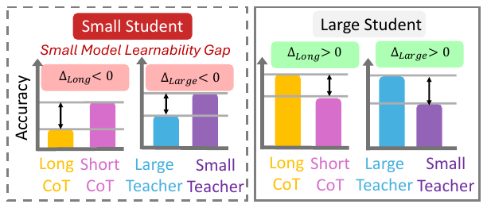
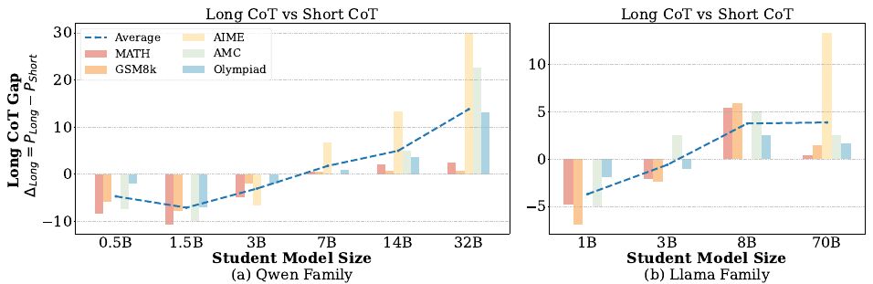

# 08. Small Models Struggle to Learn from Strong Reasoners

> **Authors**: Yuetai Li et al. (University of Washington; Carnegie Mellon University; Western Washington University)
> **Venue**: arXiv 2025 (PDF·arXiv 모두 학회 표기 없음)
> **Link**: https://arxiv.org/abs/2502.12143
> **목록 위치**: Part 2 — Off-policy 문제

---

## 1. 핵심 연구 질문과 풀고자 하는 문제
- **작은 student 모델(≤3B)은 강한 teacher의 long CoT나 대형 teacher의 CoT를 distillation 받으면 항상 이득을 보는가?**
- 배경: 강한 teacher가 만든 CoT로 student를 SFT하는 distillation이 표준 레시피. "teacher가 강할수록 좋다"는 암묵적 가정.
- 한계: 기존 capacity gap 연구는 주로 classification task 대상이고, 응답 생성기(teacher) 쪽 요인만 봄. student 크기를 핵심 변수로 본 연구가 없음.
- Off-policy 관점: teacher 분포와 student 분포의 mismatch가 클수록 SFT(imitation)가 잘 안 된다는 현상을 보여줌.

## 2. 핵심 가설
- **Small Model Learnability Gap**: 작은 모델은 long CoT나 large teacher CoT보다 **short CoT, small teacher CoT**에서 더 잘 배운다. 큰 모델은 반대.



> **Figure 1**: 작은 student(≤3B)는 long CoT나 large teacher distillation에서 일관된 이득을 얻지 못하고, 자신의 learning capacity에 맞는 short CoT·small teacher CoT로 학습할 때 더 좋다 (Small Model Learnability Gap). 큰 student는 반대 경향.

- 원인 가설 (본문에서 도출): student와 teacher 사이 **distribution mismatch**, 그리고 student의 부족한 domain knowledge.
- 해결 가설: 어려운 데이터와 쉬운 데이터를 섞으면 small student가 양쪽 장점을 모두 얻는다.

## 3. 제안하는 해결책
- 측정 지표:
  ```
  ΔLong  = P_Long  - P_Short     (long CoT vs short CoT로 SFT한 성능 차)
  ΔLarge = P_Large - P_Small     (large vs small teacher CoT로 SFT한 성능 차)
  P = MATH, GSM8K, AIME24, AMC23, OlympiadBench 5개 평균
  ```
- **Mix Distillation**:
  - Mix-Long: long CoT 비중 α + short CoT 비중 (1 - α)
  - Mix-Large: large teacher CoT 비중 α + small teacher CoT 비중 (1 - α)
  - α = 0.2 (= 1:4 비율) 사용. 학습 손실은 표준 SFT NLL 그대로.
- 기존 방법과 차이: 새 loss가 아니라 **데이터 구성(complexity 혼합)** 만 바꿈.

## 4. 가설 검증 방법
- **데이터**: MATH train 7,500 prompt. Teacher가 rejection sampling + greedy로 정답 생성.
- **Teacher**: long CoT = QwQ-32B-Preview, short CoT = Qwen2.5-32B-Instruct. large/small teacher = Qwen2.5-72B vs 3B (+ Llama3.1-70B vs 8B, Gemma2-27B vs 9B, Table 9).
- **Student**: Qwen2.5-0.5B/1.5B/3B/7B/14B/32B-Instruct, Llama3.2-1B/3B, Llama3.1-8B, Llama3.3-70B-Instruct.
- **학습**: LLaMA-Factory, <14B는 full SFT (lr 1e-5, cosine, 2 epoch), >14B는 LoRA (lr 1e-4, 2 epoch), max length 16,384. 평가는 zero-shot greedy, 16k tokens, exact match 후 Qwen-32B-Instruct judge.
- **통제**: large/small teacher CoT의 평균 길이 432.98 vs 440.70 tokens → 길이를 confounder에서 제거.
- **가설을 지지하는 결과**
  - ΔLong: Qwen 0.5B/1.5B/3B = -4.7/-7.1/-3.1 (short 우세), 7B/14B/32B = +1.7/+4.9/+13.7 (long 우세) (Table 1).



> **Figure 2**: student 크기별 Long CoT Gap (ΔLong = P_Long - P_Short), (a) Qwen family (b) Llama family. Long CoT는 QwQ-32B-Preview, short CoT는 Qwen2.5-32B-Instruct가 생성. 작은 student는 ΔLong < 0 (short CoT 우세), 큰 student는 ΔLong > 0.

  - ΔLarge: Qwen 0.5B/1.5B = -3.5/-0.8, 7B/32B = +6.6/+6.5 (Table 2).
  - Math expert(Qwen2.5-Math-1.5B)는 gap이 더 작음 (Figure 4), base model이 instruct보다 gap이 큼 (Figure 5).
  - Perplexity: small student일수록 long CoT PPL이 높음 (Qwen-0.5B 2.237 vs short 1.278, Table 10). student 응답은 small teacher CoT와 더 유사 (Table 11).
  - 가장 많이 shift된 token은 "wait", "But", "Let" 등 스타일 token (Appendix C).
  - Hyperparameter sensitivity (Qwen2.5-1.5B, Table 12): epoch 2~5, lr 5e-6~1e-4 모든 설정에서 long CoT(최고 avg 0.286) < short CoT(0.341).
  - large teacher에 "간단하게 설명하라"고 prompt를 바꿔도 small teacher를 못 이김 (0.161 vs 0.204, Table 13).
  - Mix weight ablation: α=0.2에서 최고 (Figure 6). 평균 응답 길이 long 3384.7 / short 575.7 / Mix-Long 1248.9 tokens.
- **주의/약점**
  - 본문은 "Mix-Long이 long CoT 대비 MATH·AMC에서 8 points 이상 향상"이라 하지만 Table 3 기준 AMC는 37.5→45.0 (+7.5).
  - "Qwen2.5-32B가 long CoT로 약 15 points 향상"이라는 서술과 Table 1의 ΔLong 13.7이 어긋남.
  - Table 2 header가 large teacher를 P_Long으로 표기, Llama 모델명을 "Llama-3.2-8B/70B"로 표기하는 등 오탈자. Table 10의 Qwen-1.5B ΔL-S 0.743은 2.969-1.226=1.743과 불일치.
  - Llama3.2-3B에서는 Mix 효과가 작음 (Mix-Long 35.1 vs short CoT 33.1). 평가 셋(AIME 30문제, AMC 40문제)이 작아 1문제 차이가 3.3/2.5 points.
  - "correct for both models인 pair를 filter out"한다는 Appendix A 문구가 제거인지 유지인지 모호.
  - math 도메인에만 한정 (Limitations).

## 5. 개선한 메트릭
Table 3 (MATH 7.5k로 학습, 평균은 5개 벤치마크).

| Metric | Benchmark | Baseline | Proposed | 변화 |
|---|---|---|---|---|
| Accuracy | Average (Qwen2.5-3B) | Long CoT 40.3 | Mix-Long 45.9 | +5.6 |
| Accuracy | Average (Qwen2.5-3B) | Short CoT 43.4 (최고 baseline) | Mix-Long 45.9 | +2.5 |
| Accuracy | MATH (Qwen2.5-3B) | Long CoT 56.2 | Mix-Long 64.7 | +8.5 |
| Accuracy | AMC (Qwen2.5-3B) | Long CoT 37.5 | Mix-Long 45.0 | +7.5 |
| Accuracy | Average (Qwen2.5-3B) | Strong Model CoT 39.7 | Mix-Large 45.8 | +6.1 |
| Accuracy | MATH / AIME / AMC (Qwen2.5-3B) | Strong 57.5 / 0.0 / 35.0 | Mix-Large 65.8 / 10.0 / 42.5 | +8.3 / +10.0 / +7.5 |
| Accuracy | Average (Qwen2.5-3B) | DeepSeek-R1-32B long CoT 33.5 | Mix-Long 45.9 | +12.4 |
| Accuracy | Average (Llama3.2-3B) | Short CoT 33.1 | Mix-Long 35.1 | +2.0 |
| Accuracy | Average (Llama3.2-3B) | Strong Model CoT 32.8 | Mix-Large 34.7 | +1.9 |

## 6. 한 줄 요약
> 3B 이하 student는 강한 teacher의 long/large CoT를 그대로 모방하면 오히려 성능이 떨어지며(teacher-student distribution mismatch), long/large CoT를 20%만 섞는 Mix Distillation이 이 learnability gap을 줄인다.
