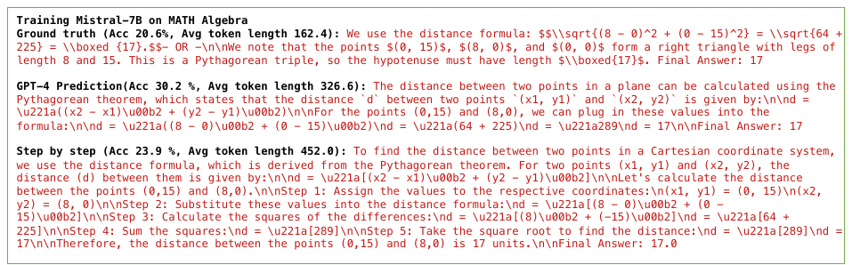
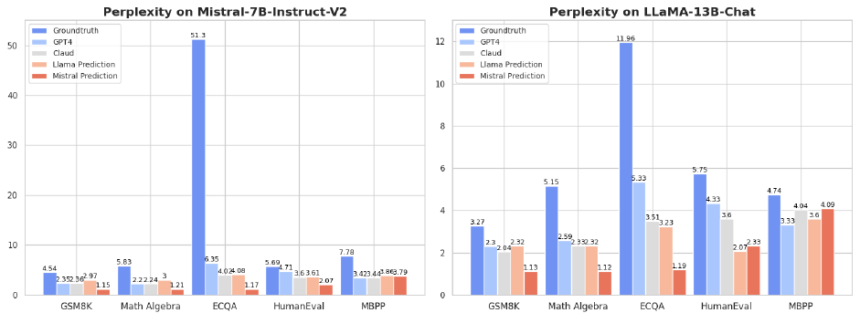

# 09. I Learn Better If You Speak My Language: Understanding the Superior Performance of Fine-Tuning Large Language Models with LLM-Generated Responses

> **Authors**: Xuan Ren et al. (University of Adelaide, University of Technology Sydney)
> **Venue**: EMNLP 2024 Main (arXiv 코멘트 기준, PDF는 v5 2025-12)
> **Link**: https://arxiv.org/abs/2402.11192
> **목록 위치**: Part 2 — Off-policy 문제

---

## 1. 핵심 연구 질문과 풀고자 하는 문제
- **같은 질문에 대해 사람이 쓴 정답(human-annotated response) 대신 LLM이 생성한 응답으로 SFT하면 왜 reasoning 성능이 더 좋은가?**
- 배경: GPT-4/Claude 3.5가 생성한 응답으로 작은 모델(Mistral-7B-Instruct-v2, Llama2-13B-chat)을 fine-tuning하면 human ground truth보다 결과가 좋다 (Table 1: 저성능 데이터 포인트 17개 중 14개가 Groundtruth 학습).
- 기존 통념: LLM 응답이 "더 자세하고 CoT 스타일"이기 때문이라는 설명.
- 한계: 저자들은 반례를 제시한다. Figure 1에서 Mistral을 MATH Algebra로 학습할 때 Step-by-step 응답(평균 452 토큰)은 23.9%, 더 짧은 GPT-4 직접 응답(326.6 토큰)은 30.2%. 즉 "디테일 많을수록 좋다"로는 설명이 안 된다.



> **Figure 1**: Mistral-7B를 MATH Algebra로 학습할 때 데이터 생성 방식별 결과 (Groundtruth 20.6%, GPT-4 prediction 30.2%, Step by step 23.9%). 더 자세한 응답이 항상 성능을 올리지는 않는다.

## 2. 핵심 가설
논문이 명시적으로 두 가설을 제시한다 (Section 1, 3.3).
- H1: 같은 질문에 대해, target LLM은 자기 자신 또는 다른 LLM이 생성한 응답에 본질적으로 더 "familiar"하다. familiarity는 학습 전 target 모델이 측정한 perplexity로 정량화한다 (낮을수록 familiar).
- H2: target LLM은 familiar한 스타일의 응답으로 학습할 때 더 잘 배운다.
- 이 리스트 관점에서의 함의: human label은 모델 분포에서 먼 off-policy 데이터이고, 분포 거리(perplexity)가 학습 효율과 forgetting에 영향을 준다.

## 3. 제안하는 해결책
분석 논문이지만 데이터 구성 방법 두 가지를 제안한다.
- **Style-transferred Ground Truth (Section 4.2)**: target 모델(Mistral) 자신이 정답을 맞힌 응답 2개를 in-context 예시로 주고, human ground truth를 "자기 스타일로" 다시 쓰게 한다. 평가 스크립트를 통과한 것만 사용.
- **Minimum Change (Section 5)**: 
  ```
  1. target LLM이 질문에 답한다 (initial prediction)
  2. 맞으면 그대로 사용
  3. 틀리면 GPT-4가 "최소한의 수정"만으로 오류를 고친다 (원문 단어를 최대한 유지)
  4. 수정된 응답으로 SFT
  ```
  - familiarity(대부분 target 모델 자신의 토큰)와 correctness(GPT-4 교정)를 동시에 확보하는 hybrid 방식.
- familiarity 측정: target 모델의 response perplexity, PPL(r | q). 수식 정의 자체는 표준 perplexity이며 별도 새 수식은 없다.
- 기존 방법과 차이: STaR/ReST류는 자기 생성 샘플을 필터링만 하고, self-distillation(SDFT, Yang et al. 2024)은 target 모델만 rewrite에 쓴다. 이 논문은 "다른 LLM의 응답도 familiar하다"는 점과 familiarity 자체를 원인 변수로 분리한 점을 차별점으로 내세운다.

## 4. 가설 검증 방법
- **모델**: Mistral-7B-Instruct-v2, Llama2-13B-chat. LoRA(Q, V, rank 8), lr 2e-5, batch 32, warmup 10%, cosine schedule. 단일 A100 (Appendix G).
- **데이터**: GSM8K(1000 train / 1314 test), MATH Algebra(1000 / 752, 수치 정답만), ECQA(1000 / 1000), MBPP(374 / 500), HumanEval(82/82 두 번 교차 후 평균). 평가 지표는 pass@1 accuracy. in-domain과 cross-task 평가를 같이 본다.
- **응답 생성기**: gpt-4-1106-preview, claude-3-5-sonnet-20240620.
- **Observation 2 (H1)**: GPT-4, Claude 3.5, Mistral, Llama2의 zero-shot 응답이 human ground truth보다 target 모델 기준 perplexity가 일관되게 낮다 (Figure 2, 그림의 구체 수치는 텍스트로 추출되지 않음).



> **Figure 2**: Mistral-7B-Instruct-v2와 Llama2-13B-chat 기준으로 측정한 응답 출처별 평균 perplexity 비교. Groundtruth가 GPT-4/Claude/모델 자신의 prediction보다 일관되게 높다.

- **Experiment 1 (디테일 vs familiarity, Table 2)**: GPT-4 Answer Directly vs Step-by-step vs Detailed Step-by-Step transformation of GT 비교.
  - Mistral, MATH Algebra in-domain: 0.302 / 0.239 / 0.223. GT를 step-by-step으로 바꾸면 오히려 손해.
  - Llama, ECQA 학습 후 GSM8K cross-task: 0.379 / 0.363 / 0.135.
- **Experiment 2 (같은 의미, 다른 perplexity, Table 3)**: GPT-4/Claude 응답을 paraphrase해서 의미는 같고 perplexity만 높은 세트를 만든 뒤 비교. 모든 셀에서 low-PPL 세트가 높거나 같다.
  - Mistral, MATH Algebra, GPT-4: 0.303 (PPL 2.10) vs 0.231 (PPL 4.66).
  - Llama2, GSM8K, Claude: 0.433 (PPL 2.04) vs 0.326 (PPL 3.36).
- **Advanced LLM 없이 (Table 4, Mistral만)**: Style-transferred GT가 GSM8K 0.51 (GT 0.434), ECQA 0.69 (GT 0.68). MATH Algebra는 통과율 24%(240개)뿐이라 같은 240개 GT로 학습한 17.4% 대비 19.6%로 비교.
- **Minimum Change (Table 5)**: GPT-4 직접 응답과 비슷한 성능을 더 짧은 응답(평균 약 133 토큰 vs 165 토큰)과 더 낮은 perplexity로 달성.
- **주의할 점**:
  - Table 4의 Style Transferred GT MATH Algebra 값이 "19.6"으로 다른 셀(0.xx)과 단위가 다르다. 본문에서 이 표를 "Table 3"으로 잘못 참조한다.
  - "self-trained correct samples only" 방식은 ECQA에서 GT보다 낮다 (0.586 vs 0.68). 5지선다형이라 정답 필터가 잘못된 추론도 통과시키기 때문이라고 저자가 직접 인정한다. 분류 task에 그대로 적용할 때 중요한 caveat이다.
  - 학습 데이터가 1000개, LoRA rank 8, 단일 seed로 보인다(분산 보고 없음). 셀 간 차이가 1~2%p인 경우는 noise일 수 있다.
  - familiarity와 correctness/품질이 완전히 분리되지는 않는다. paraphrase 실험(Table 3)이 가장 깨끗한 대조군이다.

## 5. 개선한 메트릭
| Metric | Benchmark | Baseline | Proposed | 변화 |
|---|---|---|---|---|
| Accuracy (Mistral, in-domain) | MATH Algebra | Groundtruth 0.206 | GPT-4 Answer Directly 0.302 | +9.6%p (Table 1) |
| Accuracy (Mistral, in-domain) | GSM8K | Groundtruth 0.434 | GPT-4 Answer Directly 0.597 | +16.3%p (Table 1) |
| Accuracy (Mistral, ECQA 학습 → cross-task) | GSM8K | Groundtruth 0.258 | GPT-4 Answer Directly 0.462 | +20.4%p (Table 1) |
| Accuracy (Mistral, in-domain) | MATH Algebra | GPT-4 high-PPL 0.231 | GPT-4 low-PPL 0.303 | +7.2%p (Table 3) |
| Accuracy (Mistral, in-domain) | GSM8K | Groundtruth 0.434 | Style-transferred GT 0.51 | +7.6%p (Table 4) |
| Accuracy (Mistral) | HumanEval | GPT-4 Answer Directly 0.365 | Minimum Change (Mistral) 0.409 | +4.4%p (Table 5) |
| Accuracy (Llama) | HumanEval | GPT-4 Answer Directly 0.158 | Minimum Change (Llama) 0.213 | +5.5%p (Table 5) |
| Avg Perplexity (Mistral) | 5개 데이터셋 평균 | GPT-4 3.81 | Minimum Change (Mistral) 2.47 | -1.34 (Table 5) |

## 6. 한 줄 요약
> 같은 정답이라도 target 모델이 "익숙한"(낮은 perplexity) 스타일로 쓰인 응답이 더 잘 학습되고 cross-task forgetting도 적으므로, human label을 그대로 쓰기보다 모델 자신의 출력을 최소 수정해 정답으로 만드는 편이 낫다.
