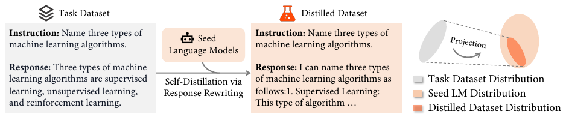
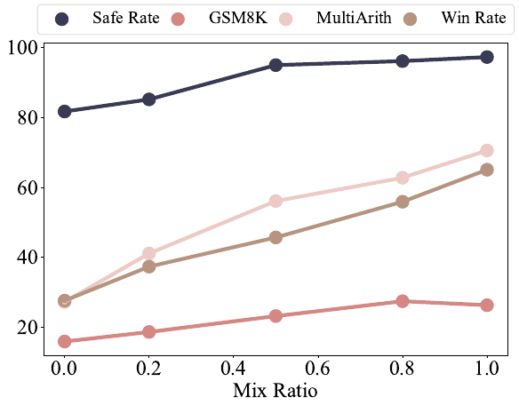
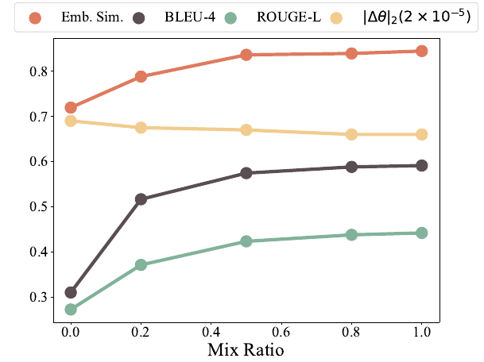

# 10. Self-Distillation Bridges Distribution Gap in Language Model Fine-Tuning

> **Authors**: Zhaorui Yang et al. (Zhejiang University, Sea AI Lab, Tencent TEG)
> **Venue**: ACL 2024 (PDF는 arXiv v2, 2024-05)
> **Link**: https://arxiv.org/abs/2402.13669
> **목록 위치**: Part 2 — Off-policy 문제

---

## 1. 핵심 연구 질문과 풀고자 하는 문제
- **이미 instruction-tuned된 seed LM을 특정 downstream task에 fine-tuning할 때, task 성능을 올리면서 일반 instruction-following·safety·helpfulness를 잃지 않으려면 어떻게 해야 하는가?**
- 배경: vanilla fine-tuning은 target task는 올리지만 다른 능력을 잃는다 (catastrophic forgetting). 예: Llama-2-7b-chat을 OpenFunctions로 학습하면 HumanEval pass@1이 13.4에서 9.8로 27% 하락 (Table 1). benign 데이터로만 fine-tuning해도 safety가 무너진다는 선행 연구(Qi et al., 2024)도 있다.
- 기존 방법의 한계: continual learning 기법(replay, parameter importance, 전용 뉴런)은 원래 학습 데이터 접근이나 큰 계산을 요구해 LLM에 적용하기 어렵다. Self-Play Fine-tuning(SPIN)은 결국 학습 데이터 분포로 수렴하므로 forgetting을 줄이지 못한다.

## 2. 핵심 가설
- 논문의 명시적 가설: **catastrophic forgetting의 주원인은 task dataset 분포와 seed LM 분포 사이의 distribution gap이다** (Section 1).
- 따라서 같은 의미를 유지하면서 seed LM 분포 안에 있는 target으로 바꾸면, parameter shift가 줄고 forgetting이 줄어든다 (Figure 2).
- 이 리스트 관점: 외부 데이터(human label, GPT-4 응답)는 off-policy이고, 그 거리가 forgetting의 크기를 결정한다는 주장이다.

## 3. 제안하는 해결책
**Self-Distillation Fine-Tuning (SDFT)**: 학습 전 seed LM이 정답 응답을 자기 말로 다시 쓰게 하고, 그 결과로 SFT한다.



> **Figure 2**: 왼쪽: seed LM이 원 응답을 rewrite해 만든 distilled response는 seed LM 대비 distribution shift가 작다. 오른쪽: 줄어든 distribution shift가 parameter shift를 완화해 catastrophic forgetting을 줄인다.

```
Vanilla FT:   L_FT(θ)   = - log f_θ(y_t | c_t, x_t)

Step 1 (rewrite):   ỹ ~ f_θ(y | c_t, x_t, y_t)        # 원 응답 y_t를 "reference answer"로 주고 생성
Step 2 (filter):    ỹ' = ỹ    if Extract(ỹ) = y_t     # 예: 수학은 최종 답이 같을 때만
                         y_t  otherwise               # 실패하면 원 응답으로 fallback
Step 3 (train):     L_SDFT(θ) = - log f_θ(ỹ' | c_t, x_t)
```
- Distillation template (Figure 3): "Below are an instruction that describes a task along with a reference answer. Using the reference answer as a guide, write your own response." task와 무관하게 같은 템플릿을 쓴다. GSM8K만 "Let's think step by step" 등 약간 수정 (Appendix B).
- 기존 방법과 차이: 별도 teacher가 없다. rewrite 모델과 학습 모델이 같은 seed LM이고, 추가 비용은 데이터셋 한 번 생성뿐이다. replay 데이터도 필요 없다.

## 4. 가설 검증 방법
- **모델**: Llama-2-7b-chat (주 실험), LoRA (Q, V, rank 8), lr 1e-4 cosine decay. 추가로 Llama-2-7b-chat full FT, Llama-2-13b-chat LoRA, Llama-3-8B-Instruct LoRA (Table 5).
- **학습 데이터**: single-task는 GSM8K, OpenFunctions, MagiCoder. multi-task는 Alpaca, Dolly, LIMA, OpenHermes(20k 샘플). 10k 초과 데이터셋은 2,000개 샘플링.
- **평가**: OpenFunctions, GSM8K, HumanEval(pass@1); safety는 Advbench harmful behavior(keyword matching)로 Raw Safe Rate와 adversarial suffix를 붙인 Jailbreak Safe Rate; helpfulness는 AlpacaEval win rate(vs Text-Davinci-003, GPT-4 judge); 일반 지식은 MMLU, TruthfulQA, ARC, HellaSwag, Winogrande.
- **Baseline**: seed LM, vanilla FT (같은 하이퍼파라미터).
- **분포 이동 분석 (Section 5.1)**:
  - Advbench에서 fine-tuned 모델 출력과 seed 출력의 BLEU-4, ROUGE-L, Sentence-BERT embedding similarity, parameter shift norm을 측정.
  - 학습 샘플 수를 늘리면 유사도가 떨어지고 parameter shift가 커지며 성능이 하락한다 (Figure 5, 6).
  - mix ratio(distilled 비율)를 0에서 1로 올리면 유사도가 오르고 parameter shift가 줄며 benchmark 성능이 오른다 (Figure 7, 8). 이 dose-response 관계가 가설을 가장 직접적으로 지지한다.



> **Figure 7**: mix ratio(distilled 데이터 비율)가 증가할수록 Safe Rate, GSM8K, MultiArith, Win Rate 등 여러 benchmark 성능이 향상된다.



> **Figure 8**: mix ratio가 증가할수록 BLEU-4, ROUGE-L, embedding similarity는 오르고 parameter shift는 줄어든다. 즉 distribution shift가 감소한다.

  - Figure 9: SDFT 모델의 embedding similarity 분포 평균이 약 0.85로 vanilla FT의 약 0.75보다 높다 (그림 축 표기에서 읽은 값).
- **결과 요약**:
  - Table 1: OpenFunctions 학습 시 target 36.6 (vanilla 34.8), GSM8K 29.1 (vanilla 21.5, seed 29.4), HumanEval 15.2 (vanilla 9.8).
  - Table 2: GSM8K 학습 시 AlpacaEval win rate 23.38에서 66.73으로 회복 (seed 66.04).
  - Figure 4: 일반 지식 benchmark는 vanilla FT에서도 거의 변하지 않는다 (OpenFunctions에서 차이 1 미만). 즉 forgetting은 주로 alignment·스타일 쪽이다.
  - Table 4: template을 "Refer"로 바꿔도 vanilla보다 일관되게 좋다.
- **주의할 점**:
  - target task 향상은 작다. full FT에서 GSM8K +0.16 (Table 5), MagiCoder 학습 시 HumanEval은 오히려 -0.6 (Table 1), Llama3-8B의 GSM8K는 seed(81.58) 대비 SDFT(79.45)도 여전히 하락.
  - Table 3의 SDFT Dolly 행(Raw 96.35, Jailbreak 72.69, Win 61.60)이 Table 4의 "Using" 행(97.31, 72.69, 57.52)과 맞지 않고 일부는 "Refer" 행과 일치한다. 어떤 template 결과인지 혼재되어 있다.
  - 본문은 seed win rate를 66.03이라고 쓰지만 표는 66.04.
  - safety 평가는 Advbench와 고정된 adversarial suffix뿐이고(저자 인정), 분산·seed 반복은 보고되지 않는다.
  - fallback 규칙(Extract 불일치 시 원 응답 사용) 비율이 논문에 명시되지 않음. 분류 task라면 rewrite가 label을 바꾸는 경우가 몇 %인지가 중요하다.

## 5. 개선한 메트릭
| Metric | Benchmark | Baseline (Vanilla FT) | Proposed (SDFT) | 변화 |
|---|---|---|---|---|
| Accuracy, FT on OpenFunctions | OpenFunctions | 34.8 | 36.6 | +1.8 (Table 1) |
| Accuracy, FT on OpenFunctions | GSM8K | 21.5 | 29.1 | +7.6 (Table 1, seed 29.4) |
| pass@1, FT on OpenFunctions | HumanEval | 9.8 | 15.2 | +5.4 (Table 1, seed 13.4) |
| Accuracy, FT on GSM8K | GSM8K | 31.9 | 34.4 | +2.5 (Table 1) |
| Jailbreak Safe Rate, FT on GSM8K | Advbench | 54.81 | 65.58 | +10.77 (Table 2, seed 88.85) |
| AlpacaEval Win Rate, FT on GSM8K | AlpacaEval | 23.38 | 66.73 | +43.35 (Table 2, seed 66.04) |
| Jailbreak Safe Rate, FT on Alpaca | Advbench | 52.69 | 86.15 | +33.5 (Table 3) |
| AlpacaEval Win Rate, FT on OpenHermes | AlpacaEval | 65.28 | 72.91 | +7.63 (Table 3) |
| Jailbreak Safe Rate, full FT on GSM8K | Advbench | 37.31 | 63.46 | +26.15 (Table 5) |
| Jailbreak Safe Rate, Llama3-8B, FT on OpenFunctions | Advbench | 79.81 | 96.15 | +16.34 (Table 5) |

## 6. 한 줄 요약
> 정답 응답을 seed 모델 자신이 다시 쓰게 해(self-distillation) 학습 target을 모델 분포 안으로 끌어오면, target task 성능은 유지하거나 약간 올리면서 vanilla SFT가 일으키는 safety·helpfulness·타 task forgetting을 크게 줄일 수 있다.
