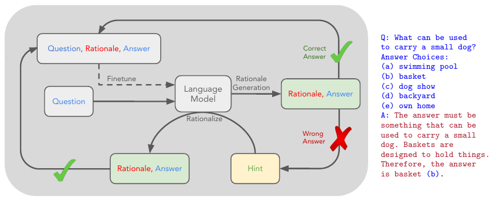
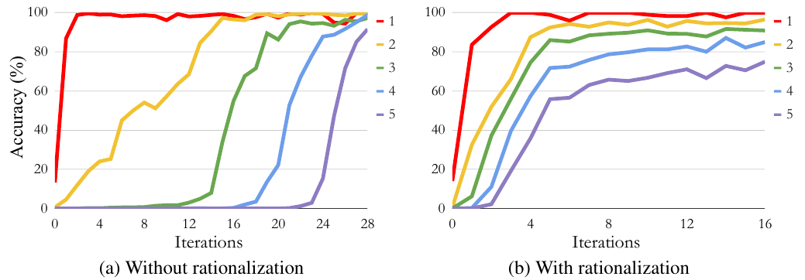

# 11. STaR: Self-Taught Reasoner — Bootstrapping Reasoning With Reasoning

> **Authors**: Eric Zelikman, Yuhuai Wu et al. (Stanford University, Google Research)
> **Venue**: NeurIPS 2022 (PDF·arXiv에 학회 표기 없음, 확인 필요)
> **Link**: https://arxiv.org/abs/2203.14465
> **목록 위치**: Part 2 — Off-policy 문제

---

## 1. 핵심 연구 질문과 풀고자 하는 문제
- **소수의 rationale 예시와 rationale 없는 (질문, 정답) 데이터만으로, 모델이 스스로 생성한 rationale을 학습해 reasoning 능력을 반복적으로 키울 수 있는가?**
- 배경: CoT rationale을 먼저 생성하면 reasoning 성능이 좋아진다 (scratchpad, chain-of-thought).
- 기존 방법의 한계:
  - 사람이 rationale 데이터셋을 만드는 방식은 비싸고, template 기반 자동 생성은 일반 해법이 알려진 문제에만 가능하다.
  - few-shot CoT prompting은 싸지만, 정답만 대량으로 학습한 fine-tuned 모델보다 크게 낮다 (CQA: Few-shot CoT GPT-J 36.6% vs GPT-J Direct Finetuned 60.0%, Table 1).

## 2. 핵심 가설
논문이 "가설"이라는 단어로 정리하지는 않으므로 본문에서 도출한다 (본문에서 도출).
- 정답에 도달한 rationale은 오답에 도달한 rationale보다 품질이 높다. 따라서 정답 일치 여부만으로 rationale을 필터링해도 학습 신호로 쓸 수 있다 (Section 3.1에 명시된 가정).
- 모델이 생성한 rationale을 학습 → 더 나은 rationale 생성 → 더 나은 학습 데이터, 라는 선순환(bootstrapping)이 성립한다.
- 모델이 못 푸는 문제는 정답을 hint로 주면 역방향으로 rationale을 만들 수 있고(rationalization), 이를 학습하면 정체 구간을 넘을 수 있다.

## 3. 제안하는 해결책



> **Figure 1**: STaR 개요와 CommonsenseQA에서 STaR가 생성한 rationale 예시. 점선은 fine-tuning outer loop이며, 질문과 정답은 데이터셋에 있고 rationale은 STaR가 생성한다.

**STaR loop (Algorithm 1)**
```
M_0 = M (pretrained)
for n = 1..N:
    (r_i, y_hat_i)         <- M_{n-1}(x_i)                 # few-shot rationale generation (greedy)
    (r_i^rat, y_hat_i^rat) <- M_{n-1}(add_hint(x_i, y_i))   # rationalization: 정답을 hint로 줌
    D_n     = {(x_i, r_i, y_i)     | y_hat_i = y_i}
    D_n^rat = {(x_i, r_i^rat, y_i) | y_hat_i != y_i and y_hat_i^rat = y_i}
    M_n = train(M, D_n ∪ D_n^rat)   # 항상 원래 pretrained M에서 다시 학습 (overfitting 방지)
```
- rationalization으로 얻은 데이터는 학습 시 hint를 제거해, 모델이 hint 없이 스스로 만든 것처럼 학습한다.
- **RL 해석 (Eq. 1, 2)**: rationale r을 latent variable로 보면
  ```
  J(M, X, Y)  = Σ_i E_{r_i, y_hat_i ~ p_M(·|x_i)} [ 1(y_hat_i = y_i) ]
  ∇J(M, X, Y) = Σ_i E [ 1(y_hat_i = y_i) · ∇ log p_M(y_hat_i, r_i | x_i) ]
  ```
  - indicator reward가 오답 샘플의 gradient를 0으로 만든다 = filtering. 즉 STaR는 binary reward를 쓴 policy gradient의 근사(greedy decoding으로 variance를 줄이고, 같은 batch로 여러 gradient step).
  - rationalization은 p(r | x, y)를 proposal distribution으로 쓰는 **off-policy estimate**로 해석된다 (Section 5). 이 리스트에서 STaR가 Part 2에 들어간 이유.
- 기존 방법과 차이: Expert Iteration과 비슷하지만 별도 value function 없이 정답 일치라는 고정 "expert"만 쓴다. 사람의 rationale 데이터셋이 필요 없다.

## 4. 가설 검증 방법
- **모델**: GPT-J 6B. Adam, lr 1e-6 (1e-7~1e-4 탐색), batch 8 sequences × 1024 tokens, packing, 100-step warmup 후 constant lr. 첫 outer loop 40 step, 이후 매 iteration 20% 증가 (Section 4.1, Appendix H).
- **데이터**:
  - Arithmetic: n-digit 덧셈 (scratchpad 형식), 50,000문항 중 iteration마다 10,000 샘플링.
  - CommonsenseQA (CQA): train 9,741, dev 1,221. 5지선다. Wei et al.의 10개 CoT 예시를 약간 수정해 few-shot prompt로 사용.
  - GSM8K: train 7,473, test 1,319.
- **Baseline**: Few-shot Direct / Few-shot CoT GPT-J, GPT-J Direct Finetuned (정답만 학습), GPT-3 Direct Finetuned (73.0%), Few-shot CoT LaMDA 137B (55.6%).
- **Ablation**: rationalization 유무, 학습 시 few-shot prompt 포함 유무, higher temperature 샘플링을 rationalization 대신 쓰는 경우.
- **결과**:
  - Arithmetic: 16 iteration 후 전체 accuracy 89.5%. rationale 없이 10,000개로 5,000 step 학습한 baseline은 76.3%. rationalization이 있으면 1 iteration 만에 2-digit 덧셈이 1% 미만에서 32%로. 없으면 n-1자리를 잘해야 n자리가 늘어나는 단계적 학습 (Figure 4).



> **Figure 4**: STaR iteration에 따른 n-digit 덧셈 accuracy, (a) rationalization 없음 (b) rationalization 있음. 각 series는 두 n자리 수의 합 accuracy다.

  - 학습 중 9, 10자리를 추가하면 학습에 없던 길이에서도 상당수를 맞힌다 (Figure 5).
  - CQA: STaR with rationalization 72.5%, GPT-J Direct Finetuned 60.0%보다 +12.5, few-shot CoT보다 +35.9. 30배 큰 GPT-3 fine-tuned 73.0%와 비슷 (Table 1).
  - Rationalization은 학습 데이터 사용률을 69.7%에서 86.7%(78.2% 생성 + 8.5% rationalization)로 늘린다.
  - Few-shot prompt를 학습에 포함하면 60.9%에서 68.8%(without rationalization), 69.9%에서 72.5%(with rationalization).
  - Human eval: 크라우드워커 20명이 STaR rationale을 few-shot rationale보다 30% 더 높게 순위 매김 (p = .039), 사람이 쓴 rationale보다 74% 더 선호 (p < .001).
  - GSM8K: 5.8%(Direct FT)에서 10.1%/10.7%로. 생성 계산 단계 수가 사람과 53~57% 일치 (Figure 6).
  - Temperature 0.5/0.7로 더 많이 샘플링하면 "답은 맞고 추론은 틀린" 샘플이 늘어 reasoning만 쓴 모델보다 일관되게 나빴다 (Section 5).
- **주의할 점**:
  - CQA는 test set이 withheld라 dev set으로 보고하고, "성능이 포화될 때까지 돌리고 best 결과를 보고"한다 (Section 4.1). 별도 validation 없이 dev에서 iteration을 고른 것이라 수치가 약간 낙관적일 수 있다.
  - Arithmetic 89.5%가 rationalization 유무 중 어느 설정인지 본문에서 명확하지 않다.
  - GSM8K에서 rationalization 효과는 +0.6%p(10.1 → 10.7)로 미미하고 rationalization 데이터는 0.5%뿐이다 (Table 2).
  - 저자 스스로 binary 분류처럼 chance 성능이 높은 설정에서는 우연히 맞은 나쁜 rationale이 많이 섞여 STaR가 흔들린다고 한계로 명시한다 (Section 6). relevance 분류처럼 label 수가 적은 task에 적용할 때 가장 중요한 caveat이다.
  - 분산이나 seed 반복은 보고되지 않는다.

## 5. 개선한 메트릭
| Metric | Benchmark | Baseline | Proposed | 변화 |
|---|---|---|---|---|
| Dev Accuracy (%) | CommonsenseQA | GPT-J Direct Finetuned 60.0 | STaR with rationalization 72.5 | +12.5 (Table 1) |
| Dev Accuracy (%) | CommonsenseQA | Few-shot CoT GPT-J 36.6 | STaR with rationalization 72.5 | +35.9 (Table 1) |
| Dev Accuracy (%) | CommonsenseQA | STaR without rationalization 68.8 | STaR with rationalization 72.5 | +3.7 (Table 1) |
| Dev Accuracy (%) | CommonsenseQA | GPT-3 Direct Finetuned 73.0 | STaR with rationalization 72.5 | -0.5 (모델 크기 30배 차이) |
| Train Data Used (%) | CommonsenseQA | STaR without rationalization 69.7 | STaR with rationalization 86.7 | +17.0 (Table 1) |
| Test Accuracy (%) | GSM8K | GPT-J Direct Finetuned 5.8 | STaR with rationalization 10.7 | +4.9 (Table 2) |
| Overall Accuracy (%) | n-digit 덧셈 (1~5자리) | Direct baseline 76.3 | STaR 89.5 | +13.2 (Section 4.3) |

## 6. 한 줄 요약
> 정답으로 필터링한 자기 생성 rationale로 반복 fine-tuning하고, 못 푼 문제는 정답 hint로 rationale을 역생성(rationalization)해 보충하면, rationale 데이터 없이도 reasoning이 bootstrapping되며 이는 binary reward policy gradient의 근사로 볼 수 있다.
