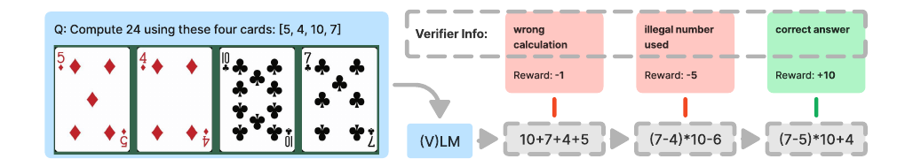
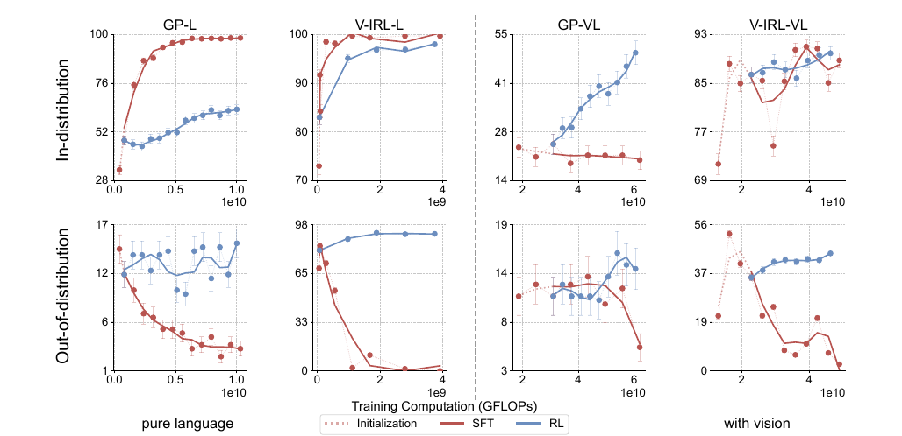

# 12. SFT Memorizes, RL Generalizes: A Comparative Study of Foundation Model Post-training

> **Authors**: Tianzhe Chu, Yuexiang Zhai et al. (HKU, UC Berkeley, Google DeepMind, NYU, University of Alberta)
> **Venue**: ICML 2025
> **Link**: https://arxiv.org/abs/2501.17161
> **목록 위치**: Part 3 — SFT → RL 전환

---

## 1. 핵심 연구 질문과 풀고자 하는 문제
- **SFT와 RL은 각각 학습 데이터를 "암기(memorization)"하는가, 아니면 새로운 변형에도 통하는 "일반화 가능한 규칙"을 학습하는가?**
- 배경: SFT와 RL은 둘 다 post-training의 표준이지만, 둘이 generalization에 미치는 영향의 차이는 분리해서 검증된 적이 거의 없다.
- 기존 연구의 한계: 대부분 SFT나 RL 중 하나만, 또는 LLM이나 VLM 중 하나만 다룬다. 이 논문은 같은 backbone, 같은 compute 조건에서 두 방법을 직접 비교한다.
- 일반화를 두 축으로 나눈다.
  - **Textual rule generalization**: 학습 때와 다른 규칙(text로 주어짐)에서도 통하는가
  - **Visual generalization**: 색·장소 같은 시각 입력이 바뀌어도 통하는가

## 2. 핵심 가설
- (본문에서 도출) outcome-based reward로 학습한 RL은 OOD rule/visual 변형까지 전이되는 규칙을 학습하고, SFT는 학습 규칙을 외워 OOD 성능이 오히려 떨어진다.
- (본문에서 도출) RL은 VLM의 visual recognition 능력 자체를 개선하고, 이것이 visual OOD 일반화에 기여한다.
- (본문에서 도출) RL이 효과를 내려면 SFT가 출력 format을 먼저 안정시켜야 한다.
- 6장에서 저자가 명시한 가설: SFT는 reasoning token이 recognition token보다 훨씬 많아서 reasoning token에 국소적으로 overfit한다. 검증은 future work로 남겼다.

## 3. 제안하는 해결책
- 새 알고리즘을 제안하는 논문이 아니라 **비교 연구 프레임워크**다.
- **Multi-turn RL + verifier (sequential revision)**
  - 각 step t에서 모델 출력 v_out_t를 verifier가 평가해 reward r_t와 텍스트 피드백 v_ver_t를 돌려준다.
  - 다음 입력은 system prompt에 지금까지의 출력과 피드백을 모두 이어 붙인 것이다.
  ```
  v_in_t = concat(v_in_0, [v_out_k, v_ver_k] for k = 0 .. t-1)
  VER(v_out_t) -> (r_t, v_ver_t)
  ```
  - RL 알고리즘은 PPO. 파이프라인은 RL4VLM을 따라 SFT로 초기화한 뒤 RL을 돌린다.



> **Figure 2**: Verifier를 붙인 sequential revision formulation의 예시. 모델은 이전 답과 verifier의 피드백(reward 포함)을 모두 이어 붙인 prompt를 조건으로 다음 답 v_out을 생성한다.

- **평가 환경**
  - GeneralPoints (신규): 카드 4장으로 목표 숫자(기본 24)를 만드는 산술 추론. GP-L(텍스트)과 GP-VL(이미지) 두 버전
    - Rule 변형: ID는 J/Q/K를 모두 10으로, OOD는 각각 11/12/13으로 해석
    - Visual 변형: 검은 무늬(♠, ♣) 카드로 학습하고 빨간 무늬(♥, ♦)로 평가
    - Reward: 정답 +5, 숫자는 맞지만 틀린 식 -1, 최대 verification step 초과 -1, 주어지지 않은 숫자 사용 -2, 그 밖의 illegal 식 -3 (Appendix A.3)
  - V-IRL: 실제 도시 지도 기반 navigation. V-IRL-L, V-IRL-VL
    - Rule 변형: ID는 절대 방위(north, northeast 등 8개), OOD는 상대 방위(left, right, slightly left/right)
    - Visual 변형: NYC route로 학습하고, 여러 도시가 들어 있는 V-IRL VLN mini benchmark로 평가
- 기존 방법과의 차이: compute(GFLOPs)를 맞춘 상태에서 SFT와 RL을 같은 초기 checkpoint로부터 각각 scaling해 비교한다.
  ```
  X_SFT = 6N (D_init + D_SFT)
  X_RL  = 6N (D_init + D_RL) + 2N D_buffer,   D_buffer ≈ λ D_RL  (GP는 λ=6, V-IRL은 λ=5.1)
  ```

## 4. 가설 검증 방법
- **모델**: Llama-3.2-Vision-11B (LLM 실험과 VLM 실험 모두)
- **SFT 데이터**: system prompt와 최적 expert 응답을 짝지은 single-turn 데이터. verification이나 revision step은 넣지 않았다 (Appendix C.1)
- **Baseline**: SFT와 RL이 공유하는 초기 checkpoint(Init)
- **실험 구성**
  - 5.1 Rule OOD: 한 rule로 학습하고 다른 rule로 평가 (Figure 5, 6)
  - 5.2 Visual OOD: 카드 색과 도시를 바꿔 평가 (Figure 7)
  - 5.3 Recognition accuracy와 success rate의 관계 (Figure 8)
  - 5.4 SFT 없이 base model에서 바로 RL (Figure 9)
  - 5.5 Verification iteration 수 {1, 3, 5, 10} 비교 (Figure 10)
  - Ablation: sub-optimal trajectory(오류와 verifier 메시지 포함)로 SFT (Figure 15), SFT learning rate 등 10개 추가 sweep (Figure 16)
- **가설을 지지하는 결과**
  - Rule OOD에서 RL은 4개 task 모두 개선되고 SFT는 4개 모두 하락한다 (Figure 6)
  - Visual OOD에서도 RL만 개선된다. V-IRL mini benchmark에서 이전 SOTA 44.0%를 77.8%로 끌어올렸다 (Figure 7)
  - Compute를 늘리면 RL은 recognition accuracy와 success rate가 함께 오르고, SFT는 둘 다 떨어진다 (Figure 8)
  - Sub-optimal trajectory로 SFT해도 여전히 OOD가 떨어진다. 저자들은 암기가 데이터가 아니라 SFT 자체의 성질에서 온다고 해석한다 (Figure 15)
  - SFT 없이 RL을 하면 모든 run이 실패한다. base model의 instruction following이 약해서 reward를 뽑아낼 수 없기 때문이다 (Figure 9, 20)
  - 같은 compute에서 verification step을 늘릴수록 OOD 향상 폭이 커진다: 1 step +0.48%, 3 steps +2.15%, 5 steps +2.99%, 10 steps +5.99% (Figure 10)



> **Figure 5**: GeneralPoints와 V-IRL에서 RL과 SFT의 success rate - GFLOPs 추이. 위 행은 in-distribution, 아래 행은 out-of-distribution 성능이며, compute를 늘릴수록 RL은 OOD가 유지·상승하고 SFT는 OOD가 무너진다 (GP는 episode success rate, V-IRL은 per-step accuracy).

- **주의할 점**
  - GP의 OOD 개선은 절대값이 작다 (GP-L 11.5%→15.0%, GP-VL 11.2%→14.2%). "RL generalizes"는 하락하지 않고 소폭 오른다는 의미에 가깝다.
  - V-IRL은 per-step accuracy로 보고했다. V-IRL-VL의 전체 route success rate는 두 방법 모두 1% 이하다 (Appendix D.2, Figure 18).
  - RL도 과하게 tuning된 SFT checkpoint(OOD per-step accuracy 1% 미만)에서 시작하면 OOD를 회복하지 못한다 (Figure 19). "RL이 항상 일반화한다"가 아니라, 초기 checkpoint가 너무 underfit이거나 overfit이면 RL도 효과가 제한된다.
  - GP-VL에서는 SFT가 ID 성능조차 RL만큼 오르지 않았다 (Section 6). 그래서 SFT와 RL의 OOD 비교가 ID 수준 차이와 섞여 있을 수 있다.

## 5. 개선한 메트릭
| Metric | Benchmark | Baseline (Init) | Proposed (RL) | 변화 | SFT (참고) |
|---|---|---|---|---|---|
| OOD success rate (rule) | GP-L | 11.5% | 15.0% | +3.5 | 3.4% (-8.1) |
| OOD per-step acc (rule) | V-IRL-L | 80.8% | 91.8% | +11.0 | 1.3% (-79.5) |
| OOD success rate (rule) | GP-VL | 11.2% | 14.2% | +3.0 | 5.6% (-5.6) |
| OOD per-step acc (rule) | V-IRL-VL | 35.7% | 45.0% | +9.3 | 2.5% (-33.2) |
| Visual OOD success | GP-VL | 23.6% | 41.2% | +17.6 | 13.7% (-9.9) |
| Visual OOD success | V-IRL-VL | 16.7% | 77.8% | +61.1 | 11.1% (-5.6) |
| V-IRL VLN mini (vs 이전 SOTA) | V-IRL mini | 44.0% | 77.8% | +33.8 | - |

- 출처: Figure 6 (rule OOD), Figure 7 (visual OOD), Section 5.2 (SOTA 비교)
- SFT와 RL은 같은 compute로 학습했다 (Figure 6 caption).

## 6. 한 줄 요약
> 같은 compute에서 outcome reward 기반 multi-turn RL은 규칙과 시각 변형 모두에서 OOD 성능을 올리지만 SFT는 학습 규칙을 외워 OOD가 무너진다. 다만 RL이 작동하려면 SFT로 출력 format을 먼저 잡아 줘야 한다.
