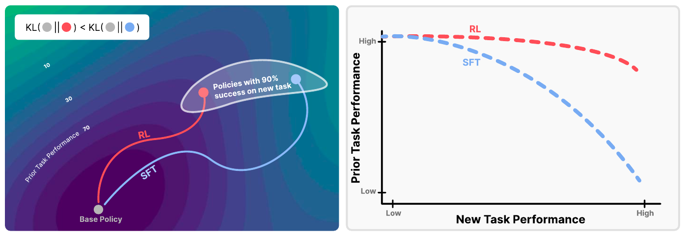
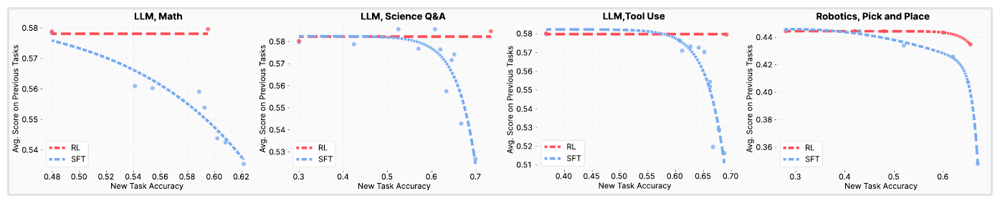
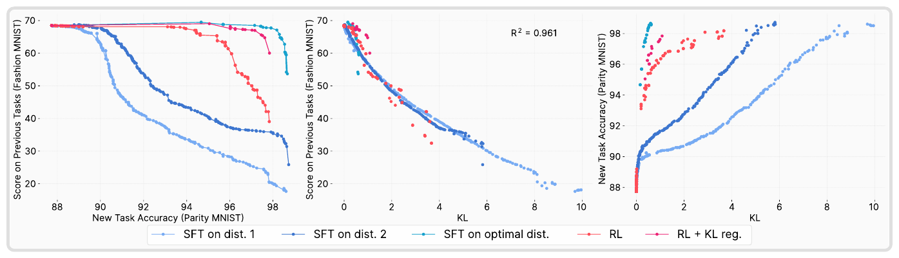

# 13. RL's Razor: Why Online Reinforcement Learning Forgets Less

> **Authors**: Idan Shenfeld, Jyothish Pari et al. (MIT Improbable AI Lab)
> **Venue**: arXiv 2025 (v1, 2025-09)
> **Link**: https://arxiv.org/abs/2509.04259
> **목록 위치**: Part 3 — SFT → RL 전환

---

## 1. 핵심 연구 질문과 풀고자 하는 문제
- **새 task에서 SFT와 RL이 같은 성능에 도달했는데도 RL이 기존 능력을 훨씬 덜 잊는 이유는 무엇이며, 무엇이 forgetting의 양을 결정하는가?**
- 배경: 오래 배포되는 agent는 새 task를 계속 배워야 하는데, catastrophic forgetting이 걸림돌이다.
- 기존 방법의 한계
  - EWC, feature 보존, output regularization 같은 기법은 forgetting의 "증상"을 억제할 뿐, 원인을 설명하지 못한다.
  - "이전 task에서 분포가 얼마나 바뀌었는가"로 forgetting을 예측하자는 제안도 있었지만, foundation model은 이전 task 집합이 사실상 무한해서 측정할 수 없다.

## 2. 핵심 가설
- **Empirical forgetting law**: forgetting의 정도는 **새 task 입력에서 잰** base policy와 fine-tuned policy 사이의 KL로 예측된다.
  ```
  forgetting ~ f( E_{x~τ} [ KL(π0 || π) ] )     τ: 새 task 분포, π0: base policy
  ```
- **RL's Razor**: 새 task를 푸는 해가 여러 개 있을 때, on-policy RL은 그중 base model에 KL로 가장 가까운 해 쪽으로 암묵적으로 편향된다. SFT는 주어진 label에 따라 임의로 먼 분포로 수렴할 수 있다.
- RL이 덜 잊는 이유는 negative example 때문이 아니라 **on-policy sampling** 때문이다.

## 3. 제안하는 해결책
- 새 학습 알고리즘이 아니라 **forgetting을 설명하는 원리(KL law + RL's Razor)와 그 이론적 근거**를 제시한다.



> **Figure 1**: KL-minimal 해로의 편향이 forgetting을 줄인다. 왼쪽: 새 task를 푸는 policy들 중 RL은 base model에 KL로 가장 가까운 해로 수렴한다. 오른쪽: 이 KL bias 덕분에 같은 new-task 성능에서 RL이 SFT보다 prior-task 성능을 더 잘 유지한다.

- 두 objective 비교 (Section 5.1)
  ```
  L_SFT(π) = - E_{x~D, y~π_β} [ log π(y|x) ]          # 외부 annotation 분포 π_β
  L_RL(π)  = - E_{x~D, y~π}   [ A(x,y) log π(y|x) ]   # 자기 자신의 분포에서 sampling
  ```
- 이론 (Section 5.2, Appendix A)
  - Lemma 5.1: binary reward에서 rejection sampling으로 얻은 분포는 KL(q || p)를 최소화하는 I-projection과 같다.
  ```
  q_RS = argmin_q KL(q || p)   s.t.  E_{y~q}[R(y)] = 1
  ```
  - Lemma A.2: policy gradient 한 step은 q(y) ∝ π(y) R(y)를 policy class로 M-projection하는 것과 같다.
  - Theorem 5.2 / A.3: binary reward에서 policy gradient는 EM(I-projection과 M-projection의 반복)과 같고, Π가 exponential family 같은 조건을 만족하면 다음 해로 수렴한다.
  ```
  π† = argmin_{π ∈ P* ∩ Π} KL(π || π0)     P*: reward=1을 달성하는 정책 집합
  ```
- 검증용 "oracle SFT": 정답률 100%를 유지하면서 base에 KL로 가장 가까운 분포를 닫힌 형태로 구해 SFT label로 쓴다 (ParityMNIST).

## 4. 가설 검증 방법
- **LLM 실험** (Qwen 2.5 3B-Instruct, RL은 GRPO, binary reward, 명시적 KL 정규화 없음)
  - 새 task: Math (Open-Reasoner-Zero), Science Q&A (SciKnowEval Chemistry L-3), Tool use (ToolAlpaca)
  - SFT 데이터: Math는 DeepSeek R1로 프롬프트당 최대 16개를 sampling해 정답 1개를 남겼다 (데이터의 96% 확보). Science는 GPT-4o로 같은 절차를 거쳤다 (Appendix B.1).
  - Forgetting 측정: Hellaswag, TruthfulQA, MMLU, IFEval, Winogrande, HumanEval의 평균
  - Hyperparameter sweep(LR, epoch, batch 등, Table 2)으로 수십 개 모델을 학습하고 Pareto frontier를 비교 (Figure 2)
- **Robotics**: OpenVLA 7B, SimplerEnv pick-and-place로 학습하고 drawer open/close로 forgetting 측정
- **Toy 실험 ParityMNIST**: 3-layer MLP를 ParityMNIST와 FashionMNIST로 함께 pretrain한 뒤 Parity만 fine-tune하고 FashionMNIST로 forgetting을 측정. 방법당 약 500 run (Appendix B.3)
- **대조 실험**
  - 알고리즘 2x2 (on-policy/offline × negative 사용 여부): GRPO, 1-0 Reinforce, SFT, SimPO (Figure 4, Science Q&A)
  - 다른 forgetting 예측 변수 후보와 R2 비교: weight change, activation change, sparsity, rank 등 (Table 1)
  - RL 모델이 생성한 데이터로 SFT (distillation, Figure 9)
  - 모델 크기 3B, 7B, 14B에서 SFT 비교 (Figure 8)
- **가설을 지지하는 결과**
  - 세 LLM task 모두에서 RL은 new-task 정확도가 올라도 prior-task 점수가 거의 그대로이고, SFT는 크게 떨어진다. Math에서 가장 심하다 (Figure 2)
  - KL과 forgetting의 관계가 RL과 SFT를 가리지 않고 하나의 곡선에 놓인다: ParityMNIST R2 = 0.96, LLM R2 = 0.71 (Figure 3, 11)
  - Oracle SFT는 RL보다도 덜 잊는다. RL 데이터로 distill한 SFT는 RL과 같은 trade-off를 보인다. 즉 학습 알고리즘이 아니라 도달한 분포가 forgetting을 결정한다.
  - 1-0 Reinforce는 GRPO와, SimPO는 SFT와 비슷하게 움직인다. 결정적인 요인은 negative gradient가 아니라 on-policy 데이터다 (Figure 4)
  - Representation 보존(CKNNA): RL 0.94, SFT 0.56 (Figure 7)
  - RL update가 sparse해 보이는 것은 bfloat16 때문이었다. float32로 학습하면 sparsity가 사라지고 성능은 같다 (Section 6)



> **Figure 2**: RL과 SFT의 Pareto frontier. x축은 new-task 성능, y축은 prior-task 성능이며 각 점은 서로 다른 hyperparameter로 학습한 모델이다. RL은 prior knowledge를 유지하면서 new-task를 개선하지만, SFT는 new-task 향상을 forgetting과 맞바꾼다.



> **Figure 3**: KL divergence가 catastrophic forgetting을 예측한다 (ParityMNIST). 왼쪽: SFT는 oracle 분포를 annotation으로 쓸 때만 RL을 앞선다. 가운데: KL에 대해 그리면 방법과 무관하게 forgetting이 하나의 곡선에 놓인다 (R2 = 0.961). 오른쪽: RL은 SFT보다 훨씬 작은 KL 변화로 new-task 정확도를 올린다.

- **주의할 점**
  - Figure 2, 4의 Pareto 곡선은 그림으로만 제시되고 구체적 수치는 논문에 명시되지 않음.
  - KL 방향 표기가 일관되지 않다. Forgetting law와 oracle은 KL(π0 || π)(저자가 "forward"라 부름)를 쓰는데, Theorem 5.2가 보장하는 것은 KL(π || π0)를 최소화하는 해로의 수렴이다. 이론이 직접 설명하는 KL과 forgetting을 예측하는 KL이 다르다. 다만 reverse KL도 R2 = 0.93으로 높다 (Table 1).
  - LLM에서는 R2 = 0.71로 toy(0.96)보다 상당히 약하다. 저자들은 KL과 정확도 추정의 noise 때문이라고 설명한다.
  - 이론은 Π가 e-flat(exponential family)이라고 가정한다. 신경망 policy class는 일반적으로 이 조건을 만족하지 않는다고 저자도 인정한다 (Appendix A).
  - Off-policy online RL은 다루지 않았다.

## 5. 개선한 메트릭
| Metric | Benchmark | Baseline | Proposed | 변화 |
|---|---|---|---|---|
| Forgetting 예측력 R2 (2차 다항식) | ParityMNIST | Weight change L1: 0.34 ± 0.02 | Forward KL: 0.96 ± 0.01 | +0.62 |
| Forgetting 예측력 R2 | ParityMNIST | Activation change L2: 0.55 ± 0.02 | Forward KL: 0.96 ± 0.01 | +0.41 |
| Forgetting 예측력 R2 | ParityMNIST | TV: 0.80 ± 0.01 / Reverse KL: 0.93 ± 0.01 | Forward KL: 0.96 ± 0.01 | +0.16 / +0.03 |
| Forgetting 예측력 R2 | LLM (3 tasks) | 논문에 명시되지 않음 | Forward KL: 0.71 | - |
| Representation 유사도 CKNNA (vs base) | Wikipedia probe | SFT 0.56 | RL 0.94 | +0.38 |

- 출처: Table 1, Figure 3, Figure 7 (Appendix C.1), Section 4
- 이론 결과: binary reward에서 policy gradient는 `argmin_{π ∈ P* ∩ Π} KL(π || π0)`로 수렴한다. 조건은 Π가 e-flat이고 full support를 가지며, P* ∩ Π가 비어 있지 않고, M-projection 오차의 합이 유한한 것이다 (Proposition A.4).
- Hyperparameter 참고: SFT LR {1e-5 ~ 9e-5}, RL LR {1e-5 ~ 5e-5}, loss type은 Dr. GRPO (Table 2)

## 6. 한 줄 요약
> Forgetting은 알고리즘이 아니라 새 task에서 잰 base 대비 KL로 예측되고, on-policy RL은 자기 분포에서 sampling하기 때문에 KL이 가장 작은 해를 고르며(RL's Razor), 그래서 SFT보다 덜 잊는다.
