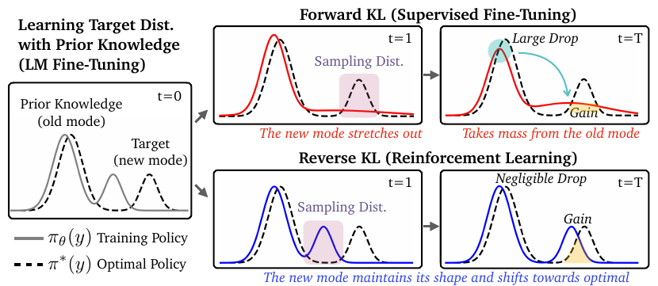
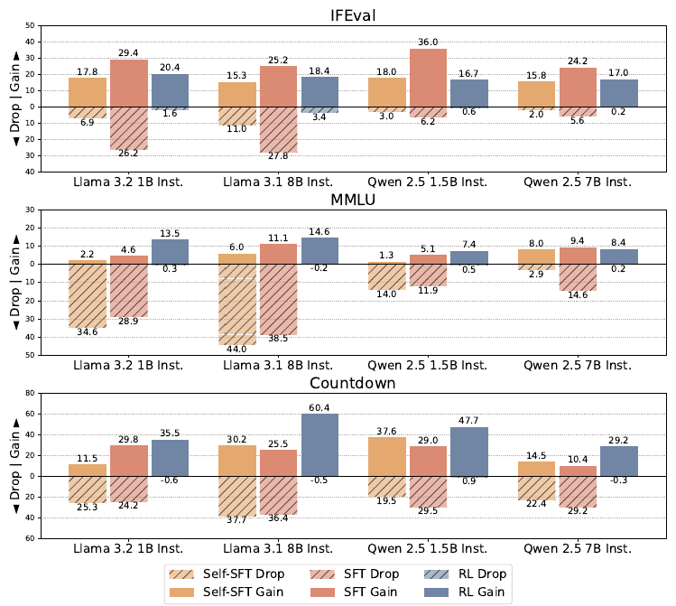
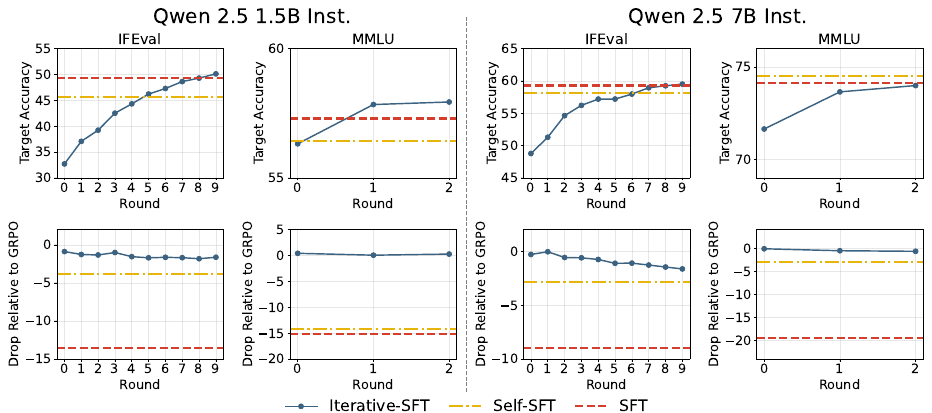

# 14. Retaining by Doing: The Role of On-Policy Data in Mitigating Forgetting

> **Authors**: Howard Chen, Noam Razin, Karthik Narasimhan, Danqi Chen (Princeton Language and Intelligence)
> **Venue**: ICML 2026 (arXiv v1 2025-10)
> **Link**: https://arxiv.org/abs/2510.18874
> **목록 위치**: Part 3 — SFT → RL 전환

---

## 1. 핵심 연구 질문과 풀고자 하는 문제
- **LM post-training에서 SFT와 RL 중 어느 쪽이 기존 능력을 덜 잊는가, 그 차이는 어디서 오는가, 그리고 실용적으로 어떻게 줄일 수 있는가?**
- 배경: SFT(instruction tuning)든 RLHF든 post-training 뒤에는 forgetting, 이른바 "alignment tax"가 보고된다.
- 기존 통념과의 충돌
  - SFT는 forward KL(mode-covering)을, RL은 reverse KL(mode-seeking)을 최소화한다.
  - 통념대로라면 mode-seeking인 RL이 기존 mode의 확률 질량을 빼앗아 더 많이 잊어야 한다. 실제 관찰은 그 반대다.
- 동시기 연구와의 관계: Lai et al.(2025)은 RL이 덜 잊는 이유를 advantage estimator로 설명했다. 이 논문은 반대 증거를 제시한다. Shenfeld et al.(2025, #13)의 KL 가설은 이 논문의 setting에서 일부만 성립한다.

## 2. 핵심 가설
- RL이 forgetting에 강한 핵심 원인은 **on-policy 데이터**다. KL regularization이나 advantage estimation이 원인이 아니다.
- (본문에서 도출) 초기 policy가 **multi-modal**이면(실제 LM은 그렇다고 볼 수 있다) mode-seeking인 reverse KL(RL)이 기존 mode를 유지한 채 새 mode만 옮긴다. 그래서 SFT보다 덜 잊는다. uni-modal이면 반대로 SFT가 덜 잊는다.
- 완전한 on-policy가 아니어도, epoch마다 다시 생성한 **approximately on-policy** 데이터로도 forgetting을 크게 줄일 수 있다.

## 3. 제안하는 해결책
- SFT와 RL을 KL 방향으로 해석한다 (Section 3.1)
  ```
  L_SFT(θ;x) = KL( π*(·|x) || πθ(·|x) ) + H(π*(·|x))                       # forward KL, mode-covering
  J_RL(θ;x)  = E_{y~πθ}[ r(x,y) ] - β KL( πθ || πθ0 )
             = -β KL( πθ(·|x) || π*(·|x) ) + β log Z(x)                     # reverse KL, mode-seeking
  π*(y|x)    = πθ0(y|x) exp( r(x,y)/β ) / Z(x)
  ```



> **Figure 1**: Forward KL(SFT)과 reverse KL(RL)의 forgetting dynamics. LM post-training을 prior knowledge인 "old" mode와 target task인 "new" mode의 mixture로 모델링하면, forward KL은 new mode를 늘린 뒤 old mode의 확률 질량을 가져와 target을 덮어 forgetting이 생기고, reverse KL은 old mode의 모양을 유지한 채 new mode만 target 쪽으로 옮긴다.

- **Mixture-of-Gaussians 시뮬레이션**: optimal policy를 "old mode"(기존 지식)와 "new mode"(목표 task)의 혼합으로 두고 비교한다.
  ```
  π*(y) = α* p_old(y) + (1 - α*) p_new(y)
  gain = S_new(θ_T) - S_new(θ_0),   drop = S_old(θ_0) - S_old(θ_T)    # S는 각 mode와의 overlap 면적
  ```
  - overlap 면적은 total variation으로 다시 쓸 수 있다 (Appendix A.2).
- **실용적 처방**: Iterative-SFT. epoch(round)를 시작할 때마다 현재 모델로 응답을 생성하고 reward로 정답만 걸러 SFT한다. RL data를 그대로 SFT에 쓰는 방법도 비교했다.

## 4. 가설 검증 방법
- **모델**: Llama-3.2-1B-Instruct, Llama-3.1-8B-Instruct, Qwen-2.5-1.5B-Instruct, Qwen-2.5-7B-Instruct
- **Target task**: IFEval (Tulu3 데이터, train 13,000 / eval 1,972), MMLU (12,000 / 2,042), Countdown (10,000 / 1,000)
- **Non-target task**: 나머지 두 target task, MATH, WildJailbreak, WildGuardTest(safety). 추가로 AlpacaEval (Appendix A.6)
- **비교 대상**
  - SFT: Llama-3.3-70B-Instruct가 생성한 응답 중 reward로 정답만 남긴 것
  - Self-SFT: 초기 모델이 생성한 정답 응답 (프롬프트당 5개 생성, STaR 방식)
  - RL: GRPO, group size 5, KL coefficient 0.05, reward는 0/1
  - 공통 설정: AdamW, LR 1e-4(1B/1.5B) 또는 5e-6(7B/8B), cosine schedule, 2 epoch (Appendix A.3)
- **Ablation**
  - KL regularization 제거: β = 0 vs 0.05 (Figure 6)
  - Advantage estimator 제거: REINFORCE vs GRPO (Table 1)
  - SFT LR/epoch: 1e-5 vs 1e-4, 2 vs 10 epoch (Figure 3)
  - on-policy 정도: SFT, Self-SFT, Iterative-SFT, SFT on RL traces (Figure 7, 10)
- **가설을 지지하는 결과**
  - 모든 모델과 task에서 SFT의 drop이 RL보다 크다 (Figure 2). 8B 기준 예: Llama 8B, MMLU target에서 SFT drop 38.5%, GRPO drop -0.2% (Table 1)
  - 시뮬레이션
    - uni-modal: gain 0.90에서 forward KL drop 0.64 < reverse KL drop 0.70 (Figure 4)
    - bi-modal: gain 0.90에서 forward KL drop 0.12 > reverse KL drop 0.03 (Figure 5)
    - forward KL에서 LR을 0.01로 낮추면 drop은 0.02로 줄지만 gain도 0.44에 그친다 (Figure 8)
  - KL regularization을 빼도 gain-drop trade-off가 거의 같다. 예외는 Llama의 IFEval (Figure 6)
  - REINFORCE는 gain은 GRPO보다 낮지만 drop은 똑같이 낮다. 따라서 advantage estimator는 원인이 아니다 (Table 1)
  - Iterative-SFT는 SFT와 비슷하거나 더 높은 target accuracy를 내면서 forgetting은 약하거나 거의 없다 (Figure 7). Self-SFT처럼 초기 policy에서 한 번만 생성한 데이터로는 부족하다.
  - AlpacaEval 승률: SFT 뒤에는 크게 떨어지고 RL 뒤에는 유지된다 (Table 3)



> **Figure 2**: 모든 task와 모델에서 SFT가 RL보다 더 많이 잊는다. Self-SFT(초기 policy가 생성한 데이터), SFT(Llama-3.3-70B-Instruct가 생성한 데이터), RL(GRPO)의 Gain(실선 막대, target task 정확도 상승)과 Drop(빗금 막대, non-target task 평균 정확도 하락)을 비교한다.



> **Figure 7**: Approximately on-policy 데이터만으로도 SFT의 forgetting을 줄일 수 있다. Qwen 2.5 1.5B/7B Instruct에서 Iterative-SFT(round마다 다시 생성한 데이터), Self-SFT, SFT를 비교하며, 위 행은 target accuracy, 아래 행은 GRPO 대비 non-target drop이다. Iterative-SFT는 SFT 수준의 target accuracy에 도달하면서 forgetting은 거의 없다.

- **주의할 점**
  - #13의 KL 가설과의 비교 (Appendix A.5): KL[πθ0 || πθ]와 drop의 Pearson 상관은 0.52로 "moderate"하다. Self-SFT와 SFT를 비교하면 KL이 크다고 반드시 더 잊지는 않는다. 예: Qwen 1.5B, MMLU target에서 Self-SFT의 KL 3.0, drop 14.0 vs SFT의 KL 9.2, drop 11.9 (Table 2).
  - Target mode가 초기 mode에서 아주 멀면(거리 4.0→6.0) RL도 forgetting을 겪는다 (Appendix Figure 9). RL은 forgetting에 면역이 아니다.
  - "on-policy가 원인"이라는 결론은 KL 정규화와 advantage를 제거하는 소거법으로 얻은 것이다. 이론적 증명은 future work로 남겼다. Gaussian 시뮬레이션은 직관을 보여 줄 뿐이다.
  - Self-SFT도 데이터는 on-policy(초기 policy)인데 많이 잊는다. Figure 3을 보면 SFT의 forgetting 상당 부분이 높은 LR(1e-4)과 함께 나타난다. RL과 SFT의 LR이 같아서 이 점이 비교에 섞여 있을 수 있다.

## 5. 개선한 메트릭
| Metric | Benchmark (target) | Baseline (SFT) | Proposed (GRPO) | 변화 |
|---|---|---|---|---|
| Non-target drop (%) ↓ | Llama-3.1-8B, IFEval | 27.8 | 3.4 | -24.4 |
| Non-target drop (%) ↓ | Llama-3.1-8B, MMLU | 38.5 | -0.2 | -38.7 |
| Non-target drop (%) ↓ | Llama-3.1-8B, Countdown | 36.4 | -0.5 | -36.9 |
| Non-target drop (%) ↓ | Qwen-2.5-7B, IFEval | 5.6 | 0.2 | -5.4 |
| Non-target drop (%) ↓ | Qwen-2.5-7B, MMLU | 14.6 | 0.2 | -14.4 |
| Non-target drop (%) ↓ | Qwen-2.5-7B, Countdown | 29.2 | -0.3 | -29.5 |
| Target gain (%) ↑ | Llama-3.1-8B, Countdown | 25.5 | 60.4 | +34.9 |
| Target gain (%) ↑ | Llama-3.1-8B, IFEval | 25.2 | 18.4 | -6.8 |
| AlpacaEval WR (%) | Llama-3.1-8B (initial 41.6), Countdown target | 0.0 | 42.0 | +42.0 |
| AlpacaEval WR (%) | Qwen-2.5-7B (initial 36.5), MMLU target | 19.9 | 36.0 | +16.1 |
| KL[πθ0‖πθ] | Llama-3.2-1B, Countdown target | 1254.7 | 70.6 | -1184.1 |

- 출처: Table 1 (gain/drop, 8B급 모델), Table 3 (AlpacaEval), Table 2 (KL)
- REINFORCE (Llama 8B): gain/drop은 IFEval 17.8/7.7, MMLU 8.6/-0.1, Countdown 7.5/-0.8 (Table 1)

## 6. 한 줄 요약
> RL이 SFT보다 덜 잊는 핵심은 KL 정규화나 advantage가 아니라 on-policy 데이터의 mode-seeking 성질이고, epoch마다 다시 생성한 approximately on-policy 데이터로 SFT해도 forgetting 대부분을 막을 수 있다.
