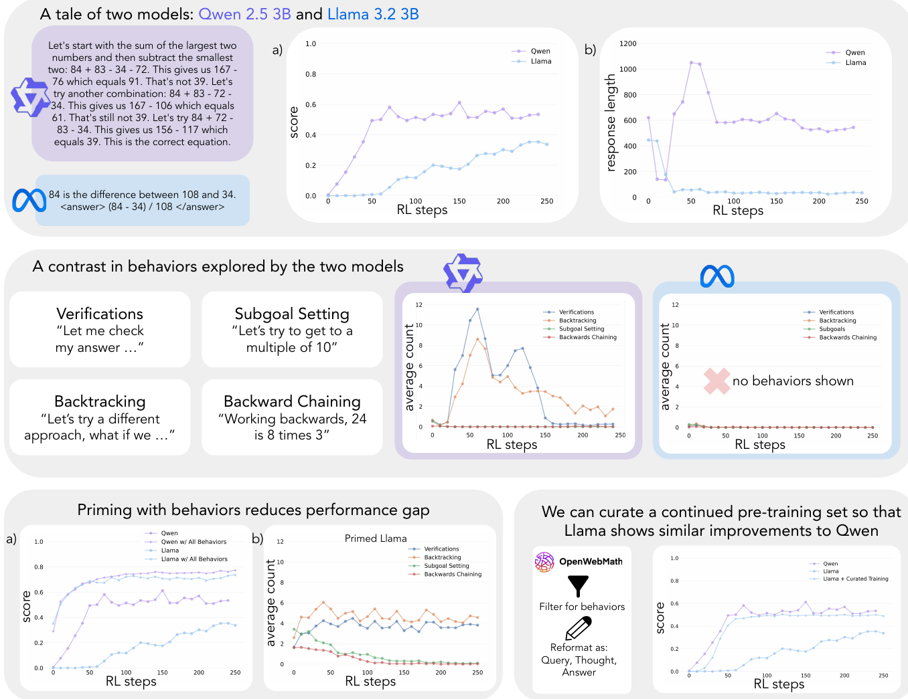
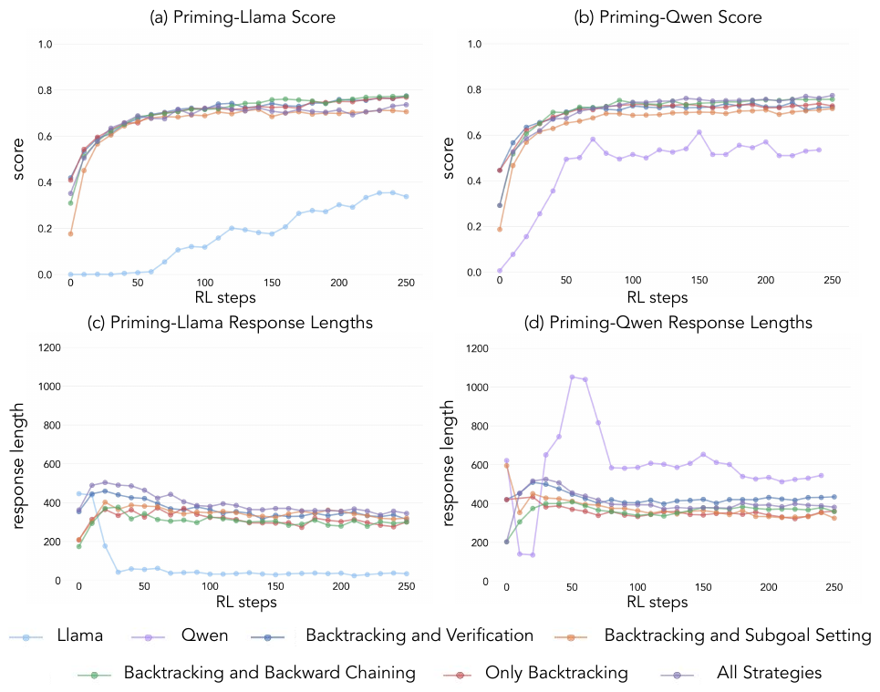

# 15. Cognitive Behaviors that Enable Self-Improving Reasoners, or, Four Habits of Highly Effective STaRs

> **Authors**: Kanishk Gandhi et al. (Stanford University, SynthLabs)
> **Venue**: COLM 2025
> **Link**: https://arxiv.org/abs/2503.01307
> **목록 위치**: Part 3 — SFT → RL 전환

---

## 1. 핵심 연구 질문과 풀고자 하는 문제
- **같은 RL을 적용해도 어떤 모델은 크게 좋아지고 어떤 모델은 금방 정체되는데, 초기 모델의 어떤 성질이 RL을 통한 self-improvement를 가능하게 하는가?**
- 배경: Countdown에서 같은 PPO 설정으로 학습해도 Qwen-2.5-3B는 약 60%까지 오르고 Llama-3.2-3B는 약 30%에 머문다 (Section 3.1).
- 기존 연구의 한계
  - 긴 CoT로 SFT하면 RL이 더 잘 된다는 분석은 있었다.
  - 그러나 "왜 어떤 모델은 RL로 배우고 어떤 모델은 못 배우는가"는 답하지 못했다. Yeo et al.(2025)이 pretraining 데이터의 reflective 표현 빈도를 짧게 분석한 정도다.

## 2. 핵심 가설
- 저자가 명시한 가설: **초기 policy에 특정 reasoning behavior가 있어야 늘어난 test-time compute(더 긴 reasoning)를 효율적으로 활용할 수 있다.**
- 여기서 말하는 4가지 cognitive behavior
  - Verification: 중간 결과를 체계적으로 확인 ("Let me check my answer")
  - Backtracking: 실패한 접근을 명시적으로 버리고 다른 접근을 시도
  - Subgoal setting: 문제를 중간 목표로 분해
  - Backward chaining: 목표에서 거꾸로 추론
- (본문에서 도출) RL은 성공한 trajectory에 나타난 행동만 증폭할 수 있다. 그래서 초기 모델이 이런 행동을 보이는지가 RL 효과의 전제 조건이다.
- (본문에서 도출) 중요한 것은 priming 데이터 답의 정답 여부가 아니라 그 안에 이런 행동이 있는지다.

## 3. 제안하는 해결책
- **행동 분석 프레임워크**: GPT-4o-mini로 각 reasoning trajectory에서 4가지 행동의 등장 횟수를 센다 (temperature 0, 행동마다 질문 1개).
- **개입 1: Priming (소량 SFT)**
  - Claude-3.5-Sonnet으로 Countdown 1,200문제를 풀게 하되, 지정한 행동만 쓰도록 system prompt로 강제해 데이터셋을 만든다 (train 1,000 / val 200).
  - 데이터셋 5종: All strategies, Backtracking only, Backtracking+Verification, Backtracking+Subgoal, Backtracking+Backward chaining
  - 대조군 3종: Empty CoT(`<think></think>`), Length-matched placeholder CoT(`<think>.....</think>`), All strategies인데 답은 전부 틀린 버전
  - SFT 설정: LR 1e-5, 5 epoch, batch 64, context 2048 (Appendix B, Table 1)
- **개입 2: Pretraining 데이터 curation**
  - Qwen-2.5-32B로 OpenWebMath 문서마다 행동 포함 여부를 분류해 behavior-curated 세트와 behavior-minimized 대조 세트를 만든다.
  - 두 세트 모두 question-thought-answer 형식으로 rewrite해 형식을 통제했다. 각 8.3M tokens이며, 이것으로 Llama를 continued pretraining한다.
- **RL 설정**: VERL/TinyZero 기반 PPO, 250 steps, 프롬프트당 4 rollout, actor LR 1e-6, critic LR 1e-5, KL coefficient 0.001, reward는 정답 1.0 / 오답 0.0 / format bonus 0.1 (Appendix C, Table 2)
- GRPO가 아니라 PPO를 고른 이유는 hyperparameter에 대한 안정성 때문이다. 저자들은 알고리즘 간 성능은 "anecdotally" 비슷했다고 적었다.

## 4. 가설 검증 방법
- **모델**: Qwen-2.5-3B, Llama-3.2-3B (base). 행동 분석에는 Llama-3.1-70B를 추가했고, 부록에서 Instruct 버전도 실험했다.
- **Task**: Countdown (주어진 숫자와 사칙연산으로 목표 숫자 만들기)
- **비교와 대조**
  - Base model 간 비교: Qwen vs Llama (Figure 1, 4)
  - 어떤 행동 조합으로 priming했는가 (Figure 2, 3)
  - 행동 없이 토큰만 늘린 Empty CoT, length-matched CoT (Figure 5)
  - 답이 틀린 priming vs 맞는 priming (Figure 6)
  - Curated pretraining vs behavior-minimized pretraining (Figure 8)
- **가설을 지지하는 결과**
  - Qwen은 step 30 무렵 응답 길이와 정확도가 함께 뛰고, 이 시점에 verification과 backtracking이 나타난다. Llama에서는 이런 행동이 거의 나타나지 않는다 (Figure 1)
  - Base 상태에서 Qwen-2.5-3B는 4가지 행동 모두 두 Llama보다 많다. Llama-3.1-70B도 backtracking은 여전히 적다 (Figure 4)
  - Backtracking을 포함한 데이터로 priming하면 Llama와 Qwen 모두 RL에서 크게 향상된다. 행동이 없는 Empty CoT 대조군은 base Llama 수준(약 30~35%)에 그친다 (Figure 2, 5)
  - 틀린 답에 올바른 행동이 담긴 데이터로 priming해도 정답 데이터로 priming한 것과 성능이 "identical"하다 (Figure 6)
  - RL은 쓸모 있는 행동(backtracking, verification)은 증폭하고 나머지(backward chaining, subgoal setting)는 억제한다 (Figure 1 bottom-left, 3)
  - Curated pretraining을 거친 Llama는 Qwen 수준의 RL 향상을 보이고, 대조 세트로 학습한 Llama는 향상이 제한적이다 (Figure 8a)

> **Figure 1**: Countdown RL에서 Qwen-2.5-3B와 Llama-3.2-3B 비교. 위: 점수와 response length 추이. 가운데: Qwen에서만 verification·backtracking 같은 행동이 RL 중에 나타난다. 왼쪽 아래: 행동을 담은 합성 데이터로 priming하면 성능 격차가 줄고, RL은 backtracking·verification은 증폭하고 backward chaining·subgoal setting은 억제한다. 오른쪽 아래: 행동 위주로 curate한 OpenWebMath로 continued pretraining하면 Llama도 Qwen 수준으로 개선된다.

> **Figure 2**: Cognitive behavior priming의 효과. (a, b) Llama-3.2-3B, Qwen-2.5-3B와 행동 조합별 primed 변형의 Countdown 점수 비교, (c, d) 표준 모델과 primed 모델의 response length 비교. Backtracking을 포함한 priming은 두 모델 모두 RL 성능을 크게 끌어올린다.

- **부록 추가 결과**
  - Countdown RL로 학습한 Qwen의 MATH 정확도가 38%에서 50%로 오른다 (Appendix H)
  - Curated 모델은 GPQA에서 행동 빈도가 훨씬 높지만 정확도는 대조군과 같다 (둘 다 약 12%)
- **주의할 점**
  - Priming, 틀린 답 priming, curated pretraining의 성능은 대부분 학습 곡선 그림으로만 제시된다. 최종 정확도 수치는 논문에 명시되지 않음.
  - Abstract는 "matching or exceeding Qwen"이라고 썼지만, 본문 근거는 Figure 2와 8의 곡선뿐이다.
  - 행동 측정이 LLM classifier에 의존한다. GPT-4o-mini와 사람의 일치도는 ICC3 0.40~0.77이고, backward chaining이 가장 낮다 (0.55, 0.40; Appendix F).
  - 결론이 Countdown 한 task와 3B 모델 두 종에서 나왔다. 저자도 어떤 행동이 유용한지는 task에 따라 달라진다고 인정한다.
  - GPQA에서는 행동이 전이되어도 정확도가 오르지 않았다. 행동의 존재가 충분조건은 아님을 시사한다.

## 5. 개선한 메트릭
| Metric | Benchmark | Baseline | Proposed | 변화 |
|---|---|---|---|---|
| RL 후 정확도 (base model 비교) | Countdown | Llama-3.2-3B 약 30% | Qwen-2.5-3B 약 60% | 약 +30 |
| RL 후 정확도 (Empty CoT priming) | Countdown | base Llama 수준 | Empty/length-matched CoT 약 30~35% | 향상 없음 |
| Accuracy (Qwen, Countdown RL 전 → 후) | MATH | 38% (4-shot 44%) | 50% (zero-shot) | +12 (4-shot 대비 +6) |
| Backtracking count (Qwen 전 → 후) | MATH | 0.15 | 0.59 | +0.44 |
| Verification count (Qwen 전 → 후) | MATH | 0.02 | 0.29 | +0.27 |
| Backtracking / Backward chaining count | GPQA | 0.019 / 0.128 | 0.114 / 0.313 | 증가 |
| Subgoal setting count (curated vs control) | GPQA | 0.7 | 6.5 | +5.8 (정확도는 둘 다 약 12%) |
| Test-time budget 128 tokens 점수 | Countdown | 초기 checkpoint 약 0 | 150~200 step 약 0.4 | 약 +0.4 |

- 출처: Section 3.1, Section 3.4와 Figure 5, Appendix G (Figure 12), Appendix H (Figure 13, 14)
- Priming 조건별, curated pretraining의 Countdown 최종 수치는 논문에 명시되지 않음 (그림만 있음)

## 6. 한 줄 요약
> RL은 base model에 이미 있는 verification과 backtracking 같은 cognitive behavior를 증폭할 뿐이므로, 이런 행동을 priming SFT나 pretraining data curation으로 먼저 심어 주면(답이 틀린 예시로도) RL이 정체되던 모델도 self-improve한다.
