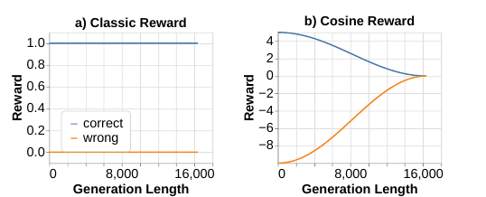
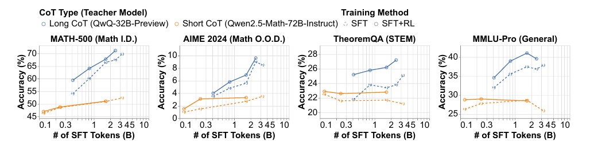
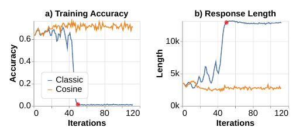

# 16. Demystifying Long Chain-of-Thought Reasoning in LLMs

> **Authors**: Edward Yeo, Yuxuan Tong, Morry Niu, Graham Neubig, Xiang Yue (IN.AI, Tsinghua University, Carnegie Mellon University)
> **Venue**: arXiv 2025 (v1, 2025-02-05; PDF에 학회 표기 없음)
> **Link**: https://arxiv.org/abs/2502.03373
> **목록 위치**: Part 3 — SFT → RL 전환

---

## 1. 핵심 연구 질문과 풀고자 하는 문제
- **long CoT(branching/backtracking, error validation/correction)는 어떤 조건에서 생기며, SFT와 RL은 각각 어떤 역할을 하는가?**
- 배경: o1, DeepSeek-R1, Kimi k1.5 등이 verifiable reward 기반 RL로 long CoT를 끌어냈지만, 어떤 설계 선택이 결정적인지 체계적으로 분해한 연구가 없었다.
- 기존 접근의 한계
  - RL만으로 CoT 길이가 안정적으로 늘지 않고, context window를 넘겨 정확도가 붕괴하기도 한다.
  - verifiable reward용 고품질 정답 데이터(MATH 등)는 양이 적어 RL scaling이 막힌다.
  - "aha moment" 같은 emergent behavior 주장이 실제로 RL이 만든 것인지 base model에 원래 있던 것인지 불분명하다.

## 2. 핵심 가설
(본문에서 도출, 논문은 Takeaway 형태로 제시)
- H1: long CoT SFT는 short CoT SFT보다 성능 상한이 높고, 이후 RL로 더 잘 개선된다.
- H2: RL에서 CoT 길이 증가는 불안정하며, 길이 의존 reward shaping으로 안정화할 수 있다.
- H3: 노이즈가 있는 web-extracted 데이터(WebInstruct)도 적절한 필터링·verifier와 함께 쓰면 OOD 성능을 올린다.
- H4: error correction 같은 핵심 능력은 base model에 이미 존재하며, RL은 이를 "새로 만들기"보다 재조합·강화한다 (§6.5에서 명시적 가설로 제시).

## 3. 제안하는 해결책
분석 논문이며, 실용적 기여는 reward 설계 두 가지다.
- **Cosine Reward**: 정답 여부 C와 생성 길이 L_gen에 따라 cosine 형태로 보상을 준다 (Appendix C.1).
```
CosFn(t, T, r_min, r_max) = r_min + 0.5 * (r_max - r_min) * (1 + cos(t * pi / T))

R(C, L_gen) = CosFn(L_gen, L_max, r0_c, rL_c)   if C = 1
              CosFn(L_gen, L_max, r0_w, rL_w)   if C = 0
              r_e                                if L_gen = L_max  (exceed penalty)
```
  - 설계 원칙: 정답 > 오답, 짧은 정답 > 긴 정답(compute 효율), 짧은 오답 < 긴 오답(틀릴 것 같으면 더 생각하도록).



> **Figure 3**: Classic Reward(정답 1, 오답 0)와 Cosine Reward 비교. Cosine Reward는 generation length에 따라 값이 변하며, 정답은 짧을수록, 오답은 길수록 보상이 높다.

  - 기본값(Table 7): r0_c=+2, rL_c=+1, r0_w=-10, rL_w=0, r_e=-10.
- **N-gram repetition penalty** (Algorithm 1): 이미 나온 N-gram이 반복되면 해당 토큰 위치마다 P를 부여(N=40, P=-0.05). trajectory 전체에 sparse로 주는 것보다 반복 토큰에 dense로 주는 편이 효과적이었다고 보고.
- **reward별 discount factor**: PPO의 GAE를 reward 종류마다 다른 gamma를 쓰도록 수정 (lambda=1).
```
A_t = sum_{l=0..L} sum_m gamma_m^l * r_{m,t+l} - V(s_t)
```
  - correctness(cosine)는 gamma_c=1, repetition penalty는 gamma_p=0.99가 기본.
- 기타 실용 권장: long CoT SFT 데이터는 action prompting으로 "구성"하기보다 long CoT 모델(QwQ-32B-Preview)에서 distill, noisy 데이터는 short-form answer로 필터링 후 rule-based verifier 사용.

## 4. 가설 검증 방법
- 모델: Llama-3.1-8B, Qwen2.5-Math-7B. 프레임워크 OpenRLHF, RL은 PPO 기본.
- 데이터: MATH train 7,500 prompts(기본), WebInstruct-462k(MinHash dedup). SFT 데이터는 rejection sampling으로 생성.
- 평가: MATH-500(in-domain), AIME 2024, TheoremQA, MMLU-Pro-1k(OOD). temperature 0.7, top-p 0.95, max 16,384 tokens, 최소 4 seed 평균.
- 주요 실험과 결과
  - **SFT scaling (Figure 1)**: long CoT SFT는 MATH-500 70% 이상까지 오르고 3.5B tokens에서도 plateau 없음. short CoT SFT는 55% 미만에서 수렴(0.25B→1.5B tokens 증가에 약 +3%만). RL 후 long CoT는 MATH-500 +3% 이상, short CoT는 거의 변화 없음 → H1 지지.



> **Figure 1**: Llama-3.1-8B에서 long CoT(QwQ-32B-Preview distill)와 short CoT(Qwen2.5-Math-72B-Instruct) SFT 및 SFT+RL의 scaling curve. long CoT SFT는 더 높은 상한까지 scaling되고, RL로 추가 개선될 여지도 크다.

  - **SFT 데이터 출처 (Table 1)**: emergent(QwQ distill) 패턴이 constructed 패턴보다 우수, SFT+RL MMLU-Pro-1k 34.6 vs 19.2.
  - **길이 안정성 (Figure 2, 4, 5)**: Classic Reward(정답 +1)에서는 두 모델 모두 CoT가 context 한계까지 늘어 정확도가 0 근처로 붕괴. Cosine Reward는 학습 정확도·길이를 안정화하고 downstream 성능도 개선 → H2 지지.



> **Figure 4**: Cosine Reward로 length shaping한 Llama-3.1-8B는 (a) training accuracy와 (b) response length가 Classic Reward보다 안정적이다. 빨간 점은 training accuracy가 0 근처로 떨어진 iteration.

  - **reward hacking (Figure 10, 12)**: 충분한 compute 후 반복으로 길이를 늘리는 hacking 발생, "alternatively," 빈도 감소. repetition penalty가 길이를 줄이고 성능 향상.
  - **discount factor (Table 5)**: gamma_c=1 / gamma_p=0.999 조합이 MATH-500 58.0으로 최고. gamma_c=0.99로 낮추면 branching이 과도해지고(빨리 포기) 성능 하락(47.9).
  - **context window (Figure 6)**: 동일 샘플 수에서 8K가 4K와 16K보다 모두 우수 → 긴 context를 쓰려면 더 많은 학습 샘플이 필요.
  - **noisy 데이터 (Table 2, 3)**: SFT에 WebInstruct 혼합 시 MMLU-Pro-1k +5~10%p. RL에서는 filtered + rule-based verifier가 대부분 벤치마크에서 최고 → H3 지지.
  - **base model RL (Figure 7, 8, Table 4)**: Qwen2.5-Math-7B 직접 RL은 정확도는 올리지만 "wait/recheck/alternatively" 빈도는 늘지 않음. 길이 증가가 KL 감소와 동반 → KL penalty로 base 길이로 회귀하는 것일 수 있음. long CoT SFT→RL(AVG 49.7)이 direct RL(41.0)보다 우수.
  - **pre-training 데이터 (§6.5)**: OpenWebMath의 토론 포럼 스레드에서 long CoT 유사 패턴(다중 접근, backtracking) 다수 발견 → H4의 정황 증거.
- 주의할 점
  - Table 4 본문은 SFT+RL이 SFT 대비 AVG "+2.6%"라고 쓰지만 표 수치는 49.7 - 47.3 = 2.4.
  - Table 1 설명의 "OOD에서 15-50% 상대 개선"은 MMLU-Pro-1k(18.1→32.0, 약 77%)와 맞지 않고, "short CoT 모델은 변화 없음"은 실제로 constructed long CoT 모델을 가리키는 것으로 보인다.
  - AIME 2024 정확도가 0.2~5% 수준이라 차이가 노이즈에 가깝다. 대부분 결과가 Llama-3.1-8B 단일 모델·MATH 단일 prompt set 기반이다.
  - §6 H4는 keyword 빈도와 웹 검색 사례에 기반한 정황 증거이며, 저자도 가설로 남겨둔다.

## 5. 개선한 메트릭
| Metric | Benchmark | Baseline | Proposed | 변화 |
|---|---|---|---|---|
| Accuracy (SFT+RL, Llama-3.1-8B) | MMLU-Pro-1k | Constructed long CoT 19.2 | Emergent long CoT 34.6 | +15.4 (Table 1) |
| Accuracy (SFT+RL, Llama-3.1-8B) | MATH-500 | Constructed 52.4 | Emergent 59.4 | +7.0 (Table 1) |
| AVG accuracy (SFT+RL) | 4개 벤치 평균 | 100% MATH 30.8 | 50% MATH + 50% WebIT 32.1 | +1.3 (Table 2) |
| Accuracy (RL) | MMLU-Pro-1k | MATH Baseline 34.6 | Filtered + Rule-Based 41.4 | +6.8 (Table 3) |
| Accuracy (RL) | TheoremQA | MATH Baseline 25.2 | Filtered + Rule-Based 28.1 | +2.9 (Table 3) |
| AVG accuracy (Qwen2.5-Math-7B) | 4개 벤치 평균 | Direct RL 41.0 | Long CoT SFT + RL 49.7 | +8.7 (Table 4) |
| Accuracy (gamma 조합) | MATH-500 | SFT 50.4 / gamma_c=0.99,gamma_p=0.99 47.9 | gamma_c=1, gamma_p=0.999 58.0 | +7.6 vs SFT (Table 5) |
| Training stability | MATH train | Classic Reward: 정확도 0 근처로 붕괴 | Cosine Reward: 안정 | 수치는 그림으로만 (Figure 2, 4) |

## 6. 한 줄 요약
> long CoT는 강한 long CoT 모델에서 distill한 SFT로 먼저 심고, RL에서는 길이 의존 Cosine Reward + repetition penalty + 필터링된 verifiable reward로 길이 폭주와 reward hacking을 막아야 안정적으로 강화된다.
