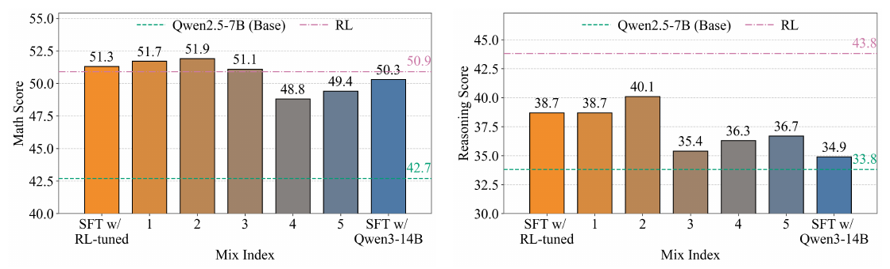
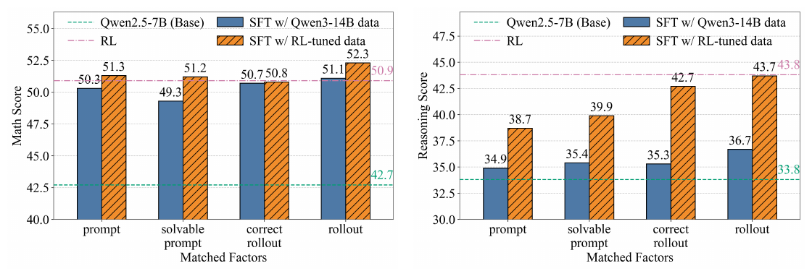

# 17. Rethinking "RL Generalizes, SFT Memorizes": The Role of SFT Data

> **Authors**: Yunlong Hou, Fengzhuo Zhang, Yuan Cheng et al. (National University of Singapore, Yale University, Cisco Foundation AI)
> **Venue**: NeurIPS 2026
> **Link**: https://arxiv.org/abs/2611.14912
> **목록 위치**: Part 3 — SFT → RL 전환

---

## 1. 핵심 연구 질문과 풀고자 하는 문제
- **"RL은 일반화하고 SFT는 암기한다"는 결론은 SFT에 RL과 동등한 데이터(출처·양)를 줬을 때도 성립하는가?**
- 배경: 기존 비교 연구(Chu et al., Huan et al.)는 수학으로 학습한 뒤 비수학 general reasoning에서 SFT가 RL보다 못하다고 보고했다.
- 기존 비교의 한계
  - SFT와 RL을 prompt 수 기준으로 맞춘다. 그런데 RL(GRPO)은 prompt당 8 rollouts를 쓰고, SFT는 prompt당 정답 1개만 본다 → RL이 8배 많은 rollout으로 학습.
  - SFT 데이터 출처(강한 teacher vs 학습 대상과 가까운 모델)의 영향이 통제되지 않았다.

## 2. 핵심 가설
(본문에서 도출, 논문은 Observation 1~4로 제시)
- H1: SFT 일반화는 데이터 출처에 크게 좌우된다. 더 강한 모델보다 학습 대상 모델에 가까운 모델의 데이터가 낫고, 적당한 다양성 혼합이 더 낫다.
- H2: rollout 예산(정답 rollout 수, 전체 rollout 수)을 RL과 맞추면 SFT도 RL만큼 일반화한다.
- H3: 데이터 규모 효과의 원인은 long-tailed 풀이 방법(tail method)의 coverage 증가다.
- H4 (이론): shallow transformer에서 SFT는 coverage가 충분한 방법에 대해서만 OOD 일반화하고, RL은 모든 정답을 균등하게 학습해 항상 일반화한다.

## 3. 제안하는 해결책
새 알고리즘이 아니라 SFT 데이터 구성 원칙 + 이론 분석이다.
- **데이터 출처 혼합 (Mix-k)**: RL-tuned 모델의 rejection sampling 데이터와 Qwen3-14B 데이터를 섞음.
```
Mix-k = (11 - 2k) * 10% RL-tuned data + (2k - 1) * 10% Qwen3-14B data,  k in {1..5}
```
- **rollout 예산 매칭** (Appendix B.3.2), RL 학습 중 실제 rollout 통계에 맞춰 SFT 셋 크기 결정
  - solvable prompt 매칭: 약 10,000 pairs (Qwen3-14B 9,963 / RL-tuned 10,020)
  - correct rollout 매칭: prompt별 RL 정답 rollout 수만큼 → 39,623 pairs
  - total rollout 매칭: 위 정답 39,623 + 오답 98,641 → 약 138,000 pairs. 오답 rollout에도 SFT loss를 전체 trace에 그대로 적용 (Appendix G.2).
- **이론 모델 (Section 4)**: 1-layer attention, 질문당 K개 정답 방법, SFT 데이터는 head 방법 확률 Theta(1), tail 방법 o(1)인 long-tailed 분포 (Assumption 4.1). SFT는 cross-entropy, RL은 정답 확률 질량의 합(KL 없는 expected reward)을 one-step gradient로 최적화.
- 기존 SFT 대비 차이: "teacher가 강할수록 좋다"는 distillation 관행 대신, 학습 대상과의 분포 근접성과 tail coverage를 데이터 선택 기준으로 제시.

## 4. 가설 검증 방법
- 모델: Qwen2.5-7B(본문), Qwen3-8B-Base(Appendix B.1). 학습 데이터: DAPO 수학 문제(중복 제거 17,391 prompts).
- RL: GRPO(VeRL), n=8 rollouts, lr 1e-6, response 8192, clip high 0.28, KL loss 미사용 (Table 3).
- SFT: LlamaFactory, lr 1e-5, 1 epoch, cosine scheduler, cutoff 16000 (Table 4). Qwen3-14B 또는 RL-tuned 모델로 prompt당 최대 128 rollouts 생성 후 정답 1개 유지.
- 평가: 수학 5종(AIME24 Avg@32, Minerva, GSM8K, MATH500, OlympiadBench), general reasoning 12종(GPQA-Diamond, MMLU-Pro, BBH, ACPBench 등, lm-eval-harness) 평균.
- 결과
  - **출처 (Table 1, 5)**: RL은 수학 평균 42.7→50.9, general 33.8→43.8. prompt 매칭 SFT는 수학은 RL과 비슷하거나 더 높지만 general은 낮다. SFT w/ RL-tuned 38.7 > SFT w/ Qwen3-14B 34.9, 최고는 Mix-2(70/30) 40.1 → H1 지지.



> **Figure 3**: 데이터 혼합 비율별 SFT 모델 성능(왼쪽: Math 평균, 오른쪽: General reasoning 평균). Mix-k는 RL-tuned 데이터 (11 - 2k) × 10% + Qwen3-14B 데이터 (2k - 1) × 10%이며, 70% RL-tuned + 30% Qwen3-14B(Mix-2)가 두 과제 모두에서 가장 좋다.

  - **규모 (Figure 6)**: solvable prompt 매칭 < correct rollout 매칭 < total rollout 매칭 순으로 general 성능 상승, total 매칭에서 RL과 동급. 수치는 그림으로만 제시, 텍스트로는 Table 6의 SFT w/ RL-tuned 43.7 vs RL 43.8 → H2 지지.



> **Figure 6**: prompt 수, solvable prompt 수, correct rollout 수, total rollout 수를 RL과 맞췄을 때의 SFT 성능(왼쪽: Math, 오른쪽: General reasoning). total rollout budget을 RL과 맞추면 수학 성능을 유지하면서 general reasoning 성능이 크게 오른다.

  - **출처 × 규모 (Figure 9, Table 6)**: total rollout 매칭에서 90/10 혼합이 44.4로 RL 43.8을 넘음.
  - **compute 통제 (Appendix B.7, Figure 16)**: 같은 gradient compute에서 unique rollout 수를 줄이면(정답 39,623개 3 epoch 등) general 성능 하락 → 효과는 compute가 아니라 데이터 규모.
  - **tail method (Figure 10, 13, Table 8)**: Qwen3-32B로 138개 풀이 방법 annotate. k(prompt당 rollout)가 커질수록 tail method coverage 증가, 평가 시 tail method 사용·정답 수 증가. tail을 제거한 SFT셋은 MMLU-Pro 정답 rollout 중 tail 사용 40회 vs 108회 → H3 지지.
  - **이론 (Theorem 4.2, 4.3)**: 아래 5절 bound 참조 → H4.
- 주의할 점
  - "SFT가 RL보다 일반화" 근거인 44.4 vs 43.8 차이(0.6)는 각각 stderr 약 0.42~0.43 수준이고, 학습 seed 간 분산은 측정하지 않았다고 저자가 인정 (Appendix B.6).
  - 가장 좋은 SFT 데이터는 **RL-tuned 모델의 rollout**이다. 즉 RL을 먼저 돌려야 얻을 수 있어, "RL 없이 SFT로 충분"하다는 실무 결론으로 읽기 어렵다.
  - 혼합 표기 불일치: 본문은 rollout 매칭 실험에서 k in {1,2,3}이라 하지만 Table 6은 Mix 1/3/5로 표기.
  - Table 1에서 Mix-3~5와 Qwen3-14B SFT의 MMLU-Pro가 0.7~3.8로 붕괴하는데, 원인 설명이 없다 (형식 문제 가능성).
  - Qwen3-8B-Base에서는 최고 SFT(Mix-3 42.6)가 RL 42.5와 거의 같고, 최적 혼합비가 50%로 바뀐다 (Table 2).

## 5. 개선한 메트릭
| Metric | Benchmark | Baseline | Proposed | 변화 |
|---|---|---|---|---|
| General reasoning avg (prompt 매칭) | 12종 평균 | SFT w/ Qwen3-14B 34.9 | SFT w/ Mix-2 40.1 | +5.2 (Table 5) |
| General reasoning avg (prompt 매칭) | 12종 평균 | RL 43.8 | SFT w/ Mix-2 40.1 | -3.7 (Table 5) |
| General reasoning avg (total rollout 매칭) | 12종 평균 | RL 43.8 ± 0.43 | SFT w/ RL-tuned 43.7 ± 0.41 | -0.1 (Table 6) |
| General reasoning avg (total rollout 매칭) | 12종 평균 | RL 43.8 ± 0.43 | Mix 1 (90/10) 44.4 ± 0.42 | +0.6 (Table 6) |
| General reasoning avg (Qwen3-8B-Base) | 평균 | RL 42.5 | Mix-3 42.6 | +0.1 (Table 2) |
| Method coverage | 138 methods | RL-tuned rollout=1: 101 | rollout=8: 132 (RL 중 rollout 137) | +31 (Table 11) |
| 이론: RL OOD 오차 | 임의 OOD mixture | - | 1 - Eval_RL = O(K^-3) | Theorem 4.3 |
| 이론: SFT OOD 오차 | covered (p_lk >= 1/log K) | - | 1 - Eval_SFT = O(K^-3) | Theorem 4.3 |
| 이론: SFT OOD 정확도 | uncovered (p_lk <= 1/K) | - | Eval_SFT <= 1/2 | Theorem 4.3 |

- 이론 in-distribution (Theorem 4.2): SFT, RL 모두 one-step 후 오답 확률 <= epsilon = log(K)/K. RL은 추가로 모든 정답을 균등 학습, |F_lk - 1/K| <= epsilon/K.

## 6. 한 줄 요약
> SFT의 일반화 열세는 데이터 출처와 rollout 규모 불일치 탓이 크며, RL-tuned 모델 rollout 중심 혼합 데이터를 RL과 같은 총 rollout 수(오답 포함)로 학습하면 SFT도 RL 수준의 OOD reasoning 성능에 도달한다.
