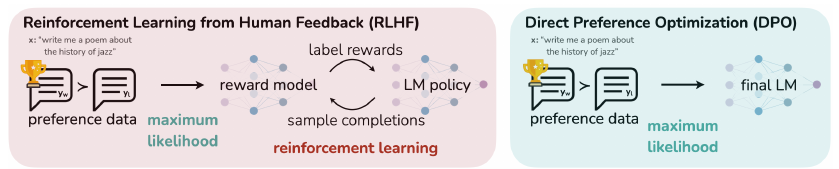
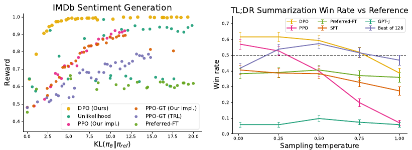
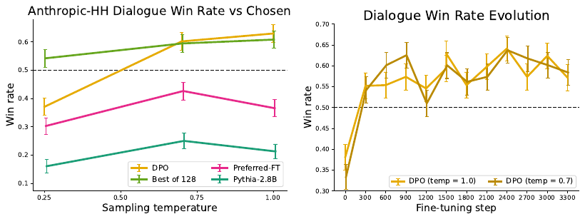

# 18. Direct Preference Optimization: Your Language Model is Secretly a Reward Model

> **Authors**: Rafael Rafailov, Archit Sharma, Eric Mitchell et al. (Stanford University, CZ Biohub)
> **Venue**: NeurIPS 2023
> **Link**: https://arxiv.org/abs/2305.18290
> **목록 위치**: Part 4 — 선호 학습 (DPO)

---

## 1. 핵심 연구 질문과 풀고자 하는 문제
- **reward model 학습과 RL 없이, 선호 데이터만으로 RLHF와 같은 KL-constrained reward maximization 목표를 정확히 최적화할 수 있는가?**
- 배경: 표준 RLHF는 (1) SFT, (2) Bradley-Terry 기반 reward model 학습, (3) PPO로 KL 제약 하 reward 최대화의 3단계.
- 기존 방법의 한계
  - 여러 LM(policy, reward, value, reference)을 동시에 다루고, 학습 루프 안에서 policy sampling이 필요해 계산 비용이 크다.
  - PPO는 불안정하고 hyperparameter에 민감하다. reward 정규화용 baseline/value function 학습도 어렵다.
  - 단순히 선호 응답에 SFT(Preferred-FT)하거나 unlikelihood로 비선호 응답 확률을 내리면 성능이 약하거나 degenerate한다.

## 2. 핵심 가설
- 논문이 명시한 주장: KL-constrained RL 목표의 최적 policy를 closed form으로 쓰고 reward를 policy로 재매개변수화(change of variables)하면, RLHF 목표를 단순 binary cross-entropy 하나로 정확히 풀 수 있다.
- 이 재매개변수화는 표현 가능한 reward class를 제한하지 않는다 (Theorem 1).
- (본문에서 도출) 같은 목표를 최적화하므로 DPO는 PPO와 같거나 더 나은 reward-KL trade-off와 품질을 더 적은 tuning으로 달성한다.

## 3. 제안하는 해결책



> **Figure 1**: 기존 RLHF는 선호 데이터로 reward model을 학습한 뒤 RL로 그 reward를 최대화하는 policy를 찾는다. DPO는 단순한 classification objective로 선호를 만족하는 policy를 직접 최적화하며, closed form으로 최적 policy를 꺼낼 수 있는 implicit reward model을 학습하는 셈이다.

- **유도 과정** (Section 4)
```
RLHF 목표:   max_pi  E[ r(x,y) ] - beta * KL( pi(y|x) || pi_ref(y|x) )
최적 policy: pi_r(y|x) = (1/Z(x)) * pi_ref(y|x) * exp( r(x,y) / beta )
reward 역산:  r(x,y) = beta * log( pi_r(y|x) / pi_ref(y|x) ) + beta * log Z(x)
```
  - Bradley-Terry는 reward 차이만 쓰므로 Z(x)가 상쇄된다.
- **DPO loss** (Eq. 7)
```
L_DPO = - E_(x, y_w, y_l) [ log sigmoid( beta * log(pi_theta(y_w|x)/pi_ref(y_w|x))
                                        - beta * log(pi_theta(y_l|x)/pi_ref(y_l|x)) ) ]
```
- **implicit reward**: r_hat(x,y) = beta * log( pi_theta(y|x) / pi_ref(y|x) ). "LM 자체가 reward model".
- **gradient 해석**
```
grad L_DPO = - beta * E[ sigmoid( r_hat(x,y_l) - r_hat(x,y_w) )
                         * ( grad log pi(y_w|x) - grad log pi(y_l|x) ) ]
```
  - implicit reward가 순서를 틀리게 매길수록 큰 weight. 이 weight 없는 naive 버전(unlikelihood류)은 degenerate (Appendix Table 3).
- **pipeline**: pi_ref = pi_SFT로 두고 offline 선호쌍 (x, y_w, y_l)에 loss 최소화. SFT 모델이 없으면 y_w에 대한 MLE로 pi_ref를 만든다(distribution shift 완화).
- **이론** (Section 5): reward 동치류(r - r' = f(x))는 같은 선호 분포·같은 최적 policy를 유도(Lemma 1, 2). 모든 Plackett-Luce/BT 일관 reward class는 beta * log(pi/pi_ref)로 표현 가능(Theorem 1). PPO 불안정성은 정규화 항(soft value function) 부재로 인한 high variance로 해석.
- 기본 hyperparameter (Appendix B): beta=0.1 (TL;DR은 0.5), batch 64, RMSprop, lr 1e-6, warmup 150 steps.

## 4. 가설 검증 방법
- 과제와 모델
  - Controlled sentiment (IMDb): GPT-2-large, ground-truth reward = sentiment classifier. reward-KL frontier로 평가.
  - Summarization (Reddit TL;DR): GPT-J SFT 모델, Stiennon et al. 인간 선호. GPT-4 win rate vs 참조 요약.
  - Single-turn dialogue (Anthropic HH, 170k dialogues): Pythia-2.8B, chosen 응답에 Preferred-FT로 reference 생성. GPT-4 win rate vs chosen.
- Baselines: zero-shot GPT-J, 2-shot Pythia-2.8B, SFT, Preferred-FT, Unlikelihood, PPO(learned reward), PPO-GT(oracle reward, TRL 구현 + 자체 tuned 구현), Best of N.
- 결과
  - **reward-KL frontier (Figure 2 left)**: 22 runs sweep(PPO target KL {3,6,9,12}, DPO beta {0.05,0.1,1,5} 등). DPO가 모든 KL에서 가장 높은 reward, PPO-GT(정답 reward 접근)보다도 우수 → 같은 목표를 더 효율적으로 최적화.
  - **TL;DR (Figure 2 right)**: DPO 약 61% (temp 0.0) vs PPO 57% (최적 temp 0.0). DPO가 Best of N 최대값보다 높고, temperature 변화에 더 강건. PPO는 고온에서 base GPT-J 수준으로 하락.



> **Figure 2**: 왼쪽은 IMDb sentiment에서 reference policy 대비 KL과 expected reward의 frontier로, DPO가 모든 KL에서 가장 높은 reward를 얻는다. 오른쪽은 GPT-4가 평가한 TL;DR 요약의 human-written 요약 대비 win rate로, DPO가 PPO의 최고 성능을 넘고 sampling temperature 변화에 더 강건하다.

  - **Human eval (Table 2)**: DPO(temp 0.25)가 PPO(temp 0) 대비 인간 승률 58%.
  - **Anthropic HH (Figure 3)**: DPO만 chosen 응답 대비 개선하는 계산 효율적 방법이며, Best of 128과 비슷하거나 더 좋음. 학습 초기에 빠르게 수렴.



> **Figure 3**: 왼쪽은 Anthropic-HH single-turn dialogue에서 GPT-4가 계산한 chosen 응답 대비 win rate로, DPO는 test set의 chosen 응답보다 개선하는 유일한 방법이다. 오른쪽은 학습 진행에 따른 sampling temperature별 win rate로, DPO의 개선이 학습 내내 비교적 안정적이다.

  - **OOD (Table 1, CNN/DailyMail)**: DPO 0.36/0.31 vs PPO 0.26/0.23 (temp 0/0.25).
  - **GPT-4 judge 검증 (Table 2)**: GPT-4(C)-human 일치율 67~85%, human-human 65~87%로 비슷.
- 주의할 점
  - Anthropic HH에서 PPO baseline은 외부 공개 체크포인트로, base Pythia-2.8B보다 나은 설정을 찾지 못했다. 그래서 Best of 128을 "PPO 수준의 proxy"로 썼다 → PPO와의 직접 비교 근거는 약하다.
  - HH 결과와 TL;DR 곡선은 그림으로만 제시되어 정확한 수치가 텍스트에 없다 (TL;DR 61%/57%만 텍스트에 있음).
  - 본문은 "beta를 의미 있게 tuning하지 않았다"고 하지만, TL;DR에는 기본값(0.1)과 다른 beta=0.5를 사용했다.
  - 최대 6B 규모, 단일 턴 과제만 다뤘고, OOD 실험도 단일 데이터셋이다. reward over-optimization 여부(Figure 3 right의 소폭 하락)는 미해결로 남겼다.
  - 모든 데이터가 offline 선호쌍이라, 정책이 학습되며 분포가 바뀌는(on-policy) 상황은 다루지 않는다.

## 5. 개선한 메트릭
| Metric | Benchmark | Baseline | Proposed | 변화 |
|---|---|---|---|---|
| GPT-4 win rate vs reference (best temp) | TL;DR summarization | PPO 57% (temp 0) | DPO ~61% (temp 0) | +~4%p (Section 6.2, Figure 2) |
| Human win rate vs PPO (temp 0) | TL;DR summarization | PPO temp 0 (기준) | DPO temp 0.25: 58% | 58% 승률 (Table 2) |
| GPT-4 win rate vs ground truth (temp 0) | CNN/DailyMail (OOD) | PPO 0.26 | DPO 0.36 | +0.10 (Table 1) |
| GPT-4 win rate vs ground truth (temp 0.25) | CNN/DailyMail (OOD) | PPO 0.23 | DPO 0.31 | +0.08 (Table 1) |
| Reward at given KL | IMDb sentiment | PPO, PPO-GT | DPO가 frontier 지배 | 수치는 그림으로만 (Figure 2 left) |
| GPT-4 win rate vs chosen | Anthropic HH | Best of 128, Preferred-FT | DPO가 동급 이상, chosen 대비 유일하게 개선 | 수치는 그림으로만 (Figure 3) |

## 6. 한 줄 요약
> KL-constrained RLHF의 최적 policy를 closed form으로 풀어 reward를 policy log-ratio로 바꾸면, reward model과 RL 없이 선호쌍에 대한 logistic loss 하나로 PPO와 같거나 더 좋은 선호 정렬을 얻는다.
