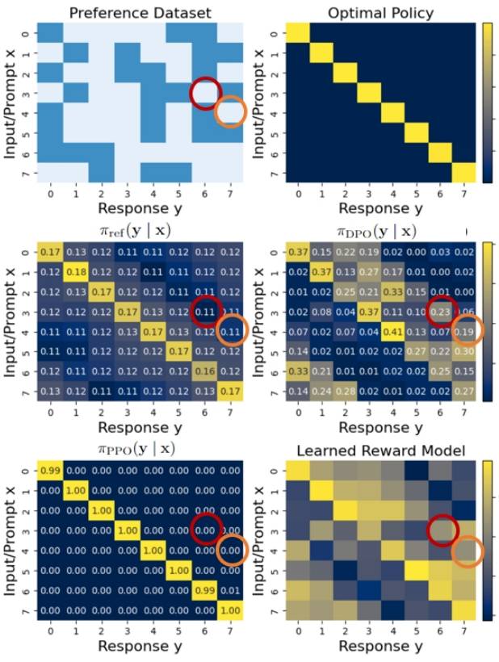
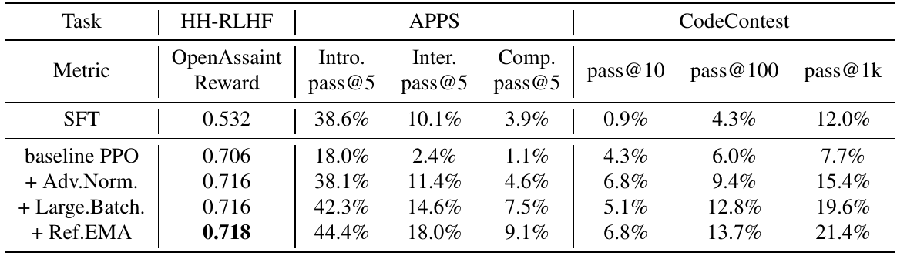

# 19. Is DPO Superior to PPO for LLM Alignment? A Comprehensive Study

> **Authors**: Shusheng Xu et al. (Tsinghua University, OpenPsi Inc., Shanghai Qi Zhi Institute)
> **Venue**: ICML 2024 (PDF는 arXiv v3, 2024)
> **Link**: https://arxiv.org/abs/2404.10719
> **목록 위치**: Part 4 — 선호 학습 (DPO)

---

## 1. 핵심 연구 질문과 풀고자 하는 문제
- **reward-free인 DPO가 정말 reward-based인 PPO보다 우수한가, 그리고 학술 benchmark에서 PPO가 약한 이유는 무엇인가?**
- 배경: ChatGPT·Claude 같은 실서비스는 PPO 기반 RLHF로 만들어졌지만, 학술 benchmark의 SOTA는 DPO 같은 reward-free 방법에서 자주 나온다. 이 괴리가 출발점.
- 기존 한계: DPO는 reward model 없이 정적 preference dataset에서 바로 policy를 학습하므로 단순하지만, 데이터 분포 밖(OOD) 응답에 대한 일반화가 어떻게 되는지 분석이 부족했다. PPO는 구현 디테일에 민감해 "잘 튜닝된 PPO"의 성능이 제대로 측정되지 않았다.

## 2. 핵심 가설
- (본문에서 도출) DPO는 preference dataset이 덮지 못하는 OOD 응답에 확률을 몰아주는 biased solution을 찾을 수 있으며, 따라서 **model output과 preference data 사이의 distribution shift에 민감**하다.
- (본문에서 도출) PPO의 낮은 성능은 알고리즘 자체가 아니라 구현 요소 때문이며, advantage normalization, large batch size, reference model EMA 업데이트를 적용하면 PPO가 DPO를 일관되게 이긴다.

## 3. 제안하는 해결책
- 새 알고리즘을 제안하는 논문이 아니라 **이론 분석 + PPO 튜닝 가이드 + 대규모 benchmark**.
- 이론 (Theorem 4.1): PPO로 얻을 수 있는 policy 집합은 DPO loss를 최소화하는 policy 집합의 **proper subset**.
  ```
  Pi_PPO ⊊ Pi_DPO
  L_DPO = -E[ log σ( β log(π(y_w|x)/π_ref(y_w|x)) - β log(π(y_l|x)/π_ref(y_l|x)) ) ]
  ```
  - 반례 (Table 1): action 3개, π_ref = (0.5, 0.5, 0), 데이터는 (y1 > y2) 한 쌍뿐. DPO loss = log(1 + (b/a)^β)는 b=0이면 최소화되므로 π_DPO = (0.1, 0.0, 0.9)처럼 **데이터에 없는 y3에 0.9**를 주는 해도 최적. PPO는 KL 때문에 π_ref가 0인 y3에 확률을 줄 수 없음.
- 실무 처방
  - DPO: preference data에 대해 추가 SFT로 reference model을 데이터 분포에 맞추고, self-generated 응답을 reward model로 라벨링하는 **iterative DPO (DPO-Iter)** 사용.
  - PPO: (1) advantage normalization, (2) large batch size, (3) reference model을 EMA로 갱신.
- 주요 설정 (Appendix A): DPO β=0.1, lr 1e-6. PPO actor lr 1e-5 / critic lr 5e-6, global batch 512 (mini-batch 4개), KL β=0.1, GAE λ=γ=1, reward clip 20, temperature 1.0, top-k 200.

## 4. 가설 검증 방법
- **Synthetic (Figure 1)**: prompt·response 각 8개인 이산 공간, MLP policy. DPO가 데이터에 없는 응답의 확률을 0.11 → 0.23으로 올리는 반면 PPO는 KL로 억제.



> **Figure 1**: synthetic 시나리오에서의 preference dataset coverage, π_ref·π_PPO·π_DPO 확률 분포, learned reward. 빨강·주황 원으로 표시한 점은 preference data에 없는데도 DPO는 reference보다 높은 확률을 주고, PPO는 낮은 확률을 주며 optimal policy를 학습한다.

- **SafeRLHF, Llama-2-7B (Table 2)**: 
  - SFT(Alpaca)를 reference로 쓴 DPO는 safety rate 55.4%에 그침 → SFT(Safe)로 바꾸면 71.8% (+16.4 pp), helpfulness -4.19 → -1.62.
  - DPO-Iter 4회 반복 시 safety rate 99.9%로 PPO(99.5%)와 비슷하나 helpfulness는 -2.96 vs PPO 1.69.
- **PPO ablation (Table 3)**: HH-RLHF (Llama2-7B), APPS·CodeContest (CodeLlama-34B). baseline PPO(batch 64)는 APPS에서 SFT보다 크게 하락(Intro 38.6% → 18.0%). Adv.Norm → Large Batch → Ref.EMA 순으로 누적 적용하면 Intro 44.4%, Comp 9.1%.



> **Table 3**: task별 PPO ablation. baseline PPO는 batch size 64로 학습했고, HH-RLHF는 Llama2-7B, APPS·CodeContest는 CodeLlama-34B를 base model로 사용했다.

- **Benchmark (Table 4–8)**: HH-RLHF (OpenAssistant reward, GPT-4 win rate), SafeRLHF, APPS (pass@5), CodeContest (10@1k). baseline: SFT, RRHF, PRO, DPO, DPO-Iter, AlphaCode 등.
- **Reference model 변경 (Table 9, 10)**: APPS에서 DPO는 pretrain reference 시 Avg pass@5 0.24%, SFT reference 시 12.8%로 급변. PPO는 13.8% → 15.1%로 변화가 작아 DPO가 distribution shift에 훨씬 민감함을 보임.
- **β sweep (Table 11)**: β=0.1이 대체로 안정적. 너무 큰 β(0.2)는 둘 다 손해.
- **Human eval (Table 14)**: PPO vs DPO 45/26/29 (win/tie/lose), GPT-4와 human 일치율 60%.
- 주의할 점:
  - Table 4의 DPO OpenAssistant reward 0.611과 Table 12의 0.615가 같은 설정(full set)으로 보이는데 값이 다르다.
  - Table 6의 Llama2 DPO 행(-2.86, -6.82, 95.8%)은 Table 2의 "+filter dual-safe" 행과 같은 수치라, Table 6의 "DPO"가 필터링된 데이터로 학습한 버전임이 표에 명시되어 있지 않다.
  - 코드 task에서 DPO는 test case로 만든 pair를 쓰지만, 정답 샘플이 없으면 dataset 정답을 y_w로 쓰는 등 PPO(ground-truth reward 직접 사용)와 신호 구성 방식이 달라 완전히 공정한 비교라고 보기 어렵다. reward model 학습의 영향은 저자도 limitation으로 남겼다.
  - 본문 Section 5에서 "result ... shown in Section 4.3"은 Table 3을 가리키는 오기로 보인다.

## 5. 개선한 메트릭
| Metric | Benchmark | Baseline | Proposed | 변화 |
|---|---|---|---|---|
| OpenAssistant reward (Table 4) | HH-RLHF, Llama2-7B | DPO 0.611 / DPO-Iter 0.678 | PPO 0.718 | +0.107 / +0.040 |
| GPT-4 win/tie/lose (Table 5) | HH-RLHF | DPO | PPO | 42 / 28 / 30 |
| ΔHelp / Safety rate (Table 6) | SafeRLHF, Llama2-7B | DPO -2.86 / 95.8% | PPO +1.69 / 99.5% | +4.55 / +3.7 pp |
| pass@5 Intro/Inter/Comp (Table 7) | APPS, CodeLlama-34B | SFT 38.6/10.1/3.9%, DPO-Iter 34.2/9.3/3.7% | PPO 44.4/18.0/9.1% | SFT 대비 +5.8/+7.9/+5.2 pp |
| 10@1k test (Table 8) | CodeContest | AlphaCode-41B+clustering 16.4%, SFT 15.2%, DPO 0.0%, DPO-Iter 3.2% | PPO 22.4% | AlphaCode 대비 +6.0 pp |
| PPO ablation pass@5 Intro (Table 3) | APPS, CodeLlama-34B | baseline PPO 18.0% | +Adv.Norm+LargeBatch+RefEMA 44.4% | +26.4 pp |

## 6. 한 줄 요약
> DPO는 이론적으로 OOD 응답을 선호하는 biased solution을 허용해 distribution shift에 취약하며, advantage normalization·large batch·reference EMA로 제대로 튜닝한 PPO가 대화·코드 생성 전반에서 DPO와 DPO-Iter를 일관되게 앞선다.
