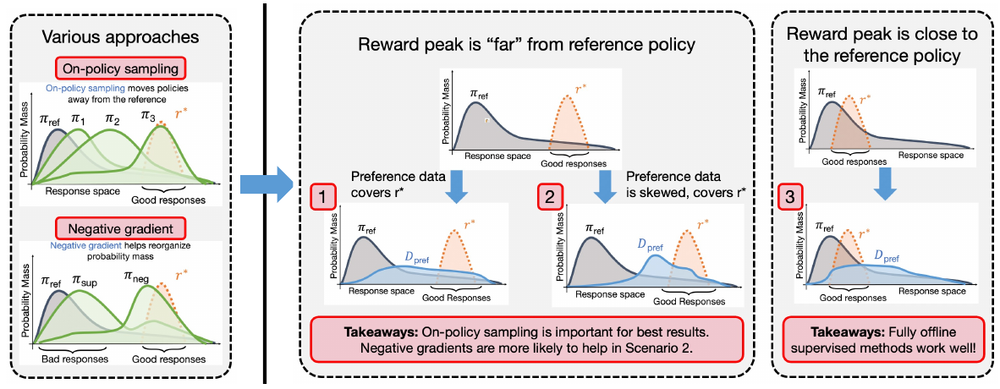
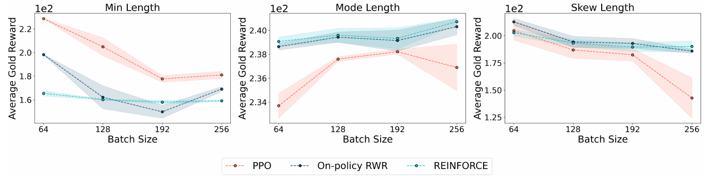
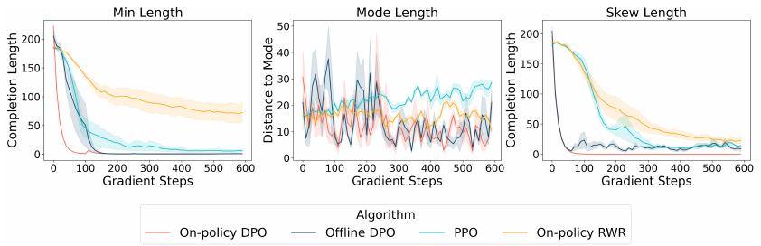

# 20. Preference Fine-Tuning of LLMs Should Leverage Suboptimal, On-Policy Data

> **Authors**: Fahim Tajwar, Anikait Singh et al. (Carnegie Mellon University, Stanford University, Google DeepMind, UW-Madison)
> **Venue**: ICML 2024 (PDF는 arXiv v3, 2024)
> **Link**: https://arxiv.org/abs/2404.14367
> **목록 위치**: Part 4 — 선호 학습 (DPO)

---

## 1. 핵심 연구 질문과 풀고자 하는 문제
- **preference fine-tuning에서 어떤 요소(on-policy sampling, negative gradient)가 왜 중요하며, 언제 필요한가?**
- 배경: 선호 학습 방법은 on-policy RL(PPO, REINFORCE), offline contrastive(DPO, IPO), supervised(Pref-FT, Best-of-N, RWR)로 나뉘는데, "online RL이 필수다"와 "offline contrastive나 SFT로 충분하다"는 상반된 실험 결과가 공존한다.
- 기존 한계: 이론상 모든 방법은 같은 optimum을 노리지만, 실제로는 데이터 coverage와 계산량이 유한하므로 loss·최적화 방식에 따라 결과가 달라진다. 실무자는 (1) RL이 꼭 필요한지, (2) preference data를 model-in-the-loop(on-policy)로 모아야 하는지 판단할 기준이 없었다.

## 2. 핵심 가설
- (본문에서 도출) 방법의 성능은 두 조건에 좌우된다.
  - [C1] ground-truth reward r*의 peak와 π_ref의 고확률 영역이 얼마나 겹치는가 (geometric alignment)
  - [C2] preference data가 π_ref 대비 얼마나 넓게 덮는가 (coverage)
- reward peak가 π_ref의 저확률 영역에 있을 때 **on-policy sampling**과 **negative gradient**(y_l의 likelihood를 밀어내는 항)가 각각 성능을 올리며, 둘은 상호 보완적이다.
- 이 둘은 **mode-seeking**(reverse KL) 목표라는 하나의 개념으로 묶이고, maximum likelihood 계열은 mode-covering(forward KL)이라 확률 질량을 빠르게 재배치하지 못한다.

## 3. 제안하는 해결책
- 새 알고리즘이 아니라 **분석 프레임워크**. 방법을 세 축으로 분류 (Table 1).



> **Figure 1**: (왼쪽) on-policy sampling은 policy 질량을 π_ref에서 reward peak r* 쪽으로 점진적으로 옮기고, negative gradient는 나쁜 응답의 likelihood를 눌러 π_sup보다 더 크게 이동한 π_neg를 만든다. (오른쪽) r*가 π_ref의 저확률 영역에 있으면 on-policy sampling이 유리하고 preference data가 π_ref에서 벗어나 skew된 경우(case 2) negative gradient가 추가로 도움이 되며, r*가 π_ref 고확률 영역에 있으면 offline supervised 방법으로 충분하다.

| 방법 | On-policy sampling | Sample reuse | Negative gradient |
|---|---|---|---|
| PPO | O | O | O |
| REINFORCE | O | X | O |
| DPO, IPO | X | N/A | O |
| Pref-FT, Binary FeedMe | X | N/A | X |
| ReST, RWR, online Best-of-N | O | O | X |

- Unified Algorithm 1: 반복마다 B/C개 prompt에 C개 응답 생성(online) 또는 dataset에서 추출(offline) → reward model로 라벨 → T번 inner step. B가 크면 stale data로 더 off-policy, T가 크면 sample reuse가 많아짐.
- 이론 (Section 6):
  - Lemma 6.1: on-policy RL 목표는 reverse KL(π_θ || π*)를 최소화하는 것과 동치 → mode-seeking.
    ```
    L_RL = -β E_x[log Z(x)] + β E_x[ KL(π_θ(.|x) || π*(.|x)) ]
    ```
  - Lemma 6.2: c2 > 0인 negative gradient 항이 있으면 margin ω = log π(y_w|x) - log π(y_l|x)가 c2 = 0일 때보다 크거나 같아지는 dataset이 항상 존재.
  - Lemma 6.3: offline weighted likelihood(RWR, ReST, BoN)는 forward KL 최적화 → mode-covering.
  - Theorem 6.5: categorical 분포에서 reverse KL은 forward KL보다 확률 질량을 더 공격적으로, 일부 category에 집중해 재배치함.
- 실무 처방: **현재 policy에서 샘플링 → reward model로 순위 → 최고/최저로 pair 구성 → DPO/IPO loss** 를 적용하는 on-policy DPO.

## 4. 가설 검증 방법
- 설정 3단계
  - Didactic bandit: vocab 100, 응답 길이 10 token. reward R1(peak가 π_ref 저밀도 영역), R2(peak가 π_ref mode 근처).
  - Synthetic LLM: 길이 기반 reward. Min Length(R1 유사), Mode Length(R2 유사, 평균 길이 203), Skew Length(95% 확률로 응답을 짧게 잘라 preference data를 π_ref에서 벗어나게 함).
  - Full-scale: AlpacaFarm (Pythia-1.4B policy, gold RM로 라벨), UltraFeedback (Mistral-7B SFT on UltraChat, gold RM UltraRM-13B).
- 비교: PPO, REINFORCE, RWR, Best-of-N, Pref-FT, DPO, IPO의 offline/on-policy 변형. TRL 기반, lr·β sweep (Appendix E).
- 주요 관찰
  - Q1 on-policy: 같은 data budget에서 B를 작게(더 on-policy) 할수록 Min/Skew Length에서 gold reward가 높고 수렴이 빠름 (Figure 4, 5, 7, 8, AlpacaFarm Figure 9). Mode Length에서는 차이 거의 없음 (Figure 6).



> **Figure 8**: synthetic LLM 문제에서 on-policy sampling 효과 요약. PPO, on-policy RWR, REINFORCE의 평균 gold reward를 batch size B별로 비교하며, Min Length·Skew Length에서는 대체로 B가 작을수록(더 on-policy) gold reward가 높고 Mode Length에서는 batch size 간 차이가 작다(y축 범위가 좁음).

  - Sample reuse: PPO는 T=8까지도 T=1과 비슷(importance ratio clip 덕분), Best-of-N은 T=2가 T=1보다 낫지만 과하면 손해 (Figure 11).
  - Q2 negative gradient: offline DPO/IPO가 Pref-FT·RWR·BoN보다 우수, 특히 R1/Min/Skew (Figure 12–14). AlpacaFarm(Pythia-1.4B)에서는 DPO가 y_w, y_l 모두의 likelihood를 떨어뜨리며 margin만 키우고, UltraFeedback(Mistral-7B)에서는 y_w는 올리고 y_l은 내림 (Figure 17).
  - Q3 보완성: on-policy IPO/DPO가 offline DPO, on-policy PPO, RWR보다 빠르고 좋음 (Figure 18, 19). wall-clock 비교는 Table 3.



> **Figure 19**: synthetic LLM length 실험에서 on-policy sampling과 negative gradient의 상호 보완 효과. optimal policy와 reference policy가 멀리 떨어진 Min Length·Skew Length에서는 on-policy DPO가 가장 좋고, 둘이 가까운 Mode Length에서는 모든 알고리즘이 비슷하다.

- 주의할 점
  - 본문 결과 대부분이 그래프로만 제시되고 수치 표는 Table 3(wall-clock) 하나뿐이다. full-scale 결과의 구체 수치는 논문에 명시되지 않음.
  - Q3의 on-policy DPO 결과는 bandit과 synthetic length task에서만 보였고, AlpacaFarm/UltraFeedback full-scale에서의 on-policy DPO 결과는 제시되지 않았다. 제목의 주장에 비해 실제 LLM 근거는 Q1·Q2에 한정된다.
  - Table 3 Min Length에서 offline DPO와 on-policy DPO의 최종 completion length가 모두 1.0이라, Min Length에서 "더 좋은 해"라는 표현은 시간 측면에만 해당한다.
  - 저자도 reward model 품질의 영향과 엄밀한 statistical guarantee는 다루지 않았다고 limitation에 적었다.

## 5. 개선한 메트릭
| Metric | Benchmark | Baseline | Proposed (on-policy DPO/IPO) | 변화 |
|---|---|---|---|---|
| Reward ↑ (Table 3) | Bandit R1 | offline DPO/IPO 0.82 / PPO 0.92 / RWR 0.88 | 0.92 | offline 대비 +0.10, PPO와 동일 |
| 수렴 시간 (Table 3) | Bandit R1 | offline 1.7h / PPO 0.93h | 0.12h | 약 14배 / 7.8배 단축 |
| Completion length ↓ (Table 3) | Min Length | offline DPO 1.0 / PPO 20.5 / RWR 65.5 | 1.0 | offline과 동일, PPO 대비 -19.5 |
| 수렴 시간 (Table 3) | Min Length | offline 1.3h / PPO 4.84h | 0.4h | 약 3.3배 / 12배 단축 |
| Completion length ↓ (Table 3) | Skew Length | offline DPO 11.8 / PPO 15.8 / RWR 15.8 | 0.0 | offline 대비 -11.8 |
| 수렴 시간 (Table 3) | Skew Length | offline 0.12h / PPO 7.26h | 0.4h | offline보다 느리지만 offline은 sub-optimal에서 정체 |

- 괄호 안 표준편차는 Table 3 원문 참조. AlpacaFarm/UltraFeedback 개선폭은 그래프(Figure 9, 14)로만 제시되어 수치는 논문에 명시되지 않음.

## 6. 한 줄 요약
> reward peak가 reference policy의 저확률 영역에 있을 때는 on-policy sampling과 negative gradient(둘 다 mode-seeking)가 필수적이며, 현재 policy 샘플로 pair를 만들어 DPO를 돌리는 on-policy contrastive 학습이 둘의 장점을 함께 얻는다.
