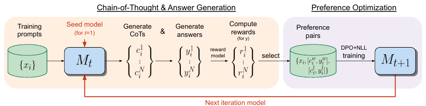
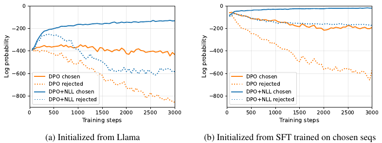

# 21. Iterative Reasoning Preference Optimization

> **Authors**: Richard Yuanzhe Pang, Weizhe Yuan et al. (FAIR at Meta, New York University)
> **Venue**: NeurIPS 2024 (PDF·arXiv에 학회 표기 없음, 확인 필요)
> **Link**: https://arxiv.org/abs/2404.19733
> **목록 위치**: Part 4 — 선호 학습 (DPO)

---

## 1. 핵심 연구 질문과 풀고자 하는 문제
- **iterative preference optimization을 CoT reasoning task에 적용해, 정답 라벨만으로 reasoning 능력을 반복적으로 끌어올릴 수 있는가?**
- 배경: Iterative DPO, Self-Rewarding LLM, SPIN 같은 iterative preference 방법은 일반 instruction tuning에서는 잘 되지만 reasoning task에서는 이득이 작거나 오히려 성능이 떨어졌다.
- 기존 한계: reasoning에 성공한 iterative 방법(STaR, ReST-EM, V-STaR)은 정답 샘플만 골라 SFT하는 방식이라 **틀린 reasoning(negative)을 학습 신호로 쓰지 못한다**. V-STaR는 DPO를 verifier 학습에만 쓴다.

## 2. 핵심 가설
- (본문에서 도출) 모델이 직접 생성한 CoT 중 **정답 CoT를 winner, 오답 CoT를 loser**로 pair를 만들어 preference optimization하면 SFT만 하는 것보다 reasoning이 더 좋아진다.
- (본문에서 도출) 표준 DPO만 쓰면 chosen sequence의 log probability까지 떨어지므로, winner에 **NLL 항을 추가**해야 성능이 난다.
- (본문에서 도출) 이득은 데이터 양 증가가 아니라 **모델을 갱신하며 반복**하는 데서 온다.

## 3. 제안하는 해결책
- 각 iteration t의 2단계 (Figure 1)



> **Figure 1**: Iterative RPO의 2단계. (i) CoT & Answer Generation: 현재 모델 M_t로 training prompt에 대한 CoT와 answer를 생성하고 reward model로 정답 여부를 평가한다. (ii) Preference Optimization: 생성 데이터에서 preference pair를 골라 DPO+NLL로 학습해 M_{t+1}을 얻으며, 성능이 포화될 때까지 반복한다.

  1. **CoT & answer generation**: 현재 모델 M_t로 training prompt마다 N개의 (CoT c, answer y) 샘플링. reward r = 1 if y == gold answer else 0.
  2. **Preference optimization**: 정답 집합 G_w와 오답 집합 G_l에서 K개 pair를 뽑아 DPO+NLL로 M_t를 초기값 삼아 학습 → M_{t+1}.
- Loss (Eq. 1), reference model은 직전 iteration 모델 M_t:
  ```
  L = -log σ( β log(M_θ(c_w,y_w|x)/M_t(c_w,y_w|x)) - β log(M_θ(c_l,y_l|x)/M_t(c_l,y_l|x)) )
      - α * log M_θ(c_w,y_w|x) / (|c_w| + |y_w|)
  ```
  - NLL 항은 응답 길이로 정규화. α=1, β=0.1 (GSM8K에서 tuning).
- 기존 방법과의 차이
  - Self-Rewarding: 매 iteration 새 prompt를 만들고 LLM judge를 reward로 씀 → 여기서는 고정 prompt + gold label exact match.
  - STaR: 정답 rationale만 SFT → 여기서는 오답을 negative로 활용.
  - 표준 DPO: NLL 항 없음.
- GSM8K 설정: seed M0 = Llama-2-70B-Chat, zero-shot prompt, N=30, temperature 0.8 (iter 1–2) / 1.3 (iter 3–4), K=10 pair/문제, iteration당 약 55–60k pair. 모델이 정답을 못 만든 문제는 **gold 사람 풀이를 winner에 포함**. batch 16, lr 7e-7, AdamW, iteration당 최대 5000 step.

## 4. 가설 검증 방법
- 데이터셋: GSM8K (train 약 7.5k), ARC-Challenge (train 7.7k, gold CoT 없음, 4지선다), MATH (12.5k, 4-shot prompt). 외부 데이터 없이 training set만 사용.
- Baseline (모두 Llama-2-70B-Chat 기반): zero-shot/few-shot CoT, majority voting, SFT on gold CoT, SFT on chosen (= STaR 1 iteration), 표준 DPO (M0 초기화 / SFT 초기화).
- 결과
  - GSM8K (Table 1): 55.6% → iter1 73.1 → iter2 78.0 → iter3 81.1 → iter4 81.6%. majority voting@32 88.7% (zero-shot CoT maj@32 70.7%).
  - 반복 효과: iteration별 증가폭 17.5 → 4.9 → 3.1 → 0.5 pp로 포화.
  - 데이터 양 대조: 1 iteration을 2배 데이터로 학습하면 74.8%로, 2 iteration(78.0%)에 못 미침. STaR도 2배 데이터에서 65.2 → 66.9%.
  - NLL ablation: 같은 pair로 표준 DPO는 61.8% (SFT 초기화 시 60.3%) vs DPO+NLL 73.1%. Figure 3에서 DPO만 쓰면 chosen log prob이 감소, DPO+NLL은 증가.



> **Figure 3**: GSM8K에서 NLL loss 항의 효과. 표준 DPO(NLL 없음, 주황 실선)에서는 chosen sequence의 log probability가 학습 중 감소하며 특히 chosen으로 SFT한 모델에서 시작할 때(오른쪽) 두드러지지만, DPO+NLL(파랑 실선)에서는 증가한다. 네 설정 모두 chosen-rejected margin은 계속 커진다.

  - SFT의 한계 (Figure 2): chosen만 SFT해도 rejected의 log prob이 함께 올라가 둘이 붙어 있음.
  - ARC-Challenge (Table 2): 77.8% → 84.8 → 86.2 → 86.7%, maj@32 87.9%. 4지선다라 우연히 맞힌 CoT(25%)가 winner로 섞이는 noise에도 개선.
  - MATH (Table 2): 12.5% → 17.7 → 19.9 → 20.8%, maj@32 29.1%. 표준 DPO는 12.4% / 10.5%로 초기 모델보다 하락.
- 주의할 점
  - 본문의 "47% 향상(55.6 → 81.6)", "SFT는 14% 향상"은 상대 비율이지만, 바로 뒤의 "17.5%, 4.9%, 3.1%, 0.5%"는 절대 pp 차이라 단위가 섞여 있다.
  - GSM8K에서는 gold 풀이를 winner에 넣으므로 순수 self-generated(on-policy) 데이터만 쓴 것은 아니다.
  - checkpoint 선택 후 held-out 1k를 다시 포함해 재학습하는 절차, seed 수, 분산은 보고되지 않았다. PPO 등 online RL과의 직접 비교도 없다.
  - ARC는 iteration이 진행될수록 오답이 없는 문제가 늘어 pair 수가 20k → 11k → 5k로 줄어든다.
  - 저자 limitation: 이전 iteration 데이터 미사용, 정답이 명확한 task에 한정, 다른 모델 샘플을 쓸 때 NLL이 필요한지는 미확인.

## 5. 개선한 메트릭
| Metric | Benchmark | Baseline | Proposed | 변화 |
|---|---|---|---|---|
| Test acc, greedy (Table 1) | GSM8K | zero-shot CoT 55.6% / SFT gold 63.5% / DPO 61.8% / STaR 65.2% | Iter RPO iter4 81.6% | CoT 대비 +26.0 pp |
| maj@32 (Table 1) | GSM8K | zero-shot CoT 70.7% | iter4 88.7% | +18.0 pp |
| Test acc, 0-shot (Table 2) | ARC-Challenge | CoT 77.8% / SFT chosen 79.8% / DPO 83.5% | iter3 86.7% | CoT 대비 +8.9 pp |
| maj@32 (Table 2) | ARC-Challenge | CoT 82.9% | iter3 87.9% | +5.0 pp |
| Test acc, 4-shot (Table 2) | MATH | CoT 12.5% / SFT chosen 16.8% / DPO 12.4% | iter3 20.8% | CoT 대비 +8.3 pp |
| maj@32 (Table 2) | MATH | CoT 18.8% | iter3 29.1% | +10.3 pp |
| NLL ablation (Table 1) | GSM8K, 1 iteration | DPO 61.8% | DPO+NLL 73.1% | +11.3 pp |

## 6. 한 줄 요약
> 정답 라벨로 자기 생성 CoT를 맞음/틀림 pair로 만들어 DPO+NLL로 반복 학습하면 Llama-2-70B-Chat의 GSM8K 정확도가 55.6%에서 81.6%로 오르며, NLL 항과 반복(iteration)이 핵심이다.
