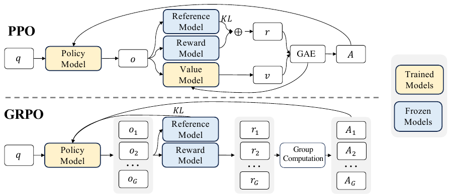
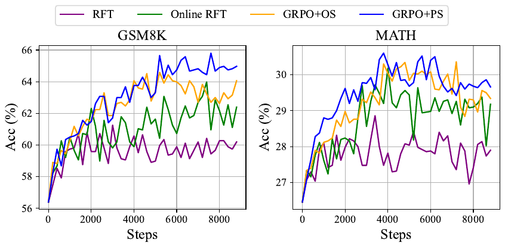
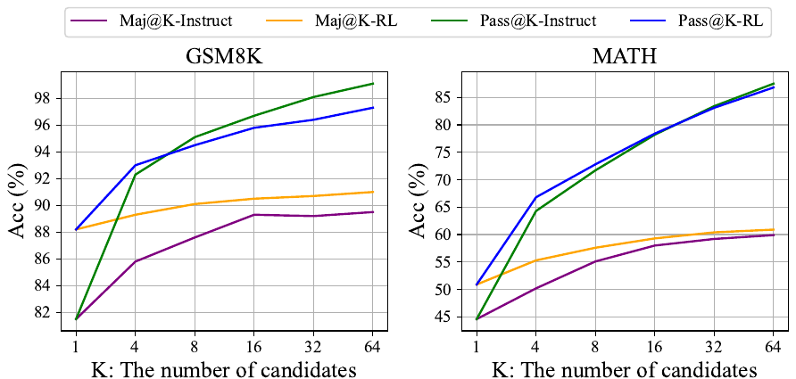

# 22. DeepSeekMath: Pushing the Limits of Mathematical Reasoning in Open Language Models

> **Authors**: Zhihong Shao, Peiyi Wang, Qihao Zhu et al. (DeepSeek-AI, Tsinghua University, Peking University)
> **Venue**: arXiv, 2024
> **Link**: https://arxiv.org/abs/2402.03300
> **목록 위치**: Part 5 — RL 방법론

---

## 1. 핵심 연구 질문과 풀고자 하는 문제
- **공개 웹 데이터와 PPO보다 저렴한 RL만으로 7B open model이 GPT-4급 수학 추론에 얼마나 다가갈 수 있는가?**
- 배경: GPT-4, Gemini-Ultra 같은 closed model과 open model 사이 MATH 성능 격차가 컸다. 기존 math corpus(OpenWebMath 13.6B, Proof-Pile-2 등)는 규모가 작거나 arXiv 위주였다.
- RL 쪽 한계: PPO는 policy와 비슷한 크기의 value model(critic)을 같이 학습해야 해서 memory와 compute 부담이 크다. LLM에서는 보통 마지막 token에만 reward가 붙기 때문에 token마다 정확한 value를 학습하기도 어렵다.
- 그리고 SFT, RFT, DPO, PPO가 서로 어떤 관계인지 한 틀로 설명한 분석이 없었다.

## 2. 핵심 가설
- (본문에서 도출) value model 없이 **같은 question에서 뽑은 G개 output의 평균 reward를 baseline으로 써도** PPO만큼 효과적으로 policy를 개선할 수 있다. reward model 자체가 비교 데이터로 학습되므로 group-relative advantage가 그 성질과 잘 맞는다.
- (본문에서 도출) SFT, RFT, DPO, PPO, GRPO는 모두 "data source × reward function × gradient coefficient"로 분해할 수 있다. 성능 차이는 (a) online인지 offline인지, (b) gradient coefficient가 reward 크기를 반영하는지(오답에 대한 penalty 포함)에서 나온다.
- 잘 걸러낸 Common Crawl 수학 데이터가 arXiv 논문보다 수학 추론에 더 유용하고, 수학 학습 전에 code 학습을 하면 도움이 된다.

## 3. 제안하는 해결책
**(a) Pretraining (간략)**: OpenWebMath를 seed로 fastText classifier를 학습해 Common Crawl(dedup 후 40B HTML pages)에서 수학 페이지를 recall한다. math 비율이 높은 domain을 찾아 URL을 사람이 annotate하고 seed를 확장한다. 이 과정을 4 iteration 반복해 35.5M pages, 120B tokens를 모았다. DeepSeek-Coder-Base-v1.5 7B에서 시작해 500B tokens를 학습했다(56% DeepSeekMath Corpus, 4% AlgebraicStack, 10% arXiv, 20% GitHub code, 10% NL).
**(b) SFT**: CoT, PoT, tool-integrated 형식의 776K 예제로 500 steps 학습(batch 256, lr 5e-5).
**(c) GRPO**: critic을 없애고 group 안의 reward를 정규화해서 advantage로 쓴다.



> **Figure 4**: PPO와 GRPO 비교. GRPO는 value model을 없애고 group score로 baseline을 추정해 학습 자원을 크게 줄인다.

```
J_GRPO(θ) = E[q ~ P(Q), {o_i}_{i=1..G} ~ π_old(O|q)]
  (1/G) Σ_i (1/|o_i|) Σ_t { min( ρ_{i,t} · Â_{i,t}, clip(ρ_{i,t}, 1-ε, 1+ε) · Â_{i,t} ) - β · D_KL(π_θ || π_ref) }
  ρ_{i,t} = π_θ(o_{i,t}|q,o_{i,<t}) / π_old(o_{i,t}|q,o_{i,<t})

D_KL = π_ref/π_θ - log(π_ref/π_θ) - 1        (Schulman k3 estimator, 항상 양수)

Outcome supervision:  Â_{i,t} = (r_i - mean(r)) / std(r)          (output 안의 모든 token에 같은 값)
Process supervision:  Â_{i,t} = Σ_{index(j) >= t} r̃_i^{index(j)}   (PRM step reward를 정규화한 뒤 이후 step들을 합산)
```
- PPO와 다른 점: (1) value model과 GAE를 쓰지 않는다. (2) KL을 token reward에 penalty로 섞지 않고 loss에 직접 더해서 advantage 계산이 단순하다. (3) Iterative GRPO에서는 policy sample로 reward model을 다시 학습하고(과거 데이터 10% replay), reference model을 현재 policy로 교체한다(Algorithm 1).
- **Unified paradigm (Eq. 5)**: gradient = E_data[ (1/|o|) Σ_t GC_A(q,o,t,π_rf) · ∇log π_θ(o_t|...) ].
  - SFT: GC=1
  - RFT/Online RFT: 정답이면 1, 오답이면 0
  - DPO: σ(β·logratio(o-) − β·logratio(o+))
  - PPO: A_t
  - GRPO: Â_{i,t} + β·(π_ref/π_θ − 1)
  - 즉 RFT는 오답에 penalty를 주지 않지만 GRPO는 reward 크기에 따라 강화하거나 penalty를 준다.

## 4. 가설 검증 방법
- **RL 설정**: DeepSeekMath-Instruct 7B에서 시작. RL data는 SFT data 중 GSM8K/MATH 관련 CoT-format question 약 144K개뿐이다. 다른 SFT question은 일부러 빼서 out-of-domain 효과를 따로 본다. reward model은 DeepSeekMath-Base 7B 기반(lr 2e-5). policy lr 1e-6, KL coef β=0.04, question당 G=64 samples, max length 1024, batch 1024, exploration당 policy update 1회.
- **Main 비교 (Table 5)**: DeepSeekMath-RL 7B는 in-domain(GSM8K, MATH CoT)과 out-of-domain(MGSM-zh, CMATH, tool-integrated) 벤치마크 **모두**에서 Instruct보다 좋아졌다. GSM8K/MATH 데이터로만 학습했는데도 중국어 벤치마크가 함께 오른 것이 RL이 일반화된다는 근거로 제시된다.
- **Unified paradigm ablation (Figure 5, DeepSeekMath-Instruct 1.3B)**:
  - Online RFT > RFT: 초반에는 비슷하지만 후반에 차이가 커진다. online sampling의 이점.
  - GRPO+OS > Online RFT: gradient coefficient가 reward 크기를 반영하고 오답에 penalty를 주는 효과.
  - GRPO+PS > GRPO+OS: step 단위 신호의 효과.
  - 수치 표는 없고 곡선(GSM8K 약 56–66%, MATH 약 27–30% 범위)만 있다.



> **Figure 5**: DeepSeekMath-Instruct 1.3B를 RFT, Online RFT, GRPO+OS, GRPO+PS로 추가 학습했을 때 GSM8K와 MATH 성능 곡선.

- **Iterative RL (Figure 6, 7B)**: 2 iteration을 돌렸고 첫 iteration에서 향상이 가장 컸다. 수치 표는 없다.
- **Why RL works (Figure 7)**: temperature 0.7에서 Maj@K는 오르지만 Pass@K는 오르지 않는다. 저자 해석은 "fundamental capability 향상이 아니라 Top-K 안의 정답을 위로 끌어올려 output distribution을 robust하게 만든 것"이다.



> **Figure 7**: SFT(Instruct)와 RL DeepSeekMath 7B의 GSM8K, MATH Maj@K와 Pass@K(temperature 0.7). RL은 Maj@K는 높이지만 Pass@K는 높이지 않는다.

- **Pretraining ablation**:
  - Table 1: 1.3B 모델을 150B tokens 학습했을 때 DeepSeekMath Corpus가 GSM8K 23.8%, MATH 13.6%로 Proof-Pile-2(14.3%, 11.2%)보다 높다.
  - Table 6: code 400B → math 150B 순서로 학습하면 GSM8K 21.9%, MATH 15.3%로 general → math(19.1%, 14.4%)보다 높다.
  - Table 8: arXiv corpus만으로 학습하면 개선이 없거나 오히려 나빠진다.
- **주의할 점**:
  - main RL은 rule reward가 아니라 **학습된 reward model**을 쓴다(Table 10에서 GRPO = "Model"). verifiable reward만 쓰는 R1 계열과 설정이 다르다.
  - exploration당 update가 1회라서 π_old = π_θ이고 clip은 실질적으로 작동하지 않는다. 이 조건에서 GRPO는 정규화된 REINFORCE에 KL을 더한 것에 가깝다.
  - "PPO 대비 memory 절감"을 주장하지만 7B에서 PPO와 GRPO의 정확도·memory를 직접 비교한 수치는 없다.
  - Pass@K가 오르지 않는다는 결과(Figure 7)는 "RL이 수학 추론 능력을 향상시킨다"는 서술을 약하게 만든다. 이 쟁점은 #4가 이어받는다.
  - 1/|o_i| length normalization과 std 나누기가 bias를 만든다는 문제는 후속 #25(Dr. GRPO)가 제기한다.
  - Table 5에서 회색(maj@32)으로 표시된 값은 텍스트 추출로 구분되지 않는다.

## 5. 개선한 메트릭
| Metric | Benchmark | Baseline | Proposed | 변화 |
|---|---|---|---|---|
| Top1 acc (CoT) | GSM8K | Instruct 7B 82.9% | RL 7B 88.2% | +5.3 (Table 5) |
| Top1 acc (CoT) | MATH | Instruct 7B 46.8% | RL 7B 51.7% | +4.9 (Table 5) |
| Top1 acc (CoT) | MGSM-zh (OOD) | 73.2% | 79.6% | +6.4 (Table 5) |
| Top1 acc (CoT) | CMATH (OOD) | 84.6% | 88.8% | +4.2 (Table 5) |
| Top1 acc (tool) | MATH+tool | 57.4% | 58.8% | +1.4 (Table 5) |
| Top1 acc (tool) | GSM8K+tool | 83.7% | 86.7% | +3.0 (Table 5) |
| few-shot CoT | MATH (Base) | Llemma 34B 25.3% / Minerva 540B 33.6% | DeepSeekMath-Base 7B 36.2% | +2.6 vs Minerva (Table 2) |
| few-shot CoT | GSM8K (Base) | Minerva 540B 58.8% | 64.2% | +5.4 (Table 2) |
| Self-consistency@64 | MATH | – | 60.9% | Abstract (어느 모델 버전인지 명시 안 됨) |

## 6. 한 줄 요약
> critic을 없애고 같은 질문에서 뽑은 G개 sample의 정규화 reward를 advantage로 쓰는 GRPO를 제안해 7B 모델의 MATH 성능을 46.8%에서 51.7%로 올렸다. 다만 이 향상은 Pass@K가 아니라 Maj@K에서만 나타나므로, 새 능력을 만들기보다 출력 분포를 날카롭게 한 것으로 보인다.
