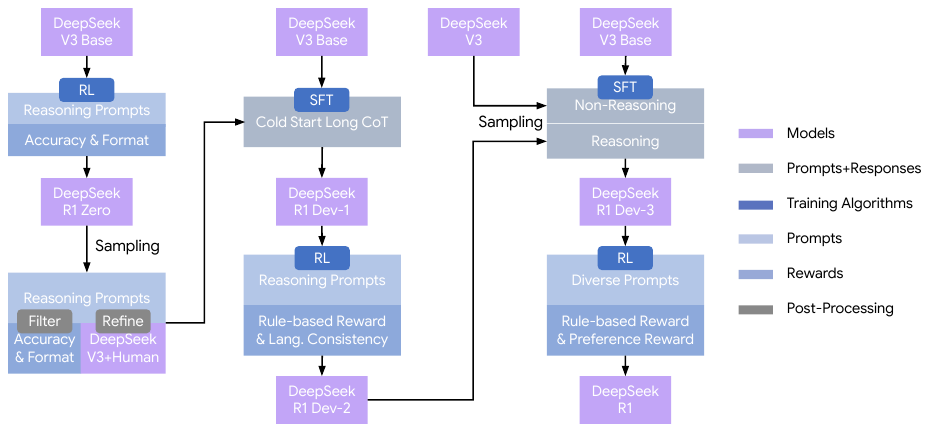
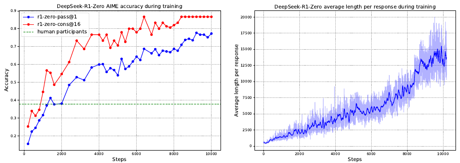

# 23. DeepSeek-R1: Incentivizing Reasoning Capability in LLMs via Reinforcement Learning

> **Authors**: DeepSeek-AI (core contributors: Daya Guo, Dejian Yang, Haowei Zhang, Junxiao Song, Peiyi Wang, Qihao Zhu et al.)
> **Venue**: Nature, 2025 (본 노트는 arXiv v2, 2026-01 기준)
> **Link**: https://arxiv.org/abs/2501.12948
> **목록 위치**: Part 5 — RL 방법론

---

## 1. 핵심 연구 질문과 풀고자 하는 문제
- **사람이 쓴 reasoning trajectory로 SFT를 하지 않고, 정답 여부만 보는 rule-based reward로 base model에 pure RL을 하면 고급 추론 능력이 생기는가?**
- 배경: CoT prompting이나 SFT 기반 추론 학습은 사람이 annotate한 trace에 의존한다. 그래서 확장성이 낮고, 성능 상한이 human exemplar에 묶이며, 사람과 다른 더 나은 추론 경로를 탐색하기 어렵다.
- 추가 문제:
  - 이렇게 얻은 R1-Zero는 readability가 낮고 language mixing이 있다.
  - writing, open-domain QA 같은 비추론 task 성능이 제한적이다.
  - 따라서 실사용 모델로 만들 multi-stage pipeline과, 작은 모델로 옮기는 distillation도 필요하다.

## 2. 핵심 가설
- 논문이 명시한 가설: "human-defined reasoning pattern은 exploration을 제한할 수 있고, 제약 없는 RL이 새로운 reasoning capability의 emergence를 더 잘 유도한다."
- (본문에서 도출) 추론 능력의 열쇠는 대규모 human annotation이 아니다. **어려운 문제, 신뢰할 수 있는 verifier, 충분한 RL compute**가 핵심이다(Conclusion).
- (본문에서 도출) neural reward model은 대규모 RL에서 reward hacking에 취약하다. 그래서 reasoning task에는 rule-based reward가 더 낫다.

## 3. 제안하는 해결책
**R1-Zero**: DeepSeek-V3-Base(671B MoE, 37B active)에 SFT 없이 바로 GRPO를 적용한다. template은 `<think>…</think><answer>…</answer>` 구조만 강제한다(Table 1).
```
Reward_rule = Reward_acc + Reward_format          (같은 가중치, neural RM 미사용)
A_i = (r_i - mean(r_1..r_G)) / std(r_1..r_G)
J_GRPO = E[ (1/G) Σ_i min( ρ_i·A_i, clip(ρ_i, 1-ε, 1+ε)·A_i ) - β·D_KL(π_θ||π_ref) ],  ρ_i = π_θ(o_i|q)/π_old(o_i|q)
```
- 하이퍼파라미터:
  - lr 3e-6, KL 0.001, temperature 1, G=16
  - max length 32,768 → 8.2k step부터 65,536
  - 32 questions/step, batch 512, 총 10,400 steps(1.6 epoch)
  - 400 step마다 π_ref를 최신 policy로 교체
  - rollout 8,192개를 16 mini-batch로 나눠 1 inner epoch
- 위 식은 ratio를 sequence 단위 π(o_i|q)로 표기한다. DeepSeekMath(#22)에서는 token 단위, 1/|o_i| 평균이었다.

**R1 multi-stage pipeline (Figure 2)**:



> **Figure 2**: DeepSeek-R1의 multi-stage pipeline. DeepSeek-R1 Dev1, Dev2, Dev3는 pipeline 중간 checkpoint다.

1. **Cold start SFT**: R1-Zero 출력 중 정답이고 읽기 좋은 것을 고른다. 사람과 DeepSeek-V3가 1인칭·대화체로 다듬은 long CoT 수천 개를 만든다(Dev1).
2. **RL stage 1**: reasoning prompt + rule reward + **language consistency reward**(target 언어 단어 비율)로 학습한다. clip ratio ε=10이며, 저자는 "낮으면 많은 token gradient가 잘려 성능이 떨어진다"고 설명한다(Dev2).
3. **Rejection sampling + SFT**: reasoning 약 600K(일부는 DeepSeek-V3를 generative judge로 사용)와 non-reasoning 약 200K로 총 804,745 samples를 만든다(Table 5). V3-Base에서 2–3 epoch, lr 5e-5 → 5e-6 cosine(Dev3).
4. **RL stage 2**: Reward = rule(reasoning) + RM(helpful/safety) + format + language. temperature 0.7, 1,700 steps. preference reward는 마지막 400 steps에만 쓴다(그보다 길면 reward hacking 발생).
- Model-based reward:
  - Helpful RM: DeepSeek-V3로 판정한 66K pair, Δ>1인 pair만 사용, chosen과 rejected의 길이를 맞춰 length bias 억제.
  - Safety RM: 106K point-wise label.
- **Distillation**: 800K R1 샘플로 Qwen2.5 / Llama 1.5B–70B를 **SFT만으로** 학습했다(RL 없음, Table 6).
- **GRPO vs PPO (Supp. A.3)**: PPO의 value model은 long CoT에서 부분 응답만 보고 최종 reward를 예측하기 어렵다. 앞에서 쓴 내용이 뒤에서 수정되기 때문이다. 또 PPO의 token별 KL penalty는 누적되어 응답 길이 증가를 억제할 수 있다.

## 4. 가설 검증 방법
- **Pure RL 효과**:
  - R1-Zero의 AIME 2024 pass@1은 15.6%에서 77.9%로 올랐고, cons@16은 86.7%다(Figure 1a).
  - 응답 길이가 꾸준히 늘었고(Figure 1b), 8.2k step에서 max length를 늘리자 성능과 길이가 함께 뛰었다.



> **Figure 1**: (a) 학습 중 DeepSeek-R1-Zero의 AIME 정확도(pass@1, cons@16; 점선은 AIME 인간 참가자 평균). (b) RL 과정에서 training set에 대한 평균 응답 길이. R1-Zero는 스스로 더 긴 thinking으로 추론 문제를 푸는 법을 익힌다.

- **Emergent behavior**: "wait", "verify" 등 reflective word 빈도가 학습 시작 대비 5–7배로 늘었다. "wait"는 8000 step 이후 급증했다(Figure 9, "aha moment", Table 2).
- **난이도별 (Figure 8, MATH)**: level 5 정확도가 약 0.55에서 약 0.90으로, level 4는 약 0.78에서 0.95로 올랐다.
- **Stage별 ablation (Table 3)**:
  - Dev1은 cold start 데이터가 적어서 AIME가 59.0으로 R1-Zero(77.9)보다 낮다.
  - Dev2(reasoning RL)에서 AIME 74.0, Codeforces 1687로 회복한다.
  - 최종 R1은 AlpacaEval2 87.6, ArenaHard 92.3으로 크게 오른다.
- **GRPO vs PPO (Figure 4, DeepSeek-Coder-V2-Lite 16B MoE)**: PPO는 GAE λ=0.95(기본값)에서 GRPO보다 크게 뒤진다. λ=1.0으로 tuning하면 GRPO에 근접한다. 수치 표는 없다.
- **Distill vs RL (Table 16)**: 같은 Qwen2.5-32B에서 RL 10K+ steps로 만든 Qwen2.5-32B-Zero(AIME 47.0)는 R1-Distill-Qwen-32B(72.6)보다 크게 낮다. 작은 모델에는 distillation이 더 경제적이라는 결론이다.
- **Base capacity (G.1)**: 7B dense와 16B MoE로 pure RL을 했을 때는 AIME가 의미 있게 오르지 않았고 반복 출력이 생겼다. 32B 이상에서야 효과가 나타났다.
- **실패 사례 (G.2)**: PRM은 step 정의가 어렵고 reward hacking과 비용 문제가 있다. MCTS는 token 탐색 공간이 너무 크고 value model 학습이 어렵다.
- **Language consistency ablation (Figure 7, Distill-Qwen-7B)**: LC reward를 쓰면 언어 일관성은 유지된다. 수학 성능은 비슷하고 code 성능은 약간 떨어진다(수치 표 없음).
- **주의할 점**:
  - **최종 R1이 일부 추론 지표에서 R1-Zero보다 낮다**(Table 3): CNMO 88.1→78.8, GPQA 75.8→71.5. multi-stage pipeline의 주된 효과는 가독성과 general task 향상이다.
  - "human label 없이"라고 하지만, base의 pretraining web data에 OpenAI 모델이 생성한 답이 상당히 포함되어 있다고 저자가 인정한다(Supp. A.1). 또 R1 자체는 cold start에 사람이 다듬은 데이터를 쓴다.
  - n-gram decontamination으로는 paraphrase된 test 문제를 막을 수 없다고 저자가 인정한다. 그래서 2024년 이전 벤치마크는 오염 가능성이 있다. AIME 2025(Pass@1 75%, Table 13)가 보완 근거다.
  - clip ε=10은 매우 큰 값인데 ε별 ablation 수치는 제시되지 않았다. reward hacking(Figure 6)과 PPO 비교(Figure 4)도 그림만 있다.
  - Distill vs RL 비교에서 teacher는 671B 모델이므로 같은 compute 조건의 비교가 아니다.
  - 분류 task 관점: helpful RM 데이터에서 길이를 맞춘 것, verifier의 신뢰성이 핵심이라는 것(G.1), RM 기반 RL은 수백 step으로 제한한다는 것이 실무적으로 중요한 시사점이다.

## 5. 개선한 메트릭
| Metric | Benchmark | Baseline | Proposed | 변화 |
|---|---|---|---|---|
| pass@1 | AIME 2024 | R1-Zero 학습 초기 15.6% | R1-Zero 77.9% (cons@16 86.7%) | +62.3 (Fig. 1) |
| pass@1 | AIME 2024 | DeepSeek-V3 39.2 / o1-1217 79.2 | R1 79.8 (cons@64 86.7) | +40.6 vs V3 (Table 8, E.4) |
| pass@1 | MATH-500 | V3 90.2 / o1-1217 96.4 | R1 97.3 | +7.1 vs V3 (Table 8) |
| Rating | Codeforces | V3 1134 / R1-Zero 1444 | R1 2029 (96.3 percentile) | +895 vs V3 (Table 3, 8) |
| pass@1 | GPQA Diamond | V3 59.1 / R1-Zero 75.8 | R1 71.5 | +12.4 vs V3, −4.3 vs Zero (Table 3, 8) |
| LC-winrate | AlpacaEval 2.0 | R1-Zero 24.7 / Dev3 62.1 | R1 87.6 | +25.5 vs Dev3 (Table 3) |
| Prompt strict | IF-Eval | R1-Zero 46.6 | R1 83.3 | +36.7 (Table 3) |
| pass@1 | AIME 2024 (32B) | Qwen2.5-32B-Zero (RL) 47.0 | R1-Distill-Qwen-32B 72.6 | +25.6 (Table 16) |
| pass@1 | AIME 2024 (1.5B) | GPT-4o 9.3 | R1-Distill-Qwen-1.5B 28.9 | +19.6 (Table 15) |
| solve rate | AIME 2025 | o1-1217 12.0/15 | R1 11.3/15 (75%) | −0.7/15 (Table 13) |

## 6. 한 줄 요약
> 정답 여부와 형식만 보는 rule-based reward로 671B base model에 GRPO를 적용하자, SFT 없이도 긴 CoT와 self-reflection이 나타나 AIME pass@1이 15.6%에서 77.9%로 올랐다. 그 위에 cold start, rejection-sampling SFT, 2단계 RL을 쌓은 R1은 o1급 성능을 보이며, 이렇게 얻은 추론 능력은 SFT distillation만으로 작은 모델에 효율적으로 옮겨진다.
