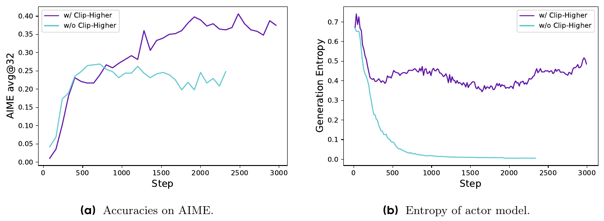
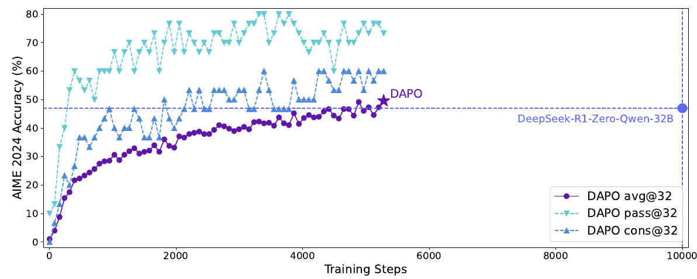

# 24. DAPO: An Open-Source LLM Reinforcement Learning System at Scale

> **Authors**: Qiying Yu et al. (ByteDance Seed, Tsinghua AIR, The University of Hong Kong)
> **Venue**: arXiv, 2025
> **Link**: https://arxiv.org/abs/2503.14476
> **목록 위치**: Part 5 — RL 방법론

---

## 1. 핵심 연구 질문과 풀고자 하는 문제
- **naive GRPO로는 재현되지 않는 R1 수준의 large-scale long-CoT RL을, 어떤 알고리즘 수정으로 안정적으로 재현할 수 있는가?**
- 배경: o1, DeepSeek-R1 보고서는 RL의 핵심 레시피를 공개하지 않아 커뮤니티가 재현에 어려움을 겪음.
- 저자들이 Qwen2.5-32B base에 naive GRPO를 돌린 결과 AIME 2024에서 30점에 그쳐 DeepSeek-R1-Zero-Qwen-32B(47점)보다 크게 낮았음.
- 원인으로 진단한 기존 방법의 한계:
  - **entropy collapse**: 학습 초반에 entropy가 급락하고 그룹 내 응답이 거의 같아짐(Figure 2b). 탐색이 사라짐.
  - **gradient 감소**: 그룹 전원이 정답이면(accuracy=1) advantage가 0이 되고, 이런 prompt 비율이 계속 늘어남(Figure 3b).
  - **sample-level loss**: GRPO는 응답 안에서 token 평균을 낸 뒤 응답끼리 평균함. 긴 응답의 token 하나하나가 덜 반영되어, 긴 응답의 반복·gibberish를 제대로 벌주지 못함.
  - **truncation reward noise**: 최대 길이를 넘어 잘린 응답에 일괄 벌점을 주면, 추론은 맞았는데 길기만 한 응답까지 벌을 받음.

## 2. 핵심 가설
- (본문에서 도출) PPO/GRPO의 기본 설정(대칭 clip, sample-level 평균, 모든 prompt 사용, truncation 일괄 벌점)은 long-CoT RL에서 탐색 붕괴와 학습 신호 희석을 일으킨다. 이 네 가지를 고치면 같은 base model로 R1-Zero 수준을 넘을 수 있다.
- 세부 주장:
  - upper clip이 낮은 확률의 "exploration" token이 커지는 것을 막는다. 실제로 up-clip에 걸리는 token의 평균 확률은 0.2 미만(Figure 3a).
  - 학습 신호가 있는 prompt(0 < 정답 수 < G)만으로 batch를 채우면 효율과 안정성이 좋아진다.
  - KL penalty는 long-CoT reasoning RL에서 필요 없다(모델이 초기 분포에서 크게 멀어지는 것이 정상).

## 3. 제안하는 해결책
- DAPO = Decoupled Clip and Dynamic sAmpling Policy Optimization. GRPO에서 KL term을 빼고 아래 4가지 기법을 더함.
```
J_DAPO(θ) = E[ 1 / (Σ_i |o_i|) * Σ_i Σ_t min( r_it * A_it , clip(r_it, 1-ε_low, 1+ε_high) * A_it ) ]
  s.t.  0 < |{o_i : is_equivalent(a, o_i)}| < G
r_it = π_θ(o_it | q, o_i,<t) / π_θold(o_it | q, o_i,<t)
A_it = (R_i - mean(R)) / std(R)          # group-relative advantage (GRPO와 동일)
R(ŷ, y) = 1 if is_equivalent(ŷ, y) else -1   # rule-based reward
```
| 기법 | 내용 | 해결하려는 문제 |
|---|---|---|
| Clip-Higher | ε_low = 0.2 유지, ε_high = 0.28로 올림 | 낮은 확률 token의 확률이 올라갈 여지를 줘서 entropy collapse를 막음 |
| Dynamic Sampling | 정답률 0 또는 1인 prompt를 over-sample 후 제거, batch가 찰 때까지 샘플링 | advantage가 0인 샘플이 batch를 희석하는 문제 |
| Token-level PG loss | 분모를 응답별 \|o_i\| 대신 batch 전체 token 수 Σ\|o_i\|로 | 긴 응답의 token이 덜 반영되는 문제, 길이·entropy의 비정상 증가 |
| Overlong Reward Shaping | 잘린 샘플 loss masking(Overlong Filtering) + Soft Overlong Punishment | truncation으로 생기는 reward noise |

- Soft Overlong Punishment (정답 reward에 더함):
```
R_length(y) = 0                                   if |y| <= L_max - L_cache
            = ((L_max - L_cache) - |y|) / L_cache if L_max - L_cache < |y| <= L_max
            = -1                                  if |y| > L_max
```
- Dataset: DAPO-Math-17K. 답을 정수로 바꾸도록 문제를 변형해 rule 파싱 오류를 줄임(예: (a+√b)/c 형태면 a+b+c를 답으로 하도록 문제를 수정).
- 기존 방법과의 차이: GRPO 대비 KL 제거, 비대칭 clip, batch 구성의 동적 필터링, token 단위 정규화. value model은 여전히 없음.

## 4. 가설 검증 방법
- 모델: Qwen2.5-32B base. 프레임워크: verl. baseline: naive GRPO, 비교 대상: DeepSeek-R1-Zero-Qwen-32B(47점).
- 설정(Sec 4.1): AdamW, lr 1e-6 constant(20 rollout step warm-up), prompt batch 512, prompt당 16 응답, mini-batch 512(rollout step당 16 gradient update), L_max 16,384 + L_cache 4,096(최대 생성 20,480 token), ε_low 0.2 / ε_high 0.28.
- 평가: AIME 2024만 사용, 32회 반복의 avg@32, temperature 1.0, top-p 0.7.
- 대조 실험:
  - 기법을 하나씩 누적 추가한 ablation(Table 1).
  - Clip-Higher 유무에 따른 AIME 정확도와 entropy 곡선(Figure 2).
  - Token-level loss 유무에 따른 entropy와 응답 길이(Figure 4).
  - Overlong Filtering 유무(Figure 5), Dynamic Sampling 유무(Figure 6).



> **Figure 2**: Clip-Higher 적용 전후의 RL 학습 중 (a) AIME avg@32 정확도와 (b) actor model의 generation entropy. Clip-Higher가 없으면 entropy가 0 근처로 붕괴하고 정확도도 정체됨.

- 가설을 지지하는 결과:
  - 누적 ablation: 30 → 36(Overlong Filtering) → 38(Clip-Higher) → 41(Soft Overlong Punishment) → 42(Token-level Loss) → 50(Dynamic Sampling).
  - Clip-Higher 없이는 entropy가 빠르게 0 근처로 떨어지고, 있으면 유지됨(Figure 2b).
  - Dynamic Sampling은 sampling 양이 늘어도 필요한 training step이 줄어 수렴 시간이 오히려 짧아졌다고 보고(Figure 6).
  - DeepSeek-R1-Zero-Qwen-32B의 50% training step으로 50점 도달(Figure 1).
  - 학습 중 reflection/backtracking 행동이 새로 나타남(Table 2, 사례 1개).



> **Figure 1**: Qwen2.5-32B base에서 DAPO의 AIME 2024 점수(avg@32, pass@32, cons@32). 이전 SoTA인 DeepSeek-R1-Zero-Qwen-32B(47점)를 50%의 training step으로 넘어섬. x축은 gradient update step.

- 주의할 점:
  - Table 1은 고정된 순서로 누적한 단일 run 결과. seed 반복, 분산, 순서를 바꾼 ablation은 논문에 명시되지 않음. 마지막 단계(Dynamic Sampling, +8)가 앞 기법들과 어떻게 상호작용하는지는 분리되지 않음.
  - 평가는 AIME 2024(30문제) 하나뿐이고 다른 benchmark나 OOD 평가는 없음.
  - Token-level loss의 이득은 +1점이고, 저자도 주로 "안정성"에 기여한다고 설명함.
  - Dynamic Sampling의 추가 sampling 비용(wall-clock, 생성 token 수)은 정량적으로 보고되지 않음.
  - DeepSeek-R1-Zero-Qwen-32B(47)와 평가 설정이 같은지는 논문에 명시되지 않음.

## 5. 개선한 메트릭
| Metric | Benchmark | Baseline | Proposed | 변화 |
|---|---|---|---|---|
| avg@32 | AIME 2024 (Table 1) | Naive GRPO 30 | DAPO 50 | +20 |
| avg@32 | AIME 2024 (Table 1) | DeepSeek-R1-Zero-Qwen-32B 47 | DAPO 50 | +3 |
| avg@32 | AIME 2024 (Table 1, 누적) | Naive GRPO 30 | + Overlong Filtering 36 | +6 |
| avg@32 | AIME 2024 (Table 1, 누적) | 36 | + Clip-Higher 38 | +2 |
| avg@32 | AIME 2024 (Table 1, 누적) | 38 | + Soft Overlong Punishment 41 | +3 |
| avg@32 | AIME 2024 (Table 1, 누적) | 41 | + Token-level Loss 42 | +1 |
| avg@32 | AIME 2024 (Table 1, 누적) | 42 | + Dynamic Sampling 50 | +8 |
| Training steps | AIME 2024 (Figure 1) | DeepSeek-R1-Zero-Qwen-32B | 50% steps로 더 높은 점수 | -50% steps |

## 6. 한 줄 요약
> DAPO는 GRPO에서 KL을 빼고 Clip-Higher, Dynamic Sampling, Token-level loss, Overlong reward shaping을 더해 Qwen2.5-32B base의 AIME 2024 점수를 30점에서 50점으로 올린 오픈소스 large-scale RL 레시피다.
