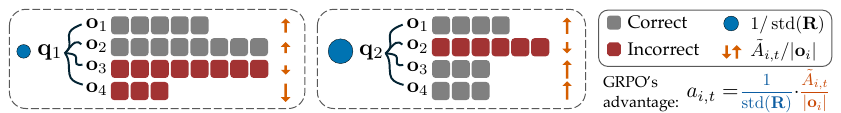
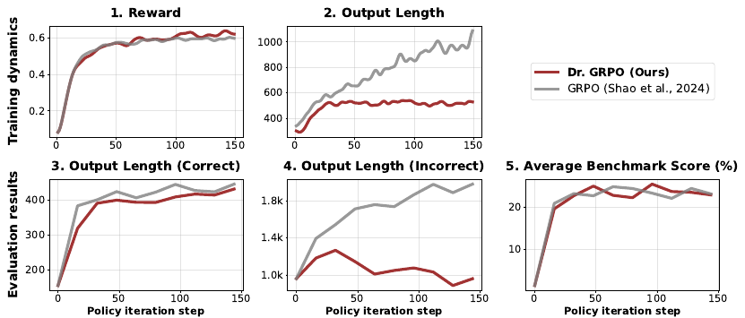

# 25. Understanding R1-Zero-Like Training: A Critical Perspective

> **Authors**: Zichen Liu et al. (Sea AI Lab, National University of Singapore, Singapore Management University)
> **Venue**: COLM 2025
> **Link**: https://arxiv.org/abs/2503.20783
> **목록 위치**: Part 5 — RL 방법론

---

## 1. 핵심 연구 질문과 풀고자 하는 문제
- **R1-Zero식 학습(base model에 바로 RL)에서 성능 향상과 응답 길이 증가는 정말 RL이 만든 것인가, 아니면 base model의 사전 특성과 GRPO의 최적화 bias 때문인가?**
- 배경: DeepSeek-R1-Zero 이후 "RL 중 응답이 길어지고 Aha moment(self-reflection)가 생긴다"는 현상이 RL의 효과로 해석되어 왔음.
- 기존 연구의 한계:
  - 재현 연구 대부분이 Qwen2.5 base를 썼지만, 이 모델들의 사전 능력과 template 효과를 따로 떼어 보지 않았음.
  - GRPO objective와 오픈소스 PPO 구현에 들어 있는 정규화 항이 최적화에 bias를 만든다는 점을 검토하지 않았음.

## 2. 핵심 가설
- 저자가 명시한 가설:
  - Qwen2.5-Math는 질문-답 이어붙인 텍스트로 pretrain되었을 수 있다(그래서 template 없이도 잘 답함, Sec 2.2).
  - domain-specific(math) pretraining은 RL의 상한을 높인다(Sec 3.4).
- (본문에서 도출) GRPO에서 응답 길이 |o_i|로 나누는 항과 그룹 std로 나누는 항은 각각 length bias와 difficulty bias를 만든다. 특히 오답의 길이를 계속 늘리는 방향으로 학습시킨다. 따라서 "길이 증가 = 추론 능력 출현"이라는 해석 일부는 최적화 bias가 섞인 결과다.
- (본문에서 도출) DeepSeek-V3-Base를 포함한 base model은 RL 전에 이미 self-reflection을 보인다.

## 3. 제안하는 해결책
- GRPO의 두 bias:
  - **Response-level length bias** (1/|o_i|): 정답(A>0)이면 짧은 응답의 update가 더 커지고, 오답(A<0)이면 긴 응답의 penalty가 작아짐. 그래서 오답일수록 길어지는 쪽으로 학습됨.
  - **Question-level difficulty bias** (1/std): reward std가 작은 문제(너무 쉽거나 너무 어려움)에 큰 가중치가 걸림.



> **Figure 4**: GRPO의 bias 도식. GRPO의 effective advantage a_i,t는 unbiased advantage Ã_i,t = R(q,o_i) - mean(R)을 std(R)와 |o_i|로 재가중한 것과 같음. 파란 원의 크기(1/std)와 주황 화살표의 길이(Ã/|o_i|)가 질문·응답별로 다른 가중치를 나타내며, 위쪽 화살표는 양의 advantage.

- Dr. GRPO (GRPO Done Right): 두 정규화 항을 제거.
```
GRPO:     (1/G) Σ_i (1/|o_i|) Σ_t min(r_it * A_it, clip(r_it, 1-ε, 1+ε) * A_it)
          A_it = (R(q,o_i) - mean(R)) / std(R)
Dr. GRPO: (1/G) Σ_i Σ_t min(r_it * A_it, clip(r_it, 1-ε, 1+ε) * A_it)
          A_it = R(q,o_i) - mean(R)
```
- 구현 수정: masked_mean에서 `mask.sum(axis=dim)` 대신 상수(예: 생성 budget MAX_TOKENS)로 나눔(Listing 1).
- trl, OpenRLHF, verl, SimpleRL-Zero, Open-Reasoner-Zero의 PPO loss 구현에도 length normalization이 들어 있어 같은 bias가 있다고 지적(Table 2).
- 이론 근거(Appendix A): Monte Carlo policy gradient에 baseline mean(R)을 쓰면 std와 |o|는 objective에 나타나지 않음. Dr. GRPO의 advantage는 RLOO advantage에 G/(G-1)을 곱한 것과 같음.
- Minimalist recipe(Oat-Zero): Qwen2.5-Math-7B + Dr. GRPO + MATH level 3-5 + Qwen-Math template. 8x A100에서 27시간.
- KL은 β = 0으로 뺌(rule-based verifier라 distribution shift 걱정이 없다는 이유).

## 4. 가설 검증 방법
- Base model 분석(Sec 2): Qwen2.5-Math-1.5B/7B, Qwen2.5-7B, Llama-3.1-8B, DeepSeek-Math-7B, DeepSeek-V3-Base-685B에 MATH train 500문제를 넣음.
  - template(R1 / Qwen-Math / 없음)별 답변율(GPT-4o-mini로 판정), temperature별 pass@8, self-reflection keyword 수를 측정(Figure 3).
  - Qwen2.5-Math의 template별 benchmark 점수 비교(Table 1, greedy, 3000 token).
- Dr. GRPO vs GRPO(Sec 3.2): Qwen2.5-1.5B base, R1 template, MATH train, Math-Verify reward(정답 1 / 오답 0).
  - 지표: training reward, 출력 길이, 평가 시 정답/오답 응답 길이, 5개 benchmark 평균(Figure 5).
- Ablation(Appendix C): GRPO에서 length norm만 제거 / std norm만 제거 / 둘 다 제거(Figure 8). 3 seed 반복(Figure 9).
- Template x question set(Sec 3.3): ORZ-57K, MATH-12K, GSM-8K, ASDiv-2K (Figure 6).
- Llama-3.2-3B와 FineMath/NuminaQA 추가 pretrain 버전 비교(Sec 3.4, Figure 7, Table 4).
- 하이퍼파라미터(Table 6): 최대 응답 3000 token, temperature 1.0, 질문당 8 응답, AdamW(0.9, 0.95), lr 1e-6 constant, KL 0, clip 0.2.
- 가설을 지지하는 결과:
  - Qwen2.5-Math-7B는 template 없이 평균 38.2로, 4-shot(23.8)과 Qwen template(26.5)보다 높음. R1 template에서는 0.0(Table 1).
  - DeepSeek-V3-Base도 RL 전에 self-reflection을 상당량 보임(Figure 3 오른쪽). R1-Zero에서 self-reflection이 늘어나도 정확도와 양의 상관은 없었음(Sec 2.3, Appendix F).
  - GRPO는 reward 증가가 둔화된 뒤에도 응답 길이가 계속 늘지만, Dr. GRPO는 그렇지 않음. 특히 평가 시 오답 응답의 길이가 크게 줄어듦(Figure 5).
  - Length norm을 제거한 두 변형(Dr. GRPO, w/o Len Norm)만 응답이 짧아짐. 어느 bias를 빼든 vanilla GRPO보다 reward와 정확도가 높음(Figure 8).
  - Template이 맞지 않을 때(R1 template + Qwen2.5-Math-1.5B)는 question set 범위가 중요함. Qwen-Math template에서는 GSM-8K만으로 학습해도 가장 높은 최종 성능(Figure 6).
  - Llama-3.2-3B에서 GRPO는 정확도와 길이가 함께 오르는 "double-increase"를 보였지만, Dr. GRPO에서는 길이가 늘지 않음(Figure 7).



> **Figure 5**: Dr. GRPO와 GRPO의 training dynamics(위: reward, output length)와 evaluation 결과(아래: 정답/오답 응답 길이, 평균 benchmark 점수) 비교. 정확도는 비슷하지만 GRPO는 특히 오답 응답의 길이가 계속 늘어남.

- 주의할 점:
  - Dr. GRPO vs GRPO의 정확도 비교는 곡선(Figure 5, 8, 9)으로만 제시되고 최종 수치 표는 없음. 본문은 "성능 유지 + token 효율 향상"이라 하고 Appendix C는 "정확도도 유의하게 향상"이라고 해서 주장 강도가 다름.
  - Oat-Zero-7B의 SOTA 주장은 template, 데이터, 알고리즘을 동시에 바꾼 recipe 결과라서 Dr. GRPO 단독 기여가 분리되지 않음. 모든 baseline은 3k 생성 budget으로 제한해 비교함(8k에서 R1-Distill-Qwen-7B는 평균 54.7로 더 높음).
  - "Qwen2.5가 QA concat 텍스트로 pretrain되었다"는 것은 간접 증거에서 나온 추측(hypothesize)임.

## 5. 개선한 메트릭
| Metric | Benchmark | Baseline | Proposed | 변화 |
|---|---|---|---|---|
| Accuracy (%) | AIME 2024 (Table 4) | Qwen2.5-Math-7B* (no template) 0.2 / SimpleRL-Zero-7B 26.7 | Oat-Zero-7B 43.3 | +43.1 / +16.6 |
| 5-benchmark 평균 (%) | AIME24, AMC, MATH500, Minerva, OlympiadBench (Table 4) | PRIME-Zero-7B 48.0 | Oat-Zero-7B 51.4 | +3.4 |
| 5-benchmark 평균 (%) | 동일 (Table 4) | OpenReasoner-Zero-7B @3k 43.0 | Oat-Zero-7B 51.4 | +8.4 |
| 5-benchmark 평균 (%) | 동일 (Table 4) | Qwen2.5-Math-1.5B* 33.1 | Oat-Zero-1.5B 42.1 | +9.0 |
| 5-benchmark 평균 (%) | 동일 (Table 4) | Llama-3.2-3B-NuminaQA 0.14 | + Dr. GRPO (Oat-Zero-3B) 20.7 | +20.56 |
| 5-benchmark 평균 (%) | 동일 (Table 4) | Llama-3.2-3B 3.3 | + Dr. GRPO 6.8 | +3.5 |
| 오답 응답 길이 | 평가 benchmark (Figure 5) | GRPO | Dr. GRPO | 크게 감소 (정확한 수치는 논문에 명시되지 않음) |
| 정확도 / 출력 길이 | 평가 benchmark, 3 seed (Figure 9) | GRPO | Dr. GRPO | 둘 다 개선 (수치는 논문에 명시되지 않음) |

## 6. 한 줄 요약
> R1-Zero식 RL의 성능 향상 일부는 base model의 사전 능력과 template 때문이고, 응답 길이 증가 일부는 GRPO의 length/std 정규화 bias 때문이다. 두 항을 지운 Dr. GRPO는 성능을 유지하면서 오답의 불필요한 길이 증가를 막는다.
