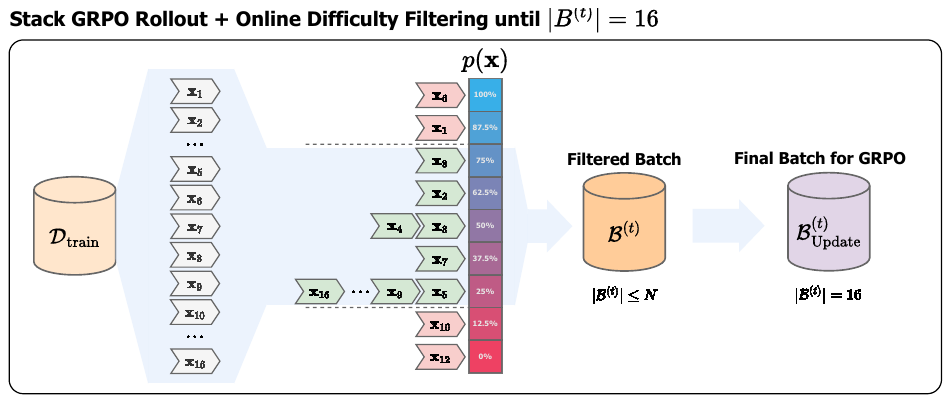
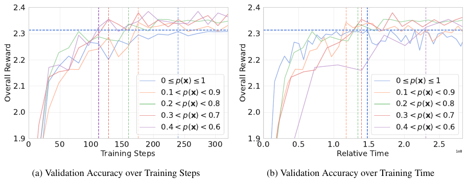

# 26. Online Difficulty Filtering for Reasoning Oriented Reinforcement Learning

> **Authors**: Sanghwan Bae, Jiwoo Hong et al. (NAVER Cloud, KAIST AI, TwelveLabs)
> **Venue**: EACL 2026 Main (arXiv 코멘트 기준, PDF는 v2 2026-01)
> **Link**: https://arxiv.org/abs/2504.03380
> **목록 위치**: Part 5 — RL 방법론

---

## 1. 핵심 연구 질문과 풀고자 하는 문제
- **RLVR(GRPO)에서 학습 중인 policy 기준으로 어떤 난이도의 prompt를 골라야 학습이 가장 효율적이며, 그 이유를 이론적으로 설명할 수 있는가?**
- 배경: binary verifiable reward는 sparse함. 그룹 전원이 정답이거나 전원이 오답이면 GRPO advantage가 0이 되어 학습 신호가 없음.
- 기존 방법의 한계:
  - offline curation이나 scheduling은 외부 모델 또는 초기 모델로 난이도를 미리 정함. 학습 중인 policy의 실제 능력과 어긋남.
  - online filtering(예: PRIME)은 경험적 heuristic일 뿐, 왜 효과가 있는지에 대한 이론적 근거가 부족했음.
  - 동적으로 걸러내면 effective batch size가 흔들려 학습이 불안정해짐.

## 2. 핵심 가설
- 명시적 주장(Proposition 3.1): prompt x의 learnability, 즉 초기 policy와 KL-regularized 최적 policy 사이의 reverse KL은 pass rate p(x)의 Bernoulli variance로 하한이 잡힌다. 이 하한은 p(x) = 0.5에서 최대다.
- 따라서 중간 난이도(pass rate가 0.5 근처)인 prompt만 남기는 **balanced filtering**이 학습 효율과 최종 성능을 최대화한다.
- 대조 가설: 쉬운 쪽이나 어려운 쪽 한쪽만 거르는 skewed filtering은 덜 효과적이다.

## 3. 제안하는 해결책
- 이론: soft-RL 최적 policy π*(y|x) = (1/Z(x)) * π_init(y|x) * exp(r(x,y)/β)를 쓰면,
```
D_KL(π_init(.|x) || π*(.|x)) >= p(x) * (1 - p(x)) / (2 β^2)     (Prop 3.1)
p(x) ∈ {0, 1}  이면  D_KL = 0   (학습 신호 없음, Remark 3.2)
```
- 일반화(Sec 6.3): reverse KL은 centered reward의 cumulant generating function과 같음.
```
D_KL = log E[ exp((r - μ)/β) ] = K_{r-μ}(1/β)          (Prop 6.1)
Gaussian reward:  D_KL = σ^2 / (2 β^2)                    (Cor 6.2, 정확히 variance에 비례)
Multinomial reward: D_KL >= σ^2 / (2 β^2) - O(1/β^3)      (Cor 6.3)
```
- 방법(Algorithm 1): prompt마다 G개 rollout을 생성해 pass rate p(x)를 구함. T_low <= p(x) <= T_high인 prompt만 batch에 쌓고, 고정 batch size N이 찰 때까지 반복.
  - asynchronous rollout으로 걸러진 prompt 자리를 병렬 rollout으로 채움(Appendix B).
  - visit count로 정렬해 같은 prompt가 반복 선택되는 것을 줄임.
  - 이렇게 모은 batch로 표준 GRPO advantage를 계산해 update.



> **Figure 1**: GRPO 효과를 극대화하기 위한 balanced online difficulty filtering. prompt x마다 G개 rollout의 평균 정확도로 pass rate p(x)를 구하고 threshold(이 예에서는 0.25 <= p(x) <= 0.75)로 거름. 걸러진 prompt를 train batch가 고정 크기 N이 될 때까지 쌓음(asynchronous 구현은 Appendix B).

- 전략: balanced(0.5 기준 대칭 threshold, 예: 0.2/0.8)와 skewed(한쪽만, 예: T_low = 0, T_high = 0.6).
- DAPO dynamic sampling과의 관계: DAPO는 p(x) ∈ {0, 1}만 제거함(이 논문의 (0,1) 설정에 해당). 이 논문은 더 좁은 대역을 쓰고, 그 근거를 variance 하한으로 제시함.

## 4. 가설 검증 방법
- 모델: Qwen2.5-3B base. 1,107개 R1 distill 풀이로 cold-start SFT(lr 5e-6, 5 epoch). 확장 실험으로 Qwen2.5-7B.
- RL: GRPO, step당 16 prompt x 16 rollout, 256 step(성능은 약 128 step에서 포화), 8x A100. 데이터는 Eurus-2-RL-Data(PRIME)의 math subset.
  - reward = format(0~1) + language(0~1) + accuracy(0/1), 합계 0~3.
- 평가: MATH500, AIME 2024(30문제), AMC 2023(40문제), MinervaMath, OlympiadBench의 pass@1. temperature 0.6, top-p 0.95, 최대 8,192 token.
- 비교 대상:
  - Plain GRPO.
  - Skewed filtering 6종.
  - Balanced (T_low, T_high) ∈ {(0,1), (0.1,0.9), (0.2,0.8), (0.3,0.7), (0.4,0.6)}.
  - Offline curation과 offline schedule(난이도 proxy는 Qwen2.5-7B-Instruct 또는 SFT 모델).
- 추가 분석:
  - 각 시점 모델이 본 batch 난이도(1 - p(x))의 변화(Figure 2).
  - step 및 wall-clock 기준 validation reward(Figure 3).
  - MATH500 level별 정확도(Table 3).
- 가설을 지지하는 결과:
  - Balanced 5종 모두 Plain(평균 26.3)보다 높음(27.3~30.1). threshold를 좁힐수록 대체로 상승(Table 1).
  - Skewed 6종은 모두 Plain보다 낮음(23.8~25.9).
  - Offline 방법(26.3~28.4)보다 balanced online이 높음.
  - 7B에서도 0.3 < p(x) < 0.7이 평균 41.8로 Plain 39.6보다 높음(Table 2).
  - 0.4 < p(x) < 0.6은 Plain의 최고 validation reward를 50%보다 적은 step으로 넘음(Figure 3a). wall-clock으로도 더 빨리 넘지만, 너무 좁은 대역은 batch를 채우는 rollout이 많이 필요해 총 학습 시간이 길어짐(Figure 3b).
  - 학습 중인 모델 기준 batch 난이도는 약 0.5로 유지됨. 외부 proxy가 본 난이도는 초기 모델보다 낮고 최종 모델보다 높음(Figure 2).



> **Figure 3**: training step(a)과 relative time(b)에 따른 validation reward. 가로 점선은 plain GRPO의 최고 reward, 세로 점선은 각 threshold의 GRPO가 그 값을 처음 넘는 시점.

- 주의할 점:
  - 초록의 "+12%"와 7B의 "+4.5% 평균"은 SFT checkpoint 대비 수치임(AMC 34.9→47.0, 평균 37.3→41.8). Plain GRPO 대비로는 AMC +4.8, 평균 +2.2. 3B의 "+4.2% 평균"은 Table 1의 어떤 행 쌍으로도 재현되지 않음(Plain 대비 최고 차이는 +3.8).
  - Table 1의 Balanced (0,1) 행은 평균이 27.3으로 적혀 있으나, 다섯 benchmark 값(60.8, 3.3, 31.3, 18.0, 27.3)의 산술평균은 28.1임.
  - 단일 seed이고 분산이 보고되지 않음. AIME 30문제에서 3.3%p는 1문제 차이라 AIME 증감은 잡음이 큼.
  - 이론은 binary accuracy reward(Bernoulli)를 가정하지만, 실제 학습 reward는 format·language를 더한 0~3 값임. 또 bound가 보장하는 것은 "π_init과 π* 사이의 거리"이지 GRPO 한 step의 실제 policy improvement는 아님. 초록의 "expected policy improvement is lower-bounded"는 증명보다 강한 표현.

## 5. 개선한 메트릭
| Metric | Benchmark | Baseline | Proposed | 변화 |
|---|---|---|---|---|
| pass@1 평균 (%) | 5개 math (Table 1, 3B) | Plain GRPO 26.3 | Balanced 0.3<p<0.7: 30.1 | +3.8 |
| pass@1 (%) | AIME (Table 1, 3B) | Plain GRPO 3.3 | Balanced 0.1<p<0.9: 13.3 | +10.0 |
| pass@1 (%) | MATH500 (Table 1, 3B) | Plain GRPO 57.2 | Balanced 0.3<p<0.7: 64.6 | +7.4 |
| pass@1 평균 (%) | 5개 math (Table 1, 3B) | 최고 offline(Curation, External) 28.4 | Balanced 0.3<p<0.7: 30.1 | +1.7 |
| pass@1 평균 (%) | 5개 math (Table 2, 7B) | Plain GRPO 39.6 | Balanced 0.3<p<0.7: 41.8 | +2.2 |
| pass@1 (%) | AMC (Table 2, 7B) | Plain GRPO 42.2 (SFT 34.9) | 47.0 | +4.8 (SFT 대비 +12.1) |
| pass@1 (%) | AIME (Table 2, 7B) | Plain GRPO 12.3 | 15.0 | +2.7 |
| Accuracy (%) | MATH500 Level 4 (Table 3) | Plain 47.66 | 0.3<p<0.7: 55.47 | +7.81 |
| Steps to beat Plain max | Validation reward (Figure 3a) | Plain GRPO | 0.4<p<0.6 | Plain step 수의 50% 미만 |
| 이론 bound | — (Prop 3.1) | — | D_KL(π_init‖π*) >= p(1-p)/(2β^2) | p = 0.5에서 최대, p ∈ {0,1}에서 0 |

## 6. 한 줄 요약
> 학습 중인 policy 기준 pass rate가 중간(예: 0.3~0.7)인 prompt만 online으로 골라 고정 크기 batch를 채우면, reward variance로 잡히는 learnability 하한이 최대가 되어 GRPO가 더 적은 step으로 더 높은 성능에 도달한다.
