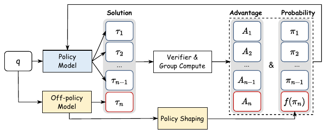
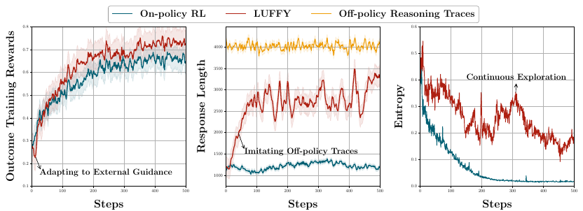

# 27. Learning to Reason under Off-Policy Guidance

> **Authors**: Jianhao Yan, Yafu Li et al. (Shanghai AI Laboratory, Westlake University, Nanjing University, CUHK)
> **Venue**: arXiv, 2025 (v5 PDF에 "Preprint. Under review" 표기)
> **Link**: https://arxiv.org/abs/2504.14945
> **목록 위치**: Part 5 — RL 방법론

---

## 1. 핵심 연구 질문과 풀고자 하는 문제
- **on-policy RLVR은 모델이 스스로 만든 출력에서만 배우는데, 더 강한 모델의 off-policy reasoning trace를 섞어 넣으면 초기 능력의 경계를 넘어서는 추론을 학습시킬 수 있는가?**
- 배경:
  - GRPO 같은 RLVR은 on-policy라서 base model이 이미 가진 행동을 증폭할 뿐이라는 지적이 있음(Echo Chamber, "Does RL incentivize..." 등).
  - 약한 모델(Llama-3.2 등)은 RL에서 빨리 정체됨.
- 기존 방법의 한계:
  - SFT(distillation)는 teacher trace를 피상적이고 경직되게 모방함. 응답이 지나치게 길어지고 OOD 성능이 떨어짐.
  - SFT → RL 2단계나 RL + SFT loss는 계산 비용이 크고, 모방과 탐색 사이의 균형을 맞추지 못함.
  - off-policy trace를 그냥 섞으면 entropy가 빠르게 붕괴함.

## 2. 핵심 가설
- (본문에서 도출) off-policy trace(DeepSeek-R1 풀이)를 GRPO 그룹 안에 on-policy rollout과 함께 넣으면 다음과 같이 동작한다.
  - 모델이 틀릴 때는 정답인 off-policy trace가 높은 advantage를 받아 모방 신호가 됨.
  - 모델이 맞히기 시작하면 on-policy rollout이 주도해 자체 탐색이 이어짐.
  - 결과적으로 모방과 탐색이 자동으로 균형을 이룸.
- 단순 mixing은 "모델이 이미 그럴듯하다고 보는 off-policy token"만 강화하고 낮은 확률의 핵심 token을 무시해서 entropy collapse를 일으킨다. 낮은 확률 token의 gradient를 키우는 policy shaping으로 이를 막을 수 있다.
- 이 방식은 on-policy RL이 reward 0으로 실패하는 약한 모델과 어려운 데이터에서도 학습을 가능하게 한다.

## 3. 제안하는 해결책
- **Mixed-Policy GRPO**: 그룹 = on-policy rollout N_on개 + off-policy trace N_off개. advantage는 합친 그룹으로 정규화.
```
A_i = (R(τ_i) - mean(G_on ∪ G_off)) / std(G_on ∪ G_off)
J_Mixed = (1/Z) [ Σ_j Σ_t CLIP(r̂_jt(θ,φ), A_j, ε)   # off-policy, r̂ = π_θ / π_φ
                + Σ_i Σ_t CLIP(r_it(θ),   A_i, ε) ]  # on-policy,  r  = π_θ / π_θold
Z = Σ_j |τ_j| + Σ_i |τ_i|
```
  - 실제 구현에서는 π_φ = 1로 둠(teacher 확률을 다시 계산하지 않아 tokenizer 불일치 문제가 없음). off-policy 쪽은 clip을 쓰지 않음.
  - Theorem 1: importance weight가 [w_low, w_high]로 bounded일 때 min E||∇J||^2 = O(1/√K) 수렴.
- **Policy shaping (regularized importance sampling)**: off-policy 항의 r̂를 f(r̂)로 바꿈.
```
J_SHAPING = (1/Z) [ Σ_j Σ_t f(r̂_jt) * A_j + Σ_i Σ_t CLIP(r_it, A_i, ε) ]
f(x) = x / (x + γ),  γ = 0.1
```
  - 원래 logit gradient 크기는 π(1-π)로 제한되어 π→0에서 사라짐. f'를 곱하면 낮은 확률 token에 더 큰 가중치가 걸림(Figure 2).
- **NoClip**: on-policy clip도 제거함(Appendix E.1, LUFFY가 on-policy RL보다 clip이 더 자주 걸림, Figure 8).
- 공통 설정: Dr. GRPO처럼 length·std 정규화를 제거, KL β = 0, entropy loss 0.01, prompt당 rollout 8개(LUFFY는 off 1 + on 7).



> **Figure 1**: LUFFY 개요. off-policy reasoning trace를 on-policy rollout과 합쳐 RL에 통합하고, policy shaping으로 낮은 확률이지만 중요한 action을 강조해 imitation과 exploration의 균형을 맞춤.


## 4. 가설 검증 방법
- 데이터: OpenR1-Math-220k default subset 94k에서 8192 token 초과와 Math-Verify 오답을 제거한 45k prompt + R1 trace.
- 모델: Qwen2.5-Math-7B(기본, rope theta 40000, 16k context로 확장), Qwen2.5-Math-1.5B, Qwen2.5-7B-Instruct, Llama-3.1-8B.
- 학습: lr 1e-6, 500 step, 8x A100, verl + vLLM. rollout batch 128, update batch 64, rollout temperature 1.0.
- 평가:
  - In-distribution: AIME24/25, AMC는 avg@32. MATH500, Minerva, OlympiadBench는 pass@1. temperature 0.6.
  - OOD: ARC-c, GPQA-diamond, MMLU-Pro.
- Baseline:
  - 기존 RLVR: SimpleRL-Zero, OpenReasoner-Zero, PRIME-Zero, Oat-Zero.
  - 같은 데이터로 재현한 On-Policy RL(Dr. GRPO).
  - off-policy 대안: SFT, RL w/ SFT Loss, SFT+RL.
- Ablation:
  - Mixed-Policy → +Shaping → +NoClip, 그리고 On-Policy에 Shaping / NoClip만 넣은 경우(Table 4).
  - γ sweep {0.05, 0.1, 0.2, 0.3, 0.5}(Figure 9).
- 가설을 지지하는 결과:
  - 6개 math 평균: LUFFY 50.1, On-Policy RL 45.5, 기존 최고 RLVR(Oat-Zero) 43.7, SFT+RL 48.2(Table 1).
  - Mixed-Policy만 쓰면 44.4로 On-Policy(45.5)보다 낮음. +Shaping 47.8, +NoClip 50.1.
  - On-Policy에 Shaping을 넣으면 42.0, NoClip을 넣으면 44.9로 오히려 하락. 두 기법은 off-policy 신호가 있을 때만 효과가 있음(Table 4).
  - On-Policy RL은 약 200 step 후 entropy가 0 근처로 떨어지지만, LUFFY는 높은 entropy를 유지(Figure 5).
  - Mixed-Policy는 초반에 빠르게 오르다 On-Policy 수준에서 정체하고, LUFFY는 계속 상승(Figure 6).
  - Llama-3.1-8B: Hard set(R1 풀이 4k token 이내, 25.4k prompt)에서 On-Policy는 training reward가 0으로 붕괴하지만 LUFFY는 상승(Figure 4).
  - SFT+RL 대비 GPU 시간의 59%만 사용(77x8 vs 130x8 GPU hours, Table 2).



> **Figure 5**: on-policy RL 대비 LUFFY의 training dynamics. 왼쪽: outcome training reward, 가운데: generation length, 오른쪽: generation entropy. LUFFY는 off-policy trace를 모방하며 길이가 늘고 entropy를 높게 유지함.

- 주의할 점:
  - OOD "+6.2"는 OpenReasoner-Zero(51.6) 대비 수치임. 같은 데이터로 재현한 On-Policy RL(57.3) 대비로는 +0.5에 불과하고, ARC-c(80.5 vs 82.3)와 GPQA(39.9 vs 40.4)는 오히려 낮음.
  - In-distribution "+6.4"도 다른 데이터로 학습한 기존 방법(Oat-Zero) 대비임. 동일 조건 On-Policy 대비는 +4.6. Minerva는 On-Policy(39.3)보다 낮은 37.5.
  - Llama-3.1-8B LUFFY(13.2)는 SFT·On-Policy보다는 높지만 Llama-3.1-8B-Instruct(17.1)보다 낮음(Table 3). 게다가 Llama 실험은 On-Policy가 학습 가능한 Easy set으로만 진행됨(Appendix C).
  - Theorem 1은 importance weight가 bounded·clipped라고 가정하지만, 실제 구현은 π_φ = 1에 clip 제거, f(x) = x/(x+γ) 변환을 써서 가정과 그대로 맞지 않음.
  - 비교 대상들은 R1 trace라는 더 강한 teacher 신호를 쓰지 않으므로(SFT 계열 제외) 단순 비교는 불공정할 수 있음. seed 반복 여부는 논문에 명시되지 않음(Table 1에 p < 0.05 표기만 있음).

## 5. 개선한 메트릭
| Metric | Benchmark | Baseline | Proposed | 변화 |
|---|---|---|---|---|
| 6개 math 평균 | AIME24/25, AMC, MATH500, Minerva, Olympiad (Table 1) | Oat-Zero 43.7 | LUFFY 50.1 | +6.4 |
| 6개 math 평균 | 동일 (Table 1) | On-Policy RL 45.5 | LUFFY 50.1 | +4.6 |
| 6개 math 평균 | 동일 (Table 1) | SFT+RL 48.2 | LUFFY 50.1 | +1.9 |
| avg@32 | AIME 2025 (Table 1) | On-Policy RL 15.3 | LUFFY 23.1 | +7.8 |
| OOD 평균 | ARC-c, GPQA*, MMLU-Pro (Table 1) | OpenReasoner-Zero 51.6 | LUFFY 57.8 | +6.2 |
| OOD 평균 | 동일 (Table 1) | On-Policy RL 57.3 / SFT+RL 44.8 | LUFFY 57.8 | +0.5 / +13.0 |
| OOD 평균 | 동일 (Table 1) | On-Policy RL 57.3 | LUFFY† (860 step) 61.8 | +4.5 |
| 6개 math 평균 | Qwen2.5-Math-1.5B (Table 3) | On-Policy 30.0 / SFT 31.9 | LUFFY 38.0 | +8.0 / +6.1 |
| 6개 math 평균 | Qwen2.5-7B-Instruct (Table 3) | On-Policy 35.2 | LUFFY 40.7 | +5.5 |
| 6개 math 평균 | Llama-3.1-8B (Table 3) | On-Policy 9.6 | LUFFY 13.2 | +3.6 |
| 6개 math 평균 | Ablation (Table 4) | Mixed-Policy 44.4 | +Shaping+NoClip 50.1 | +5.7 |
| GPU hours | 학습 비용 (Table 2) | SFT+RL 130x8 | LUFFY 77x8 | -41% |
| 이론 bound | — (Theorem 1) | — | min E‖∇J(θ_k)‖^2 = O(1/√K) | 수렴률 |

## 6. 한 줄 요약
> LUFFY는 GRPO 그룹에 teacher(R1)의 off-policy trace를 섞고, 낮은 확률 token의 gradient를 키우는 policy shaping으로 entropy collapse를 막는다. 이를 통해 SFT식 경직된 모방 없이 on-policy RL보다 높은 math 성능을 얻고, on-policy가 실패하는 어려운 데이터에서도 학습을 가능하게 한다.
