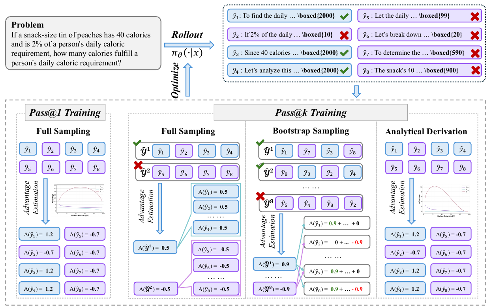
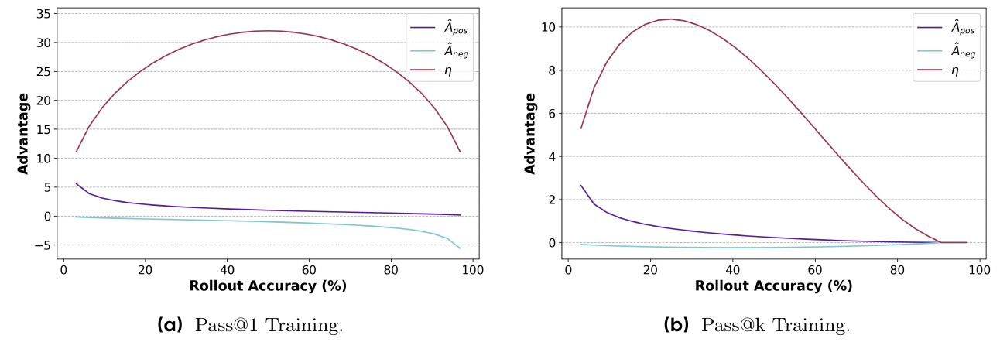
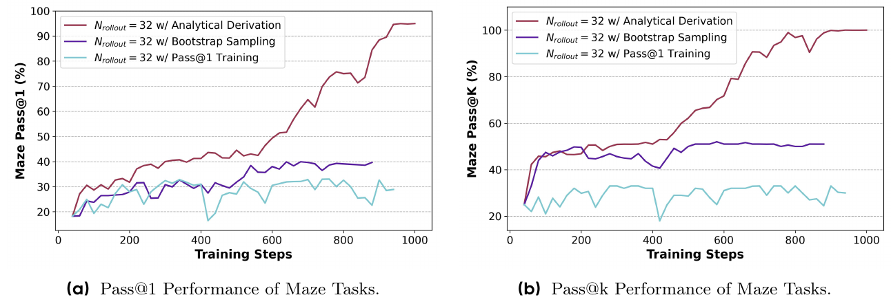

# 28. Pass@k Training for Adaptively Balancing Exploration and Exploitation of Large Reasoning Models

> **Authors**: Zhipeng Chen et al. (Renmin University of China, ByteDance Seed)
> **Venue**: arXiv, 2025
> **Link**: https://arxiv.org/abs/2508.10751
> **목록 위치**: Part 5 — RL 방법론

---

## 1. 핵심 연구 질문과 풀고자 하는 문제
- **RLVR의 reward를 Pass@1 대신 Pass@k로 바꾸면 exploration이 살아나서, 결국 Pass@1(exploitation)까지 더 높일 수 있는가?**
- 배경: GRPO/DAPO류 RLVR은 사실상 Pass@1을 reward로 최적화한다(= "Pass@1 Training"). 정답을 못 낸 시도는 아이디어가 맞더라도 reward 0을 받으므로 탐색 비용이 커지고, policy는 보수적인 행동만 반복하다 local optimum에 수렴한다.
- 기존 대응의 한계
  - Entropy regularization: 계수가 크면 collapse, 작으면 효과가 미미해 하이퍼파라미터에 민감함 (Figure 6b)
  - Pass@k는 평가 지표로만 쓰였고, RLVR의 exploration 능력과의 연결은 거의 다뤄지지 않음 (Walder & Karkhanis의 PKPO는 vanilla policy gradient에만 적용)

## 2. 핵심 가설
- (본문에서 도출) k개 중 하나만 맞으면 되는 Pass@k objective에서는 서로 다른 해를 내는 것이 최적이므로, 이를 reward로 쓰면 policy가 스스로 다양한 답을 생성하도록 학습된다.
- (본문에서 도출) exploration과 exploitation은 서로 충돌하지 않는다. Pass@k로 탐색 능력을 키운 뒤 Pass@1로 이어 학습하면 Pass@1이 Pass@1-only 학습보다 높아진다.
- 저자가 Section 4.2.1에서 명시한 가설: advantage 절댓값 합 η의 peak가 더 어려운 문제(낮은 정답률) 쪽으로 갈수록 Pass@k 최적화가 더 잘 된다.

## 3. 제안하는 해결책
- 세 단계로 진화하는 Pass@k Training (backbone 알고리즘은 clip-higher + token-level loss만 남긴 DAPO)
  1. **Full Sampling**: N_rollout개 응답을 k개씩 묶어 group을 만들고, group reward = max(그룹 내 reward). group 단위 advantage를 구성원 응답에 그대로 나눠줌
  2. **Bootstrap Sampling**: N_rollout개 중 k개를 무작위 복원 추출해 N_group(= N_rollout)개 group 구성. 응답의 advantage는 그 응답이 속한 group advantage의 합 → rollout 수를 늘리지 않고 group 수를 확보
  3. **Analytical Derivation**: 가능한 모든 C(N_rollout, k)개 조합에 대한 기댓값을 닫힌 형태로 계산해 sampling variance 제거
- Analytical advantage (N = N_rollout, N_neg = 오답 수, C(a,b) = 조합)
```
R_group_mean = 1 - C(N_neg, k) / C(N, k)
sigma_group  = sqrt( R_group_mean * (1 - R_group_mean) )

A_pos = (1 - R_group_mean) / sigma_group
A_neg = ( 1 - R_group_mean - C(N_neg - 1, k - 1) / C(N - 1, k - 1) ) / sigma_group
```
  - advantage는 N, N_pos, N_neg, k만으로 결정되므로 rollout 직후 바로 계산 가능 (Algorithm 3)
  - 직관: 오답이라도 다른 정답과 같은 group에 묶일 확률이 높으면 페널티가 줄어든다 → 오답에 대한 tolerance



> **Figure 2**: Pass@1 Training과 Pass@k Training의 overview 비교. 두 방식의 핵심 차이는 reward 계산과 advantage estimation이며, Pass@k Training은 full sampling → bootstrap sampling → analytical derivation 순으로 점진적으로 개선된다.

- 기존 Pass@1(GRPO) 대비 차이 (Figure 9)
  - η = N_pos × |A_pos| + N_neg × |A_neg| 의 argmax가 Pass@1은 정답률 50%, Pass@k는 정답률 25% → 어려운 문제에 최적화 강도 집중
  - Pass@k의 η는 쉬운 문제(정답률 60% 이상)에서 0으로 감소 → 이미 푼 문제에 대한 과적합 방지



> **Figure 9**: N_rollout = 32일 때 Pass@1 Training(a)과 Pass@k Training(b)의 advantage 곡선(A_pos, A_neg, η). Pass@k는 η의 peak가 낮은 rollout accuracy 쪽으로 이동하고 쉬운 문제에서는 0으로 떨어진다.

- Implicit reward design으로 확장 (Section 4.2)
  - Exceeding Pass@k: A' = f(N_pos) × A, f(N_pos) = 4 / (10 × log(N_pos + 0.5)) 로 peak를 더 앞당김
  - Combination: A = (N_pos/N) × A_Pass@k + (1 - N_pos/N) × A_Pass@1
  - Adaptive (entropy 기반): 문제별 평균 entropy 상위 50%는 Pass@1 advantage, 나머지는 Pass@k advantage

## 4. 가설 검증 방법
- 모델: Qwen2.5-7B/32B-Instruct (주 실험), LLaMA3.2-3B/3.1-8B-Instruct, DeepSeek-R1-Distill-Qwen-1.5B/7B, Seed1.5-VL-Small (내부 MoE)
- 데이터: Maze(텍스트 미로, 9×9~15×15 학습, 7×7~21×21 테스트), Enigmata(36종 합성 퍼즐), AIME 2024/2025, OlymMATH, MathVision, MMMU, ARC-AGI 1, KORBench
- 설정: lr 1e-6, prompt batch 128, mini-batch 32, rollout 32, ε_low 0.2 / ε_high 0.28, KL·entropy 정규화 없음, R_pos=1 / R_neg=0. 평가는 temperature 1.0, top_p 0.95, Maze 32샘플 / 기타 8샘플 (Appendix A.2)
- Baseline: Pass@1 Training, Noise Rewards(오답 reward를 10/30/50% 뒤집기), Entropy Regularization(계수 0.001/0.003/0.005)
- 가설을 지지하는 결과
  - Pass@1 Training은 후반 정체, Pass@k Training은 Pass@k가 계속 오르고 Pass@1도 하락하지 않음 (Figure 3, 5)
  - 같은 rollout 32에서 bootstrap > full sampling, rollout 128 full sampling과 비슷한 성능을 1/4 비용으로 (Figure 4)
  - Noise Rewards는 뒤집는 비율이 높을수록 성능 악화 → 개선은 "오답에 positive reward를 주는 것" 자체 때문이 아님 (Figure 6a)
  - Pass@k Training은 오답의 answer diversity와 policy entropy를 높게 유지, Pass@1은 entropy가 낮게 수렴 (Figure 7)
  - Qwen2.5-7B Enigmata: P@k T. 후 P@1 T.를 이어 하면 Pass@1 30.8로 Claude-3.7-Sonnet(22.7), GPT-4o(14.2) 초과 (Table 2)
  - Maze 평균 Pass@1/Pass@k: P@1 T. 13.9/14.4 → P@k T. w/ AD 47.7/65.0 (Table 7)
  - k ∈ {4, 8, 16}에서 모두 학습 reward 상승, 단 k가 클수록 advantage가 작아 느려짐 → lr 4e-6로 보정 가능 (Figure 8)
  - Adaptive Training이 Pass@1/Pass@k 모두에서 Pass@1, Pass@k Training 단독을 상회 (Figure 13)



> **Figure 5**: Maze 과제에서 Pass@1 Training과 Analytical Derivation / Bootstrap Sampling 기반 Pass@k Training의 학습 곡선 (N_rollout = 32). (a) Pass@1, (b) Pass@k 모두 Analytical Derivation이 가장 높고 안정적으로 상승한다.

- 주장이 약하거나 불일치하는 부분
  - "Pass@1을 해치지 않는다"는 주장과 달리 Pass@k 단독 학습이 Pass@1을 낮춘 사례가 있음: Qwen2.5-32B Enigmata 45.2 → 44.5 (Table 2), Seed1.5-VL MathVision 55.3 → 53.9로 학습 전(54.6)보다도 낮음 (Table 3), LLaMA3.2-3B 수학 평균 5.1 → 5.0 (Table 5)
  - P@k T. + P@1 T.는 총 학습 step이 P@1 T. 단독보다 많을 가능성이 있으나 compute 맞춤 비교는 논문에 명시되지 않음
  - Maze에서 AD(47.7/65.0)와 BS(16.8/26.7)의 격차가 매우 큰데, Figure 5의 서술("AD가 더 안정적")에 비해 원인 분석이 부족함
  - Section 4의 implicit reward design 결과는 학습 곡선(Figure 10~13)으로만 제시되고 수치 표가 없으며, 저자도 "preliminary"라고 명시

## 5. 개선한 메트릭
| Metric | Benchmark | Baseline (P@1 T.) | Proposed | 변화 |
|---|---|---|---|---|
| Pass@1/Pass@k | Enigmata Overall, Qwen2.5-7B (Table 2) | 12.9/21.3 | P@k T. 17.9/29.8 | +5.0/+8.5 |
| Pass@1/Pass@k | Enigmata Overall, Qwen2.5-7B (Table 2) | 12.9/21.3 | P@k T. + P@1 T. 30.8/40.6 | +17.9/+19.3 |
| Pass@1/Pass@k | Enigmata Overall, Qwen2.5-32B (Table 2) | 45.2/56.0 | P@k T. + P@1 T. 46.8/57.9 | +1.6/+1.9 |
| Pass@1/Pass@k | KORBench (OOD), Qwen2.5-7B (Table 1) | 37.7/45.6 | 47.7/63.5 | +10.0/+17.9 |
| Pass@1/Pass@k | AIME 2025 (OOD), Qwen2.5-7B (Table 1) | 5.4/19.1 | 7.1/22.4 | +1.7/+3.3 |
| Pass@1/Pass@k | Maze 평균, Qwen2.5-7B (Table 7) | 13.9/14.4 | P@k T. w/ AD 47.7/65.0 | +33.8/+50.6 |
| Pass@1/Pass@k | 수학 평균, R1-Distill-Qwen-1.5B (Table 5) | 21.2/48.7 | (P@k T. + P@1 T.) × 2 25.7/54.7 | +4.5/+6.0 |
| Pass@1/Pass@k | 수학 평균, R1-Distill-Qwen-7B (Table 5) | 28.8/57.6 | P@k T. + P@1 T. 31.4/58.6 | +2.6/+1.0 |
| Pass@1/Pass@k | MathVision+MMMU 평균, Seed1.5-VL-Small (Table 3) | 63.7/78.9 | P@k T. + P@1 T. 64.4/80.7 | +0.7/+1.8 |

## 6. 한 줄 요약
> GRPO의 advantage를 Pass@k reward의 닫힌 해로 바꾸면 오답에 관대해지고 어려운 문제에 최적화가 집중되어 entropy가 유지되며, 이후 Pass@1 학습을 이어 붙이면 Pass@1 단독 RLVR보다 높은 성능에 도달한다.
