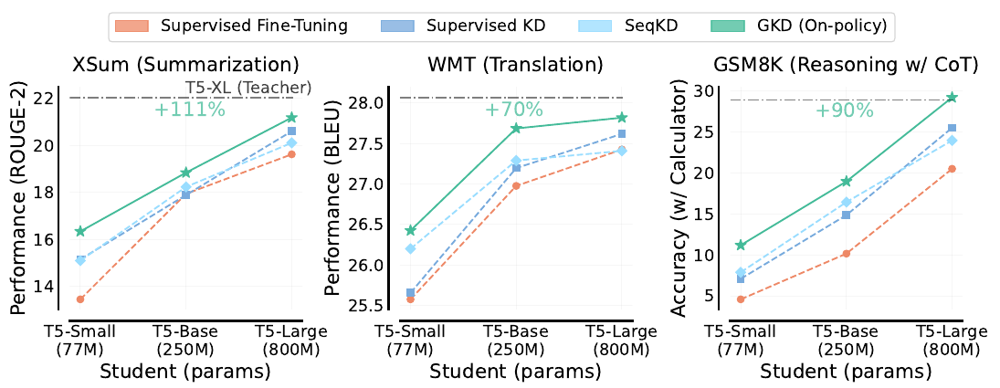
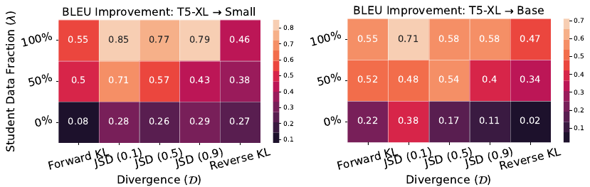

# 29. On-Policy Distillation of Language Models: Learning from Self-Generated Mistakes

> **Authors**: Rishabh Agarwal, Nino Vieillard et al. (Google DeepMind, Mila, University of Toronto)
> **Venue**: ICLR 2024
> **Link**: https://arxiv.org/abs/2306.13649
> **목록 위치**: Part 6 — On-policy distillation

---

## 1. 핵심 연구 질문과 풀고자 하는 문제
- **auto-regressive student를 distill할 때, 고정된 output sequence 대신 student가 직접 생성한 sequence에 teacher의 token-level 피드백을 주면 train-inference mismatch를 줄이고 성능을 높일 수 있는가?**
- 배경: 기존 KD는 (a) teacher가 생성한 고정 sequence로 SFT하는 SeqKD, (b) ground-truth sequence 위에서 teacher의 token 분포를 맞추는 Supervised KD가 주류다.
- 기존 한계
  - **Distribution mismatch (exposure bias)**: 학습 때 보는 prefix와 inference 때 student가 스스로 만드는 prefix가 달라, 초반 오류가 뒤로 누적된다.
  - **Forward KL 고정**: student capacity가 부족하면 teacher 분포 전체를 덮으려다 teacher가 거의 생성하지 않을 token에도 확률을 주게 되어 hallucination과 저품질 생성이 생길 수 있다 (Figure A.16).

## 2. 핵심 가설
- (본문에서 도출) KD는 interactive expert가 있는 **imitation learning**(DAgger류) 문제로 볼 수 있으므로, student의 on-policy sample 위에서 teacher logits를 따라가게 하면 mismatch가 줄어 성능이 오른다.
- (본문에서 도출) 최적 divergence(forward KL, reverse KL, JSD)는 task와 decoding temperature에 따라 다르며, mode-seeking divergence가 capacity가 작은 student에게 유리할 수 있다.
- (본문에서 도출) on-policy distillation은 student sample만 필요하므로 RL fine-tuning(RLHF/RLAIF)과 자연스럽게 결합된다.

## 3. 제안하는 해결책
- **Generalized KD (GKD)**: divergence D와 학습 sequence 출처(student data fraction λ)를 모두 선택 가능하게 일반화 (Algorithm 1).
  ```
  D(pT || pS)(y|x) = (1/L_y) * Σ_n D( pT(.|y<n, x) || pS(.|y<n, x) )

  L_GKD(θ) = (1-λ) E_{(x,y)~(X,Y)}[ D(pT||pS)(y|x) ]
           +    λ  E_{x~X, y~pS(.|x)}[ D(pT||pS)(y|x) ]
  ```
  - λ=1: on-policy (student 샘플만), λ=0: supervised, λ=0.5: mixed.
  - student 샘플링 과정으로는 **gradient를 흘리지 않는다** → policy gradient 없이 supervised처럼 안정적.
  - 특수한 경우: Supervised KD = (forward KL, λ=0), on-policy KD = (forward KL, λ=1). ImitKD, f-distill도 λ=0.5인 GKD의 사례.
- Divergence: forward KL, reverse KL, generalized JSD(β)
  ```
  JSD(β)(P||Q) = β KL(P || βP+(1-β)Q) + (1-β) KL(Q || βP+(1-β)Q)
  ```
  - β→0이면 forward KL처럼, β→1이면 reverse KL처럼 동작.
- **RL + on-policy GKD** (Eq. 5): reward 최대화와 teacher 쪽 distillation을 α로 섞음.
  ```
  E_x[ (1-α) E_{y~pS}[r(y)] - α E_{y~pS}[ D(pT||pS)(y|x) ] ]
  ```
  - 기존 RLHF가 초기 policy 쪽으로 regularize하는 것과 달리 teacher 쪽으로 regularize. RL과 결합 시 reverse KL 또는 JSD(0.9) 권장.
- MiniLLM과의 차이: MiniLLM은 sequence-level reverse KL을 policy gradient로 최적화해 안정화 trick이 많이 필요하지만, GKD는 sampling으로 backprop하지 않아 더 단순·안정적이고 divergence 선택이 자유롭다고 주장.

## 4. 가설 검증 방법
- 모델: teacher는 SFT된 T5-XL(약 3B), student는 T5-Small(77M), T5-Base(250M), T5-Large(800M). 모두 SFT 체크포인트에서 시작. GSM8K는 Flan-T5, instruction tuning은 FLAN T5-XL → FLAN T5-Base.
- Task: XSum 요약(ROUGE-2), WMT14 en-de 번역(BLEU), GSM8K 4-shot CoT + calculator(accuracy), FLAN2021 task-agnostic distillation → held-out MMLU, BBH.
- Baseline: Supervised FT, SeqKD, Supervised KD, ImitKD, f-distill.
- Ablation: divergence 5종(FKL, JSD 0.1/0.5/0.9, RKL) × λ 3종 (Figure 6, 7, A.12–A.14), on-policy 비율 sweep (Figure 8), data scaling (Figure 3), 다양성-품질 trade-off (Figure 4), RLAIF 결합 (Figure 5), self-distillation (Figure A.11).
- 결과
  - 크기별 student 평균으로, baseline KD 대비 개선폭이 요약 2.1배, 번역 1.7배, 추론 1.9배 (Figure 1).



> **Figure 1**: student 크기별 GKD와 KD 방법 비교. SFT된 T5-XL(약 3B)이 teacher(가로선)이고, Supervised KD·FT는 ground-truth sequence, SeqKD는 teacher 생성 sequence, on-policy GKD는 student 샘플로 학습한다. GKD는 WMT에서 JSD(0.1), 나머지에서 forward KL을 쓰며, XSum·GSM8K는 greedy, WMT는 beam search로 평가했다.

  - WMT (Figure 6, 3 seed 평균): T5-Small에서 on-policy+JSD(0.1)은 BLEU +0.85, supervised+FKL은 +0.08. T5-Base에서 on-policy+JSD(0.1) +0.71, supervised+RKL +0.02. 모든 divergence에서 on-policy(λ=1) 행이 supervised(λ=0)보다 높음.



> **Figure 6**: WMT en→de에서 student data fraction λ와 divergence를 바꿔 가며 측정한 GKD의 BLEU 개선폭(beam search, 3 seed 평균). teacher는 BLEU 28인 T5-XL이며, student 생성 샘플만 쓰는 설정(λ=100%)이 다른 변형보다 좋다. (왼쪽) T5-small student(초기 25.58), (오른쪽) T5-base student(초기 26.98).

  - GSM8K T5-Base (Figure 7): on-policy+FKL +8.8 vs supervised+FKL +4.7. on-policy 비율이 25%를 넘으면 비율이 늘수록 정확도가 대체로 오름 (Figure 8).
  - XSum: on-policy GKD로 5% 데이터(ground-truth 요약 없이)만 써도 전체 데이터의 Supervised KD·ImitKD를 넘음 (Figure 3).
  - Divergence: XSum temperature sampling에서는 mode-seeking(JSD 0.9, RKL)이 품질 우위지만 다양성 감소, greedy에서는 차이 작음 (Figure 4). instruction tuning에서는 reverse KL이 forward KL보다 훨씬 좋음 (Figure 10).
  - RLAIF + GKD (Figure 5): α를 키우면 ROUGE-2는 오르고 factual consistency 개선폭은 줄어드는 trade-off. teacher보다 사실 일관성이 높은 요약 생성.
  - 비용: GSM8K에서 student 샘플링 overhead는 고정 데이터 대비 약 1.8×, 2×, 2.2× (student-teacher 크기 비 38×, 12×, 3.8×) (Appendix A.2).
- 주의할 점
  - 핵심 결과 대부분이 막대/곡선 그래프로만 제시되어 heatmap(Figure 6, 7) 외에는 정확한 수치가 논문에 명시되지 않음.
  - GSM8K T5-Base 초기 정확도가 Figure 7 캡션에는 10.16, Figure A.14 캡션에는 20.5로 서로 다르다.
  - Figure 10 캡션은 student를 "T5-large"(MMLU 35.6%, BBH 31.25%)라고 쓰지만 본문 설정은 FLAN T5-Base로, student가 불일치한다.
  - Section 2에서 "reverse and forward KL results in mean and mode-seeking behavior"는 순서가 뒤바뀐 표현이다(reverse KL이 mode-seeking).
  - 최적 divergence가 task마다 달라(번역 JSD(0.1), GSM8K FKL, instruction tuning RKL) 일반 권장값은 없다.
  - 실험은 모두 T5 계열(최대 3B teacher)이라 현대 decoder-only LLM 규모에서의 검증은 없다.

## 5. 개선한 메트릭
| Metric | Benchmark | Baseline | Proposed | 변화 |
|---|---|---|---|---|
| BLEU 개선폭 (Figure 6) | WMT en-de, T5-Small (초기 25.58) | Supervised KD (λ=0, FKL) +0.08 | On-policy JSD(0.1) +0.85 | +0.77 BLEU |
| BLEU 개선폭 (Figure 6) | WMT en-de, T5-Base (초기 26.98) | λ=0, FKL +0.22 | On-policy JSD(0.1) +0.71 | +0.49 BLEU |
| BLEU 개선폭 (Figure A.15) | WMT, Small+Base 평균 | ImitKD / f-distill | On-policy JSD(0.1) | ImitKD 대비 +53%, f-distill 대비 +162% |
| Accuracy 개선폭 (Figure 7) | GSM8K, T5-Base | λ=0, FKL +4.7 | On-policy FKL +8.8 | +4.1 pp |
| KD 대비 상대 개선 (Figure 1) | XSum / WMT / GSM8K | baseline KD | On-policy GKD | 2.1× / 1.7× / 1.9× (+111% / +70% / +90%) |
| Avg accuracy 개선 (Figure 10, 본문) | MMLU / BBH (held-out) | 초기 student | On-policy GKD (RKL) | 약 +2% / +1% absolute |
| Self-distillation (Figure A.11) | GSM8K, FLAN T5-Large | teacher 20.5% / student 14.4% | on-policy GKD | teacher 초과 (정확 수치는 그래프로만 제시) |

## 6. 한 줄 요약
> student가 스스로 생성한 sequence 위에서 teacher의 token-level 분포를 따라가게 하는 on-policy GKD는 sampling으로 gradient를 흘리지 않는 단순한 형태로 exposure bias를 줄이며, 요약·번역·수학 추론에서 기존 KD를 일관되게 앞서고 RL fine-tuning과도 바로 결합된다.
