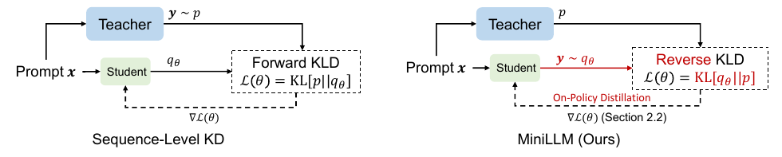
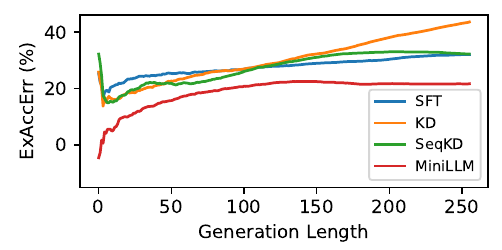

# 30. MiniLLM: On-Policy Distillation of Large Language Models

> **Authors**: Yuxian Gu et al. (Tsinghua University CoAI Group, Microsoft Research)
> **Venue**: ICLR 2024 (arXiv 2023, 확인한 PDF는 v6 2026-01)
> **Link**: https://arxiv.org/abs/2306.08543
> **목록 위치**: Part 6 — On-policy distillation

---

## 1. 핵심 연구 질문과 풀고자 하는 문제
- **white-box teacher LLM의 출력 분포를 쓸 수 있을 때, 생성형 student를 증류하기 위한 올바른 objective와 최적화 방법은 무엇인가?**
- 배경: 기존 KD는 (a) word-level KD — 정답 텍스트 위에서 teacher 토큰 분포를 모방, (b) SeqKD — teacher가 생성한 텍스트로 SFT. 둘 다 근사적으로 forward KLD `KL[p || q_θ]`를 최소화한다.
- 한계
  - forward KLD는 student가 teacher의 모든 mode를 덮도록 강제한다. 출력 공간이 작은 분류에서는 문제가 없지만, open-ended 생성에서는 capacity가 작은 student가 teacher의 저확률(void) 영역에 확률을 퍼뜨려 free-run 시 품질 낮은 샘플을 만든다.
  - teacher-forcing 학습이라 학습(정답 prefix)과 추론(자기 prefix) 간 불일치, 즉 exposure bias가 생긴다.
  - white-box KD 연구는 주로 1B 미만 이해(NLU) 모델 대상이었다.

## 2. 핵심 가설
- (본문에서 도출) reverse KLD `KL[q_θ || p]`는 mode-seeking이므로, student가 teacher의 주요 mode에 집중하게 되어 생성의 정확도·신뢰성이 오른다 (Figure 2의 Gaussian toy 실험으로 직관 제시).
- (본문에서 도출) reverse KLD는 student 자신의 샘플 위에서 기댓값을 취하므로 on-policy 학습이 되고, 그 결과 exposure bias가 줄어든다.
- (본문에서 도출) 이 이점은 정답 길이가 길어 teacher 분포의 mode가 많을수록 크고, 짧은 응답(작은 출력 공간)에서는 forward와 reverse의 차이가 거의 없다.

## 3. 제안하는 해결책
- Objective (Eq. 1)
```
θ* = argmin KL[q_θ || p] = argmin  - E_{x~p_x, y~q_θ(.|x)} [ log( p(y|x) / q_θ(y|x) ) ]
```
- Policy gradient로 미분 (Eq. 2): token별 reward `r_t = log p(y_t|y<t,x) - log q_θ(y_t|y<t,x)`, return `R_t = sum_{t'>=t} r_t'`
```
∇L(θ) = - E_{y~q_θ} [ sum_t (R_t - 1) ∇ log q_θ(y_t | y<t, x) ]
```
  - 해석: teacher가 높은 확률을 주는 토큰을 생성하도록 하되, student 자신의 확률은 낮춰 다양성 유지
- 안정화 기법 3가지
  1. **Single-Step Decomposition**: 현재 스텝 r_t의 기댓값은 vocabulary 전체 합으로 정확히 계산(Monte-Carlo 대신), 이후 스텝은 R_{t+1}로 분리 → variance 감소 (Eq. 3)
  2. **Teacher-Mixed Sampling**: `p~ = α·p + (1-α)·q_θ` (α = 0.2)에서 샘플링해 반복·무의미 문자열로 teacher 점수를 속이는 reward hacking 억제. importance weight는 누적곱 대신 단일 스텝 비율 `q_θ(y_t)/p~(y_t)`로 근사
  3. **Length Normalization**: `R_{t+1}^Norm = (1/(T-t-1)) · sum_{t'>t} log(p/q_θ)` — 긴 응답일수록 R이 작아져 빈 응답을 내는 현상 제거 (Eq. 6)
- 학습 절차 (Algorithm 1): ① 정답 응답으로 student SFT(3 epoch, 최저 validation loss ckpt) → ② PPO 스타일 clipping(ε=0.2)으로 위 gradient 학습 + pre-training LM loss `L_PT`를 더해 기존 능력 보존. RLHF와 동일한 구조
- 기존 방법과의 차이: SeqKD는 teacher 샘플을 모두 외우게 하지만, MiniLLM은 student가 자기 capacity 안에서 teacher가 선호하는 샘플을 내도록 teacher의 피드백(log prob)으로 개선 (Figure 3)



> **Figure 3**: Sequence-level KD(왼쪽)와 MiniLLM(오른쪽) 비교. SeqKD는 teacher가 생성한 샘플을 student가 모두 외우도록(forward KLD) 강제하는 반면, MiniLLM은 student가 직접 생성한 텍스트를 teacher의 피드백으로 개선한다(reverse KLD, on-policy distillation).

## 4. 가설 검증 방법
- 모델: student GPT-2(120M/340M/760M), OPT(1.3B/2.7B/6.7B), LLaMA-7B / teacher GPT-2-1.5B, OPT-13B, LLaMA-13B (Appendix C.1에 GPT-J-6B teacher 추가)
- 데이터: databricks-dolly-15k에서 학습 약 12.5K, valid 1K, test 0.5K. 평가는 DollyEval, SelfInst(252), VicunaEval(80), S-NI·UnNI(정답 길이 11 이상 subset)
- 지표: Rouge-L, GPT-4 feedback(정답 대비 점수 비율), SelfInst 50개 prompt 사람 평가. temperature 1, 5개 seed 평균
- Baseline: SFT w/o KD, word-level KD, SeqKD
- 설정: Phase 2 lr 5e-6, mini-batch 64, 한 번에 256문장 수집, inner epoch 4, max length 512, 5000 step. LLaMA-13B → 7B 증류가 V100 16장에서 10시간 미만 (Appendix B.1)
- 가설을 지지하는 결과
  - 3개 family, 120M~13B 전 크기에서 대부분 지표 1위 (Table 1). 일부 설정에서는 student가 teacher를 넘음(* 표시)
  - Exposure bias: baseline의 ExAccErr는 생성 길이에 따라 계속 증가, MiniLLM은 낮고 150 토큰 이후 누적 멈춤 (Figure 6)
  - Calibration (LLaMA-7B, zero-shot 분류): ECE가 KD/SeqKD보다 낮음 (Table 2)
  - 응답 길이별: 정답 5 토큰 이하에서는 모든 방법이 비슷, 6 토큰 이상에서 MiniLLM 우위 (Figure 7) → "출력 공간이 작으면 forward/reverse 차이가 작다"는 주장과 일치
  - Teacher scaling: teacher가 커질수록 student 성능 상승, SeqKD보다 항상 높음 (Figure 5, 14)
  - Ablation (GPT-2-125M, Dolly R-L, Table 4): MiniLLM 24.6 / w/o Length Norm 14.7 / w/o Teacher-Mixed 20.4 / w/o Single-Step 23.7
  - α = 0.2가 전반적으로 적절, 큰 모델일수록 α에 robust (Figure 16)



> **Figure 6**: training-decoding 불일치로 인한 excess error(ExAccErr)가 생성 길이에 따라 누적되는 양상. ExAccErr가 낮을수록 exposure bias가 적으며, MiniLLM은 baseline(SFT, KD, SeqKD)보다 낮고 약 150 토큰 이후 누적이 멈춘다.

- 주장이 약하거나 불일치하는 부분
  - "almost all cases" 우위이지만 예외 존재: GPT-2-340M VicunaEval GPT4 42.6 < SeqKD 43.0, DollyEval R-L 25.4 < SFT 25.5, OPT-2.7B DollyEval R-L 27.4 < SeqKD 27.5 (Table 1)
  - 다양성은 "보존"이라 했지만 수치상 소폭 감소: Dist-4 DollyEval SFT 99.5 → MiniLLM 99.0, test loss 3.89 → 3.95 (Table 3)
  - MiniLLM은 SFT(Phase 1) 위에 5000 step 추가 학습 + L_PT를 쓰므로, baseline과 compute·데이터 노출량을 맞춘 비교는 논문에 명시되지 않음
  - 분류 calibration에서 BoolQ 정확도는 teacher 74.5 대비 67.8로 격차가 큼 (Table 2)

## 5. 개선한 메트릭
| Metric | Benchmark | Baseline (최고 baseline) | Proposed (MiniLLM) | 변화 |
|---|---|---|---|---|
| GPT-4 feedback | DollyEval, GPT-2-120M (Table 1) | 41.2 (SeqKD) | 44.7 | +3.5 |
| Rouge-L | S-NI, GPT-2-120M (Table 1) | 19.7 (KD) | 25.3 | +5.6 |
| GPT-4 feedback | DollyEval, OPT-1.3B (Table 1) | 52.7 (KD) | 60.7 | +8.0 |
| GPT-4 feedback | SelfInst, OPT-1.3B (Table 1) | 37.7 (SFT) | 47.0 | +9.3 |
| GPT-4 feedback | DollyEval, LLaMA-7B (Table 1) | 73.7 (KD) | 76.4 | +2.7 |
| Rouge-L | UnNI, LLaMA-7B (Table 1) | 37.9 (KD) | 40.2 (teacher 38.5 초과) | +2.3 |
| ECE (낮을수록 좋음) | SST2, LLaMA-7B (Table 2) | 0.191 (KD) | 0.099 | -0.092 |
| Accuracy | SST2, LLaMA-7B (Table 2) | 84.7 (KD) | 89.7 | +5.0 |
| ECE (낮을수록 좋음) | BoolQ, LLaMA-7B (Table 2) | 0.681 (SeqKD) | 0.502 | -0.179 |
| Rouge-L (valid / Dolly) | GPT-2-125M ablation (Table 4) | w/o Length Norm 17.4 / 14.7 | 27.4 / 24.6 | +10.0 / +9.9 |

## 6. 한 줄 요약
> 증류 objective를 forward KLD에서 reverse KLD로 바꾸고 student 자신의 샘플 위에서 policy gradient(+ single-step 분해, teacher-mixed sampling, length normalization)로 최적화하면, mode-seeking과 on-policy 학습 덕분에 exposure bias가 줄고 120M~13B 전반에서 KD/SeqKD보다 정확한 생성을 얻는다.
