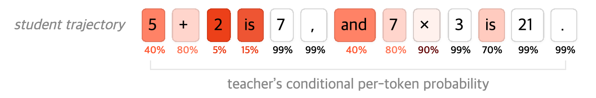
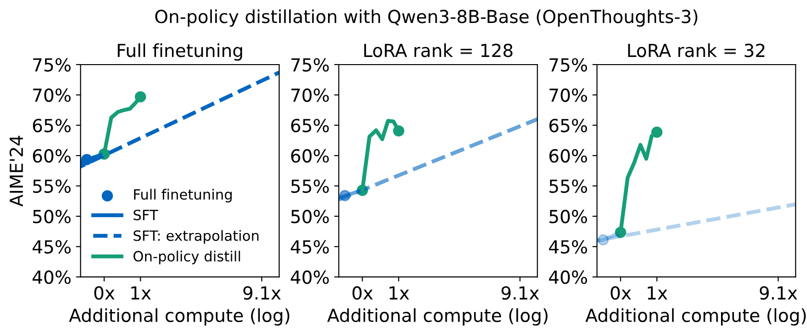
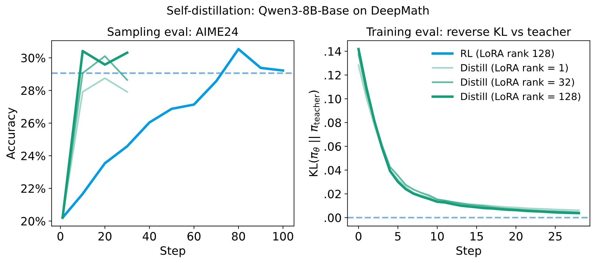

# 31. On-Policy Distillation

> **Authors**: Kevin Lu et al. (Thinking Machines Lab)
> **Venue**: Thinking Machines Lab blog, 2025 (Connectionism, 2025-10-27)
> **Link**: https://thinkingmachines.ai/blog/on-policy-distillation/
> **목록 위치**: Part 6 — On-policy distillation

---

## 1. 핵심 연구 질문과 풀고자 하는 문제
- **RL의 on-policy 장점과 distillation의 dense reward를 결합하면, post-training을 RL이나 off-policy distillation(SFT)보다 훨씬 싸게 같은 수준으로 끝낼 수 있는가?**
- 배경: post-training 방식은 두 축으로 나뉜다.

| Method | Sampling | Reward signal |
|---|---|---|
| Supervised finetuning (off-policy distillation) | off-policy | dense |
| Reinforcement learning | on-policy | sparse |
| On-policy distillation | on-policy | dense |

- 기존 방법의 한계
  - RL: episode당 O(1) bit만 학습. 오답이라는 사실만 알 뿐 어느 토큰에서 틀렸는지 모름
  - Off-policy distillation: teacher가 자주 가는 상태에서만 학습하므로 student가 초반에 실수하면 compounding error 발생. 또 teacher의 스타일·확신은 따라 하지만 사실 정확도는 따라 하지 못할 수 있음 (Gudibande et al. 인용)
  - 새 도메인 지식을 mid-training으로 넣으면 instruction following 같은 post-training 행동이 망가짐 (catastrophic forgetting)

## 2. 핵심 가설
- (본문에서 도출) student 자신의 trajectory를 teacher가 토큰 단위로 채점하면(dense + on-policy), RL과 같은 최종 성능을 훨씬 적은 compute로 얻는다.
- (본문에서 도출) RL compute의 대부분은 gradient update가 아니라 "semantic strategy 탐색"에 쓰이므로, 이미 찾은 최종 전략은 distillation으로 지름길처럼 전달할 수 있다.
- (본문에서 도출) on-policy distillation은 항상 on-policy이고 teacher가 고정되어 있으므로, 이전 버전 모델을 teacher로 써서 mid-training으로 잃은 행동을 복원할 수 있다 → continual learning 도구.

## 3. 제안하는 해결책
- Loss: per-token reverse KL, discount factor 0 (다음 토큰만 최적화)
```
KL(π_θ || π_teacher) = E_{x~π_θ} [ log π_θ(x_{t+1} | x_{1..t}) - log π_teacher(x_{t+1} | x_{1..t}) ]
advantage_t = -(log π_θ(x_t) - log π_teacher(x_t))
```
- 구현 (Tinker RL 스크립트 위에서 한 줄 변경 수준)
  1. student에서 RL과 똑같이 rollout 샘플링, student logprob 저장
  2. teacher에 `compute_logprobs` 한 번(forward pass)으로 같은 토큰의 teacher logprob 계산
  3. per-token advantage = -reverse KL로 두고 RL의 importance-sampling loss로 업데이트
- 성질
  - reverse KL은 "unhackable": KL이 낮으면 teacher 기준으로 바람직한 행동일 확률이 높음
  - mode seeking + exposure bias 감소 (MiniLLM 인용)
  - rollout이 끝날 필요가 없어 짧은/부분 rollout으로 학습 가능, 별도 reward model 불필요
  - teacher의 top-k logit distillation은 쓰지 않음 (샘플된 토큰의 logprob만 사용)



> **Figure 1**: On-policy distillation 개념도 (블로그 본문 그림, 별도 캡션 없음). student가 직접 샘플링한 trajectory의 각 토큰에 대해 teacher의 조건부 per-token probability로 채점하며, 색이 진할수록 teacher가 낮은 확률을 준(= 페널티가 큰) 토큰이다.

- 전제: student가 이미 mid-training/SFT로 teacher 분포의 support 안에 있어야 함. SFT(forward KL)가 support를 넓히고 reverse KL은 그 안에서 mode seeking
- 기존 연구와의 관계: DAgger, process reward modeling, GKD(Agarwal et al.), MiniLLM(Gu et al.), Qwen3 기술보고서의 on-policy distillation을 확장·재현

## 4. 가설 검증 방법
- 실험 1 — Reasoning (수학)
  - student Qwen3-8B-Base, teacher Qwen3-32B. 초기화는 OpenThoughts-3 400K prompt로 SFT(off-policy distillation) → AIME'24 60%
  - 비교: SFT 계속(log-linear 외삽 시 약 2M prompt에서 70%), RL(Qwen3 기술보고서 수치 인용), on-policy distillation
  - 결과: on-policy distillation이 약 150 step(약 77K prompt, prompt당 4 샘플)에 AIME'24 70% 도달
  - LoRA rank 32는 SFT 후 full FT보다 13% 낮았지만 on-policy distillation 후에는 6%만 낮음



> **Figure 2**: On-policy distillation 진행에 따른 AIME'24 (추가 compute는 training FLOPs 기준, log scale). On-policy distillation은 SFT보다 훨씬 compute-efficient하며 특히 LoRA에서 차이가 크다. rank 32 LoRA는 SFT 후 full finetuning보다 13% 낮지만 on-policy distillation 후에는 6%만 낮다.

- 실험 2 — Personalization (사내 assistant)
  - Qwen3-8B를 사내 문서 + chat 데이터(Tulu3 prompt를 Qwen3-8B로 재샘플)로 mid-training → Internal QA(지식)는 오르지만 IF-eval이 하락. chat 30% 이상 섞어도 원래 IF-eval 유지 불가, LoRA도 덜 배우고 여전히 잊음
  - 이후 원래 Qwen3-8B를 teacher로 Tulu3 prompt에서 on-policy distillation → IF-eval 복원
- 실험 3 — Dense vs sparse reward 직접 비교
  - Qwen3-8B-Base에 DeepMath로 RL(LoRA rank 128) → 이 모델을 teacher로 같은 base에 on-policy distillation
  - teacher 성능 도달까지 7~10배 적은 gradient step (distillation 10 step 미만 vs RL 70 step), 누적 compute로 50~100배 절감



> **Figure 3**: 같은 초기화(Qwen3-8B-Base, DeepMath)에서 on-policy distillation은 RL로 학습된 policy를 약 7~10배 적은 gradient step으로 따라잡으며, 이는 50~100배의 compute efficiency에 해당한다. 오른쪽은 teacher 대비 reverse KL의 감소.

- 실험 4 — 데이터 재사용: 프롬프트 1개로 20 step × 256 rollout(총 5120 시퀀스) 학습해도 teacher의 AIME'24 성능에 근접
- 실험 5 — 자기 샘플 SFT: Qwen3-32B가 직접 생성한(KL=0) Tulu3 데이터로 SFT해도 IF-eval이 하락. finite batch 노이즈로 점점 off-policy가 되기 때문이라고 설명. on-policy distillation은 teacher가 고정되어 이런 regression이 없음
- 주장이 약하거나 불일치하는 부분
  - teacher를 Qwen3-32B라고 소개하지만, 실험 1의 각주에서는 실제로 Qwen3-8B를 teacher로 썼고 compute 비교만 32B FLOPs로 계산했다고 밝힘
  - RL baseline은 직접 돌린 것이 아니라 Qwen3 기술보고서 수치(67.6%, 17,920 GPU hours)와 "합리적 가정"으로 환산한 비용(≈1×)이며, Qwen3 보고서의 off-policy 초기점(55.0%)과 이 글의 초기점(60%)도 다름
  - SFT-2M 70%는 실제 실험이 아닌 log-linear 외삽값
  - 9~30배 compute 절감은 teacher FLOPs를 어떻게 셈하느냐에 따라 달라지며, FLOPs 기준은 logprob 계산 비용을 과대평가한다고 스스로 언급
  - 블로그 글이라 seed 반복, 분산, 통계적 유의성은 보고되지 않음. 대부분의 결과가 그래프로만 제시되어 정확한 수치는 논문에 명시되지 않음

## 5. 개선한 메트릭
| Metric | Benchmark | Baseline | Proposed | 변화 |
|---|---|---|---|---|
| AIME'24 | Qwen3-8B-Base, SFT-400K 초기화 이후 (compute 표) | SFT-2M(외삽) ~70% / RL 68% | On-policy distillation 70% | 동급 성능 |
| Compute efficiency (CE vs SFT-2M) | 같은 실험 (compute 표) | SFT-2M 1×, RL ≈1× | 9~30× | 9~30배 절감 |
| Teacher / Student FLOPs | 같은 실험 (compute 표) | SFT-2M 3.4×10^21 / 1.5×10^21 | 8.4×10^19 / 8.2×10^19 | 약 1/40, 1/18 |
| AIME'24 / GPQA-Diamond / GPU hours | Qwen3 기술보고서 Table 21 인용 | + RL 67.6% / 61.3% / 17,920 | + On-policy distillation 74.4% / 63.3% / 1,800 | +6.8 / +2.0 / 약 1/10 |
| IF-eval (Chat) | Qwen3-8B 사내 assistant (personalization 표) | midtrain (70%) 79% | + distill 83% (원본 85%) | +4 |
| Internal QA (Knowledge) | 같은 실험 | midtrain (70%) 36% | + distill 41% | +5 |
| Gradient steps to teacher | DeepMath RL teacher 복원 (Qwen3-8B-Base, LoRA 128) | RL 70 step | 10 step 미만 | 7~10배 감소, compute 50~100배 |

## 6. 한 줄 요약
> student가 직접 만든 trajectory의 각 토큰에 teacher logprob 기반 reverse KL을 advantage로 주는 on-policy distillation은 RL 스크립트의 한 줄 변경만으로 RL 수준의 성능을 9~30배(RL 대비 최대 50~100배) 적은 compute로 얻고, mid-training으로 잃은 행동도 이전 모델을 teacher로 써서 복원할 수 있다.
