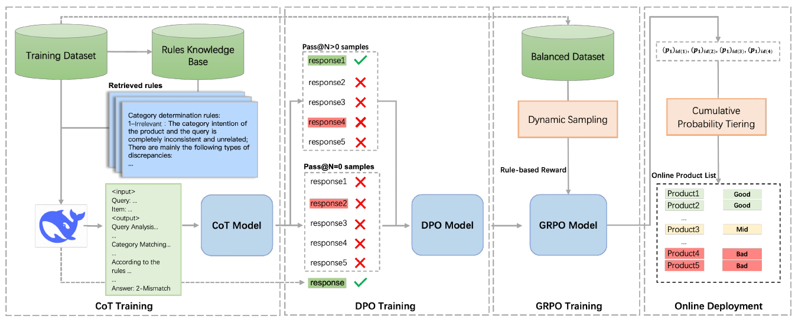

# 32. TaoSR1: The Thinking Model for E-commerce Relevance Search

> **Authors**: Chenhe Dong, Shaowei Yao et al. (Taobao & Tmall Group of Alibaba, Fudan University, Tsinghua University)
> **Venue**: KDD 2026 (arXiv journal_ref 기준. PDF v4의 ACM 템플릿 학회명은 placeholder로 남아 있음)
> **Link**: https://arxiv.org/abs/2508.12365
> **목록 위치**: Part 7 — 도메인 적용

---

## 1. 핵심 연구 질문과 풀고자 하는 문제
- **CoT reasoning을 하는 생성형 LLM을 e-commerce query-item relevance 분류에 직접 학습·배포하려면 어떤 학습 파이프라인(SFT → DPO → GRPO)과 서빙 설계가 필요한가?**
- 문제 설정: query와 상품을 입력받아 4단계 relevance(4-Excellent, 3-Related, 2-Mismatch, 1-Irrelevant)를 예측하는 multi-class classification
- 배경: BERT 기반 모델은 검색 수요의 80~90%는 처리하지만, 부정(negation)·대체품("Miu Miu alternatives")·QA·지식 기반 같은 10% 이상의 long-tail 복잡 query에 약하다. 기존 LLM 접근(LREF, ProRBP 등)도 대부분 discriminative 패러다임이거나 BERT로 증류해서 배포한다.
- 직접 배포 시 세 가지 난관
  1. Deployment latency: query 하나당 수백 개 후보를 채점해야 해 CoT 생성 비용이 감당 불가
  2. CoT error accumulation: 중간 단계 하나의 hallucination이 최종 라벨을 오염
  3. Discriminative hallucination: reasoning이 맞아도 최종 답이 틀리거나 rationale과 라벨이 모순

## 2. 핵심 가설
- (본문에서 도출) CoT-SFT만으로는 discriminative baseline을 넘지 못하지만 pass@N이 baseline을 넘으므로, 모델 내부에 정답 경로가 이미 존재하고 RL로 이를 끌어낼 수 있다 (Table 1).
- (본문에서 도출) "respond-then-think"(label 먼저, CoT 나중) 형식은 CoT error accumulation을 피하면서 CoT 학습의 이점을 보존하고, 온라인에서는 첫 토큰만 쓰면 되어 지연 문제도 해결한다.
- (본문에서 도출) 모델이 한 번도 못 푸는 hard case(pass@N = 0)는 self-sampling만으로 해결할 수 없으므로 외부 oracle(DeepSeek-R1)의 정답을 DPO로 주입해야 하며, 그 위에 GRPO를 해야 가장 좋다.
- 저자 명시 관찰: GRPO 학습 데이터의 label 분포 coefficient of variation(CV)과 최종 성능 사이에 강한 음의 상관이 있다 → label을 균형 있게 맞추면 더 좋아진다.

## 3. 제안하는 해결책
- Base model: Tbstar-42B (Taobao 자체 MoE, 총 42B / 활성 3.5B, 10T+ 토큰 학습)
- Stage 1 — SFT with CoT
  - 생성형 학습: label text를 직접 생성 (LM loss). 첫 생성 토큰의 4개 클래스 토큰("1"~"4") softmax 확률을 연속 점수로 사용
  - RAG 기반 CoT 합성: 복잡한 비즈니스 룰을 "atomic rule"로 분해·색인, 사람이 라벨링한 atomic factor로 룰을 검색해 DeepSeek-R1에 `<prompt, RAG-rule, query, item, label>`을 주고 5단계 CoT(Query Understanding → Product Comprehension → Category Matching → Attribute Matching → Relevance Determination) 생성
  - 출력 형식은 `<label, CoT>` (post-CoT)
- Stage 2 — Pass@N 기반 DPO
  - pass@N > 0: 모델의 정답을 chosen, 무작위 오답을 rejected (self-correction)
  - pass@N = 0: DeepSeek-R1의 정답을 chosen, 모델 오답을 rejected (oracle-guided). 이 구간의 약 50%를 확보
  - chosen에 SFT 보조 loss(가중치 0.5) 추가
- Stage 3 — GRPO with difficulty-based sampling
  - reward는 최종 relevance class 정답 여부(verifiable binary)
  - 그룹 정답률이 (0, γ) 구간인 샘플만 학습. DAPO와 달리 all-correct/all-wrong 그룹은 재샘플링 없이 버림
```
L_GRPO = E[ (1/G) sum_i (1/|o_i|) sum_t min( r_it·A_it, clip(r_it, 1-ε, 1+ε)·A_it ) - β·KL(π_θ || π_ref) ]
  s.t. 0 < |{o_i : correct}| < γ
A_i = (R_i - mean(R)) / std(R)
```
  - 최종 설정: 다수 클래스를 최소 클래스 크기로 downsampling해 label 균형(각 25%), 동질 그룹만 제거
- Stage 4 — CumPT (Cumulative Probability Tiering): 온라인 3-tier(Good/Mid/Bad) 판정을 하나의 threshold β_cum으로
```
if p(4) >= β_cum                     → Good
elif p(4) + p(3) >= β_cum            → Good
elif p(4) + p(3) + p(2) >= β_cum     → Mid
else                                 → Bad
```
  - 기존 방식은 클래스 anchor α1, α2와 threshold β1, β2 등 최소 4개 하이퍼파라미터 필요



> **Figure 1**: TaoSR1 프레임워크. (1) CoT SFT로 reasoning 능력 부여, (2) pass@N 기반 offline multiple sampling + DPO로 생성 품질 향상, (3) difficulty 기반 dynamic sampling + GRPO로 discriminative hallucination 완화, 이후 Cumulative Probability Tiering으로 온라인 배포.

## 4. 가설 검증 방법
- 평가 데이터: Taobao 온라인 로그에서 뽑은 약 70,000 query-item 쌍(사람 라벨), negation·affordable alternatives·QA·knowledge 4개 어려운 query 유형 중심. 라벨 분포 L4 50% / L3 5% / L2 36% / L1 9% (Table 3)
- 지표: Macro-F1(주 지표), 클래스별 F1, Accuracy. 온라인은 GSB, Query Goodrate, Item Goodrate 사람 평가와 A/B 테스트
- Baseline: 24-layer 사내 BERT, Qwen3-0.6B SFT, Qwen3-30B-A3B SFT, LLM base(Tbstar-42B를 라벨만으로 SFT, 최강 baseline)
- 설정: SFT batch 1024, lr 1e-6, 2 epoch / DPO batch 1024, lr 1e-6, 500 step, pass@N 샘플링 temperature 0.6 / GRPO rollout batch 64, 샘플당 16 응답, temperature 0.99, ratio clip 1±0.2, advantage clip ±2, ROLL 프레임워크 (Appendix A.1)
- 가설을 지지하는 결과
  - CoT-SFT pass@1 67.38 < LLM base 75.01 이지만 pass@3 77.68, pass@5 81.73으로 역전 (Table 1)
  - think-then-respond CoT-SFT는 Macro-F1 51.54로 LLM base 62.22보다 크게 하락, post-CoT는 60.01로 회복 (Table 2)
  - DPO 추가 시 post-CoT 65.03, GRPO까지 67.12 (Table 2)
  - GRPO difficulty 구간별 L-cv가 낮을수록 Macro-F1 상승: L-cv 1.06 → 63.55, 0.84 → 64.25, 균형(0) → 67.12 (Table 5)
  - DPO 없이 GRPO만 하면 66.84, DPO 후 GRPO는 67.12 (Table 6)
  - GRPO 모델의 실패 사례 중 discriminative hallucination 비율이 DPO 모델보다 30% 낮음 (정성 분석)
  - CumPT는 β_cum 0.3~0.7에서 Online Macro-F1 67.05~67.17로 안정, formula 방식은 β2에 따라 41.42~65.26으로 크게 변동 (Table 7)
  - 온라인 side-by-side(2,000 query, top-10): 4개 유형 모두 GSB 개선, alternative query에서 최대 (Table 8)
  - 서빙 최적화 후 평균 RT 800 → 286 ms, MFU 46.2% (Appendix A.2)
- 주장이 약하거나 불일치하는 부분
  - DPO 단계의 필요성 근거가 약함: DPO 없는 GRPO(66.84)와 DPO→GRPO(67.12)의 차이는 0.28pt이며 seed 반복·분산이 보고되지 않음 (Table 6)
  - GRPO difficulty 구간이 Section 3.3에서는 [0.01, 0.99], Appendix A.1과 Table 5에서는 [0.01, 0.9]로 서로 다름. DPO Macro-F1도 Table 2는 65.03, Table 6은 65.02
  - Accuracy 개선은 75.04 → 76.86(+1.82)으로 Macro-F1(+4.9) 대비 작음. 개선의 상당 부분이 소수 클래스 L3 F1(32.91 → 44.94)에서 나옴
  - 온라인 서빙은 prefill(첫 토큰)만 최적화하면 된다고 하므로 post-CoT의 CoT는 추론 시 라벨에 인과적으로 영향을 주지 않음. 저자도 Appendix A.3에서 "post-CoT는 본질적으로 reasoning 능력을 향상시키지 않으며, 이득은 비즈니스 룰 준수와 feature 활용에서 온다"고 인정
  - 온라인 A/B에서 GMV는 -0.29%로 하락, 저자는 "baseline과 동급"으로 해석
  - 학습 데이터 규모, β(KL 계수) 값은 논문에 명시되지 않음

## 5. 개선한 메트릭
| Metric | Benchmark | Baseline (LLM base) | Proposed (TaoSR1 CoT&DPO&GRPO postCoT) | 변화 |
|---|---|---|---|---|
| Macro-F1 | 사내 70K hard query 테스트셋 (Table 2) | 62.22 | 67.12 | +4.90 |
| Accuracy | 같은 테스트셋 (Table 2) | 75.04 | 76.86 | +1.82 |
| Class-1 F1 | 같은 테스트셋 (Table 2) | 65.19 | 67.34 | +2.15 |
| Class-2 F1 | 같은 테스트셋 (Table 2) | 68.86 | 73.15 | +4.29 |
| Class-3 F1 | 같은 테스트셋 (Table 2) | 32.91 | 44.94 | +12.03 |
| Class-4 F1 | 같은 테스트셋 (Table 2) | 81.90 | 83.06 | +1.16 |
| Online Macro-F1 (tiering 후) | 같은 테스트셋 (Table 7) | Formula-based 최고 65.26 (β2=0.6) | CumPT 67.17 (β_cum=0.7) | +1.91 |
| GSB / Query Goodrate / Item Goodrate | 온라인 side-by-side, Alternative query (Table 8) | 기존 온라인 bucket | +34.43% / +13.11pt / +10.69pt | 개선 |
| GSB / Query Goodrate / Item Goodrate | 온라인 side-by-side, Negative query (Table 8) | 기존 온라인 bucket | +10.92% / +3.80pt / +3.74pt | 개선 |
| UV / IPV / Transaction / GMV | 온라인 A/B (Section 4.4) | 기존 온라인 bucket | +0.22% / +2.43% / +0.82% / -0.29% | 거의 동급 |

## 6. 한 줄 요약
> 4단계 relevance 분류를 생성형 LLM으로 풀 때, RAG로 합성한 CoT를 label 뒤에 두는 post-CoT SFT → pass@N 기반 DPO(hard case는 DeepSeek-R1 정답 주입) → label 균형을 맞춘 difficulty-filtered GRPO 순서로 학습하고 CumPT 단일 threshold로 tiering하면, 최강 SFT baseline 대비 Macro-F1 +4.9pt를 얻으면서 첫 토큰만으로 온라인 서빙할 수 있다.
