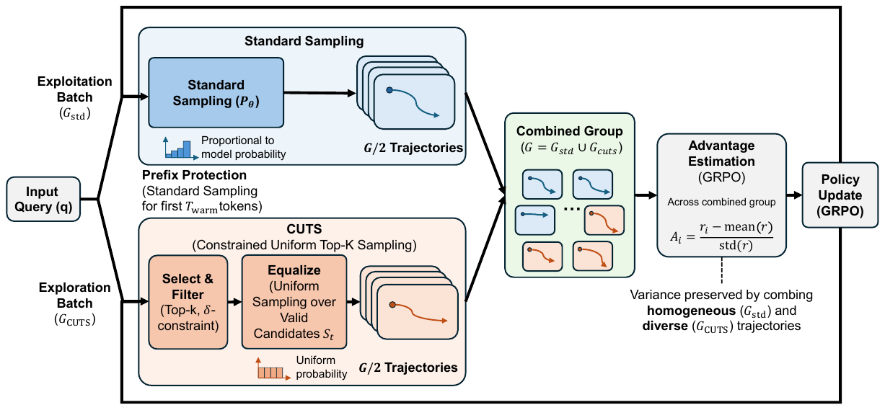
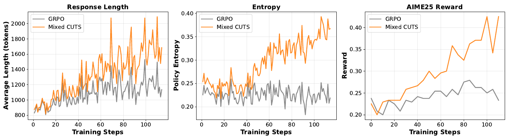
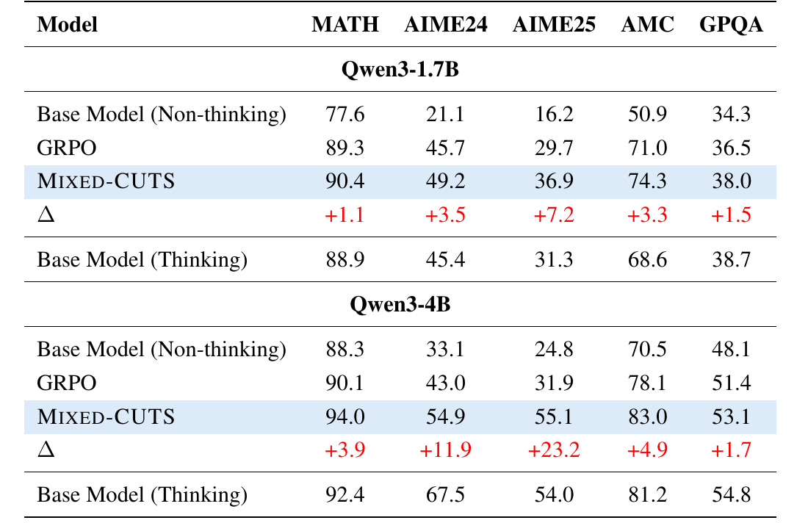

# 33. Too Correct to Learn: Reinforcement Learning on Saturated Reasoning Data

> **Authors**: Zhenwen Liang, Yujun Zhou et al. (Tencent AI Lab, University of Notre Dame)
> **Venue**: ACL 2026 Main (arXiv 코멘트 기준)
> **Link**: https://arxiv.org/abs/2604.18493
> **목록 위치**: Part 5 — RL 방법론

---

## 1. 핵심 연구 질문과 풀고자 하는 문제
- **강한 base model이 이미 대부분 맞히는 "포화된(saturated)" 데이터에서 GRPO를 돌리면 왜 학습이 멈추고, 정답 보상만으로 학습 신호를 되살릴 수 있는가?**
- 배경: 고품질 reasoning 데이터는 빠르게 커뮤니티 학습 파이프라인에 흡수되어, Qwen3 같은 강한 모델에게 MATH 같은 표준 데이터셋은 이미 쉬운 문제다.
- 문제: 한 프롬프트의 G개 rollout이 모두 정답이면 그룹 내 보상 분산이 0이 되고, group-relative advantage가 사라진다. 모델이 틀려서가 아니라 "너무 잘 맞혀서" 배울 것이 없어진다 (saturation-induced mode collapse).
- 기존 방법의 한계:
  - Entropy bonus는 confidence를 무차별로 깎아서, 일관된 추론을 흐트러뜨리는 "의미 없는 다양성"을 만든다 (Appendix A).
  - DAPO의 dynamic sampling(24번)처럼 보상이 모두 같은 그룹을 버리는 방식은 쉬운 데이터의 신호를 아예 쓰지 못한다. 이 논문은 버리지 않고 신호를 되살리는 쪽을 택한다.

## 2. 핵심 가설
논문이 "가설"이라는 단어로 정리하지는 않으므로 본문에서 도출한다 (본문에서 도출).
- 포화된 데이터에서는 정답 여부만으로는 학습 신호가 부족하다. 다양성을 명시적으로 다시 넣어야 advantage 신호가 살아난다 (Section 1).
- 다양성은 objective가 아니라 **decoding 단계**에서, 그리고 모델의 고확률 영역 **안에서** 넣어야 추론의 일관성을 해치지 않는다.
- 쉬운 데이터에서 포화 함정을 깨면, 그 효과가 어려운 out-of-domain 문제(AIME)의 일반화로 이어진다.

## 3. 제안하는 해결책



> **Figure 1**: Mixed-CUTS 프레임워크. 한 그룹을 exploitation rollout(G_std, 일반 sampling)과 exploration rollout(G_CUTS)으로 반씩 나눠 생성하고, 합친 그룹에서 advantage를 계산해 포화 상태에서도 분산을 유지한다. CUTS는 제한된 Top-K 후보 안에서 균등하게 sampling해 모델의 편향에서 생성을 떼어 낸다.

**CUTS (Constrained Uniform Top-K Sampling, Section 2.2)**: 학습 파라미터가 없는 decoding 연산자.
```
S_t = { v ∈ Top-K | P_θ(v | q, x_<t) ≥ δ }        # Select & Filter
Q(x_t = v | q, x_<t) = 1 / |S_t|   if v ∈ S_t      # Equalize (균등 분포)
                     = 0           otherwise
# S_t가 비면 Top-K로 fallback, |S_t| = 1이면 그 토큰을 그대로 선택
# Prefix protection: 처음 T_warm 토큰은 일반 sampling
```
- 기본값: K = 5, δ = 0.03, T_warm = 5 (Table 3).

**Mixed-CUTS (Section 2.3)**
- 프롬프트마다 G = 16개 rollout을 일반 sampling 8개, CUTS 8개로 만든다.
- Advantage는 합친 그룹 전체에서 표준 GRPO 방식으로 계산한다.
  ```
  A_i = (r_i - mean(r_1..r_G)) / (std(r_1..r_G) + ε)
  ```
- 분산이 0이 되지 않는 이유 (Eq. 5, Appendix D): 크기가 같은 두 하위 그룹에 total variance 분해를 적용하면
  ```
  σ²_mixed = 1/2 (σ²_std + σ²_CUTS) + 1/4 (μ_std - μ_CUTS)²
  ```
  - 너무 쉬운 프롬프트(μ_std → 1): CUTS가 가끔 덜 좋은 가지로 빠져 μ_CUTS < 1이 되므로 σ²_mixed > 0.
  - 너무 어려운 프롬프트(μ_std → 0): CUTS가 가끔 다른 정답 가지를 찾아 μ_CUTS > 0이 되므로 σ²_mixed > 0.
- Off-policy 처리: 행동 정책이 섞이지만 importance correction 없이 표준 clipped objective(π_θold 기준)를 그대로 쓴다. 저자는 (1) CUTS 토큰은 원래 Top-K 안에 있고, (2) δ가 tail 토큰을 자르고, (3) PPO clipping이 update를 제한하므로 bias가 작다고 주장한다.
- 기존 방법과 차이: entropy bonus와 달리 고확률 영역 밖으로 나가지 않는다. Dynamic sampling(24번)과 달리 포화된 그룹을 버리지 않고 신호를 되살린다.

## 4. 가설 검증 방법
- **모델**: Qwen3-1.7B, Qwen3-4B (non-thinking mode). 최대 생성 길이 1.7B는 5,000 토큰, 4B는 12,000 토큰 (Appendix B.2).
- **학습 데이터**: MATH train set. 의도적으로 포화된 쉬운 데이터를 쓴다.
- **학습 설정**: batch 128, PPO mini-batch 32, low-variance KL 계수 1e-3, rollout temperature 1.0, top-p 1.0 (Table 3).
- **평가**: MATH-500, AIME24, AIME25, AMC, GPQA-Diamond에서 Pass@1, Pass@16, maj@16. 비수학 일반화는 MMLU-Pro, SuperGPQA.
- **Baseline**: 표준 GRPO, 같은 모델의 "Thinking Mode"(참고용).
- **결과**:
  - 4B에서 GRPO 대비 AIME25 Pass@1 +15.1%p (26.6 → 41.7), AIME24 +13.5%p. 1.7B는 AIME25 +5.3%p로 모델이 클수록 이득이 크다 (Table 1).
  - Pass@1 이득이 Pass@16 이득보다 크다 (4B MATH: +4.4 vs +0.7). 저자는 이를 우연히 정답을 덮는(coverage) 것이 아니라 확률 질량을 정답 쪽으로 옮긴 증거로 해석한다.
  - maj@16 (Table 6): 4B AIME25에서 GRPO 31.9 → 55.1 (+23.2%p). GRPO는 Pass@16이 괜찮아도 다수결 합의를 못 만드는 경우가 많다.
  - 학습 동역학 (Figure 2): GRPO는 entropy가 약 0.20~0.25에 정체하고 응답 길이도 약 1,200 토큰에서 멈춘다. Mixed-CUTS는 entropy와 길이(1,800 이상)가 계속 늘고, AIME25 reward가 step 30 무렵부터 벌어져 약 0.40에 이른다.
  - 비수학 일반화: MATH만으로 학습한 4B가 MMLU-Pro +1.06%p, SuperGPQA +1.25%p (Table 2).
  - 어려운 데이터(DAPO-17K)로 학습해도 이득이 남지만 작다: AIME25 Pass@1 +1.9%p, Pass@16 +4.9%p (Table 7). 쉬운 데이터일수록 효과가 크다는 주장과 맞는다.
  - Hyperparameter 민감도: δ ∈ [0.02, 0.05], K ∈ [3, 7]에서 모두 GRPO보다 낫다. δ = 0.01이나 K = 9처럼 tail 토큰이 섞이면 Pass@1이 크게 떨어진다 (Table 4, 5).



> **Figure 2**: Qwen3-4B 학습 동역학. 왼쪽부터 응답 길이, policy entropy, AIME25 reward. GRPO(회색)는 entropy와 성능이 정체하지만, Mixed-CUTS(주황)는 높은 entropy를 유지하며 더 긴 추론을 만들고 out-of-domain 성능을 계속 올린다.



> **Table 6**: maj@16(16개 샘플 중 다수결 정답률) 비교. Qwen3-4B의 AIME25에서 Mixed-CUTS가 GRPO보다 +23.2%p 높고, 같은 모델의 Thinking Mode(54.0)보다도 높다.

- **주의할 점**:
  - 핵심 주장은 "포화 → advantage 소실"인데, **보상이 모두 같은 그룹의 비율(zero_adv_frac)을 학습 중에 직접 보고하지 않는다.** 메커니즘은 entropy, 길이, 성능 곡선으로 간접 확인할 뿐이다. 가이드의 zero_adv_frac 근거로 쓸 때는 이 점을 감안해야 한다.
  - Figure 2 캡션은 4개 패널(오른쪽 maj@16 곡선 포함)을 설명하지만 PDF에는 3개 패널만 있다. 본문의 "maj@16 곡선이 학습 초기부터 벌어진다"는 서술은 그림으로 확인할 수 없다.
  - Baseline이 표준 GRPO 하나뿐이다. Entropy bonus, dynamic sampling(DAPO), 높은 temperature 같은 직접적인 대안과 비교하지 않는다.
  - 행동 정책이 섞인 off-policy 학습인데 importance correction이 없다. 저자도 Limitation에서 장기적 영향을 이론으로 정량화하지 못했다고 인정한다.
  - Seed 반복이나 분산이 보고되지 않는다. AIME는 문항이 30개라 1문항이 약 3.3%p다.
  - Appendix D의 "too hard" 분석은 "greedy policy가 같은 오답 경로를 반복한다"고 가정하지만, 실제 rollout은 temperature 1.0 sampling이다.
  - GPQA Pass@16은 오히려 약간 떨어진다 (1.7B -0.7, 4B -0.1).

## 5. 개선한 메트릭
| Metric | Benchmark | Baseline | Proposed | 변화 |
|---|---|---|---|---|
| Pass@1 (%) | AIME25 (Qwen3-4B) | GRPO 26.6 | Mixed-CUTS 41.7 | +15.1 (Table 1) |
| Pass@1 (%) | AIME24 (Qwen3-4B) | GRPO 32.5 | Mixed-CUTS 46.0 | +13.5 (Table 1) |
| Pass@16 (%) | AIME25 (Qwen3-4B) | GRPO 57.9 | Mixed-CUTS 71.9 | +14.0 (Table 1) |
| Pass@1 (%) | MATH (Qwen3-4B) | GRPO 86.4 | Mixed-CUTS 90.8 | +4.4 (Table 1) |
| Pass@1 (%) | AIME25 (Qwen3-1.7B) | GRPO 22.8 | Mixed-CUTS 28.1 | +5.3 (Table 1) |
| maj@16 (%) | AIME25 (Qwen3-4B) | GRPO 31.9 | Mixed-CUTS 55.1 | +23.2 (Table 6) |
| Accuracy (%) | MMLU-Pro (Qwen3-4B) | GRPO 68.59 | Mixed-CUTS 69.65 | +1.06 (Table 2) |
| Pass@1 (%) | AIME25, DAPO-17K 학습 (Qwen3-4B) | GRPO 54.1 | Mixed-CUTS 56.0 | +1.9 (Table 7) |

## 6. 한 줄 요약
> 쉬운 데이터에서 GRPO 그룹이 모두 정답이면 advantage가 사라져 mode collapse가 오므로, rollout 절반을 Top-K 안에서 균등 sampling(CUTS)해 그룹 내 분산을 구조적으로 되살리면 쉬운 데이터만으로도 어려운 벤치마크의 pass@1과 maj@k가 크게 오른다.
