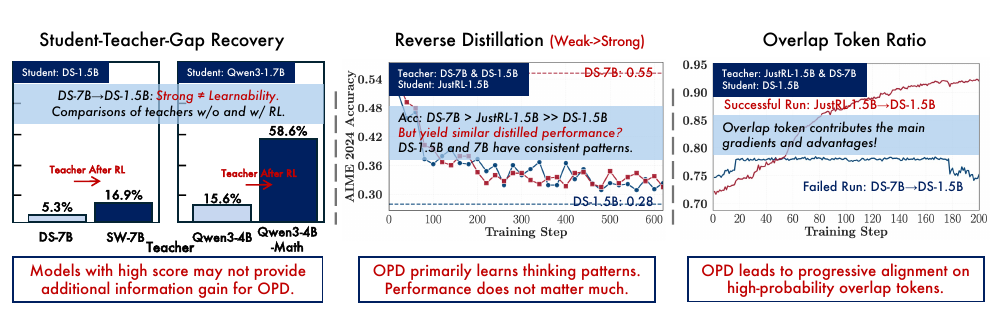
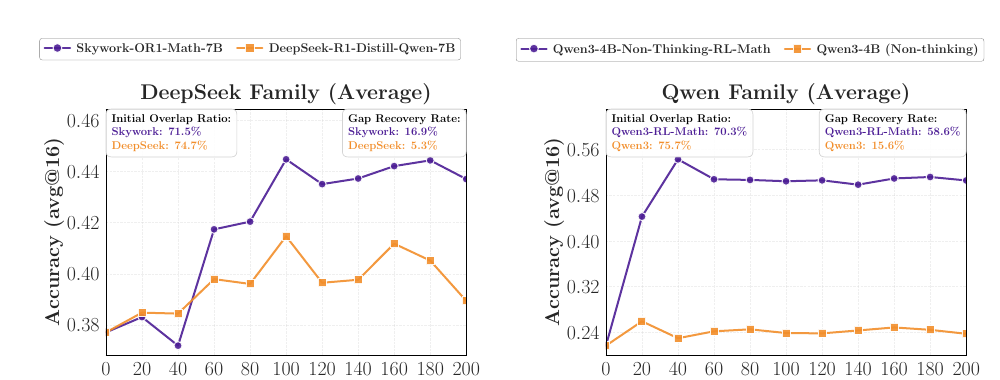
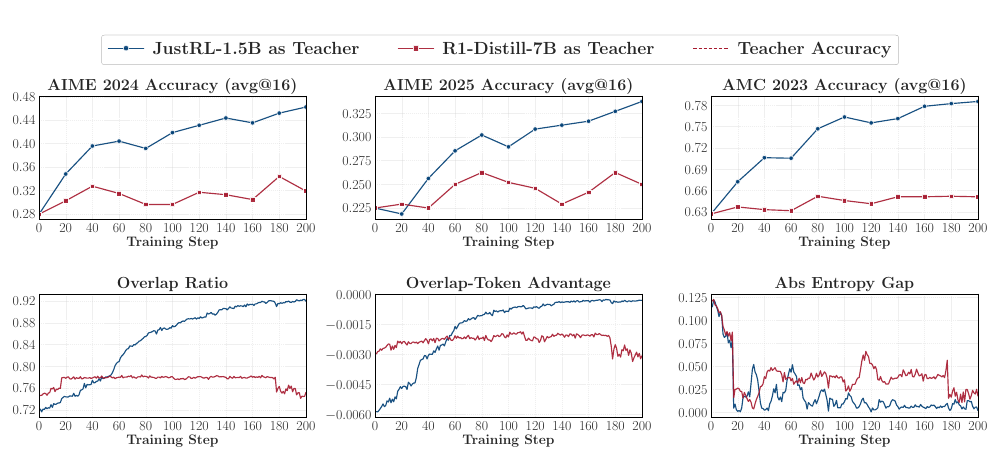
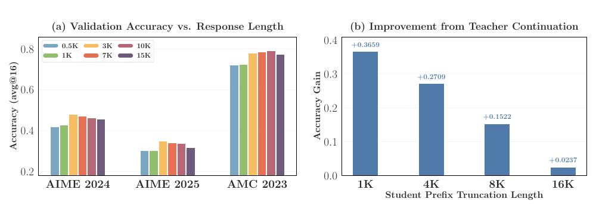

# 34. Rethinking On-Policy Distillation of Large Language Models: Phenomenology, Mechanism, and Recipe

> **Authors**: Yaxuan Li, Yuxin Zuo, Bingxiang He et al. (Tsinghua University, ShanghaiTech University, UIUC, Renmin University of China)
> **Venue**: arXiv 2026 (v2, 2026-04-15)
> **Link**: https://arxiv.org/abs/2604.13016 · Code: https://github.com/thunlp/OPD
> **목록 위치**: Part 6 — On-policy distillation
> **상세 요약**: [2026-07-26 요약 노트](../../2026-07-26/opd%20papers/rethinking_opd.md) (Background, 블로그 대비 갱신점 포함)

---

## 1. 핵심 연구 질문과 풀고자 하는 문제
- **OPD(on-policy distillation)는 언제 성공하고 언제 실패하며, 성공할 때 토큰 수준에서 무슨 일이 일어나는가?**
- 배경: Qwen3, MiMo, GLM-5가 post-training에 OPD를 쓰고, Thinking Machines 블로그(31번)는 "아무 open-weight teacher나 쓸 수 있다"고 했다.
- 문제: 저자들이 관찰한 실패 사례 — **더 강한 teacher가 student를 전혀 개선하지 못하는데, 더 약한 teacher는 성공한다.** "teacher 점수가 높을수록 좋다"는 암묵적 전제와 충돌한다.
- 기존 연구의 한계: capacity gap, distillation scaling law 같은 연구는 모두 off-policy KD 대상이다. OPD에서 teacher의 token-level 신호가 student를 어떻게 움직이는지, 어떤 조건에서 실패하는지를 체계적으로 본 연구가 없었다.

## 2. 핵심 가설
논문은 Phenomenology(§3)에서 두 조건을 명시한다.
- **조건 1, thinking-pattern consistency**: student와 teacher의 사고 패턴이 호환되어야 한다. teacher의 신호는 student가 만든 prefix 위에서 계산되므로, 신호 품질은 teacher의 절대 실력보다 "student의 상태에 teacher가 얼마나 자연스럽게 반응하는가"에 달려 있다.
- **조건 2, higher scores ≠ new knowledge**: teacher는 student가 학습 중 보지 못한 능력을 가져야 한다. 같은 데이터·레시피로 학습한 같은 계열의 큰 모델은 점수만 높을 뿐 전달할 새 능력이 없다.
- 두 조건은 서로를 대신하지 못하며, 함께 충족될 때만 이득이 난다.
- 메커니즘 가설(§4): 성공한 OPD는 student가 방문한 상태의 **고확률 공유 토큰(overlap token)에 대한 점진적 정렬**로 나타난다.

## 3. 제안하는 해결책
새 알고리즘이 아니라 **분석 + 진단 지표 + 복구 레시피**를 제안한다.



> **Figure 1**: 논문 요약. 왼쪽: 같은 파이프라인 teacher의 gap recovery(DS-7B 5.3%, Qwen3-4B 15.6%)보다 RL post-trained teacher(Skywork 16.9%, Qwen3-4B-RL-Math 58.6%)가 훨씬 높다. 가운데: reverse distillation에서 점수가 높은 DS-7B로 distill해도 DS-1.5B로 distill한 것과 같은 결과가 나온다. 오른쪽: 성공 run에서만 overlap token ratio가 오른다.

**OPD 목적함수 (student prefix 위의 per-token reverse KL)**
```
p_t(v) = π_θ(v | x, ŷ_<t),   q_t(v) = π_T(v | x, ŷ_<t)      # ŷ ~ π_θ (student rollout)
L_OPD(θ) = E_{x, ŷ~π_θ} [ Σ_t KL( p_t || q_t ) ]
# sampled-token:  ℓ_t = log p_t(ŷ_t) - log q_t(ŷ_t)
# top-k:          student top-k(기본 k=16)로 재정규화한 분포끼리의 KL
```

**진단 지표 3종 (§4)** — 초기 수십 step만 보고 실패를 예측하는 도구
```
Overlap Ratio            = E_t [ |TopK(p_t) ∩ TopK(q_t)| / k ]          # 후보 공간 정렬도
Overlap-Token Advantage  = 교집합 토큰에서 p̄_t(v) · (log q̄_t(v) - log p̄_t(v))의 평균   # 0에 가까울수록 좋음
Entropy Gap              = | H(q_t) - H(p_t) |                           # 확신·다양성 정렬도
Gap Recovery Rate        = (Acc_after - Acc_before) / (Acc_teacher - Acc_before)
```

**실패한 OPD 복구 레시피 (§5)** — 둘 다 조건 1(패턴 차이)만 좁힌다. 조건 2는 teacher의 본질적 속성이라 학습 설계로 바꿀 수 없다.
- **Off-policy cold start**: teacher rollout으로 먼저 SFT한 뒤 OPD를 시작한다.
- **Teacher-aligned prompt selection**: teacher의 post-training 템플릿과 prompt를 쓴다. 단 그것만 쓰면 student entropy가 무너지므로 OOD prompt를 섞는다.

## 4. 가설 검증 방법
- **설정**: 학습 데이터 DAPO-Math-17K(기본). 평가는 AIME 2024/2025, AMC 2023 avg@16 (temp 0.7, top-p 0.95). OPD는 lr 1e-6, rollout 4, student top-k 16, max response 7,168, KL coefficient 0 (상세 요약 §5.1).
- **조건 1 검증** (§3.1): student Qwen3-1.7B-Base에 점수가 비슷한 두 teacher — Qwen3-4B(Non-thinking)와 같은 base에서 zero-RL한 Qwen3-4B-Base-GRPO. 초기 overlap이 높은 GRPO teacher 쪽이 일관되게 낫고, 초기 mismatch로 잃은 이득은 나중에 overlap 곡선이 수렴해도 회복되지 않는다.
- **조건 2 검증** (§3.2): 같은 파이프라인 teacher vs 거기에 RL을 추가한 teacher.



> **Figure 4**: teacher에 추가 RL post-training이 있는 경우(보라)와 없는 경우(주황)의 OPD. DeepSeek·Qwen 두 계열 모두 RL post-trained teacher의 gap recovery가 3~4배 높은데, 초기 overlap ratio는 오히려 더 낮다 (71.5% < 74.2%, 70.3% < 75.7%). overlap은 조건 1의 대리 지표일 뿐 조건 2를 대신하지 못한다.

- **Reverse distillation** (§3.3): RL로 강해진 JustRL-1.5B(AIME24 약 0.54)를 student로 두고, 자기 pre-RL checkpoint인 R1-Distill-1.5B(0.28)와 점수가 더 높은 R1-Distill-7B(0.55)를 각각 teacher로 쓴다. 둘 다 student를 약 0.30으로 끌어내리며 두 곡선이 구분되지 않는다. teacher는 성능 상한이 아니라 student를 자기 분포로 끌어당기는 "자석"이다.
- **메커니즘** (§4): 같은 student(R1-Distill-1.5B)에 성공 teacher(JustRL-1.5B)와 실패 teacher(R1-Distill-7B)를 붙여 비교한다.



> **Figure 6**: 성공 teacher(파랑)와 실패 teacher(빨강) 비교. 위: 세 벤치마크 avg@16에서 파랑만 오른다. 아래: 성공 run은 overlap ratio가 0.72에서 0.92로 오르고, overlap-token advantage가 0에 다가가고, entropy gap이 줄어든다. 실패 run은 세 지표가 처음부터 정체한다.

  - overlap 토큰이 student·teacher 양쪽 확률질량의 97~99%를 차지한다 (Appendix B.1).
  - Ablation: overlap 토큰만 학습(Overlap Top-k)해도 Student Top-k와 같은 성능이고, non-overlap 토큰만 학습하면 일관되게 약하다. 인과성 근거다.
  - 교차 검증: student R1-Distill-7B, teacher Skywork-OR1-Math-7B(성공) / R1-Distill-14B(실패)에서도 같은 패턴 (Appendix B.3).
- **레시피 검증** (§5): cold start SFT 초기화가 학습 내내 Base 초기화보다 위에 있고(AMC 2023 약 0.40 vs 0.26), teacher-aligned 템플릿 한 줄 교체로 gap recovery가 약 80%에서 약 85%로 오른다.
- **Dense supervision의 비용** (§6): max response length 3K~7K가 최적이고, 10K·15K는 step 200 부근에서 무너진다. 불안정은 응답 끝에서 시작해 앞으로 번진다.



> **Figure 11**: (a) max response length별 성능. 3K·7K가 정점이고 15K에서 내려온다. (b) student prefix를 여러 길이에서 자르고 teacher가 이어 풀 때의 정확도 이득. 1K에서 +0.3659, 16K에서 +0.0237로, 궤적이 깊어질수록 teacher의 우위가 사라진다.

- **주의할 점**:
  - 모든 실험이 수학 벤치마크다. 코드나 open-ended task에서 성립하는지는 확인되지 않았다 (저자 open problem).
  - "새 지식" 조건은 결국 pre-training 데이터 차이에 의존하는데, 이를 분리하는 cross-family 실험은 tokenizer·아키텍처 차이와 섞여 하지 못했다.
  - 실패 teacher의 reward가 정답/오답 판별 AUROC 0.75로 성공 teacher(0.73)보다 오히려 높다. 저자는 이를 per-token advantage의 방향이 제각각이라 gradient가 상쇄되는 anisotropy로 설명하지만, **직접 검증하지 않았다**고 명시한다.
  - 수치 대부분이 그림에서 읽은 근사값이고, seed 반복이나 분산은 보고되지 않는다.

## 5. 개선한 메트릭
분석 논문이라 "제안 방법 vs baseline"보다 조건별 대조가 핵심이다.

| Metric | 설정 | 비교 A | 비교 B | 차이 |
|---|---|---|---|---|
| Gap recovery rate | DeepSeek 계열 (student R1-Distill-1.5B) | same-pipeline R1-Distill-7B 5.3% | RL post-trained Skywork-OR1-Math-7B 16.9% | +11.6%p (Figure 4) |
| Gap recovery rate | Qwen 계열 (student Qwen3-1.7B) | same-pipeline Qwen3-4B 15.6% | RL post-trained Qwen3-4B-RL-Math 58.6% | +43.0%p (Figure 4) |
| Overlap ratio | 성공 vs 실패 run | 실패 약 0.78에서 정체 | 성공 0.72 → 0.92 | (Figure 6) |
| Gap recovery rate | prompt template | 원본 DAPO 약 80% | teacher-aligned 약 85% | +약 5%p (Appendix C.4) |
| Teacher continuation 이득 | student prefix 길이 | 1K: +0.3659 | 16K: +0.0237 | 깊이에 따라 소멸 (Figure 11) |
| avg@16 AIME 2024 | support size | Top-64 0.463 | Sampled-token 0.454 | 사실상 대등, Top-1만 0.446으로 낮음 (Figure 15) |

## 6. 한 줄 요약
> OPD는 teacher 점수가 아니라 "student와 사고 패턴이 호환되고 student가 못 본 능력을 가진" teacher일 때만 작동하며, 성공은 확률질량 97~99%를 차지하는 공유 고확률 토큰에 대한 점진적 정렬로 나타나므로, teacher는 초기 overlap 지표로 고르고 패턴 차이는 cold start SFT와 teacher-aligned prompt로 좁힌다.
