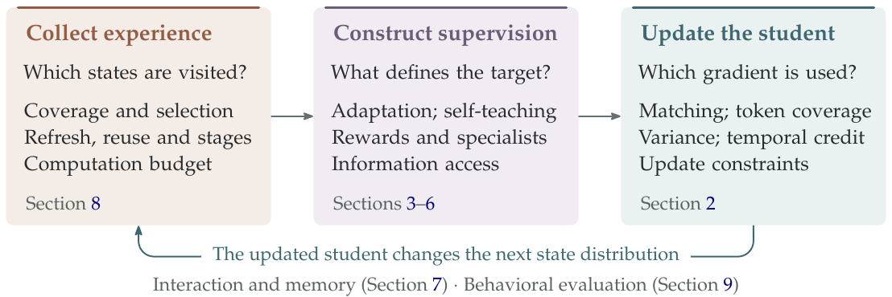
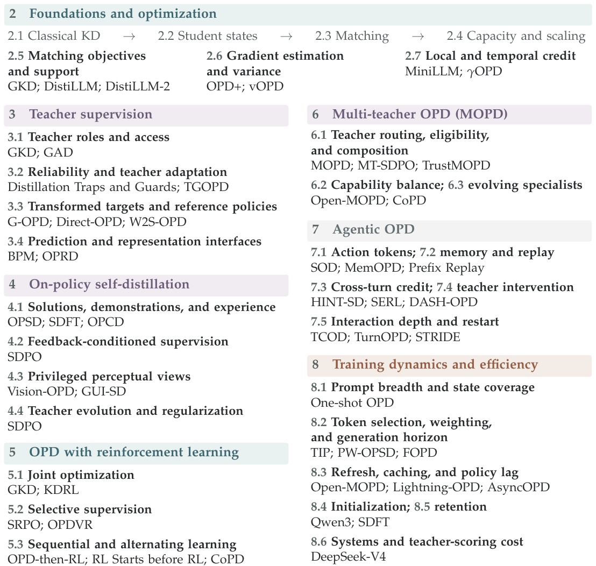

# 35. A Survey of On-Policy Distillation for Large Language Models

> **Authors**: Mingyang Song, Mao Zheng (Foundation Model Department, Tencent)
> **Venue**: arXiv 2026 (v1 2026-04, 이 노트는 v5 2026-10-21 기준, 본문 54쪽 + 참고문헌)
> **Link**: https://arxiv.org/abs/2604.00626
> **목록 위치**: Part 6 — On-policy distillation

---

## 1. 핵심 연구 질문과 풀고자 하는 문제
- **OPD 방법이 빠르게 늘어나면서 supervision 형태와 최적화 방식이 제각각이라 서로 비교하기 어렵다. 이들을 하나의 틀로 묶으면 언제 어떤 설계가 효과적인지 설명할 수 있는가?** (Abstract)
- 배경: 고정된 demonstration으로 학습한 student는 배포 시 자기 출력이 만든 prefix를 만나는데, 거기에는 teacher 정답이 감독을 주지 못한다 (Section 1, 2.1).
- OPD는 student가 생성한 trajectory 위에서 teacher가 감독을 주는 방식이다. 이 서베이는 그 범위를 self-distillation, multi-teacher, RL 결합, agent까지 넓혀 정리한다.

## 2. 핵심 가설
서베이라 가설 대신 핵심 주장을 정리한다.
- **OPD는 세 가지 선택의 상호작용이다**: (1) 어떤 state를 방문하나, (2) 어떤 정보로 target을 만드나, (3) 그 target이 어떤 update로 이어지나 (Section 1, Figure 2). 비슷한 학습 절차가 다르게 동작하는 이유가 여기서 나온다.
- **Teacher가 강하다고, 또는 divergence 하나만 잘 고른다고 OPD 성공이 설명되지 않는다** (Section 12). 강한 teacher도 student의 틀린 prefix 뒤에서는 잘못된 감독을 줄 수 있다 (Section 3.2).
- **성공 기준은 즉시 정확도가 아니다**: 정답 coverage, 종료(stopping), 기존 능력 보존, 이후 RL로 더 배울 수 있는 정도까지 봐야 한다 (Section 2.8, 9.3, 12).

## 3. 제안하는 해결책
새 방법이 아니라 **통일된 수식 틀과 장(chapter) 단위 분류**를 제시한다.



> **Figure 2**: OPD 학습 루프. student가 생성한 state에서 감독을 요청하고(Collect, Section 8), teacher나 구성된 target이 guidance를 주며(Construct, Section 3–6), update가 다음 state 분포를 바꾼다(Update, Section 2). Agent 상호작용은 observation과 memory까지 바꾼다 (Section 7).

**통일 objective (Section 2.3, Eq. 2)**
```
L_match(θ) = E_{s ~ d_μ} [ w(s) · D_f( q(·|s_T) || π_θ(·|s) ) ]
  d_μ : collection policy μ가 만드는 state 분포 (μ = 현재 student면 strict on-policy)
  s_T : teacher가 보는 state (privileged 정보를 더 가질 수 있음)
  D_f : f-divergence. f(u) = u log u → forward KL, f(u) = -log u → reverse KL
```
- 같은 divergence라도 d_μ(어느 prefix에서), s_T(teacher가 무엇을 보고), gradient estimator(어떻게 미분하나)가 바뀌면 다른 방법이 된다 (Section 2.3, 2.6).
- 흔히 쓰는 sampled-token reverse-KL surrogate (Section 2.5):
  ```
  ℓ_t(θ) = - sg[r_t] · log p_θ(y_t | c_t),   r_t = log p_T(y_t|c_t) - log p_θ(y_t|c_t)
  ```
- Exposure bias 근거: DAgger 분석을 인용해, expert state에서의 작은 imitation error가 horizon T에 대해 최악 O(εT²) 누적 비용 차이를 낼 수 있고, learner가 방문한 state에서 expert에게 묻으면 horizon 의존성이 개선된다고 쓴다 (Section 2.2). **OPD 자체에 대해 "quadratic → linear"를 명시적으로 유도하거나 O(εT)를 적지는 않는다.**



> **Figure 1**: 장별 지도와 대표 연구. Section 2의 공통 기반이 Section 3–8의 설계 선택을 잇고, 한 방법이 여러 장에 걸칠 수 있다. Section 9는 증거를 종합하고 Section 10은 실무 사용을 다룬다.

| 장 | 다루는 내용 | 대표 연구 (Figure 1, arXiv ID는 참고문헌 기준) |
|---|---|---|
| 2 Foundations | KD → student-state 감독, f-divergence matching, gradient 분산, temporal credit | GKD (2306.13649), DistiLLM (2402.03898), MiniLLM (ICLR 2024, OpenReview) |
| 3 Teacher supervision | teacher 접근 방식, 신뢰도·적응, target 변환, vocab/representation 정렬 | GKD, Distillation Traps and Guards (2604.18963), G-OPD / W2S-OPD |
| 4 On-policy self-distillation | 정답·demonstration·feedback을 privileged context로 준 자기 자신이 teacher | OPSD (2601.18734), SDFT (2601.19897), SDPO (2601.20802), Vision-OPD (2605.18740) |
| 5 OPD + RL | joint objective, selective supervision, 순차·교대 학습 | KDRL (2506.02208), RL Starts before RL (2609.28145), Sequential Beats Joint (2609.04108) |
| 6 Multi-teacher OPD | teacher routing·자격, 능력 균형, 진화하는 specialist | Open-MOPD (2608.19098), TrustMOPD (2609.23697), CoPD |
| 7 Agentic OPD | action token, memory·replay, cross-turn credit, teacher 개입 | SOD, MemOPD, HINT-SD, TurnOPD |
| 8 Training dynamics & efficiency | prompt 범위, token 선택, refresh·caching·policy lag, 초기화, 시스템 비용 | TIP (2604.14084), Lightning-OPD (2604.13010), Qwen3 (2505.09388) |
| 9–11 | 메커니즘 검증, 실무 가이드, open challenge | — |

## 4. 가설 검증 방법
- **자체 실험이 없다.** 근거는 전부 인용 연구의 결과이며, 저자가 직접 만든 그림은 개념도나 "constructed illustration"이다 (Figure 3: Gaussian mixture로 forward/reverse KL 차이를 보여 주는 예시).
- Section 9는 "정확도 향상이 teacher 지식 전달 때문인가"를 가르는 통제 실험들을 모은다 (Table 4). 예: paired solution을 무관한 예제로 바꿔도 forward-KL 이득이 유지됨(Ichihara et al.), 가장 낮은 확률 20% token의 teacher advantage를 고정 음수로 바꿔도 재현됨(Ding & Zhang). 서베이는 이득의 설명으로 정보 습득, 기존 지식의 더 나은 실행, teacher credit이 필요 없는 분포 변화 세 가지를 든다 (Section 9.2).
- **주의할 점**:
  - "Work in Progress" 성격의 살아 있는 문서다. v1(2026-04) 이후 v5(2026-10)까지 개정됐고, 2610.xxxxx 논문까지 인용한다. 인용 시 버전을 적어야 한다.
  - 흔히 이 서베이의 요지로 인용되는 "exposure bias 오차가 quadratic에서 linear로 줄어든다"는 표현은 v5 본문에서 확인되지 않는다. 본문은 DAgger의 O(εT²)와 "horizon 의존성 개선"까지만 말한다 (Section 2.2). 이전 버전(v4 이하)에 있었는지는 확인하지 않았다.
  - Figure 1의 대표 연구 일부(GAD, OPD+, OPCD, CoPD, SOD 등)는 약칭만 있고, 표에 적은 arXiv ID는 참고문헌에서 찾은 것이다. 약칭↔논문 대응을 모두 확인하지는 않았다.
  - 저자(Song, Zheng)가 공저한 OPD 논문 여럿(예: 2604.02288, 2609.14193)도 인용 대상에 포함된다.
  - 인용 결과 대부분이 2026년 arXiv preprint이며, 서베이 스스로도 각 결과의 적용 범위 한계를 자주 덧붙인다 (예: Section 5.3 "fixed-budget superiority는 확립되지 않음").

## 5. 개선한 메트릭
서베이라 자체 메트릭이 없다. 대신 본문이 주는 "언제 무엇을 쓰나" 가이드를 정리한다.

| 결정 | 서베이가 주는 가이드 | 출처 |
|---|---|---|
| Forward vs reverse KL | forward KL은 teacher가 지지하는 대안을 덮고(mode-covering), reverse KL은 teacher가 낮게 보는 token의 student 확률을 벌한다. 이후 RL을 할 거면 즉시 정확도로 고르면 안 된다: RL Starts before RL에서 RL 전엔 reverse KL, RL 후엔 forward KL이 20개 task 중 14개에서 앞섬 | Section 2.3, 5.3, 10.4 |
| Reverse KL 부작용 | 수학 비교에서 reverse KL이 Avg@k +2.45pt지만 4,096-token 설정에서 낮은 entropy와 심한 응답 길이 증가 | Section 9.3.1 |
| Teacher 선택 | 가장 강한 teacher가 최선의 student를 만들지 않는다 (distillation scaling). student 초기화(base vs post-trained)만 바꿔도 teacher 순위가 뒤집힌다 | Section 2.4, 9.1 |
| Teacher 신뢰도 | 단독 정확도가 student prefix에서의 감독 품질을 보장하지 않는다. student prefix가 길어지면 teacher continuation 정확도가 떨어진다 | Section 3.2 |
| OPD와 RL 순서 | reverse-KL OPD 후 GRPO가 joint보다 좋았다(logic task, 수학은 차이가 작거나 동률) | Section 5.3 |
| 비용 병목 | 생성이 비싸면 horizon 제어, teacher scoring이 비싸면 caching·재사용(staleness 주의) | Section 10.4, 8.3 |
| 배포 목적별 설계 | student 개선 / specialist 보존 / reasoning budget / 모델 변환 / privileged feedback 내재화별 조건과 비교 대상 | Table 5 |

**이 리스트와의 연결**
- [29. GKD](./29_gkd.md): 서베이가 "collection(student 응답 비율)과 matching(divergence)을 분리한 출발점"으로 다룬다 (Section 2.3, Figure 1의 2.5·3.1·5.1).
- [31. Thinking Machines OPD](./31_thinking_machines_opd.md): sampled log ratio에 teacher의 선택 token 확률만 필요한 estimator로 인용된다 (Section 2.6, Lu & Thinking Machines Lab 2025).
- [34. Rethinking OPD](./34_rethinking_opd.md): Li et al. 2026l (2604.13016). student 오류 prefix 뒤 teacher 오도, SFT 초기화·prompt 형식이 transfer에 영향을 준다는 근거로 쓰인다 (Section 1, 3.2).

## 6. 한 줄 요약
> OPD를 "student가 방문한 state × teacher가 쓰는 정보 × update 방식"의 조합으로 보고 f-divergence matching 하나로 묶은 서베이로, teacher 강도나 divergence 하나로는 성공을 설명할 수 없고 coverage·보존·이후 RL 학습 가능성까지 봐야 한다고 정리하므로 처음부터 읽기보다 장별 인덱스로 쓴다.
