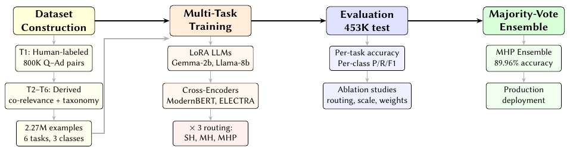
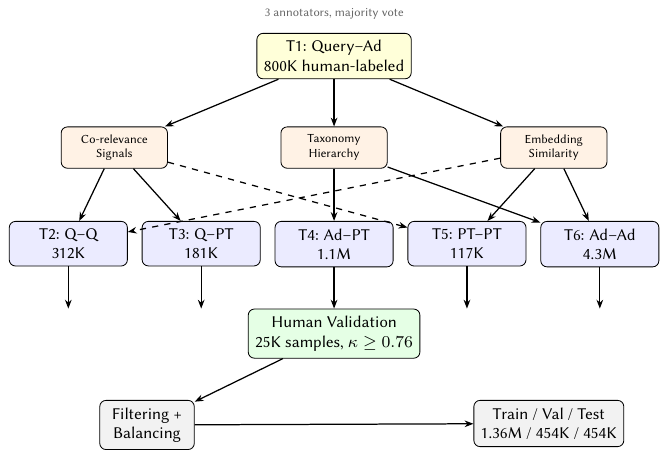
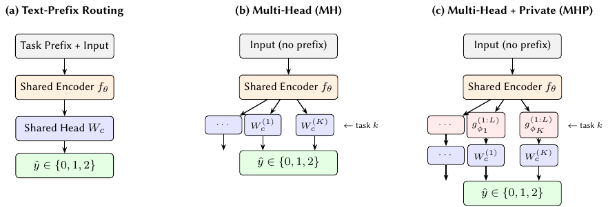
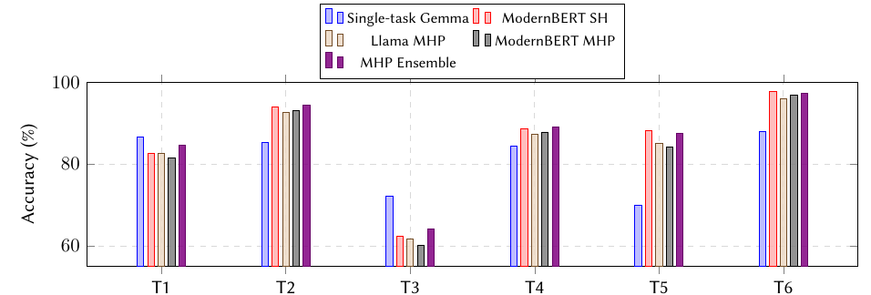
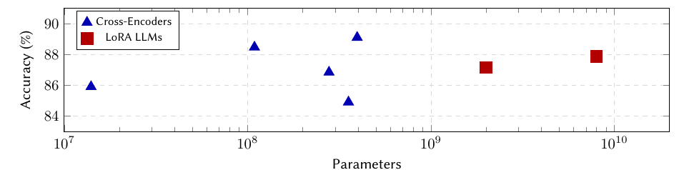

# Unified Multi-Task Relevance Modeling for E-Commerce: Comparing Task Routing Architectures Across LLMs and Cross-Encoders

> **Venue**: ECOM'26: SIGIR Workshop on eCommerce (2026-07-24, Melbourne, Australia)
> **Authors**: Md Omar Faruk Rokon*, Jhalak Nilesh Acharya*, Shasvat Desai*, Hong Yao, Kuang-chih Lee (Walmart Global Tech) — *equal contribution
> **Platform**: Walmart Sponsored Search (query–ad relevance 및 파생 entity-pair 관계)

---

## 1. Background

### E-commerce Relevance Modeling의 현황
- E-commerce 플랫폼은 하나의 relevance가 아니라 **여러 entity-pair 관계**를 동시에 판단해야 한다
  - 검색: query–product(ad) 매칭
  - 검색어 제안: query–query 유사도
  - 추천: product–product 연관성
  - 의도 이해: query–product type 매핑
- 업계 관행은 **task별로 별도 모델**을 학습·서빙한다. 그 결과
  - task 간 knowledge transfer가 일어나지 않고 (예: "hiking boots"라는 query의 의미는 어떤 관계를 판단하든 동일한데 6번 따로 배움)
  - downstream 시스템마다 relevance signal이 서로 일관되지 않으며
  - 학습·서빙 인프라가 6배로 든다
- 저자들의 선행 연구(Rokon et al.)에서 LoRA-adapted Llama-2가 query–ad relevance에서 89.43%로 GPT-4(63%), BERT cross-encoder(86.27%)를 앞섰다. 이 논문은 그 단일 task 데이터를 seed로 6개 task로 확장한다.

### 기존 방법의 한계
| 방법 | 문제점 |
|---|---|
| Task별 single-task 모델 | knowledge transfer 없음 → 저자원 task(PT–PT 14K)에서 성능 저조, 6× 인프라 비용 |
| Off-the-shelf LLM (GPT-4 few-shot, zero-shot Llama) | 3-point relevance scale에 calibration 안 됨 (GPT-4 67.2%, Llama-3-8b zero-shot 61.3%) |
| 기존 MTL 연구 (MT-DNN, PLE, MoE 등) | sharing 메커니즘 자체에 집중. **task identity를 모델에 어떻게 전달하느냐(task routing)**가 encoder/decoder 계열에서 다르게 작동하는지는 연구되지 않음 |
| 기존 ensemble | 대부분 같은 architecture family끼리 결합 → error 다양성 제한 |

---

## 2. Motivation

### 핵심 통찰 1: Encoder와 Decoder는 task identity를 다른 방식으로 인코딩한다
- **Cross-encoder**는 bidirectional attention 위에서 전용 `[CLS]` 토큰으로 pooling → `[CLS]`는 입력 전체를 요약하도록 학습되어 있어 task 정보가 어떤 형태로 들어오든 상대적으로 둔감
- **Decoder-only LLM**은 **last token**으로 pooling → causal mask 때문에 last-token 표현은 **입력 prefix에 크게 좌우**된다
- 따라서 task-prefix를 제거하면 두 계열이 비대칭적으로 반응할 것이라는 가설
  - 실제로 prefix 제거 + linear multi-head만 쓰면 ModernBERT는 −1.02%인데 Gemma-2-2b는 87.14% → **55.59% (−31.55%) 붕괴**

### 핵심 통찰 2: 데이터 풍부 task → 데이터 희소 task로의 transfer
- Task별 학습 데이터 편차가 매우 큼: Query–Ad 404K vs PT–PT 14K (약 29배)
- 공유 모델이면 풍부한 task에서 배운 query/product 의미 이해가 희소 task로 전이될 수 있음
  - 실제로 Gemma-2-2b 기준 T5(PT–PT) **+14.07%**, T2(Q–Q) +7.22%
  - 반대로 가장 큰 T1은 −4.75% (capacity trade-off, negative transfer)

### 핵심 통찰 3: Architecture 다양성이 ensemble의 원천
- Llama-3-8b와 ModernBERT는 test 예시의 **14.2%에서 서로 다른 예측**
  - 추상적 task(T3 Q–PT)에서 26.8%, lexical task(T6 Ad–Ad)에서 4.1%
- 서로 다른 오류 패턴 → majority vote로 보정 가능

---

## 3. Contributions
1. **Unified multi-task relevance framework**: 6개 entity-pair 관계를 하나의 3-point graded scale(Irrelevant / Partially Relevant / Relevant)로 통합. 사람 라벨 seed에서 5개 task를 파생하는 데이터 파이프라인 + inter-annotator agreement 검증(κ ≥ 0.76)
2. **LLM vs Cross-encoder 체계적 비교**: LoRA-adapted decoder LLM(2B, 8B) vs full fine-tuned cross-encoder(14M–396M)를 6개 task 전반에서 비교
3. **Task routing architecture 3종 최초 비교**: Text-prefix(SH) / Multi-Head(MH) / Multi-Head + Private layers(MHP)를 encoder·decoder 양쪽에서 비교 → **decoder LLM에는 private layer가 필수, cross-encoder에는 불필요**
4. **MHP majority-vote ensemble**: 453K test에서 **89.96%**로 전체 최고 (SH ensemble 대비 +1.92%)
5. **Ablation**: routing, dataset scale, precision, class weight, model scale에 대한 실무 가이드
- 온라인 A/B 테스트는 **없음** (future work로 명시)

---

## 4. Method



> **Figure 1**: 전체 시스템 개요. 사람 라벨 seed 데이터로 데이터셋 구축 → LoRA LLM과 cross-encoder를 3가지 routing architecture로 multi-task 학습 → 453K test 평가 → majority-vote ensemble(89.96%).

### 4.1 Problem Formulation
- Entity 공간: query Q, ad item A, product type P. 전체 E = Q ∪ A ∪ P
- 6개 task 모두 **동일한 3-class 분류 문제**로 취급, 차이는 입력 entity 쌍의 종류와 task identity 전달 방식뿐

```
r : E × E × T → Y = {0, 1, 2}
    0 = Irrelevant, 1 = Partially Relevant, 2 = Relevant
```

| Task | Entity Pair | 예시 | Total (pre-filter) |
|---|---|---|---|
| T1 | Query–Ad Item | "hiking boots" ↔ Merrell Moab 3 | 800K |
| T2 | Query–Query | "hiking boots" ↔ "outdoor footwear" | 312K |
| T3 | Query–Product Type | "hiking boots" ↔ Hiking Boots | 181K |
| T4 | Ad Item–Product Type | Merrell Moab 3 ↔ Hiking Boots | 1.1M |
| T5 | Product Type–Product Type | Hiking Boots ↔ Trail Shoes | 117K |
| T6 | Ad Item–Ad Item | Merrell Moab 3 ↔ Salomon X Ultra | 4.3M |

### 4.2 Dataset Construction (사람 라벨 seed → 5개 task 파생)



> **Figure 2**: 데이터 구축 파이프라인. 사람이 라벨링한 query–ad 쌍(T1)을 seed로 co-relevance, taxonomy, embedding 신호를 이용해 5개 task를 파생. 모든 파생 task는 human validation(κ ≥ 0.76), filtering, balancing을 거쳐 최종 2.27M 예시가 된다.

- **T1 (seed)**: Walmart sponsored search 로그의 약 800K query–ad 쌍, 3명 annotator majority vote
- **파생 규칙** (임계값은 task당 2,000쌍 held-out에서 derived–human agreement 최대화로 튜닝, ±0.05 변화 시 정확도 변화 <1%)

| Task | 파생 신호 | 라벨 규칙 (요약) |
|---|---|---|
| T2 Q–Q | 같은 relevant ad를 공유하는 정도(co-relevance) + text embedding cosine | 2: co-rel ≥ 1.5 & sim ≥ 0.65 / 1: co-rel 0.5–1.5 & sim 0.4–0.65 / 0: co-rel < 0.5 & sim < 0.35 |
| T3 Q–PT | query–ad relevance를 product type 단위로 집계 + PT 예측 API 점수 | 2: 평균 relevance ≥ 0.8 또는 강한 API 점수 |
| T4 Ad–PT | Product taxonomy hierarchy | 2: PT 정확 일치 / 1: 같은 taxonomy branch / 0: top-1 레벨 불일치 |
| T5 PT–PT | query–ad context 공출현 + 대표 ad title embedding 유사도 | 2: sim ≥ 0.7 / 1: 0.4–0.7 / 0: < 0.2 |
| T6 Ad–Ad | PT 일치 + taxonomy 정렬 + title embedding | 2: 같은 PT & 같은 relevance / 1: cross-type이지만 taxonomy 정렬 / 0: 불일치 & sim < 0.3 |

- **Post-processing**: 애매한 쌍 제거(label 2인데 sim < 0.7, label 0인데 sim > 0.2 제거) + class-balanced sampling (3 클래스 각 약 33%)
- **Human validation**: 파생 task당 5,000쌍(총 25K)을 2명이 독립 라벨링

| Task | Cohen's κ | Human–Human | Derived–Human |
|---|---|---|---|
| T2 Q–Q | 0.82 | 89.3% | 88.1% |
| T3 Q–PT | **0.76** | 83.7% | 82.4% |
| T4 Ad–PT | 0.84 | 91.2% | 90.5% |
| T5 PT–PT | 0.79 | 86.5% | 85.8% |
| T6 Ad–Ad | 0.85 | 92.1% | 91.3% |

- 파생 라벨과 사람의 일치도가 사람끼리의 일치도와 거의 같다(차이 ~1%p) → 파생 라벨의 품질이 annotator 수준
- T3의 낮은 κ는 query→product type 매핑 자체의 모호성을 반영하며, 이후 모델 성능에서도 T3가 일관되게 가장 어렵다

### 4.3 Backbone: LoRA LLM과 Cross-Encoder

| | LoRA-adapted LLM | Cross-Encoder |
|---|---|---|
| 모델 | Gemma-2-2b, Llama-3-8b | ModernBERT-large (396M), ELECTRA-base (109M), TinyBERT (14M), RoBERTa-large (355M), BGE-reranker (278M) |
| 적응 방식 | LoRA r=16 (q,k,v,o + gate,up,down), 학습 파라미터 ~0.1% | Full fine-tuning |
| Attention | Causal (autoregressive) | Bidirectional |
| Pooling | last token h_last | h_[CLS] |
| 초기화 | base LM | 기존 reranker/cross-encoder 체크포인트 (예: reranker-ModernBERT-large-gooaq-bce) |

```
LLM:            p(y | e_i, e_j, t) = softmax( W_c · h_last( prompt(e_i, e_j, t); θ + Δθ ) ),  Δθ = B·A
Cross-encoder:  p(y | e_i, e_j)    = softmax( W_c · h_[CLS]( e_i, e_j; ψ ) ),  W_c ∈ R^{3×d_h}
```

### 4.4 Task Routing Architectures (핵심)



> **Figure 3**: 세 가지 task routing architecture. (a) Text-prefix (SH): task identity를 입력 텍스트에 넣고 head는 공유. (b) Multi-head (MH): task별 head, task ID로 hard routing. (c) MHP: task별 transformer layer + task별 head.

"공유 모델이 지금 어떤 task를 풀고 있는지 어떻게 알게 할 것인가"라는 질문에 대한 세 가지 답:

```
(a) SH  (Text-prefix):
    x_k = concat(τ_k, e_i, [SEP], e_j)           # τ_k = "Task Query and Product Title Relevance:"
    p   = softmax( W_c · pool(f_θ(x_k)) )        # 단일 공유 head

(b) MH  (Multi-head):
    x   = concat(e_i, [SEP], e_j)                # prefix 없음
    p   = softmax( W_c^(k) · pool(f_θ(x)) )      # task k가 head를 결정 (hard routing)

(c) MHP (Multi-head + Private layers):
    h_k = g_{φ_k}^(1:L)( f_θ(x) )                # task k 전용 L개 transformer encoder layer (전체 시퀀스 위에서)
    p   = softmax( W_c^(k) · pool(h_k) )
```

| | SH | MH | MHP |
|---|---|---|---|
| Task 정보 위치 | 입력 텍스트(prefix) | 출력 head 선택 | 전용 transformer layer + head |
| 추가 파라미터 | 0 | K×3×d_h (cross-encoder ~18K) | L=2 기준 cross-encoder ~24M, LLM은 수백M (Gemma +3.3%, Llama +5.0%) |
| 특징 | routing과 입력 표현이 뒤섞임 | routing과 인코딩 분리, 용량 최소 | task별 표현 용량 확보, shared/task-specific 파라미터 분리 |

- **MoE와의 차이**: task ID는 학습·추론 시 모두 알려져 있으므로 learned gating 없이 **hard deterministic routing**. load-balancing loss가 필요 없고, 각 task의 private layer가 항상 100% 활용된다.
- MHP private layer 스펙: 8 attention heads, FFN 차원 축소(cross-encoder 1024, LLM min(d_h, 2048))

### 4.5 Majority-Vote Ensemble
- 각 계열 최고 모델 3개(Gemma-2-2b, Llama-3-8b, ModernBERT)를 결합

```
y_ens = mode(y_1, y_2, y_3)                        if at least 2 of 3 agree
      = argmax_c (1/M) Σ_{m=1..M} p_m(c)           otherwise (all three disagree)
```

- Stacking 대신 majority vote를 쓴 이유: calibration set 불필요, 투명함, 모델 수(M=3)가 적어 overfitting 위험 회피
- SH Ensemble(text-prefix 모델들)과 MHP Ensemble(private-layer 모델들) 두 가지를 비교

#### Training Objective

```
L_MTL(θ) = Σ_{k=1..K} (N_k / N) · L_k(θ)          # K=6, N = Σ_k N_k  (combined dataset에서 uniform sampling의 결과)

L_k(θ)   = -(1/N_k) Σ_i Σ_{c=0..2} y_{i,c}^(k) · log p_{i,c}^(k)(θ)

L_k^w(θ) = -(1/N_k) Σ_i Σ_c w_c · y_{i,c}^(k) · log p_{i,c}^(k)(θ)
           w ∈ { [1,1,1], [1,1.25,1], [1,1.5,1] }   # 어려운 "Partially Relevant" 클래스 upweight
```

- Task 가중치는 별도 튜닝 없이 데이터 비율 그대로 → 큰 task(T1, T4, T6)가 gradient를 지배
- Class weight는 Partial 클래스 recall과 Relevant 클래스 정확도의 trade-off 조절용

#### 학습 vs 추론
| 단계 | 과정 |
|---|---|
| **학습** | 6개 task 데이터를 섞어 uniform sampling, SH는 prefix 붙인 입력 + 공유 head, MH/MHP는 prefix 없는 입력 + task ID로 head/private layer 선택 |
| **추론** | 입력 쌍과 task ID(또는 prefix)를 주고 3-class 예측. Ensemble은 3개 모델 예측을 majority vote |

---

## 5. Experiments

### 5.1 Dataset
| | Train | Val | Test | % Train |
|---|---|---|---|---|
| T1 Query–Ad | 404,146 | 134,715 | 134,716 | 29.71% |
| T2 Query–Query | 142,725 | 47,575 | 47,576 | 10.49% |
| T3 Query–PT | 33,670 | 11,223 | 11,224 | 2.47% |
| T4 Ad–PT | 388,128 | 129,376 | 129,377 | 28.53% |
| T5 PT–PT | 13,798 | 4,599 | 4,600 | 1.01% |
| T6 Ad–Ad | 378,052 | 126,017 | 126,018 | 27.79% |
| **Total** | **1,360,519** | **453,505** | **453,511** | |

- 출처: Walmart sponsored search (proprietary, 공개 불가), 언어: 영어
- Label: 3-point (Irrelevant 33.4% / Partial 33.3% / Relevant 33.3%로 균형)
- T1, T4, T6이 test의 **86%**를 차지 → sample-weighted accuracy는 이 세 task가 지배

### 5.2 Implementation Details
| | LLM (SH) | LLM (MH/MHP) | Cross-encoder (SH) | Cross-encoder (MH/MHP) |
|---|---|---|---|---|
| 적응 | LoRA r=16 | LoRA r=16, α=16, dropout 0.1 | Full FT | Full FT (fp32) |
| LR | 1e-5 | 1e-5 | 2e-5 | 2e-5 |
| Batch | 16 | 16 | 16 | 64 |
| Epochs | 3 | ≤4, early stop | 10 | ≤50, early stop (patience 5) |
| Max seq len | 64 | 64 | 128 | 64 |
| Class weight | [1,1,1] | – | [1,1.25,1] | [1,1.25,1] |
| HW | 2× A100-40GB | bf16 + torch.compile | 1× A100-40GB | |

- LLM 입력은 left padding, pad_token = eos_token. 64 토큰 제한으로 약 3.2% 입력이 잘림(주로 T6 긴 상품명)
- 평가: sample-weighted overall accuracy + macro(6개 task 단순 평균) + per-class P/R/F1. Paired bootstrap(10K) 기준 **≥0.5% 차이는 p < 0.01로 유의**
- 주의: LLM과 cross-encoder는 각자 best-practice 설정으로 학습했으므로 **계열 간 비교는 관찰적(observational)**. 통제된 비교는 같은 backbone 내 routing ablation(5.4)

### 5.3 Main Results

453,511 test 예시, per-task accuracy (%)

| Category | Model | Routing | Params | Overall | Macro | T1 | T2 | T3 | T4 | T5 | T6 |
|---|---|---|---|---|---|---|---|---|---|---|---|
| Off-the-shelf | GPT-4 (5-shot) | – | ~1.8T | 67.20 | 66.22 | 72.10 | 69.40 | 58.30 | 65.80 | 61.20 | 70.50 |
| | Llama-3-8b (zero) | – | 8B | 61.30 | 60.18 | 65.40 | 63.50 | 52.80 | 59.70 | 55.40 | 64.30 |
| Single-task | Gemma-2-2b | – | 2B | 83.42 | 81.04 | **86.71** | 85.23 | **72.15** | 84.38 | 69.82 | 87.94 |
| | Llama-3-8b | – | 8B | 84.89 | 82.40 | 87.45 | 86.12 | 74.83 | 85.91 | 71.47 | 88.63 |
| | ModernBERT | – | 396M | 85.73 | 82.20 | 84.21 | 91.45 | 57.38 | 86.12 | 78.23 | 95.82 |
| Multi-task SH | Gemma-2-2b | SH | 2B | 87.14 | 83.56 | 81.96 | 92.45 | 62.91 | 85.83 | 83.89 | 94.30 |
| | Llama-3-8b | SH | 8B | 87.88 | 84.63 | 83.02 | 93.25 | 64.67 | 86.08 | 85.74 | 95.02 |
| | ModernBERT | SH | 396M | 89.26 | 85.55 | 82.58 | 93.90 | 62.30 | 88.56 | **88.13** | **97.81** |
| | ELECTRA | SH | 109M | 88.38 | 84.73 | 82.14 | 93.28 | 63.58 | 87.36 | 85.80 | 96.57 |
| Multi-task MH | Gemma-2-2b† | MH | 2B | 55.59 | 46.43 | 47.36 | 33.16 | 33.14 | 44.81 | 33.41 | 86.71 |
| | Llama-3-8b | MH | 8B | 80.96 | 79.97 | 77.90 | 92.66 | 62.22 | 72.27 | 84.50 | 90.28 |
| | ModernBERT | MH | 396M | 88.24 | 83.88 | 81.43 | 92.98 | 60.14 | 87.76 | 84.11 | 96.88 |
| Multi-task MHP | Gemma-2-2b | MHP | 2B | 88.04 | 83.76 | 82.49 | 92.33 | 61.18 | 86.99 | 83.59 | 95.99 |
| | Llama-3-8b | MHP | 8B | 88.27 | 84.25 | 82.69 | 92.73 | 61.74 | 87.38 | 85.04 | 95.93 |
| | ModernBERT | MHP | 396M | 88.31 | 83.95 | 81.50 | 93.00 | 60.20 | 87.86 | 84.20 | 96.94 |
| Ensemble | SH Ensemble | SH | – | 88.04 | 84.46 | 82.46 | 92.90 | 63.41 | 86.54 | 85.46 | 96.02 |
| | **MHP Ensemble** | MHP | – | **89.96** | **86.19** | 84.64 | **94.38** | 64.21 | **89.07** | 87.61 | 97.26 |

† Gemma MH는 training collapse (거의 모든 입력을 "Partially Relevant"로 예측)

**핵심 분석**
- **MHP Ensemble이 overall(89.96%)·macro(86.19%) 모두 최고**. 최고 단일 모델 ModernBERT SH 대비 +0.70%, SH Ensemble 대비 +1.92%
- **Off-the-shelf LLM은 크게 부족**: GPT-4 few-shot 67.2% → 도메인 특화 fine-tuning이 필수
- **Multi-task > Single-task**: Gemma 83.42% → 87.14% (+3.72%)
- **SH Ensemble이 단일 ModernBERT SH보다 낮음(88.04 < 89.26)**: 트래픽 대부분인 T1/T4/T6에서 더 약한 두 LLM이 강한 ModernBERT를 다수결로 이겨버림. MHP 학습은 모델 간 격차를 좁혀(88.04~88.31) 이 문제를 회피하면서 오류 다양성은 유지 (MHP ensemble 내 disagreement rate 16.01%)
- **계열별 상보성**:
  - Cross-encoder는 task 간 편차가 큼 (ModernBERT SH 62.30%~97.81%) — lexical overlap이 많은 T6, T2에 강하고 추상적 매핑 T3에 약함
  - LLM은 상대적으로 고른 성능
- **T3(Query–PT)는 모든 multi-task 모델에서 single-task보다 오히려 낮다** (Gemma single 72.15% vs multi 60~65%) — 아래 negative transfer 참고



> **Figure 4**: Task별 정확도(453K test). MHP Ensemble이 multi-task 구성 중 전 task에서 가장 좋다. Cross-encoder는 lexical task(T2, T6)에 강하고 추상 task(T3)에 약하다. Single-task Gemma가 T1·T3에서는 multi-task 모델들보다 높다는 점도 그림에서 확인된다.

**Per-class 분석**

| Model | Routing | Irrelevant F1 | Partial F1 | Relevant F1 |
|---|---|---|---|---|
| ModernBERT | SH | .899 | .842 | .902 |
| ModernBERT | MHP | .896 | .852 | .902 |
| Llama-3-8b | MHP | .897 | .847 | .904 |
| Gemma-2-2b | MHP | .898 | .844 | .899 |

- "Partially Relevant"가 모든 모델에서 가장 어렵다 (F1이 다른 클래스보다 3~8% 낮음). 사람 annotator 간 일치도도 이 클래스에서 낮음
- MHP는 SH와 비슷한 클래스 분포를 유지하고, ModernBERT에서는 Partial precision이 .816 → .848로 개선

### 5.4 Ablation Study

#### (1) Task Routing — 논문의 핵심 ablation (같은 backbone, 같은 optimizer·데이터)

| Model | Routing | Overall (%) | Δ vs SH |
|---|---|---|---|
| ModernBERT | SH | 89.26 | – |
| | MH | 88.24 | −1.02 |
| | MHP | 88.31 | −0.95 |
| Llama-3-8b | SH | 87.88 | – |
| | MH | 80.96 | **−6.92** |
| | MHP | 88.27 | **+0.39** |
| Gemma-2-2b | SH | 87.14 | – |
| | MH† | 55.59 | **−31.55** |
| | MHP | 88.04 | **+0.90** |

- **Cross-encoder는 routing에 robust**: prefix를 빼도 ~1%만 손실. `[CLS]`가 전역 문맥을 모으므로 prefix의 task 정보가 주는 이득이 작다
- **Decoder LLM은 routing에 민감**: linear head만으로는 task 판별 표현을 못 배움. Gemma는 붕괴, Llama도 −6.92%
- **Private layer 2개로 완전 복구**: Gemma MHP는 SH보다 +0.90%, Llama MHP +0.39%
- **Capacity vs Routing 분리 논증**: cross-encoder는 파라미터 <0.01% 추가(MH)만으로도 1% 이내로 회복 → 개선의 주원인은 routing 메커니즘이지 파라미터 수가 아니라는 주장 (단, LLM 쪽에서 같은 크기의 non-routed capacity를 추가한 대조 실험은 없음)
- **저자 해석**: last-token 표현은 causal mask 때문에 prefix에 강하게 조건화된다. Prefix가 사라지면 last token은 task conditioning의 주 원천을 잃고, linear projection만으로는 공유 backbone에서 이 정보를 복원할 수 없다. Private transformer layer는 전체 hidden-state 시퀀스 위에서 self-attention을 다시 수행해 task-specific 표현을 만들 수 있다
- **주의**: MH의 learning rate를 별도로 튜닝하지 않았으므로 붕괴 일부는 학습 불안정 탓일 수 있음. 다만 MHP는 같은 설정으로 회복했으므로 private layer가 결정적 요인이라는 것이 저자 주장

#### (2) Dataset Scale & Numerical Precision

| Factor | Model | Small (680K) | Large (1.36M) | Δ |
|---|---|---|---|---|
| Dataset scale | Gemma-2-2b | 83.83 | 87.16 | +3.33 |
| | Llama-3-8b | 86.22 | 87.87 | +1.65 |
| | | **fp16** | **fp32** | |
| Precision | Gemma-2-2b | 87.14 | 87.16 | +0.02 |
| | Llama-3-8b | 87.64 | 87.87 | +0.23 |

- 데이터 2배 → +1.65~3.33%, 작은 모델일수록 데이터 이득이 큼
- fp32는 이득이 거의 없고 학습 시간 ~2× → **fp16/bf16 권장**
- 입력 포맷: task-prefix("Task X Relevance: q1 [SEP] q2") vs 자연어 질문("How relevant is 'q2' to 'q1'?") → 87.16% vs 87.14%, 차이 없음

#### (3) Class Weights (Llama-3-8b MHP, fp16)

| w | Overall | Irrelevant | Partial | Relevant |
|---|---|---|---|---|
| [1.0, 1.0, 1.0] | 87.64 | 89.25 | 82.70 | 90.97 |
| [1.0, 1.25, 1.0] | 87.12 | 86.75 | 84.36 | 90.24 |
| [1.0, 1.5, 1.0] | 87.12 | 85.33 | **89.04** | 86.98 |

- Partial을 1.5× 올리면 Partial +6.34%, 대신 Relevant −3.99%, Irrelevant −3.92%. overall은 −0.52%
- 균형점으로 [1, 1.25, 1]을 cross-encoder 기본값으로 사용

#### (4) Model Scale



> **Figure 5**: 파라미터 수(log scale) vs 정확도. Cross-encoder는 크기에 대해 단조 증가하지 않으며, 파라미터 수보다 pre-training objective가 더 중요하다. LoRA LLM은 전체의 ~0.1%만 학습한다.

- RoBERTa-large(355M) 84.91% < ELECTRA-base(109M) 88.48% < ModernBERT(396M) 89.11%
- 해석: RoBERTa는 일반 웹 텍스트 pre-training, ELECTRA의 replaced-token-detection 목적함수와 ModernBERT의 reranker 초기화가 fine-grained relevance 판별에 더 좋은 inductive bias를 제공
- Gemma 2B(87.16%)는 Llama 8B와 0.71% 차이 → 4배 작은 모델로 거의 같은 성능

#### (5) Negative / Positive Transfer 분석 (Gemma-2-2b SH vs single-task)

| Task | Train size | Single → Multi | Δ |
|---|---|---|---|
| T5 PT–PT | 14K | 69.82 → 83.89 | **+14.07** |
| T2 Q–Q | 143K | 85.23 → 92.45 | +7.22 |
| T1 Q–Ad | 404K | 86.71 → 81.96 | **−4.75** |
| T3 Q–PT | 34K | 72.15 → 62.91 | −9.24 |

- 이득은 task 데이터 크기와 **역상관** — 작을수록 크게 얻음
- 가장 큰 T1은 capacity를 다른 task에 내주며 손해 (negative transfer). MHP Ensemble이 multi-task 중 T1 최고(84.64%)로 일부 완화
- T3는 데이터가 적은데도 오히려 하락 → 저자는 "데이터 부족이 아니라 task 고유의 난이도"로 설명. Lexical overlap 의존 task(T6)와 추상적 범주 추론 task(T3)의 목적 충돌 가능성

#### (6) Error Analysis (MHP Ensemble 오류 100개 샘플)
| 오류 유형 | 비율 | 예시 |
|---|---|---|
| Partial → Irrelevant 오분류 (taxonomy는 공유하나 구체성 차이) | ~38% | "running shoes" vs Athletic Footwear |
| Irrelevant → Partial 오분류 (query 단어가 다른 의미로 등장) | ~29% | "apple" 과일 vs Apple 브랜드 액세서리 |
| T3 cross-task 혼동 (lexical overlap 없는 추상 매핑) | ~22% | |
| 사람도 의견이 갈리는 borderline | ~11% | |

### 5.5 Online A/B Test
- **수행하지 않음**. Future work로 production A/B 테스트와 MHP Ensemble → 단일 student로의 knowledge distillation을 제시
- 오프라인 serving 수치:

| 항목 | 값 |
|---|---|
| ModernBERT-396M throughput (V100, bs 64, len 128) | ~2,500 examples/sec |
| Gemma-2-2b + LoRA throughput (V100, bs 16, len 64) | ~180 examples/sec |
| MHP private layer latency overhead | < 2% |
| Ensemble serving cost | 3× (최고 단일 모델 대비 +0.70%) |

- 저자 권고
  - Latency 민감 온라인: **Gemma-2-2b MHP (88.04%)**가 정확도-효율 균형 최고
  - 오프라인 대량 annotation(특히 lexical task): **ModernBERT SH (89.26%)** — LLM 대비 throughput ~14배
  - 모든 task가 동등히 중요할 때: **MHP Ensemble (89.96%)**

---

## 6. Key Takeaways
1. **Task routing은 중립적 설계가 아니다**: 같은 backbone에서 routing만 바꿨을 때 Gemma-2-2b가 87.14% → 55.59%(MH)로 붕괴, MHP로 88.04%로 회복. Routing 선택이 모델 계열과 상호작용한다.
2. **Encoder–Decoder 비대칭**: Cross-encoder는 prefix 제거에 −1.02%로 robust하지만 decoder LLM은 −6.9~−31.6%. **Encoder는 text-prefix가 간단하고 좋은 기본값**, **decoder LLM에서 prefix를 빼려면 private transformer layer(L=2)가 사실상 필수**.
3. **Multi-task는 저자원 task를 살리지만 공짜는 아니다**: PT–PT(14K) +14.07%, Q–Q +7.22%인 반면 최대 task T1은 −4.75%, 추상 task T3는 single-task보다 크게 낮다. Task 가중치를 데이터 비율 그대로 둔 설정의 한계이기도 하다.
4. **Ensemble은 구성원 간 격차가 작아야 효과적**: SH Ensemble(88.04%)은 단일 ModernBERT(89.26%)보다 못했지만, MHP로 격차를 좁힌 MHP Ensemble은 89.96%로 최고. 다만 3× serving 비용에 +0.70%.
5. **Off-the-shelf LLM은 graded relevance에 부적합, 작은 fine-tuned 모델이 압도**: GPT-4 few-shot 67.2% vs ModernBERT 396M 89.26%. Cross-encoder에서는 크기보다 pre-training objective/초기화가 중요(ELECTRA 109M > RoBERTa 355M).
6. **실무 레시피**: 사람 라벨 seed 1개 task → co-relevance·taxonomy·embedding 신호로 파생 task 생성 → 소규모 human validation(κ ≥ 0.76, derived–human ≈ human–human)으로 품질 보증. Partial 클래스는 class weight [1, 1.25, 1]로 균형, 학습은 bf16으로 충분.

### 읽을 때 주의할 점
- 데이터는 proprietary, ESCI 등 공개 벤치마크 평가 없음, 온라인 A/B 없음 (workshop paper)
- 본문 수치가 표와 일부 불일치: Gemma SH 87.14%(Table 4) vs 87.16%(Table 6/7.2), ModernBERT 89.26% vs 89.11%(7.2), ELECTRA 88.38% vs 88.48%
- MHP 파라미터 서술이 섞여 있음: "LLM 402M 추가"와 "Gemma +3.3% / Llama +5.0%"가 서로 맞지 않음
- LLM vs cross-encoder 비교는 seq len(64 vs 128), epoch(3 vs 10), class weight가 달라 통제되지 않은 비교
- MH 붕괴는 learning rate 미튜닝 상태의 결과이며, warmup·gradient clipping 등으로 해결될 가능성을 저자도 인정
